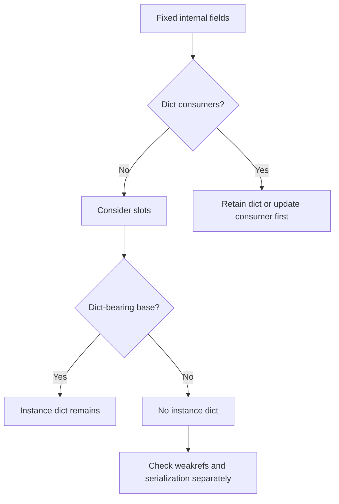
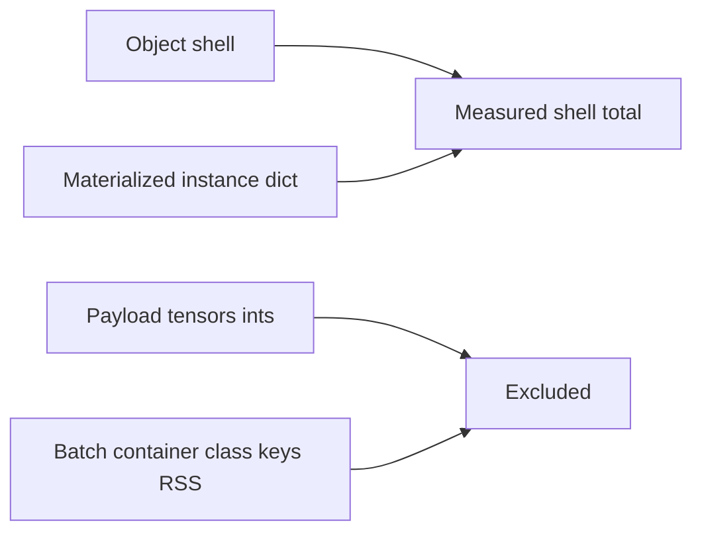
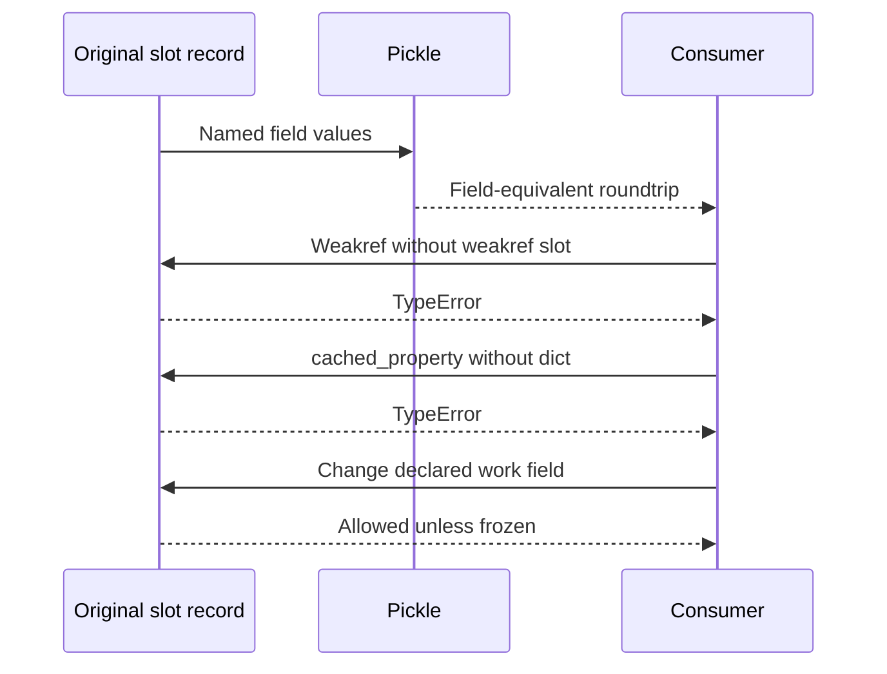

# Metadata selection FAQ:slotted records,dictionary inheritance and serialization

> **Language**:English | [中文](slotted-worker-metadata-dictionary-inheritance-serialization-selection-faq.md)  
> **Round165 · actualNov14 17:18BJT**:internal dataclasses add slots,not every scheduler/wire class. Original CPython3.12.10/three-field64-record shells:plain9216B,slots3584B,weakslots4608B,inherited-dict9216B. **Payloads/tensors/RSS and native DTO layouts are excluded.**
>
> [H5](../reports/slotted-worker-metadata-dictionary-inheritance-serialization-sizer.html) · [7-Card](../reports/slotted-worker-metadata-dictionary-inheritance-serialization-selection-cards.html) · [1600pxSVG](../../assets/svg/slotted-worker-metadata-dictionary-inheritance-serialization-selection-faq-summary.svg) · [Experiment/evidence](../../experiments/slotted_metadata_selection/README.md)

## Q1: Which native records changed,and does every dataclass qualify?

Pinned changes include IterationDetails,KVConnectorBlockState,GrammarOutput and ModelRunnerOutput. Manager Params add slots while preserving frozen/kw_only semantics. Slots and frozen are separate choices.

NewRequestData,CachedRequestData and SchedulerOutput remain plain at the same pin. Their dict state hook/cached_property are visible. ModelRunnerOutput is serialized yet slotted,so not all IPCrecords require dictionaries either.

## Q2: What do shell bytes include?

The metric sums object sizeof plus **materialized instance dict** sizeof where present. Referenced payloads/ints,class/shared-key tables,batch container,RSS and deep heap are excluded. Accessing `__dict__`materializes its wrapper;this is not the complete unobserved allocator footprint.

Exact64/256/1024/4096tiers are sealed;H5 refuses unmeasured interpolation. Original64record totals describe these three-field shells,not native ModelRunnerOutput/tensor/GPU deltas.

## Q3: Why can a dict-inheriting slotted subclass return empty vars()?

Declared fields still occupy slots;the inherited dictionary accepts additional attributes. **Having a dict does not mean declared fields live in it.** Original inherited-dict `vars()`returns `{}`,while `asdict()`reads rid/work/payload and dynamic extra works.

Pure slots explicitly reject vars withTypeError and extra attributes withAttributeError. Do not catch that and fabricate a field dictionary. Named/asdict access is a field API;vars observes dictionary storage.

65-case parity caught the initial H5 assumption that every dict contained fields. It now uses actual sealed Python dictionary keys,not invented live JSlayout.

## Q4: What are the separate pickle,weakref,cached_property and GC contracts?

Original protocol5pickle preserves fields/shared payload alias,not every custom reducer,TorchIPC or cross-version contract. Weakrefs require explicit support;measured shell cost is separate and not a hard-coded pointer-size prediction.

cached_property normally stores in a dict and fails without it. Slots do not imply immutability or GC-untracking:both original payload-bearing layouts remain tracked. Native dict state hooks cannot be blindly converted.

## Q5: What did tests and construction timing establish?

Eight tests cover exact-tier lookup,field/pickle contracts,explicit errors,inherited empty dict,weakrefs,GC scope,bounded payloads/schema and shared alias. 65Nodeconfigs compare sealed Python predictions,not live JS pickle or object sizes.

Timing creates/destroys original three-field batch lists with precreated shared payload. Two warmups,seven alternating repeats,three batches/sample and median repeat means are used. List lifetime is included in timing but its container is excluded from shell bytes:the boundaries differ explicitly.

Native constructors,lifecycle,IPC,tensors and scheduler throughput are unmeasured. Small/noisy differences remain as observed;all bars use sealed samples.

## Q6: How should production avoid blind decorator migration?

Audit inheritance,dynamic attrs,vars/state hooks,cached_property,weakrefs,frozen/kw_only and field consumers first. Measure real instance counts,referent share,RSS/deep heap and IPCcontracts;retain dictionaries where needed.

Relevant paginated patches and full scheduler definitions were read,not a claimed complete census from the first300-file response. Main report is `synthetic`,`independently_reproduced=false`;original CPython layouts/probes/timings separately `measured`. Native fields/memory/performance and browser acceptance remain null.

**Pinned primary evidence**:[Actualcommit](https://github.com/vllm-project/vllm/commit/ce72586f8aded8dafa7d4c745a5cef3198070e3e) · [Scheduler records](https://github.com/vllm-project/vllm/blob/ce72586f8aded8dafa7d4c745a5cef3198070e3e/vllm/v1/core/sched/output.py) · [Model outputs](https://github.com/vllm-project/vllm/blob/ce72586f8aded8dafa7d4c745a5cef3198070e3e/vllm/v1/outputs.py) · [Manager Params](https://github.com/vllm-project/vllm/blob/ce72586f8aded8dafa7d4c745a5cef3198070e3e/vllm/v1/core/single_type_kv_cache_manager.py) · [Dataclasses](https://docs.python.org/3.12/library/dataclasses.html) · [cached_property](https://docs.python.org/3.12/library/functools.html#functools.cached_property) · [Apache-2.0LICENSE](https://github.com/vllm-project/vllm/blob/ce72586f8aded8dafa7d4c745a5cef3198070e3e/LICENSE). Rights retained;original records,not native implementation copies.
