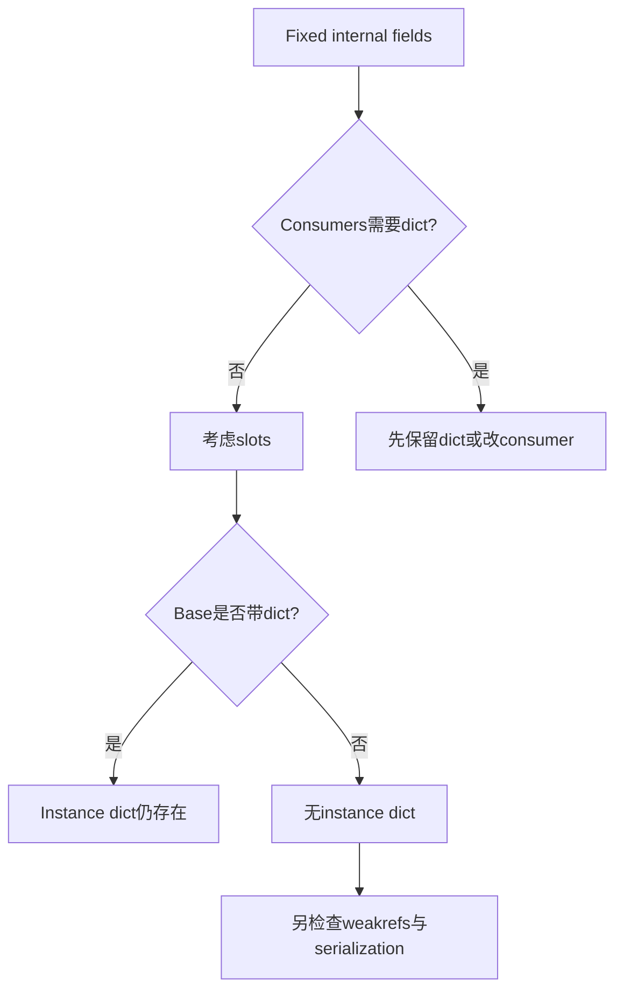
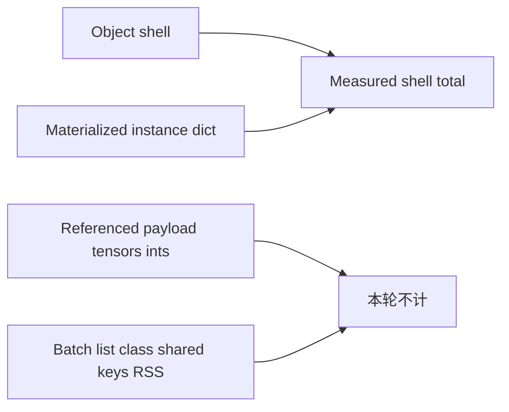
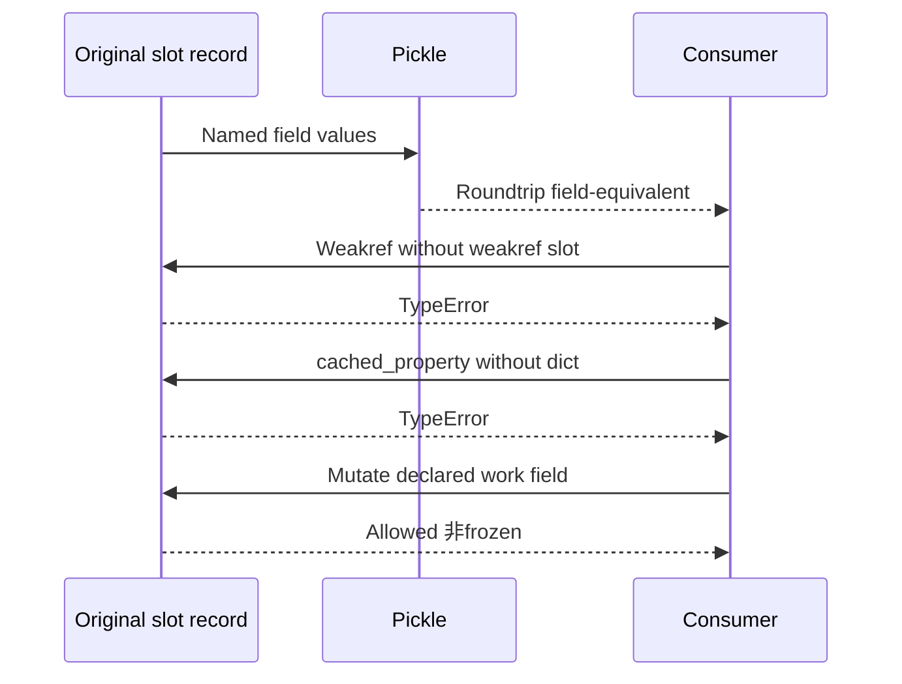

# AI Infra Metadata 架构 FAQ：Slotted Records、Dictionary Inheritance 与 Serialization Contract

> **语言**：中文 | [English](slotted-worker-metadata-dictionary-inheritance-serialization-selection-faq.en.md)  
> **Round165 · actualNov14 17:18BJT**：internal dataclasses增加slots；并非所有scheduler/wire classes都失去dict。原创CPython3.12.10三field、64records的materialized shells：plain9216B、slots3584B、weakslots4608B、inherited-dict9216B。**不含payload/tensor/RSS，也不是native DTO尺寸。**
>
> [H5 contract workbench](../reports/slotted-worker-metadata-dictionary-inheritance-serialization-sizer.html) · [7-Card](../reports/slotted-worker-metadata-dictionary-inheritance-serialization-selection-cards.html) · [1600pxSVG](../../assets/svg/slotted-worker-metadata-dictionary-inheritance-serialization-selection-faq-summary.svg) · [实验/封存证据](../../experiments/slotted_metadata_selection/README.md)

## Q1：哪些native记录被转换，是否“所有dataclass”都同样适用？

固定diff中IterationDetails、KVConnectorBlockState、GrammarOutput与ModelRunnerOutput改为slots；一些manager frozen Params也增加slots，保留原frozen/kw_only语义。不能把slots与frozen混为一谈。

同一pin的NewRequestData、CachedRequestData、SchedulerOutput仍是plain dataclass；前者自定义`__setstate__`更新dict，CachedRequestData有cached_property。ModelRunnerOutput虽serialized却可以slots，所以也不能反向宣称“所有IPC对象都必须plain”。

## Q2：shell bytes包含什么，是否可以按减幅推算worker RAM？

本轮测量`sys.getsizeof(object)`加存在时**materialized instance dict**的sizeof；field引用的payload、ints、class/shared-key tables、batch list、RSS/deep heap不在里面。读取`__dict__`会物化其wrapper，这个指标不是未观测时的完整allocator footprint。

exact64/256/1024/4096tiers分别封存实际batch totals，H5只允许这些tiers，不按未知payload做插值。原创64records plain9216B与slots3584B只说明本record shell差异，不说明native ModelRunnerOutput/tensor/GPUmemory的delta。

## Q3：继承dict的slotted subclass为什么vars()可能是空dict？

slot fields仍在slots中，继承来的dict可用于额外dynamic attrs；**dict存在不代表declared fields存放在dict里**。原创inherited-dict subclass `vars()`成功但为`{}`，`asdict()`仍读出rid/work/payload；`extra=9`可写入继承dict。

纯slots的vars()明确TypeError，dynamic extra明确AttributeError；不应catch之后假装返回完整字段。named access/asdict是field接口，vars是dictionary storage观察，二者不是等价serializer。

H5曾把“有dict”误当作“vars包含全部fields”，65-case parity抓到并已修正；现在按封存Pythonprofile的实际dict keys构造预测，而不是伪装live JS对象内存。

## Q4：pickle、weakref、cached_property与GC tracking分别要求什么？

原创ordinary pickle protocol5保持字段与shared payload alias；不是证明所有custom reducers/state hooks、TorchIPC或版本间兼容。weakref需显式weakref slot或合适base，实测其shell成本与普通slots不同，不能硬编码“必定一个pointer字节数”。

cached_property默认把cache放dict，纯slots会失败。slots不自动让对象immutable，也不自动GC-untrack；本轮含list payload的plain/slots均tracked。native NewRequestData的dict state hook不能盲目改成slots而不更新consumer。

## Q5：本机验证什么，construction timing代表什么？

八tests覆盖exact-tier shell lookup、字段/pickle、vars/dynamic显式错误、inherited empty dict、weakref opt-in、GC scope、payload/range/schema与shared alias。65Nodeconfigs比较sealed Python contract predictions，不是JS执行pickle或测JSobject bytes。

CPython timed path创建/销毁原始三field batch list；payload预先构造且共享。两warmups、七交替repeats、三batches/sample，median repeat means。list lifetime含在timing，但shell metric不含list container——两个指标边界必须分别注明。

native constructor、request lifecycle、IPC、tensor allocation与scheduler吞吐未测。construction差值很小或有noise也如实保留；七卡条宽来自封存samples，不编造native性能。

## Q6：真实内部metadata怎么选，而不做blind decorator migration？

先audit实际继承链、dynamic attrs、vars/custom state hooks、cached_property、weakrefs、frozen/kw_only和所有字段消费者；再测native记录数量、referent占比、完整heap/RSS和IPC协议。必要时保留dict，不把decorator统一当正确目标。

本轮读取paginated commit的相关patch并核验完整scheduler definitions；不把GitHub首300-file response冒充全repo census。主report为`synthetic`,`independently_reproduced=false`；originalCPython layout/probes/construction为`measured`，native字段/内存/性能与browser验收null。

**固定一手证据**：[actualcommit](https://github.com/vllm-project/vllm/commit/ce72586f8aded8dafa7d4c745a5cef3198070e3e) · [scheduler records/exceptions](https://github.com/vllm-project/vllm/blob/ce72586f8aded8dafa7d4c745a5cef3198070e3e/vllm/v1/core/sched/output.py) · [model runner outputs](https://github.com/vllm-project/vllm/blob/ce72586f8aded8dafa7d4c745a5cef3198070e3e/vllm/v1/outputs.py) · [manager Params](https://github.com/vllm-project/vllm/blob/ce72586f8aded8dafa7d4c745a5cef3198070e3e/vllm/v1/core/single_type_kv_cache_manager.py) · [Python dataclasses](https://docs.python.org/3.12/library/dataclasses.html) · [cached_property](https://docs.python.org/3.12/library/functools.html#functools.cached_property) · [Apache-2.0LICENSE](https://github.com/vllm-project/vllm/blob/ce72586f8aded8dafa7d4c745a5cef3198070e3e/LICENSE)。权利保留，原创records非native实现镜像。
