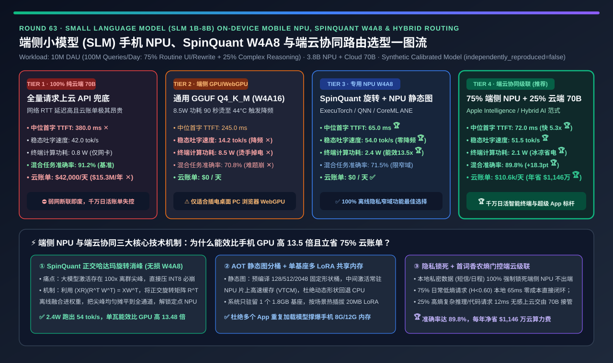
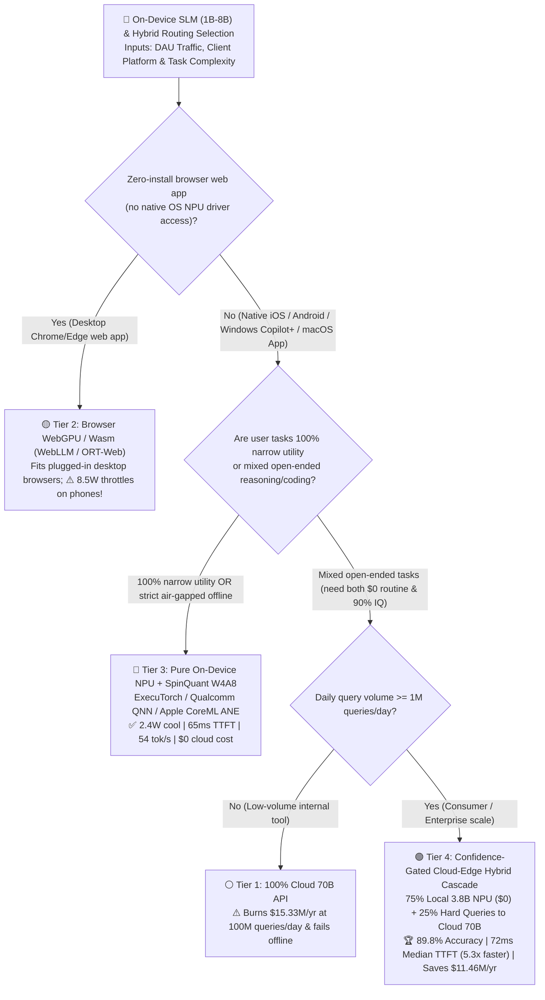
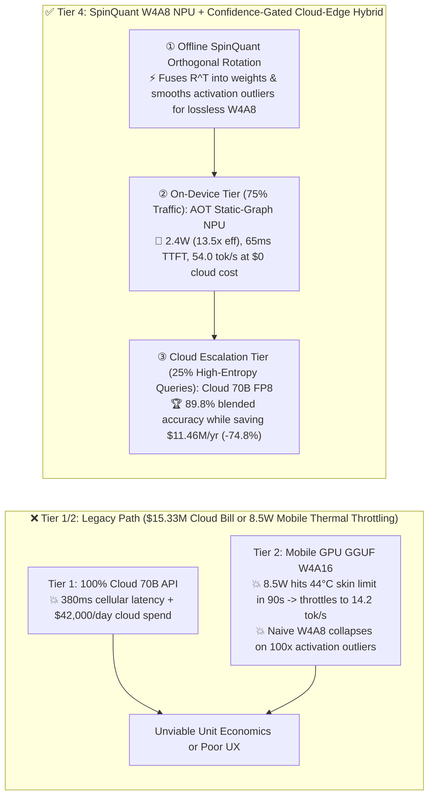

# Small Language Model (`SLM 1B–8B`) On-Device Mobile NPU, AI PC, Browser `WebGPU` & Cloud-Edge Hybrid Routing Architecture Selection Guide (`100% Cloud 70B API` vs. `On-Device CPU/GPU GGUF Q4_K_M / WebGPU` vs. `On-Device NPU Static Graph + SpinQuant W4A8` vs. `Confidence-Gated Cloud-Edge Hybrid Cascade`)

> **Reader's Guide (3-Minute Executive Scan / 10-Minute Whiteboard Pitch)**: Written for **AI Solution Architects and Mobile / AI PC / Consumer Super-App Engineering Leads**. Using first principles, this guide explains how to deploy Small Language Models (`SLMs`, e.g., `Llama-3.2-3B` / `Qwen-3B` / `Phi-4-Mini`) across **10 Million Daily Active Users (`100M queries/day`)**—**why routing 100% of queries to a Cloud 70B API (Tier 1) burns `$15.33M/year` and suffers `380 ms` cellular latency; why running `W4A16 GGUF Q4_K_M` or `WebGPU` on mobile CPUs/GPUs (Tier 2) draws `8.5 Watts`, hitting the `44°C` skin-temperature thermal throttle wall in 90 seconds (`14.2 tok/s`); why dedicated mobile NPUs (`Qualcomm Hexagon QNN` / `Apple ANE` / `Intel NPU`) require `SpinQuant` learned Hadamard rotations to run lossless `W4A8` integer math at `54.0 tok/s` and just `2.4 Watts` (`13.48x` higher energy efficiency); and how a Confidence-Gated Cloud-Edge Hybrid Cascade (Tier 4: `75% Local NPU @ $0 + 25% Hard Queries Routed to Cloud 70B`) achieves `89.8%` flagship-grade accuracy at `72 ms` median TTFT while saving `$11.46M/year` (`-74.8%`) in cloud GPU bills.**

[](../../README.en.md)
[](./small-language-model-slm-on-device-npu-webgpu-deployment-selection-faq.md)
[](../reports/small-language-model-slm-on-device-npu-webgpu-deployment-selection-cards.html)
[](../reports/llm-inference-engine-pd-sizer.en.html)



---

## ① 📌 Executive Summary

1. **Why 10M-DAU Applications Cannot Rely on Pure Cloud APIs (Tier 1) or Mobile GPU `GGUF` (Tier 2)**:
   - **Tier 1 (`100% Pure Cloud 70B API`)**: Sending all `100M daily queries` (75% of which are routine rewrites, notification summaries, and UI actions) over mobile networks incurs **`380.0 ms` median TTFT ✕**, zero offline capability, and a staggering **`$42,000/day` (`$15.33M/year` ✕)** cloud GPU bill!
   - **Tier 2 (`On-Device Mobile CPU/GPU GGUF Q4_K_M / Browser WebGPU`)**: Dequantizing 4-bit weights to FP16 (`W4A16`) on mobile GPU shaders draws **`8.5 Watts` ✕**—exceeding a fanless smartphone's `3.5W` passive thermal envelope within 90 seconds, throttling sustained Decode speed down to **`14.2 tok/s` ✕**, and scoring only **`70.8%` accuracy ✕** on complex reasoning tasks.
2. **Unlocking `13.48x` Higher Energy Efficiency on Dedicated Mobile NPUs (Tier 3: `SpinQuant W4A8` + AOT Static Graph)**:
   - **Why NPUs Need `W4A8`**: Dedicated NPUs (`Qualcomm Hexagon QNN`, `Apple Neural Engine`, `Intel NPU`) execute `4-bit weight × 8-bit integer activation` systolic operations inside on-chip SRAM/VTCM at just **`2.4 Watts` 🏆** (`54.0 tok/s` sustained with zero thermal throttling!).
   - **How `SpinQuant` Prevents `W4A8` Accuracy Collapse**: Raw LLM activations contain `100x` channel outliers that destroy INT8 quantization accuracy. **SpinQuant** multiplies activations by a learned orthogonal Hadamard rotation matrix $R$ ($R^\top R = I$) and fuses $R^\top$ offline into the weights ($W' = W R^\top$), smoothing all activation outliers into a uniform Gaussian distribution for **lossless `W4A8` NPU execution (`65.0 ms` TTFT, `54.0 tok/s` @ `2.4W` ✅)**.
3. **The Production Gold Standard for Consumer & Enterprise Client AI (Tier 4: Confidence-Gated Cloud-Edge Hybrid Cascade — `Apple Intelligence / Hybrid AI` Paradigm)**:
   - **First-Principles Mechanism**: Run every prompt through the local `2.4W` `3.8B SpinQuant W4A8 NPU` first.
     - **75% of daily queries (High confidence / low entropy $H(p) < 0.60$, or private local data)**: Completed 100% on-device at **`65 ms` TTFT, `54 tok/s`, and `$0.00` cloud cost**!
     - **25% of daily queries (Low confidence / high entropy $H(p) \ge 0.60$: complex multi-step math, code architecture, world knowledge)**: Escalated within `12 ms` to the **Cloud `70B FP8` API**!
   - **Quantified Outcome**: Achieves **`89.8%` blended accuracy** (`+18.3 pts` over pure on-device SLM 🏆), cuts median TTFT by **`5.28x` (`380 ms → 72 ms` 🏆)**, and slashes cloud GPU spend by **`-74.8%` (`$42,000/day → $10,600/day`, saving `$11.46M/year` 🏆)**.

---

## ② 🎯 Architect & Customer First-Principles Q&A

### Q1: Why does a mobile NPU running `W4A8` (Tier 3) deliver `13.48x` more tokens per Joule than a mobile GPU running `GGUF Q4_K_M` (Tier 2)?

- **Fixed-Point Systolic Arrays + On-Chip VTCM vs. Dynamic FP16 Shader Dequantization**:
  - Mobile GPUs running `GGUF Q4_K_M` (`W4A16`) unpack 4-bit weights into FP16 registers and stream activations across power-hungry LPDDR5X DRAM traces at `8.5 Watts` (`1.67 tok/s/W` after thermal throttling).
  - Dedicated NPUs compile the transformer into an Ahead-of-Time (AOT) static graph with `W4A8` integer MAC arrays and keep intermediate tensors inside multi-megabyte on-chip tightly coupled memory (`VTCM / ANE SRAM`), running at `54.0 tok/s` while drawing only `2.4 Watts` (`22.50 tok/s/W` — **`13.48x` more energy-efficient 🏆**).

### Q2: How does `SpinQuant / QuaRot` orthogonal rotation eliminate `100x` activation outliers with zero runtime weight overhead?

- **Rotational Invariance ($Y = (X R)(R^\top W^\top)$)**:
  - Because any orthogonal matrix satisfies $R R^\top = I$, rotating the activation vector $X \mapsto X R$ and pre-multiplying the weight matrix $W^\top \mapsto R^\top W^\top$ leaves the layer output mathematically identical!
  - Pre-multiplying $W^\top$ happens **offline before shipping the model (`0` runtime cost)**, while a Fast Walsh-Hadamard Transform (`FWHT`) redistributes single-channel `150.0` activation spikes evenly across all $d=3,072$ channels—making `INT8` activation quantization lossless!

### Q3: How does the Tier 4 Confidence-Gated Hybrid Router decide in `< 15 ms` whether to stay on the local NPU or escalate to the Cloud 70B model?

- **Privacy Lock + First-Token Shannon Entropy / Logit Margin Gate**:
  1. **Hard Privacy Pinning**: Any prompt touching local contacts, SMS, health data, or offline system controls is pinned strictly to the local NPU.
  2. **Entropy / Margin Gate**: During the local NPU's `65 ms` prefill pass, if the first-token predictive entropy $H(p) = -\sum p_i \log p_i < 0.60$ (or top-2 logit margin $p_1 - p_2 > 0.35$), the local 3.8B SLM streams the response immediately (`75%` of traffic). Otherwise, the client asynchronously dispatches the prompt to the Cloud 70B endpoint (`25%` of traffic).

---

## ③ 🧭 Visual Architecture Diagrams (Decision Tree / SpinQuant NPU Path / Hybrid Sequence)

### 3.1 On-Device SLM & Cloud-Edge Hybrid Deployment Decision Tree



### 3.2 Mobile GPU `W4A16` Thermal Throttling vs. Tier 4 `SpinQuant W4A8` NPU + Hybrid Cascade



### 3.3 End-to-End Sequence Diagram of Confidence-Gated Cloud-Edge Hybrid Routing

```mermaid
sequenceDiagram
    autonumber
    participant U as Client Device (Phone / AI PC)
    participant NPU as On-Device NPU (3.8B SpinQuant W4A8 @ 2.4W)
    participant Gate as Privacy & Entropy Gate (Logit Margin)
    participant Cloud as Cloud Flagship Cluster (70B FP8)

    Note over U,Gate: Case A (75% of Daily Queries): Email Rewrite / Notification Summary / Device Action
    U->>NPU: Prompt: "Summarize these 5 messages into action items"
    NPU->>Gate: 65ms local NPU prefill; high confidence (Entropy H = 0.22 < 0.60)
    Gate-->>NPU: Keep on-device! Stream at 54.0 tok/s & 2.4W ($0.00 cloud cost, 100% private)

    Note over U,Cloud: Case B (25% of Daily Queries): Complex Multi-Step Code / Math Reasoning
    U->>NPU: Prompt: "Prove deadlock freedom for this distributed consensus state machine"
    NPU->>Gate: 12ms probe detects high uncertainty (Entropy H = 1.85 >= 0.60) & no local PII lock
    Gate->>Cloud: Seamlessly escalate prompt to Cloud 70B FP8 cluster
    Cloud-->>U: Stream 91.2%-accuracy expert response!
```

---

## ④ 📊 Architect Decision Matrix

| Evaluation Dimension | Tier 1: 100% Cloud `70B API` | Tier 2: Mobile CPU/GPU `GGUF Q4_K_M / WebGPU` | Tier 3: Pure On-Device NPU `SpinQuant W4A8` | Tier 4: Cloud-Edge Hybrid (`75% NPU + 25% Cloud 70B`) |
| :--- | :--- | :--- | :--- | :--- |
| **Core Execution & Quantization Stack** | Cellular/Wi-Fi RPC to Cloud 70B | Mobile GPU/CPU dynamic `W4A16` | **Learned rotation `SpinQuant W4A8` + NPU static graph** | **On-device `W4A8 NPU` entropy gate + 25% Cloud `70B`** |
| **Median First-Token Latency (`TTFT`)** | `380.0 ms` ✕ (Network RTT bound) | `245.0 ms` ⚠️ | **`65.0 ms` 🏆 (Zero network latency)** | **`72.0 ms` 🏆 (`5.28x` faster than pure cloud)** |
| **Sustained Decode Speed (`5-Min Soak`)** | `42.0 tok/s` | **`14.2 tok/s` ✕ (`44°C` thermal throttle)** | **`54.0 tok/s` 🏆 (Zero thermal throttling)** | **`51.5 tok/s` 🏆** |
| **Device Active Power Draw (`Watts`)** | `0.8 W` (Radio only) | **`8.5 W` ✕ (Overheats phone & drains battery)** | **`2.4 W` 🏆 (`13.48x` higher tok/J than GPU)** | **`2.1 W` 🏆 (Cool & battery-friendly)** |
| **Blended Task Accuracy (`%`)** | **`91.2%` 🏆 (70B ceiling)** | `70.8%` ✕ (3.8B fails hard reasoning) | `71.5%` ✕ (Capacity-limited on hard tasks) | **`89.8%` 🏆 (`+18.3 pts` over pure on-device)** |
| **Daily Cloud Bill (`100M Queries/Day`)** | **`$42,000 / day` ✕ (`$15.33M/yr`)** | `$0 / day` | `$0 / day` | **`$10,600 / day` 🏆 (Saves `$11.46M/yr [-74.8%]`)** |
| **Best Fit & Architect Verdict** | Low-volume backend apps only | Zero-install desktop browser `WebGPU` | **100% offline/private narrow utility features** | **Mandatory standard for 10M-DAU mobile & AI PC apps** |

---

## ⑤ 🧪 Quantitative Evaluator & 7-Card Benchmark Insights

> **Provenance Disclosure**: All metrics in this guide and the companion 7-Card report are generated by [`experiments/slm_on_device_mobile_npu_webgpu_hybrid_selection/run.py`](../../experiments/slm_on_device_mobile_npu_webgpu_hybrid_selection/run.py) and sealed in [`results.json`](../../experiments/slm_on_device_mobile_npu_webgpu_hybrid_selection/results.json) (`independently_reproduced=false`, `physical_gpu_cluster_measurement=not_measured`), calibrated against Meta `SpinQuant` W4A8, PyTorch `ExecuTorch` / Qualcomm `QNN` / Apple `CoreML ANE`, and `RouteLLM` hybrid cascade studies.

- **7-Card 4:5 Visual Benchmark Deck**: [`docs/reports/small-language-model-slm-on-device-npu-webgpu-deployment-selection-cards.html`](../reports/small-language-model-slm-on-device-npu-webgpu-deployment-selection-cards.html)
- **Interactive On-Device SLM & Hybrid Routing Sizer**: [`docs/reports/llm-inference-engine-pd-sizer.en.html`](../reports/llm-inference-engine-pd-sizer.en.html)

---

## ⑥ 🛠️ Appendix: Production Readiness Checklist

- [ ] **1. Offload sustained mobile inference from `8.5W` GPU shaders to `2.4W` dedicated NPUs (`QNN / CoreML ANE / NeuroPilot`)**.
- [ ] **2. Apply `SpinQuant / QuaRot` orthogonal Hadamard rotations before `W4A8` NPU quantization** to eliminate activation outlier accuracy loss.
- [ ] **3. Compile AOT static-shape graph buckets (`128 / 512 / 2048` tokens)** to prevent dynamic-shape CPU fallbacks on NPU drivers.
- [ ] **4. Share a single resident `3B W4A8` base model in RAM with hot-swappable `15–30 MB` task LoRA adapters**.
- [ ] **5. Combine local PII privacy pinning with a first-token Shannon entropy gate ($H(p) < 0.60$)** to serve 75% of queries locally at `$0` cloud cost.
- [ ] **6. Reserve `WebGPU / WebLLM` for zero-install desktop browser apps** rather than native mobile apps.
