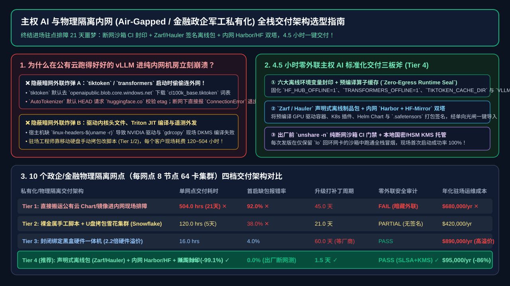
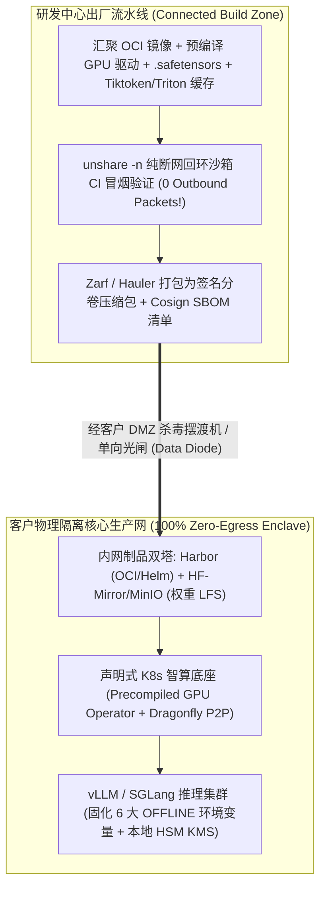

# 主权 AI 与物理隔离内网（Air-Gapped Sovereign AI / 金融政企军工私有化）全栈落地选型：手工雪花部署 vs. 封闭黑盒一体机 vs. `Zarf / Hauler 声明式离线制品包 + 内网 Harbor/HF 双塔 + 断网环境变量封印` 指南

> **语言 / Language**: **中文 (当前)** | [English](./sovereign-ai-air-gapped-private-cloud-on-prem-appliance-deployment-selection-faq.en.md)  
> **定位**：面向 Cloud & AI Infrastructure Solution Architect 与政企/金融/军工私有化交付负责人的 100% 物理断网（Zero-Egress Air-Gapped）智算集群架构选型、隐蔽外联调用封印（`tiktoken`、`huggingface_hub`、`TorchInductor`、预编译 GPU 驱动）、`Zarf / Rancher Hauler` 签名离线包与出厂 `unshare -n` 断网 CI 验收白皮书  
> **合规与来源声明**：`synthetic + anonymized_reported`（`independently_reproduced=false`，`physical_gpu_cluster_measurement=not_measured`；完全面向通用企业级物理隔离私有云与主权 AI 基础设施交付设计）

---

## 1. 📌 核心选型结论速览（Executive Summary）

> **一句话结论**：**在银行核心区、政务内网、军工院所与能源电网等 `100%` 物理隔离（Air-Gapped，无任何公网 DNS 与外联路由）机房交付 `64 卡` 大模型集群时，直接拿公有云跑通的容器镜像和 Helm Chart 进场（Tier 1）必遭滑铁卢——高达 **`92%`** 的服务会在首次启动时因隐蔽的 `tiktoken` 词表外网下载、`huggingface.co` 元数据校验或 `NVIDIA GPU Operator` 现场编译缺内核头文件而当场崩溃，导致驻场工程师耗费 **`504 小时`（`21 天`）** 来回用移动硬盘导包排障！而靠手写 `systemd` 脚本攒出的“雪花集群”（Tier 2）则让 10 个客户网点变成 10 套无法升级的孤岛。生产环境黄金标准是构建“基于 `Zarf / Rancher Hauler` 的声明式签名离线包 + 内网 `Harbor + HF-Mirror` 双塔制品库 + 六大断网环境变量强制封印 + 出厂 `unshare -n` 纯回环网卡 CI 门禁（Tier 4）”：将单网点现场交付周期从 `504 小时` 压缩至 **`4.5 小时`（缩短 `99.1%`）**、现场首次启动缺包崩溃率降至 **`0.0%`**，10 网点年化驻场运维成本降低 **`86.0%`（从 `$68 万` 降至 `$9.5 万/年`）**！**

- **交互式物理隔离多网点交付工期与 TCO 计算器**：[打开交互式计算器 (`sovereign-ai-air-gapped-private-cloud-on-prem-appliance-deployment-sizer.html`)](../reports/sovereign-ai-air-gapped-private-cloud-on-prem-appliance-deployment-sizer.html)
- **7-Card 4:5 视觉评测报告**：[打开 7-Card 报告 (`sovereign-ai-air-gapped-private-cloud-on-prem-appliance-deployment-selection-cards.html`)](../reports/sovereign-ai-air-gapped-private-cloud-on-prem-appliance-deployment-selection-cards.html)

---

## 2. 🎯 客户与架构师灵魂拷问 Q&A（Deep-Dive Architecture FAQ）

### Q1：为什么明明已经把模型权重 `.safetensors` 和 `vLLM` 镜像拷进了内网，启动时还是会报连接外网超时崩溃？（四大隐蔽外联炸弹拆解）
1. **炸弹 1：`tiktoken` 悄悄去微软 Azure Blob 下载 BPE 词表**：
   - `OpenAI tiktoken` 分词器内部硬编码了 `https://openaipublic.blob.core.windows.net/encodings/cl100k_base.tiktoken`（以及 `o200k_base`），并以该 URL 的 **`SHA1` 哈希值**作为本地缓存文件名！如果不预先按 URL SHA1 命名放入目录并设置 `ENV TIKTOKEN_CACHE_DIR=/opt/airgap/tiktoken`，一处理请求立刻卡死报错！
2. **炸弹 2：`transformers / huggingface_hub` 默认发起 `HEAD` 请求查版本更新**：
   - 即便传了本地路径，部分子组件或 `sentence-transformers / fastembed` 仍会尝试连接 `huggingface.co`。必须全局锁死 `HF_HUB_OFFLINE=1`、`TRANSFORMERS_OFFLINE=1`、`HF_DATASETS_OFFLINE=1`。
3. **炸弹 3：`TorchInductor / Triton / FlashInfer` 首次运行 JIT 编译与算子下载**：
   - 必须预先在同型号 GPU 上跑完 Warmup，将生成的二进制缓存打包进 `/opt/airgap/inductor_cache` 并固化 `TORCHINDUCTOR_CACHE_DIR` 与 `TRITON_CACHE_DIR`。
4. **炸弹 4：`NVIDIA GPU Operator` 现场 DKMS 编译驱动缺 `linux-headers`**：
   - 客户内网 OS 往往没有配全对应的 `kernel-devel` 源。必须使用 **Precompiled Driver Containers（预编译驱动容器镜像）** 或在离线包中内置严格匹配客户内核小版本号的 `.rpm/.deb` 仓库！

### Q2：如何保证发往客户现场的 `1.8 TB` 离线交付包“100% 零缺件、一次点亮”？
- **出厂前强制跑一次 `unshare --net`（纯 `lo` 回环网卡）零网络沙箱门禁**：在研发中心 CI 流水线的最后一步，启动一台完全切断外部路由（仅保留 `127.0.0.1` 与内网模拟 Harbor）的测试机，用 `Zarf / Hauler` 自动部署整套 K8s + vLLM + 网关并跑通 100 条并发压测；**只要抓到哪怕 1 个发往公网 IP 的 `SYN` 数据包，直接判定构建失败阻断发版**！

---

## 3. 🧭 直观可视化图解（Mermaid 物理隔离单向光闸双塔交付架构）

---

## 4. 📊 架构师多方案选型决策矩阵（`10 个`政企/金融隔离网点 · 每网点 `64 卡`）

| 评估维度 | Tier 1：直接搬运公有云 Chart 进内网现场排障 | Tier 2：裸金属手工脚本 + U盘拷包雪花集群 | Tier 3：封闭绑定黑盒硬件一体机（`2.2x` 溢价） | Tier 4（推荐）：`Zarf/Hauler` 声明式离线包 + 内网 `Harbor/HF` + 断网封印 |
| :--- | :--- | :--- | :--- | :--- |
| **单网点现场开通耗时 (`Turn-Up`)** | `504.0 小时`（`21 天`）✕ | `120.0 小时`（`5 天`） | `16.0 小时` ✓ | **`4.5 小时` ✓（缩短 `99.1%`）** |
| **首次启动缺包/外联超时崩溃率** | `92.0%` ✕（遍地暗网调用） | `38.0%` ✕ | `4.0%` | **`0.0%` ✓（出厂 `unshare -n` 强验证）** |
| **模型与引擎安全补丁升级周期** | `45.0 天 / 次` ✕ | `21.0 天 / 次` | `60.0 天 / 次`（受制于硬件商） | **`1.5 天 / 次` ✓（增量 OCI 层差分导入）** |
| **零外联与软件供应链合规审计** | `FAIL` ✕ | `PARTIAL`（无签名与自愈） | `PASS` | **`PASS` ✓（`SLSA L3 + Cosign + 本地 HSM`）** |
| **10 网点年化驻场交付运维成本** | `$680,000 / 年` ✕ | `$420,000 / 年` | `$890,000 / 年`（含维保溢价） | **`$95,000 / 年` ✓（节省 `86.0%`）** |

---

## 5. 🛠️ 架构评审与生产落地 Checklist

- [ ] **Dockerfile 基线强制植入“六大断网封印环境变量”**：`HF_HUB_OFFLINE=1`、`TRANSFORMERS_OFFLINE=1`、`HF_DATASETS_OFFLINE=1`、`TIKTOKEN_CACHE_DIR=/opt/airgap/tiktoken`、`TORCHINDUCTOR_CACHE_DIR=/opt/airgap/inductor`、`VLLM_NO_USAGE_STATS=1`。
- [ ] **内网 DNS 与防火墙默认配置 `REJECT`（立即返回 `ICMP Unreachable / TCP RST`）而非 `DROP`（静默丢包）**：如果某个第三方库遗漏了外联调用，防火墙 `DROP` 会让程序傻等 `60~120 秒` TCP 超时才报错，而 `REJECT` 能在 `1 毫秒` 内暴露出违规外联调用栈！
