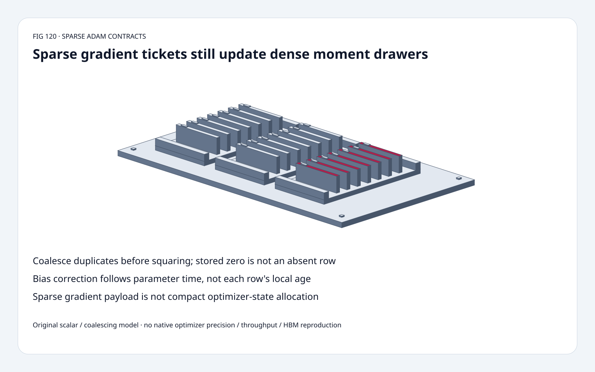
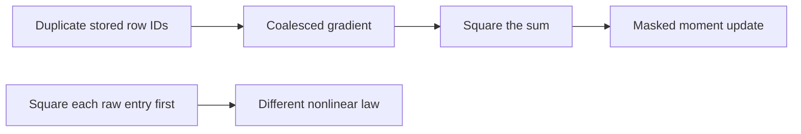
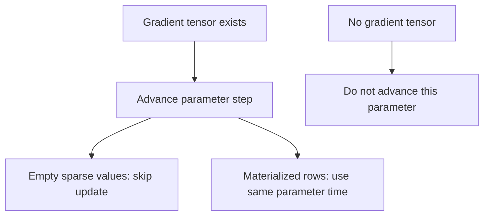
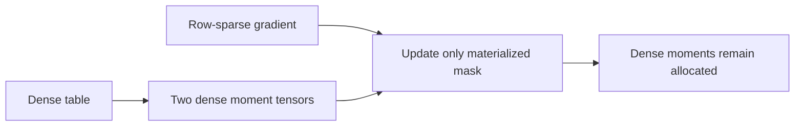

# SparseAdam FAQ: duplicate coalescing, masked moments and parameter time

> **Language**: [中文](sparse-adam-coalescing-mask-step-state-selection-faq.md) | English
>
> **Round 120 · 2026-11-14 (night round 29)** · [SVG](../../assets/svg/sparse-adam-coalescing-mask-step-state-selection-faq-summary.svg) · [7 cards](../reports/sparse-adam-coalescing-mask-step-state-selection-cards.html) · [H5](../reports/sparse-adam-coalescing-mask-step-state-sizer.html) · [Data](../../experiments/sparse_adam_contract_selection/report.json)
>
> **Synthetic, `independently_reproduced=false`.** Original scalar optimizer/coalescing models and independent Decimal/Fraction references; separate CPU grouping timing. No native PyTorch optimizer/GPU or precision-parity reproduction.



## 1. Executive summary: sparse gradients do not compact Adam state

Pinned SparseAdam requires **dense parameters and sparse-layout
gradients** and initializes both moment tensors with `zeros_like(param)`.
Sparse gradient traffic does not imply sparse moment allocation.

Original duplicate gradients 1 and 2 at one row must become g=3
**before** squaring: **9**, not **5**.
Selected first-step delta is **0.100000** versus an incorrect
square-before-coalesce delta **0.134164**.

These are existing optimizer contracts, not a November algorithm launch.
The August 28 functional-API publication is separately dated;
the inspected functional routine reads the caller's current
**per-parameter step**, without incrementing it.

## 2. Architect Q&A: sparse in which sense?

### Q1: Why coalesce before a nonlinear optimizer update?

Sparse COO can contain duplicate stored coordinates.
The mathematical gradient is their sum, so its second moment must
use `(g1+g2)^2`, not `g1^2+g2^2`.
The pinned functional implementation explicitly coalesces first.

Original model lr=0.1, beta1=beta2=0.5, epsilon=0.
For raw `(row0,1),(row0,2)`, m=1.5 and v=4.5;
the incorrect squared-first v is 2.5.
These teaching hyperparameters are **not source defaults**.

The original implementation groups entries and uses `math.fsum`;
its exact small-integer timing fixture is not certification of
arbitrary native floating coalescing order or precision.

### Q2: Is an absent coordinate the same as a materialized numeric zero?

No. The source masks by sparse layout and explicitly does not verify
that every materialized value is nonzero.
An absent row is not updated. A stored zero participates and can
decay existing moments and move a parameter.

Original row starts at 2; step 1 has gradient 4, producing weight 1.9,
m=2, v=8. At step 2:

| Row event | Weight | m | v |
| :--- | ---: | ---: | ---: |
| Absent row | 1.900000000 | 2 | 8 |
| Materialized zero | 1.842264973 | 1 | 4 |

Duplicate cancellation `(1,+1),(1,-1)` retains a stored zero key
in the original model. Dropping that key changes masked-update semantics.
Dense Adam with zeros is not generally equivalent to masked SparseAdam.

### Q3: Is bias-correction time the number of times this row appeared?

No. Source state increments per **parameter tensor with a gradient**,
not per row. A gradient tensor can be empty: the wrapper advances the
parameter step before the functional routine skips empty updates.
If the parameter has no gradient tensor (`grad is None`), it is skipped.

For a row first materialized at parameter step 2, the original
delta is **0.081649658**, not row-local-first-step **0.1**.
When using the functional API, the caller must supply the already
incremented current step, not expect the routine to advance it.

### Q4: Where does epsilon enter?

The inspected form is:

```text
m = beta1*m + (1-beta1)*g
v = beta2*v + (1-beta2)*g*g
scale = lr*sqrt(1-beta2^t)/(1-beta1^t)
delta = scale*m/(sqrt(v)+eps)
```

Moving epsilon unchanged into a bias-corrected denominator changes
the update. The tests use an independent 50-digit Decimal reference
across multiple steps and a nonzero epsilon control.

The original finite-scalar model explicitly rejects a nonpositive/
nonfinite denominator. For example, epsilon=0 and a materialized
first zero gradient is rejected, **not claimed to match native NaN
behavior or native validation**.

### Q5: How much state remains dense?

Selected float32 table: 16,384 rows ×128 features:

| Logical payload | Bytes |
| :--- | ---: |
| Dense parameter | 8,388,608 |
| Two dense moments | 16,777,216 |
| Raw row-sparse gradient: 128 stored rows | 66,560 |
| Coalesced gradient: 64 unique rows | 33,280 |

Gradient accounting assumes one int64 row index plus a float32
128-feature value block per stored row; it is not scalar-coordinate
COO accounting. Raw/unique counts are selected assumptions.
No actual allocation, transient workspace, peak HBM or state
compaction is measured.

H5's separate two-row first-update toy accepts at most 64 **bounded
integer** contributions so JavaScript and Python grouping sums remain
exact on those inputs. The budget table is independent of toy width.

## 3. Visual architecture: coalesce, mask, then use parameter time







## 4. Selection matrix: choose masked semantics deliberately

| Choice | Good fit | Gate |
| :--- | :--- | :--- |
| SparseAdam | Dense embedding parameters with sparse-layout gradients | Coalescing, mask and parameter-step contract |
| Dense Adam on zero-filled gradients | Intentionally decay all rows | Not masked-update equivalence |
| Row-local time variant | A deliberately different algorithm | Do not label as this source contract |
| Sparse-gradient accounting | Row-index/value traffic estimates | Moments remain dense |
| Functional API | Caller-managed optimizer state | Supply current per-parameter step |
| Dense-to-sparse conversion | Explicitly justified pipeline | Conversion overhead may erase benefit |

## 5. Hands-on evidence: independent nonlinear and grouping controls

```powershell
python -m experiments.sparse_adam_contract_selection.run --check
python -m unittest discover -s tests -p test_sparse_adam_contract_selection.py -q
```

Eight tests cover duplicate squaring, Fraction grouping, stored-zero
retention, absent/zero histories, None/empty parameter time, independent
Decimal epsilon/multi-step updates, explicit invalid states,
Node/Python parity and sealed samples.

| Stored scalar entries | Original hash grouping (ms) | Original sorted grouping (ms) |
| :--- | ---: | ---: |
| 32 | 0.016633 | 0.022733 |
| 128 | 0.050633 | 0.068267 |
| 512 | 0.163667 | 0.209933 |
| 2,048 | 0.622000 | 0.778833 |

Both use validation and f-sum on exact small integer-valued inputs.
Two warmups, seven alternating repeats, three operations/sample;
median repeat means. Optimizer updates, sparse tensor conversion
and native/GPU execution excluded. No browser visual inspection.

## 6. Sources, provenance and readiness

- [Pinned SparseAdam](https://github.com/pytorch/pytorch/blob/22e0dfd2aed75aa2bc0a44e7ff4b49753f62c3ce/torch/optim/sparse_adam.py): layout restrictions, dense moments, materialized-value mask and parameter-step wrapper.
- [Pinned functional implementation](https://github.com/pytorch/pytorch/blob/22e0dfd2aed75aa2bc0a44e7ff4b49753f62c3ce/torch/optim/_functional.py): coalescing, masked updates, epsilon and caller-owned step.
- [August 28 public functional APIs](https://github.com/pytorch/pytorch/commit/9d2b3dd0d265930c916e1431aaaa3a1f3cf127a5): chronology, not a new SparseAdam algorithm.
- [License](https://github.com/pytorch/pytorch/blob/22e0dfd2aed75aa2bc0a44e7ff4b49753f62c3ce/LICENSE): BSD-style repository terms; upstream rights retained.

Original scalar models, independent references, CPU grouping and art.
No upstream implementation copied; no native precision, speed,
model quality or optimizer-state compaction claim.
