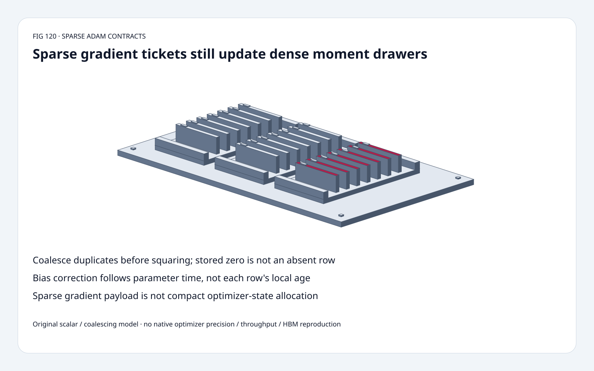
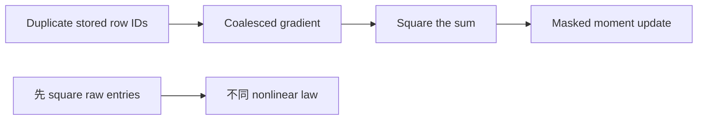
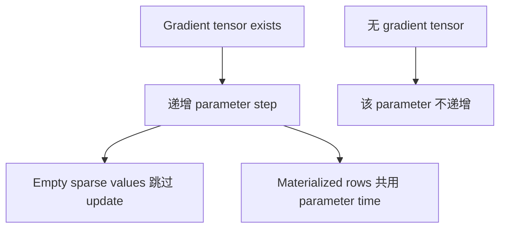
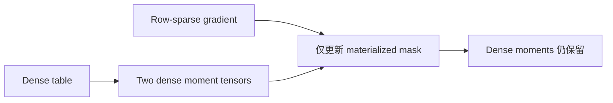

# SparseAdam FAQ：Coalescing、Masked Moments 与 Parameter Time

> **语言**：中文 | [English](sparse-adam-coalescing-mask-step-state-selection-faq.en.md)
>
> **Round 120 · 2026-11-14（夜班第 29 轮）** · [高清 SVG](../../assets/svg/sparse-adam-coalescing-mask-step-state-selection-faq-summary.svg) · [七卡](../reports/sparse-adam-coalescing-mask-step-state-selection-cards.html) · [H5](../reports/sparse-adam-coalescing-mask-step-state-sizer.html) · [数据](../../experiments/sparse_adam_contract_selection/report.json)
>
> **Synthetic，`independently_reproduced=false`。** 原创 scalar optimizer/coalescing、
> 独立 Decimal/Fraction references、CPU grouping；不复现 native optimizer/GPU precision。



## 一、先看结论：Sparse Gradient 不会自动压缩 Adam State

固定 SparseAdam 要求 **dense parameters、sparse-layout gradients**，
两个 moments 均 `zeros_like(param)` 初始化；
sparse gradient traffic 不等于 sparse moment allocation。

同 row 的 gradients 1、2 必须**先相加再平方**：
**9** 而非 **5**。原创 first-step delta **0.100000**，
错误 square-before-coalesce 则 **0.134164**。

这些是既有 optimizer 契约，不是 11 月新算法；
8 月 28 日 public functional API 单独标日期。
所读 functional routine 读取 caller 当前 **per-parameter step**，不会自行递增。

## 二、架构师 Q&A：究竟哪里 Sparse？

### Q1：为什么必须在 Nonlinear Update 前 Coalesce？

COO 可有 duplicate coordinates，数学 gradient 是它们的和；
second moment 应用 `(g1+g2)^2`，不是 `g1^2+g2^2`。
Source 明确先 coalesce。

原创 lr=0.1、beta1=beta2=0.5、epsilon=0，
raw `(row0,1),(row0,2)` 得 m=1.5、v=4.5，
错误 squared-first v=2.5；
这些教学超参**不是 source defaults**。

原创 group/f-sum，exact small-integer timing fixture
不认证任意 native floating coalescing order/precision。

### Q2：Absent Coordinate 等于 Materialized Numeric Zero 吗？

不等于。Source 按 sparse layout mask，
明确不检查每个 materialized value 是否非零。
Absent row 不更新；stored zero 会衰减已有 moments，可能移动参数。

原创 row 从 2 出发，step 1 gradient 4 后 weight=1.9、m=2、v=8；
step 2：

| Event | Weight | m | v |
| :--- | ---: | ---: | ---: |
| Absent row | 1.900000000 | 2 | 8 |
| Materialized zero | 1.842264973 | 1 | 4 |

Duplicate cancellation `(1,+1),(1,-1)` 在原型保留 zero key；
删除该 key 改变 masked semantics。
Dense Adam 加 zero-filled gradients 一般不等价。

### Q3：Bias-Correction Time 是每行出现次数吗？

不是。Source 对**有 gradient tensor 的 parameter**计数，不按 row。
即使 sparse gradient 空，wrapper 也先递增 t，再由 functional routine 跳过 empty update。
`grad is None` 才跳过该 parameter。

某 row 首次在 parameter step 2 materialize，
原创 delta **0.081649658**，而非 row-local t=1 的 **0.1**。
Functional caller 必须提供已经递增的 current step，不能期待 kernel 递增。

### Q4：Epsilon 放在哪里？

所读形式：

```text
m = beta1*m + (1-beta1)*g
v = beta2*v + (1-beta2)*g*g
scale = lr*sqrt(1-beta2^t)/(1-beta1^t)
delta = scale*m/(sqrt(v)+eps)
```

把 epsilon 原样移进 bias-corrected denominator 会改结果；
测试用独立 50-digit Decimal、多步和 nonzero-epsilon control。

原创要求 finite positive denominator；
eps=0 且首次 materialized zero 会显式拒绝，
**不声称复现 native NaN behavior 或 validation**。

### Q5：多少 State 仍是 Dense？

选定 float32 16,384×128 table：

| Logical Payload | Bytes |
| :--- | ---: |
| Dense parameter | 8,388,608 |
| Two dense moments | 16,777,216 |
| Raw sparse gradient：128 stored rows | 66,560 |
| Coalesced：64 unique rows | 33,280 |

按 row-sparse 每项一个 int64 row index＋128 float32 values 计算，
不是 scalar-coordinate COO；raw/unique counts 为 selected assumptions，
非 actual allocation、workspace、peak HBM 或 state compaction 实测。

H5 另有 two-row first-update toy，
最多 64 个 **bounded integer** contributions，确保两端 grouping sum 精确；
budget 与 toy width 独立。

## 三、三张架构图：Coalesce、Mask、Parameter Time







## 四、选型矩阵：有意选择 Masked Semantics

| 选择 | 适合 | Gate |
| :--- | :--- | :--- |
| SparseAdam | Dense embedding＋sparse-layout gradient | Coalesce/mask/parameter t |
| Dense Adam 加 zeros | 有意更新衰减全表 | 不等于 masked update |
| Row-local time | 另一种有意设计的算法 | 不冒充该 source contract |
| Sparse-gradient accounting | Row index/value traffic | Moments 仍 dense |
| Functional API | Caller 管理 state | 传 current per-parameter step |
| Dense→Sparse conversion | 明确证明值得 | 转换成本可能抵消收益 |

## 五、动手证据：Independent Nonlinear 与 Grouping Controls

```powershell
python -m experiments.sparse_adam_contract_selection.run --check
python -m unittest discover -s tests -p test_sparse_adam_contract_selection.py -q
```

8 tests：duplicate square、Fraction grouping、zero key、absent/zero history、
None/empty t、Decimal epsilon/multistep、invalid states、
Node/Python parity、sealed medians。

| Stored Scalar Entries | Original Hash Grouping（ms） | Original Sorted Grouping（ms） |
| :--- | ---: | ---: |
| 32 | 0.016633 | 0.022733 |
| 128 | 0.050633 | 0.068267 |
| 512 | 0.163667 | 0.209933 |
| 2,048 | 0.622000 | 0.778833 |

都含 validation/f-sum；inputs 是 exact small integers。
2 warmups、7 alternating repeats、3 ops/sample，取 repeat means median；
排除 optimizer updates、sparse tensor conversion、native/GPU；
未做浏览器视觉验收。

## 六、来源、许可、溯源与 Readiness

- [固定 SparseAdam](https://github.com/pytorch/pytorch/blob/22e0dfd2aed75aa2bc0a44e7ff4b49753f62c3ce/torch/optim/sparse_adam.py)：layout、dense moments、materialized mask、parameter-step wrapper。
- [固定 functional](https://github.com/pytorch/pytorch/blob/22e0dfd2aed75aa2bc0a44e7ff4b49753f62c3ce/torch/optim/_functional.py)：coalescing、masked updates、epsilon、caller-owned t。
- [8 月 28 日 public APIs](https://github.com/pytorch/pytorch/commit/9d2b3dd0d265930c916e1431aaaa3a1f3cf127a5)：不是新 SparseAdam 算法。
- [LICENSE](https://github.com/pytorch/pytorch/blob/22e0dfd2aed75aa2bc0a44e7ff4b49753f62c3ce/LICENSE)：BSD-style，上游权利保留。

Scalar models、independent references、CPU grouping、视觉原创，
未复制上游实现；不声称 native precision/speed、model quality 或 state compaction。
