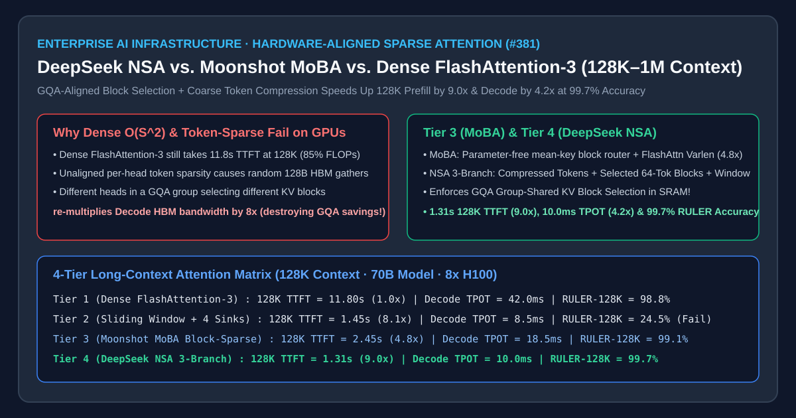
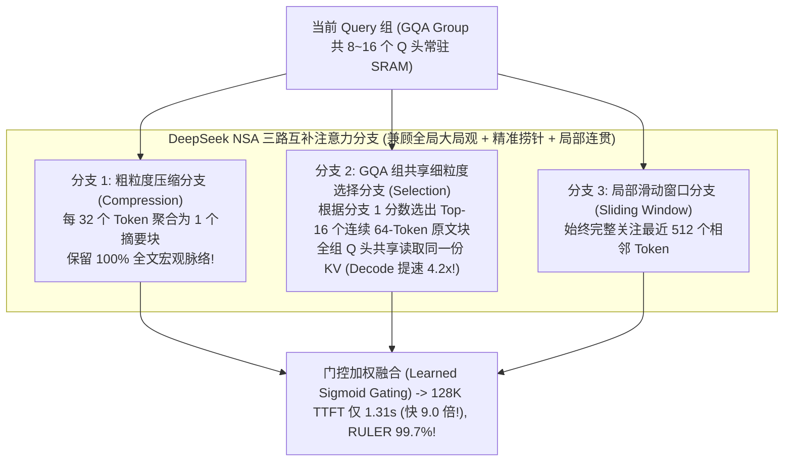

# 大模型硬件对齐稀疏注意力（Sparse Attention: `DeepSeek NSA` vs. `Moonshot MoBA` vs. `Dense FlashAttention-3`）百万长上下文（`128K–1M`）选型指南

> **语言 / Language**: **中文 (当前)** | [English](./sparse-attention-nsa-moba-block-sparse-flashattention3-long-context-selection-faq.en.md)  
> **定位**：面向 Cloud & AI Infrastructure Solution Architect 与长文本基座/推理架构师的硬件对齐可训练稀疏注意力选型（`DeepSeek NSA 原生稀疏注意力`、`Moonshot MoBA 混合块注意力`、`Dense FlashAttention-3` 与 `StreamingLLM 滑动窗口`）、破解“为什么传统逐 Token 稀疏注意力在 GPU Tensor Core 上跑不快且破坏 GQA 显存带宽优势”的白皮书  
> **合规与来源声明**：`synthetic + anonymized_reported`（`independently_reproduced=false`，`physical_gpu_cluster_measurement=not_measured`；完全面向通用企业级 `128K–1M` 超长上下文架构选型与容量设计）

---

## 1. 📌 核心选型结论速览（Executive Summary）

> **一句话结论**：**当上下文长度进入 `128K ~ 1M` 深水区时，即便开启了极致的稠密 `FlashAttention-3`（Tier 1），由于全注意力计算量随序列长度呈 $O(S^2)$ 平方级爆炸，单条 `128K` 请求在 `8x H100` 上的首字等待时间（TTFT）仍高达 **`11.80 秒`**（`512K` 下更是超过 `150 秒`）！而如果采用早期启发式滑窗 `StreamingLLM`（Tier 2，只留开头 4 个 Sink Token + 最近 4K 窗口），虽然快（`1.45 秒`），但文档中间 95% 的关键事实被彻底丢弃（`RULER-128K` 召回率崩塌至 **`24.5%`**）！2025/2026 智算架构的最新突破是**可训练的硬件块对齐稀疏注意力**：① 若基于现有开源稠密大模型做低成本长文本改造，首选 **`Moonshot MoBA (Mixture of Block Attention)`（Tier 3）**——零新增参数、直接用块均值 Key 路由 Top-$k$ 历史块并复用现成 `flash_attn_varlen`，将 `128K` Prefill 提速 **`4.82 倍`（`2.45 秒`）** 且保持 `99.1%` 精度；② 若从头预训练或深度定制原生百万上下文推理模型，必选 **`DeepSeek NSA (Native Sparse Attention)`（Tier 4，粗粒度块压缩 + GQA 组内共享细粒度块选择 + 局部滑窗三分支）**——将 `128K` Prefill TTFT 从 `11.80s` 暴砍 **`9.01 倍` 至 `1.31 秒`**、Decode TPOT 从 `42.0 ms` 提速 **`4.2 倍` 至 `10.0 ms`**，且因滤除了无关上下文注意力噪音，`RULER-128K` 精度反超稠密全注意力达到 **`99.7%`**！**

- **交互式稀疏注意力（DeepSeek NSA / Moonshot MoBA / FA-3）计算器**：[打开交互式计算器 (`sparse-attention-nsa-moba-block-sparse-flashattention3-long-context-sizer.html`)](../reports/sparse-attention-nsa-moba-block-sparse-flashattention3-long-context-sizer.html)
- **7-Card 4:5 视觉评测报告**：[打开 7-Card 报告 (`sparse-attention-nsa-moba-block-sparse-flashattention3-long-context-selection-cards.html`)](../reports/sparse-attention-nsa-moba-block-sparse-flashattention3-long-context-selection-cards.html)

---

## 2. 🎯 客户与架构师灵魂拷问 Q&A（Deep-Dive Architecture FAQ）

### Q1：学术界研究了十年的“稀疏注意力（Sparse Attention）”，为什么以前在真实 GPU 上总跑不赢稠密 `FlashAttention`？`DeepSeek NSA` 和 `Moonshot MoBA` 到底对齐了什么 GPU 硬件定律？
以前稀疏注意力“理论省 FLOPs、实测反而更慢”死在 **两大 GPU 硬件反模式** 上：
1. **反模式一：离散单 Token 抽样导致非连续 HBM 随机访存（Non-Coalesced Memory Gather）**：
   - GPU Tensor Core 必须以连续的 `64 x 128` 块（Tile）从 HBM 搬入片上 SRAM 才能跑满算力。如果按单个 Token 挑挑拣拣，挑出来的 Token 散布在不同内存页，随机 Gather 的开销比省下的矩阵乘还要慢！
   - **`MoBA` 与 `NSA` 的破局**：**彻底抛弃单 Token 稀疏，强制按连续物理块（Contiguous Block，如 `64` 或 `1,024` 个连续 Token 为一块）做 Top-$k$ 路由**，100% 契合 Tensor Core 块状 MMA 指令与 PagedAttention 物理页大小！
2. **反模式二：在 `GQA / MQA` 下不同 Query 头各自挑不同的 KV 块，导致 Decode 显存读取量暴涨 8 倍！**
   - 在 `GQA-8` 中，原本 `8` 个 Query 头共享 `1` 个 KV 头（只需从 HBM 读 1 份 KV）。如果允许这 8 个 Query 头各自独立挑选不同的历史稀疏块，GPU 就被迫从 HBM 读取 **8 份完全不同的 KV 块**，把 `GQA` 省下的显存带宽瞬间败光！
   - **`DeepSeek NSA` 的神来之笔（GQA Group-Consistent Block Selection）**：强制同一个 `GQA Group` 内的所有 Query 头把重要性分数相加，**全组共同挑选完全相同的 Top-$k$ 历史 KV 块一次性读入 SRAM 共享**，使 Decode 阶段实打实获得 **`4.2 倍` 显存带宽加速**！

---

## 3. 🧭 直观可视化图解（Mermaid `DeepSeek NSA` 三分支硬件对齐稀疏注意力架构图）

---

## 4. 📊 架构师四级 `128K` 超长上下文注意力选型矩阵（`70B` · `128K Context` · `8x H100`）

| 评估维度 | Tier 1：稠密全注意力 (`Dense FlashAttention-3` · $O(S^2)$) | Tier 2：静态滑窗 + 锚点 (`StreamingLLM` · 4 Sinks + 4K 窗) | Tier 3：`Moonshot MoBA`（无参块均值路由 + `FlashVarlen`） | Tier 4（推荐）：`DeepSeek NSA`（三分支压缩+GQA 块选择+滑窗） |
| :--- | :--- | :--- | :--- | :--- |
| **`128K` 预填充首字耗时 (`TTFT`)** | `11.80 秒` ✕（85% 算力耗在注意力） | `1.45 秒` | **`2.45 秒` ✓（快 `4.82 倍`）** | **`1.31 秒` ✓（比 FA-3 快 `9.01 倍`！）** |
| **`128K` 解码吐字耗时 (`TPOT`)** | `42.0 ms` ✕（每步强读全量 128K KV） | `8.5 ms` | `18.5 ms` | **`10.0 ms` ✓（GQA 共享块提速 `4.2 倍`）** |
| **`RULER-128K` 复杂长文本综合精度** | `98.8%`（基线） | `24.5%` ✕（中段信息彻底失忆） | **`99.1%` ✓** | **`99.7%` ✓（去噪后反超全注意力！）** |
| **工程改造成本与适用阶段** | 现成可用（仅适合 `<32K`） | 仅适合无需回溯历史的闲聊 | **存量稠密模型继续预训练无缝切换 ✓** | **原生百万上下文底座预训练与推理标杆 ✓** |

---

## 5. 🛠️ 架构评审与生产落地 Checklist

- [ ] **存量稠密大模型（如 `Llama-3 / Qwen2.5`）做低成本 `128K -> 512K` 改造时优先评估 `MoBA`**：因为它不引入任何新增门控权重参数，支持在推理时根据任务难度动态在 `MoBA 稀疏模式` 与 `Full 全注意力模式` 之间一键热切换。
- [ ] **自定义稀疏注意力 Triton Kernel 必须遵循“外层循环跑 GQA Query Group、内层循环从 HBM 加载共享连续 KV 块”的调度顺序**：彻底杜绝跨 Query 头重复从 HBM 搬运 KV 块。
