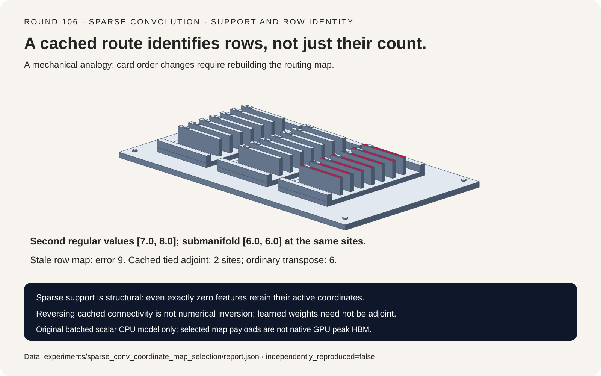
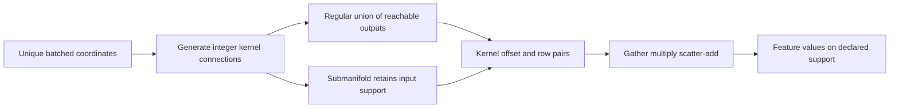
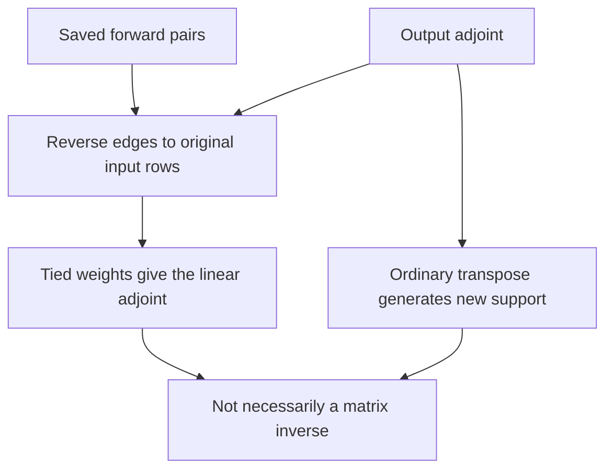
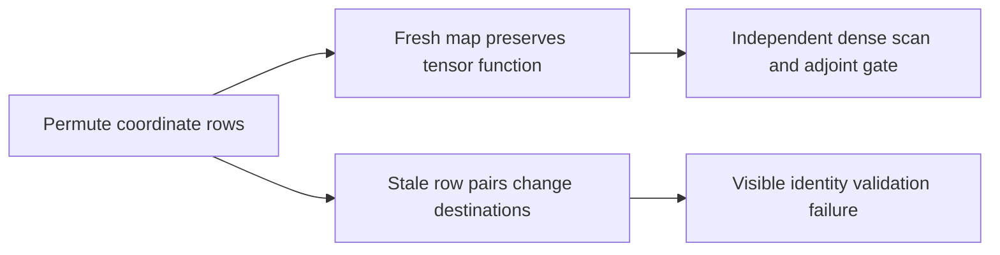

# Sparse convolution FAQ: coordinate support, cached inverse maps and row identity

> **Language**: [中文](sparse-convolution-coordinate-map-submanifold-inverse-selection-faq.md) | English
>
> **Round 106 · 2026-11-14 (fifteenth round of the November 13 night)** · [SVG](../../assets/svg/sparse-convolution-coordinate-map-submanifold-inverse-selection-faq-summary.svg) · [7-card report](../reports/sparse-convolution-coordinate-map-submanifold-inverse-selection-cards.html) · [H5 workbench](../reports/sparse-convolution-coordinate-map-submanifold-inverse-sizer.html) · [Sealed report](../../experiments/sparse_conv_coordinate_map_selection/report.json)
>
> **Synthetic, `independently_reproduced=false`.** Only original Python CPU maps were timed. No spconv/CUDA execution, multi-channel 3D kernel, perception accuracy, GPU latency or peak-HBM observation.



## 1. Executive summary: support is an operator contract, not a nonzero test

Regular sparse convolution can expand active coordinates; submanifold
convolution keeps the existing support. Replacing one with the other is
an architectural change, not simply a faster implementation of an
identical multilayer network.

With two active input sites `[2,3]`, features `[1,2]`, a three-tap
all-ones kernel and same padding, regular output has four active sites;
submanifold output has two. After a second layer, their values at the
original sites are **`[7,8]` versus `[6,6]`**.

| Contract | Preserve | Do not infer |
| :--- | :--- | :--- |
| Active support | Declared coordinate topology | Zero features erase coordinates |
| Pair maps | Kernel offset and exact feature-row identity | Equal row counts mean cache equivalence |
| Cached inverse | Reverse saved connectivity to original support | It constructs ordinary transpose support |
| Numerical inverse | Additional mathematical conditions | A transpose or learned inverse layer recovers inputs |

This is a new independent study of **longstanding** spconv mechanics.
The pinned repository head is December 15, 2024; `conv.py` last changed
March 23, 2023. It is not presented as a fresh 2026 launch or daily
popularity ranking. Original references are batched 1D scalar
cross-correlations, with no bias or nonlinearities.

## 2. Architect Q&A: when is the sparse computation a different function?

### Q1: What distinguishes regular from submanifold convolution?

For each kernel offset k, a regular connection satisfies
`input_x = output_y*stride - padding + k*dilation`.
Our original map derives valid output coordinates and takes their union.
Submanifold convolution retains only original active sites and requires
an odd centered kernel and stride one in this model.

On the main fixture, regular first-layer values are `[1,3,3,2]`
at sites `[1,2,3,4]`; submanifold values are `[3,3]` at `[2,3]`.
The discarded surrounding values affect the next regular layer,
explaining `[7,8]` versus `[6,6]` at the original sites.

Both references match an independent full dense scan **at their own
declared output coordinates**. That is not equivalence between the
two multilayer architectures. Native output row order need not match
our toy's sorted regular coordinates.

### Q2: Does a zero feature deactivate a sparse coordinate?

No. On the same two sites, features `[1,1]` and kernel `[1,-1,1]`
produce two exactly zero submanifold outputs. The two coordinates
remain active. Activity is structural membership, not a feature-value
test. Pruning zero-valued rows would be an additional topology policy.

Batch identity is also part of a coordinate. Identical spatial positions
in different batches never share an edge. Duplicate coordinates require
an explicit aggregation policy; the original model rejects them rather
than silently choosing sum, mean or last write.

### Q3: Is cached inverse convolution the same as ordinary transpose?

No. The inspected inverse path retrieves stored original indices and
reverses saved pair connectivity. Ordinary transposed convolution
generates reachable coordinates from its current input support.

The stride-two fixture starts at sites `[1,4]`, shape eight, kernel
`[1,2,3]`, padding one and dilation one. Forward active sites are
`[0,1,2]` with values `[6,2,-2]`. For upstream `[.5,-1,2]`,
reversing the saved map with tied scalar weights returns `[.5,4]`
at the original **two** sites. Ordinary transpose at original shape
eight reaches **six** sites `[0,1,2,3,4,5]`; its values are
`[1,.5,-2,-1,4,6]`. For the ordinary output-shape convention this
fixture corresponds to output padding one.

The tied-weight map reversal satisfies
`<A*x,u>=<x,A^T*u>=-3`, and independent input finite differences
agree within `1.53e-10`.

### Q4: Does the name “inverse” mean numerical inversion?

No. Even with tied adjoint weights, `A^T*A*x=[20,-4]`, not the original
`[2,-1]`. A separately learned SparseInverseConv may use different
weights and is not necessarily the forward operator's adjoint.

Our adjoint identity assumes the same scalar kernel, reversed edges,
no bias and no intervening nonlinear transformation. A multichannel
adjoint additionally needs correctly transposed channel weights.
Restoring coordinate support and reconstructing feature values are
different promises.

### Q5: Why can cached pairs become invalid after a row permutation?

Pairs contain feature-row numbers, not only coordinate counts.
Permuting input coordinates and features together preserves the
mathematical tensor if a fresh map is built. Reusing the stale pairs
instead changes `[6,2,-2]` to `[-3,-1,4]`, maximum error **nine**.

The inspected source reuse checks compare relevant kernel/dilation,
spatial shape and row counts; they do not compare every ordered
coordinate. Source bookkeeping must preserve the matching row contract.
Our original exact ordered-coordinate guard is deliberately stronger.
This is not a claim that source validates full equality, nor a report
of a reproduced native bug.

Source normal map reuse is limited to submanifold maps in the inspected
path; inverse uses saved regular connectivity. Our timed reuse is
therefore submanifold, with immutable coordinates and operator.

## 3. Visual architecture: build, apply and reverse coordinate maps







## 4. Selection matrix: choose topology before choosing kernels

| Choice | Good fit | Gate before adoption |
| :--- | :--- | :--- |
| Regular sparse convolution | Expand or downsample support | Validate integer stride/padding/dilation and output shape |
| Submanifold convolution | Keep existing sparse sites | Accept different multilayer information paths |
| Cached inverse connectivity | Restore prior coordinate support | Preserve map history and row identity |
| Ordinary transpose | Generate new reachable support | Explicit output shape/padding; not numerical inversion |
| Map reuse | Same operator and immutable rows | Validate identity; account for initial construction |

The source selects different Native/implicit-GEMM paths.
The H5 **Native `[2,K,N]` pair payload is one selected path**, not a
prediction of default GPU allocation: the inspected small-kernel GPU
configuration can choose implicit GEMM instead.

For 200,000 input rows, 27 kernel offsets and four-byte indices,
padded pair capacity is **43,200,000 bytes**. A hypothetical 1,800,000
valid pairs needs **14,400,000 bytes** for two compact IDs per pair,
excluding grouping/kernel metadata. Input coordinates take 3,200,000
bytes; 64 two-byte input features take 25,600,000 bytes.

Active counts and valid pairs are synthetic user inputs, not inferred
from occupancy. The calculator compares a shared declared spatial
volume, not stride-dependent shape inference. Hash key width can
become int64 independently of pair row-ID dtype. Masks, hashing,
unique/sort buffers, other workspace and allocator state are omitted:
none of these payloads is peak HBM.

## 5. Hands-on: original CPU references and sealed evidence

```powershell
python -m experiments.sparse_conv_coordinate_map_selection.run
python -m unittest tests.test_sparse_conv_coordinate_map_selection -q
python -m experiments.sparse_conv_coordinate_map_selection.run --check
```

`--measure` explicitly replaces `latency.json`; ordinary generation
and checking never remeasure. Tests cover support growth, zero-valued
active rows, batch isolation, stride/dilation dense-reference parity,
the adjoint identity, stale-cache rejection and JavaScript exact budgets.
The empty toy map returns an empty result; native vanished-point
diagnostics and launch constraints are not reproduced.

ARM64 Python 3.12.10 CPU medians, two warmups and seven alternating
repeats:

| Active inputs | Valid edges | Reuse + apply, ms | Build + apply, ms |
| ---: | ---: | ---: | ---: |
| 16 | 16 | .0084 | .0369 |
| 64 | 160 | .0367 | .1626 |
| 256 | 286 | .1044 | .5449 |
| 1024 | 2590 | .5601 | 2.8000 |

Both include exact ordered-coordinate checks and scalar application.
Reuse excludes initial construction and requires unchanged coordinates
and operator; pair counts vary with each synthetic topology. This is
not native spconv, GPU speedup or end-to-end inference evidence.

The report contains seven static 900×1125 cards with strict CSP
`default-src 'none'; style-src 'unsafe-inline'`. H5 uses only inline
code and visible input errors; the original SVG is 1600×1000.
No browser inspection was performed; the prior browser refusal remains
binding.

## 6. Sources, provenance and boundaries

- [Pinned convolution/reuse/inverse contracts](https://github.com/traveller59/spconv/blob/263d6b47425ef843c82f997b12d8b714013d216c/spconv/pytorch/conv.py).
- [Pinned output shapes, pair arrays and hash-key selection](https://github.com/traveller59/spconv/blob/263d6b47425ef843c82f997b12d8b714013d216c/spconv/pytorch/ops.py).
- [March 23, 2023 `conv.py` change](https://github.com/traveller59/spconv/commit/cd99e7a63be24131ada321dc9c2309d4c4fd3cda);
  repository pin December 15, 2024. Chronology is disclosed rather
  than repackaged as a current launch.
- [Apache-2.0 license](https://github.com/traveller59/spconv/blob/263d6b47425ef843c82f997b12d8b714013d216c/LICENSE).

Upstream rights remain with their holders. No source implementation,
trained weights or datasets are vendored. Original scalar inputs and
allocation counts are synthetic; original CPU timing is separately
measured. Native 3D kernel behavior, model accuracy, GPU latency and
peak HBM remain unmeasured.
