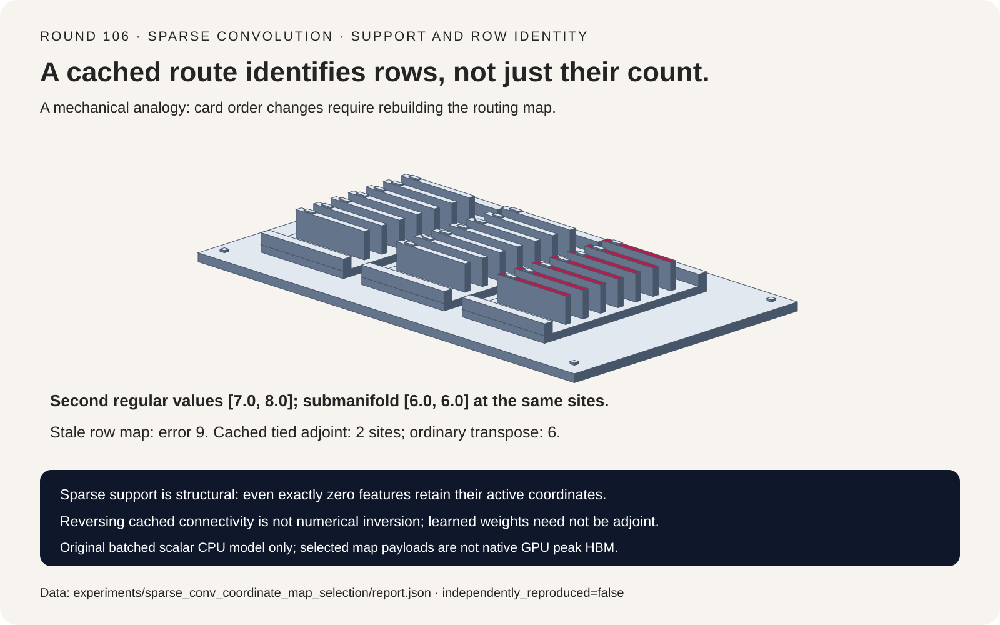
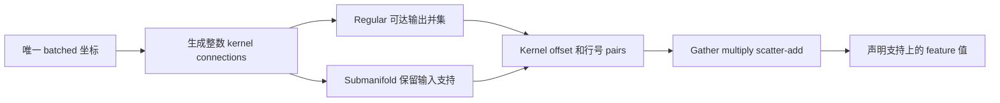
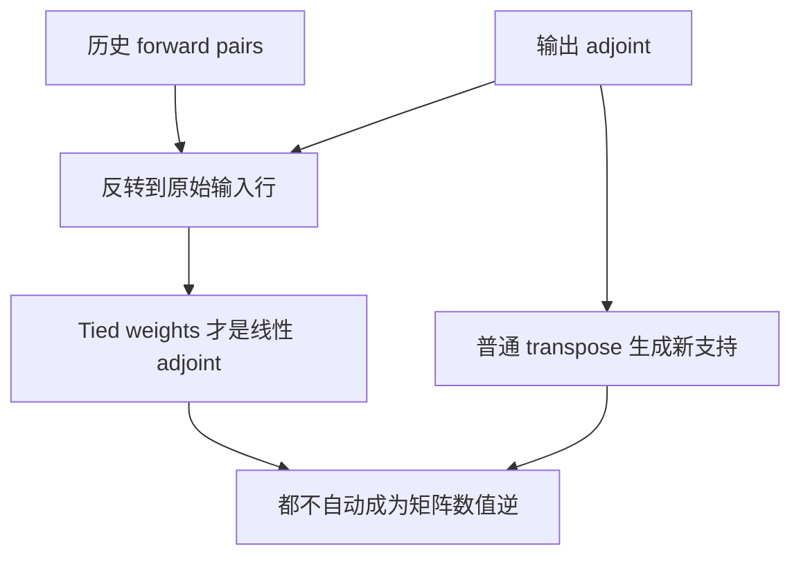
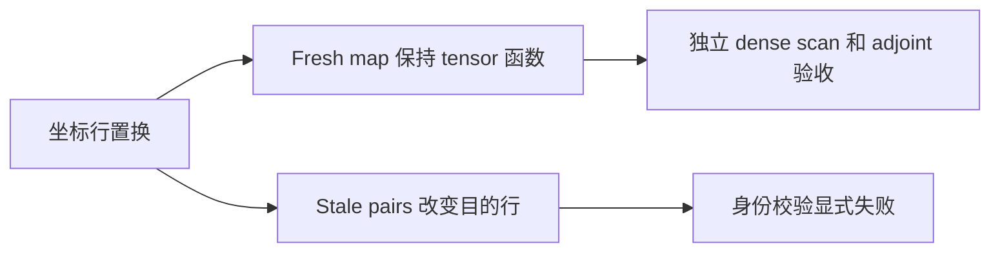

# 稀疏卷积选型 FAQ：Submanifold 支持、Cached Inverse 与坐标行身份

> **语言**：中文 | [English](sparse-convolution-coordinate-map-submanifold-inverse-selection-faq.en.md)
>
> **Round 106 · 2026-11-14（11 月 13 日夜班第十五轮）** · [高清 SVG](../../assets/svg/sparse-convolution-coordinate-map-submanifold-inverse-selection-faq-summary.svg) · [七卡报告](../reports/sparse-convolution-coordinate-map-submanifold-inverse-selection-cards.html) · [H5 工作台](../reports/sparse-convolution-coordinate-map-submanifold-inverse-sizer.html) · [封存数据](../../experiments/sparse_conv_coordinate_map_selection/report.json)
>
> **Synthetic，`independently_reproduced=false`。** 仅原创 Python CPU map 实测；未运行 spconv/CUDA、原生多通道 3D kernel，未测感知精度、GPU latency 或 peak HBM。



## 1. 一句话结论：支持集是算子契约，不是 feature 非零判断

Regular sparse convolution 可以扩展活动坐标；submanifold convolution
保留现有支持。二者互换是架构改变，不只是给同一个多层网络换一个更快 kernel。

输入活动位置 `[2,3]`、features `[1,2]`、三点全一 kernel 和 same padding，
regular 第一层有四个活动位置，submanifold 只有两个。
第二层在原始位置的值已经变成 **`[7,8]` 对 `[6,6]`**。

| 契约层 | 必须保留 | 不能推断 |
| :--- | :--- | :--- |
| Active support | 声明的坐标拓扑 | Feature 为零就删除坐标 |
| Pair map | Kernel offset 与精确 feature-row 身份 | 行数相同就可复用 cache |
| Cached inverse | 历史边反转到原始支持 | 等于普通 transpose 重新生成支持 |
| 数值求逆 | 额外数学条件 | Transpose 或 learned inverse 能恢复输入 |

本轮是对 spconv **长期存在机制**的全新独立研究。
固定 repo head 为 2024-12-15，所查 `conv.py` 最后变更为 2023-03-23；
不冒充 2026 新发布或未经证实的日榜热度。
原创模型为 batched 1D scalar cross-correlation，不含 bias 和非线性。

## 2. 架构师 Q&A：哪些选择真正改变函数？

### Q1：Regular 与 submanifold 的核心区别是什么？

对 kernel offset k，一条边满足
`input_x=output_y*stride-padding+k*dilation`。
原创 regular map 对有效整数输出坐标取并集；submanifold
仅保留原始活动位置。本模型的 submanifold 限制为奇数居中 kernel、stride 一。

主例 regular 在 `[1,2,3,4]` 上输出 `[1,3,3,2]`；
submanifold 在 `[2,3]` 上输出 `[3,3]`。
被删掉的外围值会进入下一层 regular 的邻域，
所以第二层原位置得到 `[7,8]` 而不是 `[6,6]`。

两条原创路径各自都能在**声明的输出坐标**上对齐独立 full dense scan，
但不能据此宣称两种多层架构等价。Toy regular 对输出排序；
不要求 native row order 与该顺序相同。

### Q2：Feature 恰好为零时，坐标还 active 吗？

还在。相同两位置，输入 features `[1,1]`、kernel `[1,-1,1]`
时，submanifold 两个输出都严格为零，但两个坐标继续 active。
活动性是结构成员关系；按零值剪枝是额外拓扑策略。

Batch identity 同样属于坐标；不同 batch 的相同 x 不应连边。
重复坐标需显式 coalescing 约定；原创模型直接拒绝，
不偷偷选择 sum、mean 或 last-write。

### Q3：Cached inverse 就是普通 transposed convolution 吗？

不是。所查 inverse 路径读取保存的原始 indices，反转历史 pair
connectivity；普通 transpose 从当前输入支持重新生成可达坐标。

Stride 二例子原始位置 `[1,4]`、shape 八、kernel `[1,2,3]`、
padding 一、dilation 一，forward 在 `[0,1,2]` 输出 `[6,2,-2]`。
上游 `[.5,-1,2]` 通过 tied scalar weights 反转历史边，
在原始 **两个**位置返回 `[.5,4]`。
普通 transpose 选择原 shape 八时，对应 output padding 一，
会生成 **六个**位置 `[0,1,2,3,4,5]`，值为 `[1,.5,-2,-1,4,6]`。

Tied map reversal 满足 `<A*x,u>=<x,A^T*u>=-3`；
输入 finite differences 的误差低于 `1.53e-10`。

### Q4：“Inverse” 是否承诺数值求逆？

不承诺。即使权重严格 tied，`A^T*A*x=[20,-4]`，
也不是原输入 `[2,-1]`。独立学习的 SparseInverseConv 可以有不同权重，
未必是 forward 算子的 adjoint。

本轮 adjoint 等式要求同一 scalar kernel、反转边、没有 bias
或中间非线性；多通道情形还要正确转置 channel weights。
恢复坐标支持与恢复 feature 数值是两个承诺。

### Q5：为什么坐标和 features 一起置换仍会破坏缓存？

数学 tensor 不变，但 pair 里写的是 feature-row number。
重建 map 会保持 `[6,2,-2]`；
直接用旧 pair 却得到 `[-3,-1,4]`，最大误差 **九**。

所查 source reuse checks 验证相关 kernel/dilation、spatial shape
和 row count，不逐项验证 ordered coordinates。
Source bookkeeping 必须维护配套行身份；
原创模型的 exact ordered-coordinate guard 是刻意更强的约束，
不是声称 source 已有逐坐标相等检查，也不是复现 native bug。

所查普通 map reuse 仅允许 submanifold，inverse 则消费保存的
regular connectivity。因而本轮 CPU reuse timing 也采用 submanifold，
且要求 operator 与坐标不可变。

## 3. 可视化架构：生成、应用与反转坐标图







## 4. 选型矩阵：先选支持语义，再选 kernel 路径

| 选择 | 适用点 | 采用前的验收门 |
| :--- | :--- | :--- |
| Regular sparse conv | 扩展或降采样支持 | 整数 stride/padding/dilation 与输出形状 |
| Submanifold | 保持稀疏活动位置 | 接受不同的多层信息路径 |
| Cached inverse connectivity | 恢复历史坐标支持 | Map history 与行身份不变 |
| 普通 transpose | 生成新可达支持 | 显式输出 shape/padding；不是数值逆 |
| Map reuse | 算子与行身份不变 | 身份校验；计入初次 construction |

Source 有 Native 与 implicit-GEMM 等路径。
工作台 **Native `[2,K,N]` 只是指定路径的 payload**，
不是默认 GPU allocation 预测：所查小 kernel GPU 配置可能选 implicit GEMM。

200,000 input rows、27 offsets、四字节索引时，
Native pair capacity 为 **43,200,000 bytes**。
假设 1,800,000 valid pairs 的两个 compact IDs 为 **14,400,000 bytes**，
不含 grouping/kernel metadata。
Input coordinates 为 3,200,000 bytes；
64 个两字节 input features 为 25,600,000 bytes。

活动行和有效边数是 synthetic 用户输入，不根据 occupancy 猜测。
工作台采用共享声明 grid volume 比较 payload，不推断 stride 后形状。
Hash key 可变成 int64，不等于 pair row-ID dtype 同步变宽。
Masks、hash/unique/sort workspace 和 allocator 都未计入；
这些数字都不是 peak HBM。

## 5. 动手验证：原创 CPU 参考与封存证据

```powershell
python -m experiments.sparse_conv_coordinate_map_selection.run
python -m unittest tests.test_sparse_conv_coordinate_map_selection -q
python -m experiments.sparse_conv_coordinate_map_selection.run --check
```

`--measure` 单独显式替换 `latency.json`，普通生成和检查不重测。
测试覆盖支持增长、零值 active rows、batch isolation、
stride/dilation dense parity、adjoint 等式、stale cache 拒绝和 JS exact budgets。
Toy 空 map 返回空结果；不复现 native vanished-point diagnostics 或 launch 限制。

ARM64 Python 3.12.10 CPU median，两个 warmup、七轮交替：

| Active inputs | Valid edges | Reuse＋apply / ms | Build＋apply / ms |
| ---: | ---: | ---: | ---: |
| 16 | 16 | .0084 | .0369 |
| 64 | 160 | .0367 | .1626 |
| 256 | 286 | .1044 | .5449 |
| 1024 | 2590 | .5601 | 2.8000 |

两者都包含 exact ordered-coordinate checks 和 scalar apply；
reuse 不含首次 construction，要求 operator 与坐标不变。
各 tier synthetic topology 的 pair count 不同。
不能将这些结果叫 native spconv、GPU 加速或端到端 inference benchmark。

七卡为 900×1125 静态自包含 HTML，CSP
`default-src 'none'; style-src 'unsafe-inline'`。
H5 仅内联代码、输入错误可见；原创 SVG 为 1600×1000。
未做 browser 检查，继续尊重此前 browser-operation 拒绝。

## 6. 来源、许可证与边界

- [固定 conv/reuse/inverse 契约](https://github.com/traveller59/spconv/blob/263d6b47425ef843c82f997b12d8b714013d216c/spconv/pytorch/conv.py)。
- [固定 output shape、pair array 与 hash-key 选择](https://github.com/traveller59/spconv/blob/263d6b47425ef843c82f997b12d8b714013d216c/spconv/pytorch/ops.py)。
- [`conv.py` 2023-03-23 变更](https://github.com/traveller59/spconv/commit/cd99e7a63be24131ada321dc9c2309d4c4fd3cda)；
  repo pin 为 2024-12-15，披露真实年代，不包装成当前新发布。
- [Apache-2.0 license](https://github.com/traveller59/spconv/blob/263d6b47425ef843c82f997b12d8b714013d216c/LICENSE)。

上游权利保留；未 vendoring source 实现、权重或数据集。
原创标量输入与分配计数为 synthetic，CPU timing 单独标 measured。
Native 3D kernel、模型精度、GPU latency、peak HBM 均未实测。
