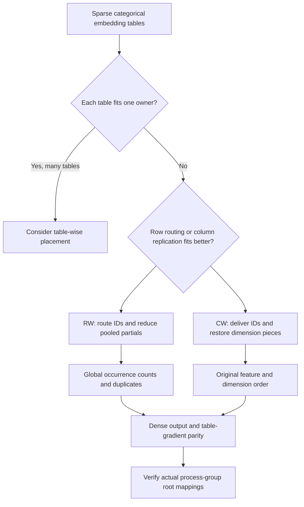
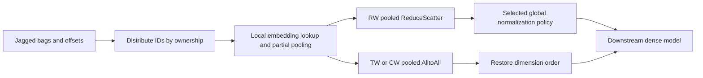
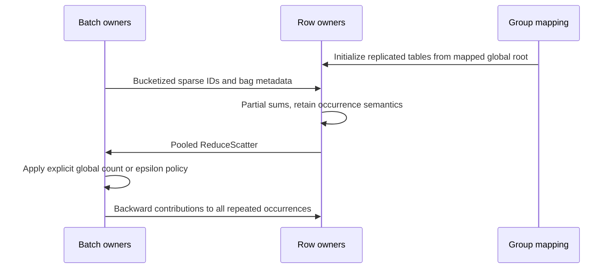

# Sparse embedding table sharding FAQ: jagged pooling, row/column ownership and subgroup roots

> **Language**: [中文](sparse-embedding-table-row-column-sharding-selection-faq.md) | English
>
> **Round 96 · 2026-11-14 (fifth round of the November 13 night)** · [SVG](../../assets/svg/sparse-embedding-table-row-column-sharding-selection-faq-summary.svg) · [7-card report](../reports/sparse-embedding-table-row-column-sharding-selection-cards.html) · [H5 workbench](../reports/sparse-embedding-table-row-column-sharding-sizer.html) · [Sealed report](../../experiments/sparse_embedding_sharding_selection/report.json) · [CPU timing samples](../../experiments/sparse_embedding_sharding_selection/latency.json)
>
> **Synthetic pooling inputs; `independently_reproduced=false`.** Only the latency subsection is **measured local CPU** execution of original scalar Python functions. No TorchRec/FBGEMM/GPU execution, recommendation-quality score or distributed throughput claim.


## 1. Executive summary: distribute table ownership without changing bag semantics

**Sparse recommendation tables have a different contract from text embedding
encoders:** gather rows by categorical ID, pool jagged bags, and route table
gradients back to every occurrence. Splitting ownership must preserve that
contract, including duplicates, empty bags, dimension order and normalization.

| Layout | Ownership | Principal tradeoff |
| :--- | :--- | :--- |
| Table-wise, TW | Whole tables placed on selected owners | Simple table placement; one large table still needs one owner |
| Row-wise, RW | Different row ranges on different ranks | Route IDs, merge partial vectors and respect full bag counts |
| Column-wise, CW | Different embedding dimensions on different ranks | Replicate relevant IDs, then reconstruct dimensions in the original order |

For one hypothetical `100,000,000 × 128` table with two-byte weights,
whole-table storage is `25.6 GB`. Eight equal row shards or equal column
shards have a maximum `3.2 GB` weight block. **These are weight-only bytes,
not peak training HBM or optimizer-state estimates.**

Recent first-party context is concrete rather than a popularity claim:
the [November 11, 2026 TorchRec fix](https://github.com/meta-pytorch/torchrec/commit/36276ee3d0c9d0e52a00cbf10129035f529314b2)
maps subgroup-local rank zero to a global rank before replicated-table
initialization. This matters when embedding sharding is composed with
two-dimensional process groups.

No prior component guide covered TorchRec/EmbeddingBag at source-discovery
time. Unlike the [vocabulary-parallel CE study](vocabulary-parallel-cross-entropy-global-logsumexp-selection-faq.en.md),
this topic pools categorical feature bags rather than normalizing language-model
logits over a vocabulary.

## 2. Architect Q&A: what must remain invariant across sharding layouts?

### Q1: Is a row-sharded pooled table just two All-to-All operations?

Not universally. At the pinned training implementation, `RwSparseFeaturesDist`
bucketizes IDs by row owner and redistributes sparse features with AlltoAll.
`RwPooledEmbeddingDist` returns pooled partials through **ReduceScatter**.
The numerical operation combines sums and sends the appropriate bag outputs
back to their owning batch partitions.

TW uses sparse input AlltoAll and pooled output AlltoAll. CW reuses these
distribution building blocks but partitions dimensions and may apply an
output permutation. Inference paths include different AlltoOne behavior;
do not apply the training communication description indiscriminately.

The original model checks the mathematical routing/reconstruction only.
It does not execute these collectives or reproduce a complete TorchRec plan.

### Q2: Why is summing local bag means wrong?

For bag `b`, row shard `r` has sum vector `s_br` and occurrence count `n_br`.
The ideal unweighted mean is:

```text
global_sum = SUM_r s_br
global_count = SUM_r n_br
ideal_mean = global_sum / global_count
```

Summing `s_br/n_br` weights shards equally even when they own different
numbers of occurrences. Empty local pieces also need explicit handling.
The original fixture has eight rows, six dimensions and six jagged bags,
including an empty bag and `[0,0,1,7]`. The “sum local means” control differs
from the global reference by a maximum `8.3357142857`.

An empty bag returns a zero vector in this harness. It does not divide by
zero and does not become a missing model-quality score.

**Important source caveat:** the pinned RW/TWRW mean callback uses the global
bag length—or summed weights when supplied—**plus `1e-6`** as its divisor.
That is not bitwise identical to an ideal nonempty-count mean. Our explicit
epsilon-policy variant differs by up to `1.403174e-6` on this fixture. It is
reported as a numerical-policy difference, **not an upstream bug finding**.
Do not silently remove that epsilon and claim source-level parity.

### Q3: Can deduplicating repeated IDs reduce work for free?

Only if multiplicity or equivalent accumulated weights are retained.
`[0,0,1,7]` contains two contributions from row zero. Treating it as
`[0,1,7]` changes both pooled output and table-gradient accumulation.
The intentionally broken dedup control still divides by the original count,
and its maximum output error is `1.3047619048`.

For upstream vector `u_b`, ideal unweighted-mean table gradients satisfy:

```text
dL/dE[id, :] += u_b / len(bag_b)   for every occurrence of id
```

Weighted SUM instead multiplies each occurrence by its sample weight.
The harness verifies all 48 table coordinates against finite differences
for SUM, ideal MEAN and weighted SUM. It does not assess weighted MEAN;
restrictions in `torch.nn.EmbeddingBag` must not be blindly generalized to
TorchRec's separate callback.

### Q4: Why can CW pass shape checks while producing wrong embeddings?

Column shards carry dimensions, not interchangeable replicas. The receiving
side must restore the exact original dimension order and feature order.
The control that reverses column pieces has the correct output width but
maximum error `2.9333333333`.

Downstream MLP weights, feature interactions and checkpoint mappings all
depend on dimension identity. Changing a sharding plan may require resharding
weights and optimizer slots, not merely concatenating whatever finishes first.

### Q5: Why does a subgroup make `src=0` incorrect?

In the pinned initialization path, `dist.broadcast(..., src=..., group=pg)`
uses a **global** source rank. For group members `[1,3,5,7]`, local rank zero
is global rank **one**; global zero is not even a member.

The fresh source fix uses `dist.get_global_rank(pg,0)` when a group exists.
The default world group still maps zero to zero. The local model checks this
rank-space mapping without launching a process group. It does not claim
every distributed API uses the same rank convention; APIs exposing
`group_src` must be read on their own terms.

## 3. Visual architecture: selection tree, routing and pooling sequence







## 4. Selection matrix and byte-budget boundaries

| Requirement | Prefer evaluating | What must be measured |
| :--- | :--- | :--- |
| Many individually small tables | TW with load-aware placement | Hot-table imbalance and owner memory |
| One table exceeds owner capacity | RW | ID skew, partial reduction and real optimizer storage |
| Useful dimension partitioning | CW | ID replication, dimension alignment and output reconstruction |
| Many repeated IDs | Multiplicity-preserving coalescing | Coalescing overhead and backward multiplicity |
| Hierarchical groups/2D composition | Explicit local/global rank conversion | Actual group membership, init and collective APIs |

The default workbench uses 4,096 global bags, 20 IDs per bag, eight-byte IDs
and two-byte output scalars. RW logical ID delivery is `655,360` bytes;
delivering IDs to all eight CW owners is `5,242,880` bytes. RW full dense
partials across all ranks materialize `8,388,608` bytes; CW output pieces
total `1,048,576` bytes.

**These are not wire-byte measurements.** Logical deliveries include local
delivery. Offsets/lengths, sample weights, collective routing, communication
codecs and topology are excluded. Materialized partials are not a formula
for ReduceScatter traffic. Access skew can dominate despite equal weight
shards; no uniform-access throughput guarantee is made.

## 5. Worked example and seven cards: numerical proof plus real CPU samples

| Original protocol case | Maximum ideal-mean error | Interpretation |
| :--- | ---: | :--- |
| TW | `0` | Matches selected ideal reference |
| RW | `2.22e-16` | Matches within `1e-12` |
| CW | `0` | Matches selected ideal reference |
| Sum local means | `8.3357142857` | Incorrect normalization |
| Dedup without multiplicity | `1.3047619048` | Lost occurrences |
| Reverse column pieces | `2.9333333333` | Wrong dimension identity |
| Global divisor plus epsilon | `1.403174e-6` | Explicit policy difference |

Reversing occurrences or using two row shards preserves the ideal result
within tolerance. Table-gradient central differences use `epsilon=1e-5`.

Unlike the analytical byte budget, the following are **measured local-CPU
medians** from [sealed samples](../../experiments/sparse_embedding_sharding_selection/latency.json):

| Bags | Direct Python toy, ms | Row-sharded serial Python toy, ms |
| ---: | ---: | ---: |
| `16` | `0.142` | `0.280` |
| `64` | `0.463` | `1.011` |
| `256` | `1.870` | `4.201` |
| `1,024` | `7.267` | `16.791` |

Environment: Windows ARM64, Python 3.12.10, Qualcomm ARMv8 processor.
Timing uses `perf_counter_ns`, two warmups and seven repeats per path,
alternating timing order. The latency fixture is separate: 64 rows, eight
dimensions, four logical row shards, bag length `i mod 9`, IDs
`(i×7+j²) mod 64`. Timings include validation and serial Python bookkeeping.
There are **no parallel workers, TorchRec, FBGEMM or GPU** in this measurement.
The extra serial work is not evidence that distributed GPU sharding is slower.

GPU latency, recommendation quality and confidence remain `null`, not zero.
Static report bars come only from the sealed medians.

## 6. Reproduction, pinned sources and deployment checklist

```powershell
python -m experiments.sparse_embedding_sharding_selection.run
python -m experiments.sparse_embedding_sharding_selection.run --check
python -m unittest tests.test_sparse_embedding_sharding_selection
```

Rendering and `--check` preserve the measurements. Deliberately replacing
them requires `--measure`, which also rebuilds the report; it cannot be
combined with `--check`. Source, inputs, repeat samples and hardware scope
remain explicit.

The [self-contained H5](../reports/sparse-embedding-table-row-column-sharding-sizer.html)
varies table dimensions, shard count and scalar sizes. It never extrapolates
CPU samples into GPU timing. Static cards use
`default-src 'none'; style-src 'unsafe-inline'`, no script or external
resources; only the calculator enables inline JavaScript. Browser visual
inspection remains unperformed after denied browser access.

Fixed source anchors:

- [EmbeddingBag collection and mean divisor](https://github.com/meta-pytorch/torchrec/blob/36276ee3d0c9d0e52a00cbf10129035f529314b2/torchrec/distributed/embeddingbag.py): subgroup root and the explicit epsilon policy.
- [RW sharding](https://github.com/meta-pytorch/torchrec/blob/36276ee3d0c9d0e52a00cbf10129035f529314b2/torchrec/distributed/sharding/rw_sharding.py): ID bucketing, input AlltoAll and pooled ReduceScatter.
- [CW sharding](https://github.com/meta-pytorch/torchrec/blob/36276ee3d0c9d0e52a00cbf10129035f529314b2/torchrec/distributed/sharding/cw_sharding.py) and [TW sharding](https://github.com/meta-pytorch/torchrec/blob/36276ee3d0c9d0e52a00cbf10129035f529314b2/torchrec/distributed/sharding/tw_sharding.py): reused distributors and output permutation.
- [Upstream LICENSE](https://github.com/meta-pytorch/torchrec/blob/36276ee3d0c9d0e52a00cbf10129035f529314b2/LICENSE): upstream rights retained; no implementation copied.

Before production, check ID range, empty bags, duplicates/weights, feature
and dimension order, normalization epsilon, optimizer/resharding state,
group-rank spaces, actual kernel support, hot-ID skew and full memory/network
traces. Correct toy pooling is not a recommendation-model quality result.
