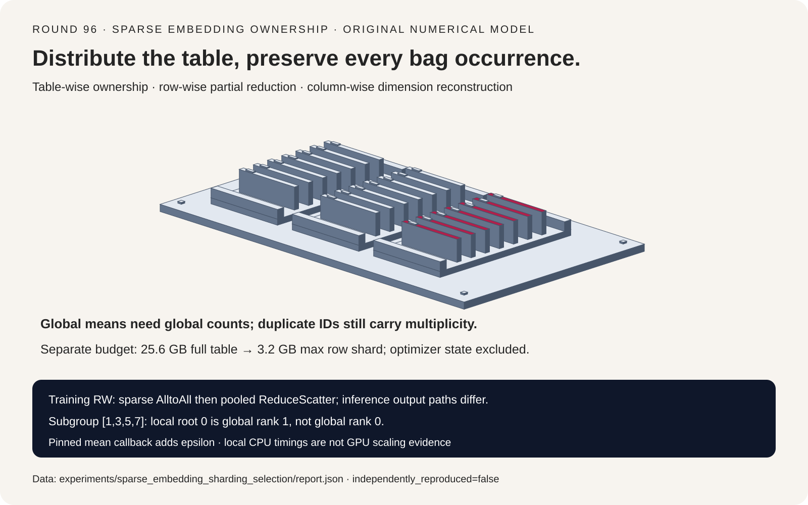
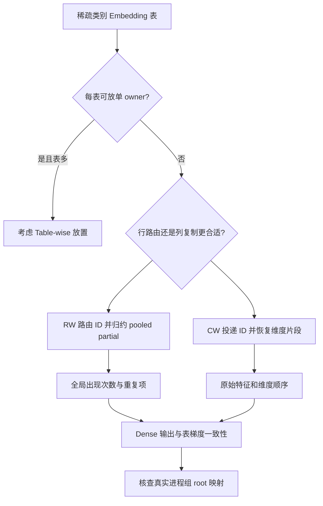
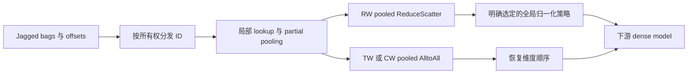
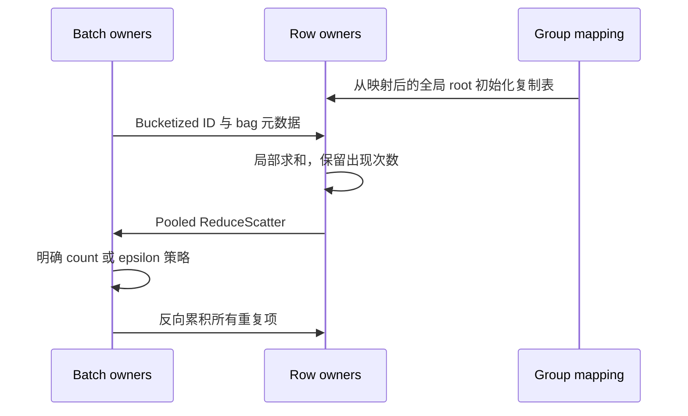

# 稀疏 Embedding 表分片选型 FAQ：Jagged Pooling、行列所有权与子组 Root

> **语言**：中文 | [English](sparse-embedding-table-row-column-sharding-selection-faq.en.md)
>
> **Round 96 · 2026-11-14（11 月 13 日夜班第 5 轮）** · [高清 SVG](../../assets/svg/sparse-embedding-table-row-column-sharding-selection-faq-summary.svg) · [七卡报告](../reports/sparse-embedding-table-row-column-sharding-selection-cards.html) · [H5 工作台](../reports/sparse-embedding-table-row-column-sharding-sizer.html) · [封存报告](../../experiments/sparse_embedding_sharding_selection/report.json) · [CPU 原始计时](../../experiments/sparse_embedding_sharding_selection/latency.json)
>
> **合成 pooling 输入；`independently_reproduced=false`。** 仅延迟小节是原创标量 Python 函数的**本地 CPU 实测**；没有执行 TorchRec/FBGEMM/GPU，也没有推荐模型质量或分布式吞吐结论。



## 1. 核心结论速览：可以分配表所有权，不能改变 Bag 语义

**推荐系统稀疏表不是文本 Embedding encoder：** 按类别 ID 查行，对变长 bag 聚合，将梯度回送到每次出现的行。所有权分片必须保持重复项、空 bag、维度顺序与归一化语义。

| 布局 | 持有内容 | 主要权衡 |
| :--- | :--- | :--- |
| Table-wise，TW | 整表放到指定 owner | 多表放置较直接；一张超大表仍要单 owner 容纳 |
| Row-wise，RW | 不同 rank 持不同 ID 行区间 | 路由 ID、合并 partial、使用完整 bag 计数 |
| Column-wise，CW | 不同 rank 持不同特征维度 | 相关 ID 复制给列 owner，输出按原始维度顺序复原 |

假定单表 `100,000,000 × 128`，每权重两字节，完整权重为 `25.6 GB`。八路均匀行分片或列分片的最大块为 `3.2 GB`。**只算权重，不等于训练峰值 HBM，更没有包含优化器状态。**

近期一手背景是具体源码而非虚构热度：[TorchRec 2026-11-11 修复](https://github.com/meta-pytorch/torchrec/commit/36276ee3d0c9d0e52a00cbf10129035f529314b2) 将 subgroup 局部零号映射为全局 rank 后，再初始化复制表。这对 embedding sharding 与二维进程组组合尤其重要。

选题检查时，既有组件指南未覆盖 TorchRec/EmbeddingBag。本轮也不同于[词表并行 CE](vocabulary-parallel-cross-entropy-global-logsumexp-selection-faq.md)：它聚合类别特征 bag，而不是为语言模型 logits 计算全词表 softmax。

## 2. 架构师 Q&A：换一种分片后，哪些量必须保持不变？

### Q1：Row-wise pooled 表是不是两次 All-to-All？

不能一概而论。固定训练实现里，`RwSparseFeaturesDist` 按 row owner bucketize ID，再 AlltoAll 重分发稀疏特征；`RwPooledEmbeddingDist` 对 pooled partial 使用 **ReduceScatter**。它既合并数值，也将相关 bag 输出送回批次拥有者。

TW 的输入和 pooled 输出使用 AlltoAll；CW 复用这些分发模块，但切的是维度，可能附加输出 permutation。推理路径有不同的 AlltoOne 行为，不能把训练通信描述套到所有模式。

原创模型验证的是数学路由与重建，没有执行真实 collective，也没有复刻完整 TorchRec plan。

### Q2：为什么把各分片的均值相加会错？

对 bag `b`，row shard `r` 有向量和 `s_br` 与出现次数 `n_br`：

```text
global_sum = SUM_r s_br
global_count = SUM_r n_br
ideal_mean = global_sum / global_count
```

直接相加 `s_br/n_br`，就让不同样本数的 shard 获得错误权重；空的局部片还要明确处理。原创 fixture 有八行、六维、六个 jagged bag，其中包含空 bag 与 `[0,0,1,7]`。局部均值相加的最大误差为 `8.3357142857`。

本 harness 的空 bag 返回零向量，不除零，也不与“模型质量未测”混为一谈。

**源码重要边界：** 固定 RW/TWRW mean callback 的全局分母是 bag length，或加权时的 weight sum，**再加 `1e-6`**。它不与理想非空计数均值 bitwise 相同。显式 epsilon-policy 对照在本 fixture 最大偏差 `1.403174e-6`，报告为数值策略差异，**不是声称上游有 bug**。不能悄悄去掉 epsilon 后宣布源码级精确复现。

### Q3：把重复 ID 去重，能免费省 lookup 吗？

只有保留 multiplicity 或等价累计权重才行。`[0,0,1,7]` 中 row zero 贡献两次；改成 `[0,1,7]` 会改变前向与表梯度。负对照故意去重但沿用原 count，最大输出误差为 `1.3047619048`。

上游向量梯度 `u_b` 对理想 unweighted mean：

```text
每出现一次 id：
dL/dE[id, :] += u_b / len(bag_b)
```

Weighted SUM 则每次乘对应 sample weight。本轮对 SUM、理想 MEAN、weighted SUM 的全部 48 个表坐标做独立有限差分。没有验证 weighted MEAN；也不把 `torch.nn.EmbeddingBag` 的限制直接套到 TorchRec 单独的 callback。

### Q4：为什么 CW 形状正确，向量仍会错？

列 shard 持有的是不同维度，不是可互换副本。接收端必须恢复特征与维度的原始顺序。反转列片段的负对照宽度完全正确，最大数值误差却为 `2.9333333333`。

下游 MLP、feature interaction 与 checkpoint 映射依赖维度身份。改 plan 时可能还要 reshard 权重与 optimizer slot，不能按“哪个先回来”随意拼接。

### Q5：为什么 subgroup 中 `src=0` 可能不合法？

固定初始化路径的 `dist.broadcast(..., src=..., group=pg)` 使用**全局** source rank。组成员 `[1,3,5,7]` 的局部零号是全局 **1**，全局零号甚至不在组中。

近期修复在存在进程组时使用 `dist.get_global_rank(pg,0)`；默认 world group 仍映射到零。原创模型只核查 rank-space 映射，没有启动进程组。并非所有分布式 API 都用相同参数语义；暴露 `group_src` 的接口要独立核查。

## 3. 可视化架构：选型树、路由与 Pooling 时序







## 4. 选型矩阵与字节预算边界

| 需求 | 优先评估 | 必须实测 |
| :--- | :--- | :--- |
| 多张单表不大的表 | TW 与负载感知放置 | 热表不均衡、owner 显存 |
| 单张表超出单卡容量 | RW | ID 倾斜、partial 归约、真实优化器状态 |
| 适合按维度拆分 | CW | ID 复制、维度对齐、输出复原 |
| 大量重复 ID | 保留 multiplicity 的 coalescing | 合并成本与反向权重 |
| 分层/二维 group | 显式局部/全局 rank 转换 | 成员、初始化与 collective 参数语义 |

默认工作台：4,096 个全局 bag、每 bag 20 个 ID、八字节 ID、两字节 pooled 输出。RW logical ID delivery 为 `655,360` 字节，投递到八个 CW owner 为 `5,242,880` 字节；RW 全 rank dense partial 物化量 `8,388,608` 字节，CW 输出列片合计 `1,048,576` 字节。

**这些不是网络实测 wire bytes。** Logical delivery 含本地投递，未计 offsets/lengths、sample weights、collective 路由、通信编码与拓扑。Partial 物化量也不能直接当 ReduceScatter 流量公式。权重均匀不代表访问均匀，未承诺任何热点情况下的吞吐。

## 5. 算例与七卡报告：数值证明与真实 CPU 样本分开

| 原创协议路径 | 相对理想均值最大误差 | 解释 |
| :--- | ---: | :--- |
| TW | `0` | 符合理想参考 |
| RW | `2.22e-16` | 在 `1e-12` 内 |
| CW | `0` | 符合理想参考 |
| 相加局部均值 | `8.3357142857` | 归一化错误 |
| 去重不保留 multiplicity | `1.3047619048` | 丢出现次数 |
| 逆序拼列片 | `2.9333333333` | 维度身份错误 |
| 全局分母加 epsilon | `1.403174e-6` | 明确的策略差异 |

逆转 bag 内出现顺序、改为两路行分片，都在容差内保持理想结果。表梯度中心差分 `epsilon=1e-5`。

与解析字节预算不同，下表来自[封存 CPU 原始样本](../../experiments/sparse_embedding_sharding_selection/latency.json)的**本地实测中位数**：

| Bag 数 | Direct Python toy，ms | Row-sharded 串行 Python toy，ms |
| ---: | ---: | ---: |
| `16` | `0.142` | `0.280` |
| `64` | `0.463` | `1.011` |
| `256` | `1.870` | `4.201` |
| `1,024` | `7.267` | `16.791` |

环境为 Windows ARM64、Python 3.12.10、Qualcomm ARMv8 处理器。使用 `perf_counter_ns`，每路径两次 warmup、七次 repeat、交替计时顺序。计时 fixture 独立于正确性 fixture：64 行、八维、四个逻辑 row shard，bag 长度 `i mod 9`，ID 为 `(i×7+j²) mod 64`。计时包含输入校验和串行 Python bookkeeping。

**没有并行 worker、TorchRec、FBGEMM 或 GPU**。串行分发多做的工作，不能证明真实分布式 GPU 分片更慢。GPU latency、推荐质量与 confidence 均保持 `null`，静态条形图只取封存中位数。

## 6. 复现步骤、一手源码与上线检查

```powershell
python -m experiments.sparse_embedding_sharding_selection.run
python -m experiments.sparse_embedding_sharding_selection.run --check
python -m unittest tests.test_sparse_embedding_sharding_selection
```

普通渲染与 `--check` 不重新计时。只有显式 `--measure` 才替换样本并重建报告，不能与 `--check` 同用。来源、输入、原始 repeat 和硬件口径均可追溯。

[自包含 H5](../reports/sparse-embedding-table-row-column-sharding-sizer.html) 可修改表规模、分片和标量字节，不把 CPU 样本外推成 GPU 延迟。静态七卡 CSP 是 `default-src 'none'; style-src 'unsafe-inline'`，无脚本和外部资源；仅计算器允许 inline JavaScript。浏览器权限拒绝后仍未进行视觉检查。

固定源码锚点：

- [EmbeddingBag collection 与 mean divisor](https://github.com/meta-pytorch/torchrec/blob/36276ee3d0c9d0e52a00cbf10129035f529314b2/torchrec/distributed/embeddingbag.py)：subgroup root 与 epsilon 策略。
- [RW sharding](https://github.com/meta-pytorch/torchrec/blob/36276ee3d0c9d0e52a00cbf10129035f529314b2/torchrec/distributed/sharding/rw_sharding.py)：bucketize、输入 AlltoAll、pooled ReduceScatter。
- [CW sharding](https://github.com/meta-pytorch/torchrec/blob/36276ee3d0c9d0e52a00cbf10129035f529314b2/torchrec/distributed/sharding/cw_sharding.py) 与 [TW sharding](https://github.com/meta-pytorch/torchrec/blob/36276ee3d0c9d0e52a00cbf10129035f529314b2/torchrec/distributed/sharding/tw_sharding.py)：复用 distributor 与输出 permutation。
- [上游 LICENSE](https://github.com/meta-pytorch/torchrec/blob/36276ee3d0c9d0e52a00cbf10129035f529314b2/LICENSE)：原作者权利保留，未复制实现。

上线前核查 ID 范围、空 bag、重复项/weights、特征和维度顺序、epsilon、优化器/resharding 状态、group rank 空间、真实 kernel 支持、热 ID 倾斜与完整显存/网络 trace。Toy pooling 正确不等于推荐模型质量成立。
