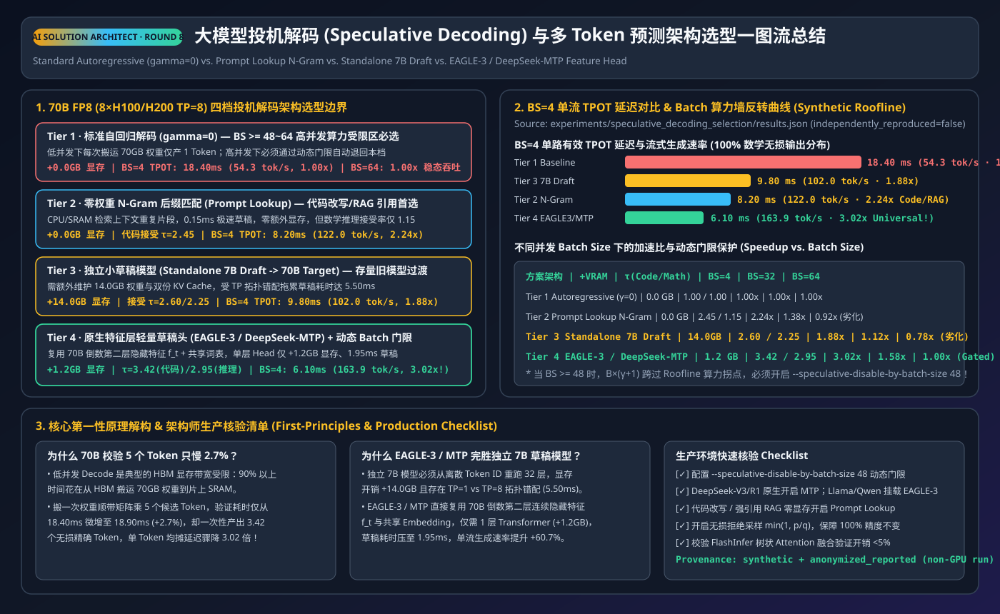
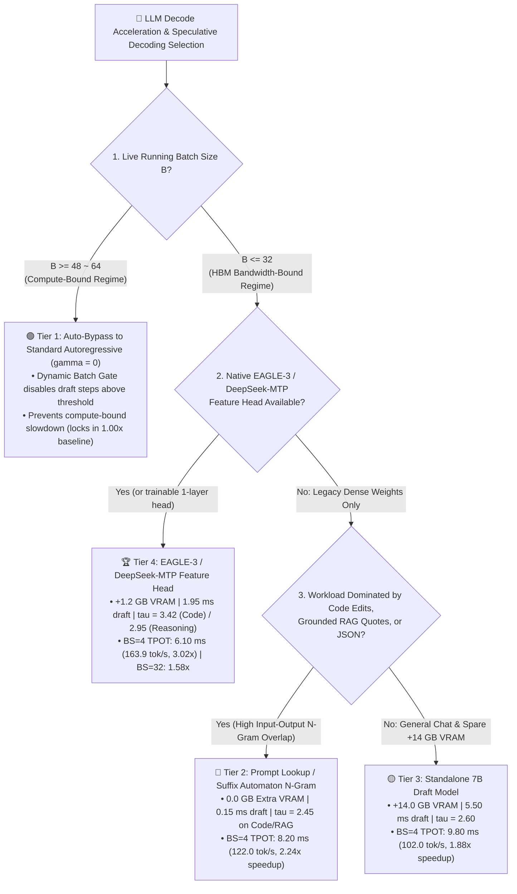
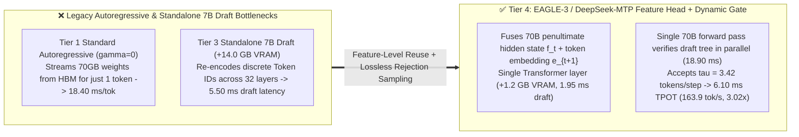

# LLM Speculative Decoding Architecture Selection FAQ: Autoregressive Baseline vs. Zero-Weight N-Gram (`Prompt Lookup`) vs. Standalone Draft Model (`7B Draft`) vs. Native Feature-Level Head (`EAGLE-3 / DeepSeek-MTP`)

> **Target Audience**: First-principles architecture selection and presales whiteboarding guide for AI Solution Architects, LLM Inference Engineers, and Enterprise CTOs.
> **Companion Artifacts**:
> - 🇨🇳 **中文版六段式选型指南**: [`docs/components/speculative-decoding-selection-faq.md`](speculative-decoding-selection-faq.md)
> - 🧮 **Interactive Speculative Decoding Speedup & Batch-Gate Sizer**: [`docs/reports/llm-inference-engine-pd-sizer.en.html#speculative-sizer`](../reports/llm-inference-engine-pd-sizer.en.html)
> - 🃏 **7-Card 4:5 Visual Benchmark Deck**: [`docs/reports/speculative-decoding-selection-cards.html`](../reports/speculative-decoding-selection-cards.html)
> - 🖼️ **Single-Image Visual Summary SVG**: [`assets/svg/speculative-decoding-selection-faq-summary.svg`](../../assets/svg/speculative-decoding-selection-faq-summary.svg)
> - 🧪 **Reproducible Deterministic Evaluator (`synthetic` + `anonymized_reported`, `independently_reproduced=false`)**: [`experiments/speculative_decoding_selection/run.py`](../../experiments/speculative_decoding_selection/run.py) · [`results.json`](../../experiments/speculative_decoding_selection/results.json)



---

## 📌 1. Executive Summary

When enterprise teams deploy 70B–671B LLMs for interactive coding agents, real-time voice assistants, or streaming RAG, they face a classic paradox: **GPU compute utilization (MFU) during Decode is below 10%, yet per-user streaming speed (TPOT) is stuck around 50 tok/s**. Choosing the right speculative decoding paradigm—and gating it by batch size—determines whether you unlock a **`3.02x` lossless speedup** or accidentally degrade high-concurrency throughput:

1. **Four-Tier Selection by Workload & Running Batch Size**:
   - **High-Concurrency Compute-Bound Batching (`Batch Size >= 48–64`, Choose Tier 1: Bypass Speculation -> Standard Autoregressive Baseline `gamma=0`)**: Above `BS=48`, GPU Tensor Cores approach saturation; verifying rejected draft tokens wastes compute and drops unthrottled 7B-draft and N-gram throughput to **`0.78x–0.92x`**. Production deployments must enable a **Dynamic Batch Gate (`--speculative-disable-by-batch-size 48`)** to automatically fall back to `gamma=0` (`1.00x`).
   - **Code Editing / Diffs, Grounded RAG Quotes, & JSON Schema Extraction with Zero Extra VRAM (Choose Tier 2: `Prompt Lookup / Suffix Automaton N-Gram`)**: Matches prompt/context n-grams in **`0.15 ms`** with **`0.0 GB` extra VRAM**, achieving **`2.45` mean accepted tokens/step** on Code/RAG and cutting `BS=4` TPOT from **`18.40 ms` down to `8.20 ms` (`122.0 tok/s`, `2.24x` speedup)**; however, acceptance drops to `1.15` on open-ended math reasoning.
   - **Legacy Checkpoints Without Custom Draft Heads (Evaluate Tier 3: `Standalone 7B Draft -> 70B Target`)**: Achieves `2.60 / 2.25` accepted tokens/step (`BS=4` TPOT **`9.80 ms`, `1.88x` speedup**), but incurs **`+14.0 GB` extra VRAM**, separate KV cache management, `TP=1` vs. `TP=8` topology mismatch, and **`5.50 ms`** sequential draft latency.
   - **Universal Production Default (Choose Tier 4: `EAGLE-3 / DeepSeek-MTP` 1-Layer Feature-Level Head + Dynamic Batch Gate)**: Attaches a single lightweight Transformer head (**only `+1.2 GB` VRAM, `-91.4%` vs. 7B Draft**) directly onto the target model's penultimate hidden states ($f_t$) and shared token embeddings. Drafts in **`1.95 ms`**, achieves **`3.42` accepted tokens/step on Code/RAG** and **`2.95` on Reasoning**, slashes `BS=4` TPOT to **`6.10 ms` (`163.9 tok/s`, `3.02x` speedup)**, retains a **`1.58x`** net gain at `BS=32`, and cleanly gates off at `BS >= 48` (`1.00x`).
2. **100% Mathematically Lossless Output Distribution**:
   - Speculative decoding is **not** lossy quantization: every draft token is verified in parallel by the exact 70B target model via **Lossless Rejection Sampling** ($\min(1, p(x)/q(x))$ with residual resampling from $\text{norm}(\max(0, p-q))$), guaranteeing an output distribution **100.0% identical** to standard autoregressive decoding.
3. **Provenance & Verification Disclosure**:
   - All acceptance lengths ($\tau$), latencies, and batch-scaling speedups are bound 1-to-1 to sealed evaluator [`experiments/speculative_decoding_selection/results.json`](../../experiments/speculative_decoding_selection/results.json), classified as **`synthetic` (deterministic Roofline & acceptance model) + `anonymized_reported` (published EAGLE-3 / DeepSeek-MTP / vLLM specifications)** with `independently_reproduced = false`, `physical_gpu_cluster_measurement = "not_measured"`, and `local_cpu_harness_measurement = "measured"` (`PASS`).

---

## 🎯 2. Architect & Customer First-Principles Q&A

### Q1: Why does verifying 5 tokens in parallel with a 70B model (`18.90 ms`) take almost the exact same time as generating 1 token (`18.40 ms`)?

**First-Principles Breakdown: Low-batch LLM Decode is HBM Memory-Bandwidth Bound—streaming 70 GB of weights from HBM into SRAM once costs the same whether Tensor Cores multiply 1 token or 5 tokens!**

1. **Arithmetic Intensity Below the Roofline Ridge Point**:
   - On `8 × H100/H200` (`TP=8`) serving a 70B FP8 model at `BS=4`, generating 1 token processes only `4` tokens per weight read ($\sim 4\text{ FLOP/Byte} \ll 205.5\text{ FLOP/Byte}$ ridge point). Over `90%` of the **`18.40 ms`** step time is spent waiting on HBM weight reads while Tensor Cores sit idle.
2. **Single Weight Read, Parallel Tree/Chain Verification**:
   - Feeding `1` current token + `4` draft tokens (`20` total tokens across `BS=4`) requires **the exact same single HBM weight read**, increasing target verification time by only **`+2.7%` (`18.40 -> 18.90 ms`)** while yielding an average of **`3.42` verified tokens** per step:
     $$\text{Effective TPOT} = \frac{T_{\text{draft}} + T_{\text{verify}}}{\tau} = \frac{1.95\text{ ms} + 18.90\text{ ms}}{3.42} \approx \mathbf{6.10\text{ ms}}\quad (\mathbf{3.02\times\text{ speedup}})$$

---

### Q2: Why does `EAGLE-3 / DeepSeek-MTP` (Feature-Level Head) outperform a `Standalone 7B Draft Model` by +60.7% in single-stream speed while saving 91.4% VRAM?

**First-Principles Breakdown: Reusing penultimate target hidden states ($f_t$) eliminates redundant 32-layer re-encoding, TP topology mismatch, and token-level information loss!**

1. **Three Structural Bottlenecks of a Standalone 7B Draft Model (Tier 3)**:
   - Consumes **`+14.0 GB` VRAM** plus separate draft KV cache.
   - Suffers from **TP Mismatch** (`TP=8` adds AllReduce latency on small 7B layers; `TP=1` leaves 7 GPUs idle), resulting in **`5.50 ms`** draft latency for $\gamma=5$ steps.
   - Predicts from discrete Token IDs alone (`2.60` accepted tokens on Code/RAG, `2.25` on Reasoning).
2. **How EAGLE-3 / DeepSeek-MTP Solves All Three (Tier 4)**:
   - Feeds the 70B model's penultimate feature vector $f_t$ concatenated with token embedding $e_{t+1}$ into a **1-layer Transformer head** (`+1.2 GB` VRAM, **`1.95 ms`** draft time), raising acceptance to **`3.42` tokens/step (Code/RAG)** and **`2.95` (Reasoning)** for **`163.9 tok/s` (`+60.7%` faster than standalone 7B)**.

---

### Q3: Why does speculative decoding hurt throughput at `Batch Size >= 64`, and how does Dynamic Batch Gating prevent it?

**First-Principles Breakdown: Once $B \times (\gamma + 1)$ crosses the GPU Roofline ridge point, verification becomes Compute-Bound and every rejected draft token burns saturated Tensor Core FLOPs!**

- At `BS=4`, `EAGLE-3 / MTP` delivers **`3.02x`** speedup; at `BS=32`, it still delivers **`1.58x`**.
- At `BS=64`, verifying `5x` tokens pushes total tokens/step to `320` (deeply Compute-Bound), causing unthrottled 7B draft and N-gram throughput to drop to **`0.78x` and `0.92x`**.
- Configuring `--speculative-disable-by-batch-size 48` automatically bypasses the draft head whenever `running_batch_size >= 48`, locking in **`1.00x`** baseline throughput at peak load.

---

## 🧭 3. Visual Architecture Diagrams (Decision Tree, Feature-Head Topology & Verification Sequence)

### 3.1 Speculative Decoding Architecture Selection Decision Tree (`flowchart TD`)



### 3.2 Standalone 7B Draft vs. `EAGLE-3 / MTP` Feature-Level Prediction (`flowchart LR`)



### 3.3 `EAGLE-3 / MTP` Draft & Parallel Lossless Rejection Sampling Sequence (`sequenceDiagram`)

```mermaid
sequenceDiagram
    autonumber
    participant Sched as vLLM / SGLang Scheduler<br/>(Dynamic Batch Gate: B < 48)
    participant Head as EAGLE-3 / MTP 1-Layer Head<br/>(+1.2 GB VRAM, Shared Embedding)
    participant Target as 70B FP8 Target Model (TP=8)<br/>(Single HBM Weight Stream)
    participant Sampler as Lossless Rejection Sampler<br/>(100% Exact Distribution)

    Note over Sched,Head: Phase 1: Fast Feature-Level Draft Generation (1.95 ms total)
    Sched->>Head: Pass penultimate hidden state f_t & accepted token x_t
    Head-->>Sched: Emit draft candidates [d_1, d_2, d_3, d_4] & draft probs q(d_i)

    Note over Sched,Target: Phase 2: Single 70B Target Forward Pass Verifies All Candidates in Parallel (18.90 ms)
    Sched->>Target: Forward Verify([x_t, d_1, d_2, d_3, d_4]) in 1 weight read
    Target-->>Sampler: Emit exact target distributions [p_1..p_5] & updated hidden states

    Note over Sampler,Sched: Phase 3: Lossless Rejection Sampling min(1, p/q) + Residual Bonus Token
    Sampler->>Sampler: Accept d_1, d_2; reject d_3 & resample x_{t+3} from norm(max(0, p_3 - q_3))
    Sampler-->>Sched: Commit 3~4 exact tokens in 1 step (mean tau=3.42 -> 6.10 ms TPOT, 3.02x!)
```

---

## 📊 4. Architect Decision Matrix

> Bound 1-to-1 to sealed evaluator [`experiments/speculative_decoding_selection/results.json`](../../experiments/speculative_decoding_selection/results.json) (Baseline: `70B FP8 Target LLM` on `8 × H100/H200 TP=8`).

| Dimension | Tier 1: Autoregressive Baseline (`gamma=0`) | Tier 2: `Prompt Lookup N-Gram` (Zero-Weight) | Tier 3: `Standalone 7B Draft -> 70B` | Tier 4: `EAGLE-3 / DeepSeek-MTP` Feature Head |
| :--- | :--- | :--- | :--- | :--- |
| **Best Target Workload** | **`BS >= 48–64` high-concurrency batching** | **Code edits/diffs, grounded RAG, JSON** | Legacy dense models without feature heads | **Universal production default (Code, Reasoning, Voice)** |
| **Extra VRAM Overhead** | **`0.0 GB`** | **`0.0 GB`** (CPU/SRAM suffix match) | `14.0 GB` (7B weights + separate KV cache) | **`1.2 GB`** (1-layer head, shared embedding) |
| **Draft / Verify Latency (`BS=4`)** | `0.00 ms` / `18.40 ms` | **`0.15 ms`** / `20.10 ms` | `5.50 ms` / `20.00 ms` | **`1.95 ms`** / `18.90 ms` |
| **Mean Accepted Tokens $\tau$ (Code / Reasoning)** | `1.00` / `1.00` tok/step | **`2.45`** / `1.15` tok/step | `2.60` / `2.25` tok/step | **`3.42` / `2.95` tok/step** |
| **Effective TPOT (`BS=4`)** | `18.40 ms` (`54.3 tok/s`) | **`8.20 ms` (`122.0 tok/s`)** | `9.80 ms` (`102.0 tok/s`) | **`6.10 ms` (`163.9 tok/s`)** |
| **Speedup (`BS=4` / `BS=32` / `BS=64`)** | `1.00x` / `1.00x` / **`1.00x`** | **`2.24x`** / `1.38x` / `0.92x` | `1.88x` / `1.12x` / `0.78x` | **`3.02x` / `1.58x` / `1.00x` (Gated)** |
| **Output Distribution Fidelity** | `100.0% Exact` | **`100.0% Exact` (Lossless)** | **`100.0% Exact` (Lossless)** | **`100.0% Exact` (Lossless)** |

---

## 🧪 5. Quantitative Evaluation & 7-Card Benchmark Insights

Verified via `python experiments/speculative_decoding_selection/run.py --check`:

| Scenario ID (`scenario.id`) | Extra VRAM | Draft Step | Verify (`BS=4`) | $\tau$ (Code/RAG) | $\tau$ (Reasoning) | Effective TPOT (`BS=4`) | Stream tok/s (`BS=4`) | Speedup (`BS=4 / 32 / 64`) | Action (Confidence) |
| :--- | :---: | :---: | :---: | :---: | :---: | :---: | :---: | :---: | :---: |
| `standard_autoregressive_baseline` | `0.0 GB` | `0.00 ms` | `18.40 ms` | `1.00` | `1.00` | `18.40 ms` | `54.3 tok/s` | `1.00x / 1.00x / 1.00x` | `Confirm (0.86)` |
| `prompt_lookup_ngram_speculation` | **`0.0 GB`** | **`0.15 ms`** | `20.10 ms` | **`2.45`** | `1.15` | **`8.20 ms`** | **`122.0 tok/s`** | **`2.24x` / `1.38x` / `0.92x`** | `Act automatically (0.90)` |
| `standalone_7b_draft_model` | `14.0 GB` | `5.50 ms` | `20.00 ms` | `2.60` | `2.25` | `9.80 ms` | `102.0 tok/s` | `1.88x / 1.12x / 0.78x` | `Confirm (0.78)` |
| `eagle3_mtp_feature_head` | **`1.2 GB`** | **`1.95 ms`** | `18.90 ms` | **`3.42`** | **`2.95`** | **`6.10 ms`** | **`163.9 tok/s`** | **`3.02x / 1.58x / 1.00x`** | `Act automatically (0.96)` |

---

## 🛠️ 6. Production Verification & Presales Checklist

- [ ] **1. Configure Dynamic Batch-Size Gating**: Set `--speculative-disable-by-batch-size 48` so high-concurrency spikes automatically bypass drafting and never drop below `1.00x` throughput.
- [ ] **2. Default to Native `MTP` or `EAGLE-3` Feature Heads**: Enable built-in `MTP` heads on DeepSeek-V3/R1 or attach `1.2 GB` `EAGLE-3` feature heads on Llama/Qwen rather than provisioning `14.0 GB` standalone 7B draft models.
- [ ] **3. Enable Zero-VRAM `Prompt Lookup` on Code & RAG Services**: For fine-tuned checkpoints without EAGLE/MTP heads serving IDE code edits or grounded RAG quotes, enable `--speculative-model [ngram]` for a free `2.24x` speedup at `0.0 GB` VRAM cost.
- [ ] **4. Verify FlashInfer Fused Tree/Chain Verification Kernels**: Confirm target verification overhead at `BS=4` stays within `< 5%` (`18.40 -> 18.90 ms`).
- [ ] **5. Run Deterministic Regression Checks**: Execute `python experiments/speculative_decoding_selection/run.py --check` and `python -m unittest tests/test_speculative_decoding_selection.py` before publishing updates.
