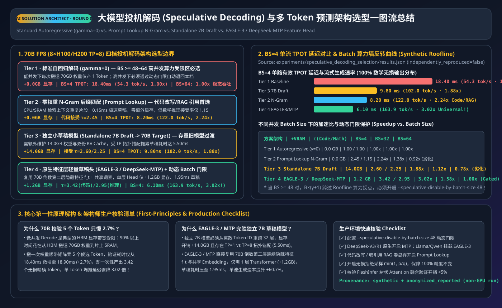
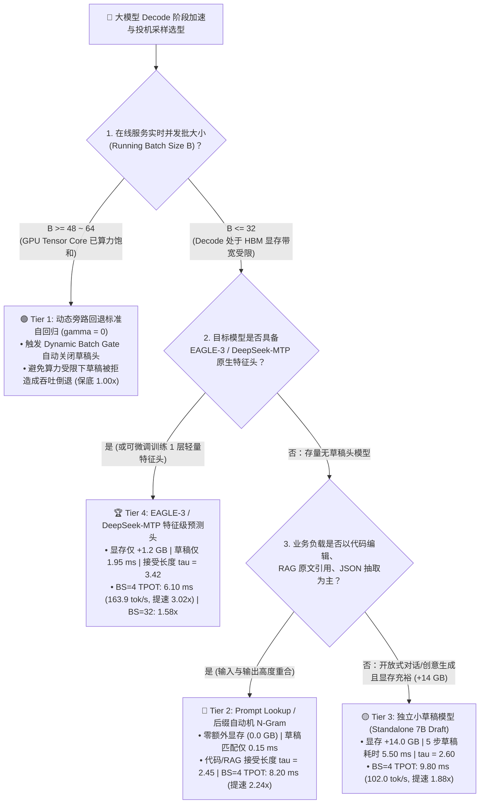
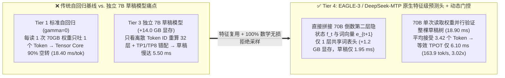
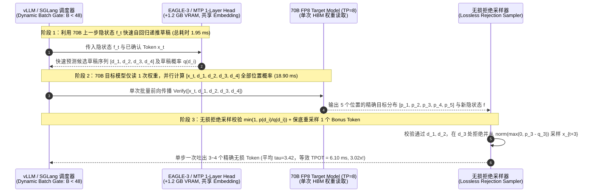

# 大模型投机采样（Speculative Decoding）加速架构选型 FAQ：自回归基线 vs. N-Gram 无模型匹配 (`Prompt Lookup`) vs. 独立小草稿模型 (`7B Draft`) vs. 原生特征级预测头 (`EAGLE-3 / DeepSeek-MTP`)

> **文档定位**：面向 AI Solution Architect（AI 解决方案架构师）、推理引擎研发与企业技术决策者的**第一性原理选型指南**。
> **核心关联产出**：
> - 🌐 **English Companion Guide**: [`docs/components/speculative-decoding-selection-faq.en.md`](speculative-decoding-selection-faq.en.md)
> - 🧮 **交互式投机采样加速比与批大小门控计算器**: [`docs/reports/llm-inference-engine-pd-sizer.html#speculative-sizer`](../reports/llm-inference-engine-pd-sizer.html)
> - 🃏 **7-Card 4:5 视觉评测报告**: [`docs/reports/speculative-decoding-selection-cards.html`](../reports/speculative-decoding-selection-cards.html)
> - 🖼️ **一图流架构选型总结 SVG**: [`assets/svg/speculative-decoding-selection-faq-summary.svg`](../../assets/svg/speculative-decoding-selection-faq-summary.svg)
> - 🧪 **可复现确定性评估算例 (`synthetic` + `anonymized_reported`, `independently_reproduced=false`)**: [`experiments/speculative_decoding_selection/run.py`](../../experiments/speculative_decoding_selection/run.py) · [`results.json`](../../experiments/speculative_decoding_selection/results.json)

---

## 📌 一、核心结论速览（Executive Summary）

当企业客户部署 70B～671B 大模型用于实时交互式 Coding Agent、低延迟语音对话或流式 RAG 问答时，常常困惑：“**为什么集群 GPU 算力利用率（MFU）只有不到 10%，但单路流式输出速度（TPOT）却卡在 50 tok/s 上不去？投机采样到底该选 N-Gram、独立 7B 小模型，还是 EAGLE-3 / MTP？高并发下开启投机采样为什么反而变慢？**”

1. **按业务场景与并发批大小（Batch Size）进行四档精准选型**：
   - **高并发满载批处理（`Batch Size >= 48 ~ 64`，选 Tier 1：关闭投机采样，走标准自回归基线 `gamma=0`）**：当并发达到 `BS >= 64` 时，GPU Tensor Core 已接近算力瓶颈（Compute-Bound）；此时强行验证额外草稿 Token 会把单步耗时撑大，导致无门控的 7B 草稿与 N-Gram 吞吐倒退至 **`0.78x ~ 0.92x`**。生产环境必须配置 **动态批大小门控（Dynamic Batch Gate，`--speculative-disable-by-batch-size 48`）**！
   - **代码编辑/改写、RAG 原文引用、固定 JSON Schema 提取（且不想增加任何额外显存，选 Tier 2：`Prompt Lookup / Suffix Automaton N-Gram` 无模型匹配）**：直接用后缀自动机在输入 Prompt 与已生成上文中毫秒级（**`0.15 ms`**）匹配连续词组作为草稿，**零额外显存占用（`0.0 GB`）**！在代码改写与 RAG 场景下平均每步接受 **`2.45` 个 Token**，将 `BS=4` 的 TPOT 从 **`18.40 ms` 压降至 `8.20 ms`（单流速度从 `54.3` 跃升至 `122.0 tok/s`，提速 `2.24x`）**；但在开放式数学推理中接受长度跌至 `1.15`，不适合纯创意/数学场景。
   - **存量闭源/无定制头权重、跨通用领域（谨慎评估 Tier 3：独立草稿模型 `Standalone 7B Draft -> 70B Target`）**：虽然在代码/推理上可获得 `2.60 / 2.25` 的接受长度（`BS=4` TPOT **`9.80 ms`，提速 `1.88x`**），但需额外付出 **`+14.0 GB` 显存**、独立的 KV Cache 管理、大小模型张量并行度错配（`TP=1` vs `TP=8`）以及 **`5.50 ms`** 的串行草稿生成开销，已逐步被特征级预测头取代。
   - **全场景生产首选（选 Tier 4：`EAGLE-3 / DeepSeek-MTP` 原生 1 层特征级预测头 + 动态批大小门控）**：直接在目标大模型倒数第二层隐状态（Feature）与词嵌入上挂载仅 **1 层轻量级 Transformer 头（显存仅 `+1.2 GB`，较独立 7B 节省 `91.4%`）**，草稿耗时仅 **`1.95 ms`**，在代码/RAG 与推理场景平均每步分别接受 **`3.42` 与 `2.95` 个 Token**，将 `BS=4` TPOT 压降至 **`6.10 ms`（单流高达 `163.9 tok/s`，提速 `3.02x`）**，在 `BS=32` 中等并发下仍保持 **`1.58x`** 净增益，并在 `BS >= 48` 时自动旁路回退至 `1.00x` 基线！
2. **第一性原理定心丸：投机采样是 100% 数学无损的（Lossless Rejection Sampling），绝不是有损量化！**
   - 许多客户担心“小模型猜的词会不会拉低 70B 大模型的智商？”——答案是**绝对不会（`100.0%` 输出分布数学等价）**。因为草稿 Token 只是“候选提案”，70B 目标模型会在一次前向传播中并行算出所有候选位置的真实概率分布 $p(x)$，并通过严格拒绝采样（以 $\min(1, p(x)/q(x))$ 概率接受，并在首个拒绝处从修正分布 $\text{norm}(\max(0, p - q))$ 中重采样 1 个保底 Token），证明与逐字自回归采样生成的分布**逐比特同分布**！
3. **证据口径声明（Provenance Disclosure）**：
   - 本文所有接受长度（$\tau$）、TPOT 延迟、单流吞吐与不同 Batch Size 下的加速比均严格绑定封存算例 [`experiments/speculative_decoding_selection/results.json`](../../experiments/speculative_decoding_selection/results.json)，分类为 **`synthetic`（确定性 Roofline 与接受率分析模型）+ `anonymized_reported`（公开 EAGLE-3 / DeepSeek-MTP / vLLM 基准参数锚定）**，`independently_reproduced = false`，物理 8 卡 H100/H200 实机测量状态为 **`not_measured`**，本地 CPU 确定性评估器与单测状态为 **`measured`（PASS）**。

---

## 🎯 二、客户与架构师灵魂拷问 Q&A（First-Principles FAQ）

### Q1：为什么大模型一次验证 5 个草稿 Token 的耗时（`18.90 ms`），和原本只生成 1 个 Token 的耗时（`18.40 ms`）几乎一模一样？“白嫖”算力的物理本质是什么？

**第一性原理拆解：Decode 阶段卡在把 70 GB 权重从 HBM 搬进 SRAM 的“显存带宽墙”，而搬一次权重算 1 个 Token 还是算 5 个 Token，显存读取量几乎不变！**

1. **Roofline 模型下的算术强度（Arithmetic Intensity）真相**：
   - 在 `8 × H100/H200`（`TP=8`）上运行 70B FP8 模型（约 `70 GB` 权重，每卡分摊 `8.75 GB`），当并发较小（如 `BS=4`）且每步只生成 `1` 个 Token 时，总共只有 `4` 个有效 Token 参与矩阵乘（GEMV/小矩阵 GEMM）。
   - 此时算术强度仅为 $\sim 4\text{ FLOP/Byte}$，远低于 GPU 的 Roofline 拐点（`205.5 FLOP/Byte`）！也就是说，**`18.40 ms` 的单步时间里，95% 的时间都在等待 HBM 显存把 70B 权重读进芯片，而强大的 Tensor Core 有超过 90% 的周期在空转等数据**！
2. **一次权重搬运，并行验证整棵草稿树（Tree / Chain Verification）**：
   - 如果我们先用极轻量的草稿头（耗时仅 `1.95 ms`）猜出后续 $\gamma = 4$ 个候选 Token，拼成总长度为 `5` 的验证序列（`1` 个当前词 + `4` 个草稿词）送入 70B 目标模型：
   - 70B 目标模型**仍然只需要从 HBM 读取 1 次权重**！而 Tensor Core 顺手把 `4 × 5 = 20` 个 Token 的矩阵乘一起算完，验证前向耗时仅从 `18.40 ms` 微增至 **`18.90 ms`（仅增加 `+2.7%`）**，却一次性吐出了平均 **`3.42` 个合格 Token**！等效每 Token 延迟（TPOT）直接从 `18.40 ms` 暴降至 $(1.95 + 18.90) / 3.42 \approx \mathbf{6.10\text{ ms}}$（**提速 `3.02x`**）！

---

### Q2：为什么 `EAGLE-3 / DeepSeek-MTP`（原生特征级预测头）能全面击败传统的“独立 7B 小模型（Standalone Draft Model）”？

**第一性原理拆解：消除了“重复编码表征”、“跨模型显存/TP 错配”与“特征信息瓶颈”三大系统内耗！**

1. **独立 7B 草稿模型的三大工程痛点（Tier 3）**：
   - **显存与 KV Cache 双重税**：7B BF16 草稿模型本身要吃掉 **`+14.0 GB` 显存**，而且长上下文下还要为草稿模型单独维护一份 KV Cache。
   - **并行拓扑错配（TP Mismatch）**：70B 目标模型跑在 `TP=8` 上，而 7B 草稿模型在 `TP=8` 下会因小张量 AllReduce 延迟过大而变慢，若跑在单卡 `TP=1` 上又会导致其余 7 张卡空等（5 步草稿耗时高达 **`5.50 ms`**）。
   - **只看 Token ID 丢掉了高维推理意图**：独立小模型只能根据已采样的离散 Token ID 重新从第 1 层算起，猜词准确率受限（代码/推理接受长度分别为 `2.60 / 2.25`）。
2. **EAGLE-3 / DeepSeek-MTP 的核心突破（Tier 4）**：
   - **复用目标模型倒数第二层高维隐状态（Feature-Level Autoregression）**：70B 模型前向传播算出的最后一层隐状态 $f_t$ 已经浓缩了极其丰富的上下文语义。EAGLE-3 / MTP 直接把 $f_t$ 与最新采样的词向量 $e_{t+1}$ 拼接，送入**仅 1 层共享词表的轻量级 Transformer 解码头**！
   - **极致轻量与高命中率**：显存仅需 **`+1.2 GB`（节省 `91.4%`）**，天然复用主模型的 `TP=8` 切分，草稿阶段耗时压至 **`1.95 ms`**，同时因为站在 70B 巨人的特征肩膀上预测，代码/RAG 平均接受长度飙升至 **`3.42` Token/步**，数学推理亦高达 **`2.95` Token/步**，单流吞吐达 **`163.9 tok/s`（比独立 7B 快 `+60.7%`）**！

---

### Q3：为什么在并发很高（例如 `Batch Size >= 64`）时开启投机采样反而会导致全站吞吐下降？架构师该如何设计自动保护阀？

**第一性原理拆解：当总并发 Token 数（$B \times (\gamma + 1)$）跨过 Roofline 算力拐点后，“免费算力午餐”消失，被拒绝的草稿 Token 全部变成纯粹的算力浪费！**

1. **从“显存带宽受限”到“算力受限”的相变**：
   - 假设 GPU 的算力拐点对应每次前向并行处理 `~160` 个 Token。
   - 当 `Batch Size = 4` 时，附带 `4` 个草稿词总计才 $4 \times 5 = 20$ 个 Token，远低于 `160`，验证几乎不增加耗时（**`3.02x` 提速**）。
   - 当 `Batch Size = 32` 时，总验证 Token 数达到 $32 \times 5 = 160$，验证耗时开始上升，但 `EAGLE-3 / MTP` 凭借高达 `3.42` 的接受率仍能取得 **`1.58x` 净提速**。
   - 当 `Batch Size = 64` 时，总验证 Token 数飙升至 $64 \times 5 = 320$，Tensor Core 完全陷入 **Compute-Bound（算力打满）**——此时验证耗时几乎随 Token 数线性翻倍！如果其中有 40% 的草稿词被拒绝，这部分 Tensor Core 算力就白白浪费了，导致无门控的 7B 草稿和 N-Gram 吞吐分别跌至基线的 **`0.78x` 与 `0.92x`**！
2. **生产必配：动态批大小门控（Dynamic Batch-Size Gating）**：
   - 在 vLLM / SGLang / TensorRT-LLM 调度器中设置动态阈值（如 `speculative_disable_by_batch_size = 48`）：当实时运行队列 `running_batch_size < 48` 时全速开启 EAGLE-3 / MTP 享受 `1.58x ~ 3.02x` 极速流式响应；一旦突发流量涌入使 `running_batch_size >= 48`，调度器在**当前迭代步自动跳过草稿头（回退 $\gamma=0$）**，保证高负载峰值吞吐恒定 $\ge \mathbf{1.00x}$ 绝不劣化！

---

## 🧭 三、直观可视化图解（Mermaid 选型决策树 + 架构对比图 + 验证重采样时序图）

### 3.1 大模型投机采样（Speculative Decoding）架构选型决策树（`flowchart TD`）

### 3.2 传统自回归 & 独立 7B 草稿 vs. `EAGLE-3 / MTP` 特征级预测对比图（`flowchart LR`）

### 3.3 `EAGLE-3 / MTP` 特征草稿生成与单次前向无损拒绝采样时序图（`sequenceDiagram`）

---

## 📊 四、架构师选型决策矩阵（Architect Decision Matrix）

> 数据严格锚定本仓库确定性算例 [`experiments/speculative_decoding_selection/results.json`](../../experiments/speculative_decoding_selection/results.json)（基准：`70B FP8 Target LLM`，`8 × H100/H200 TP=8`）。

| 选型维度 | Tier 1: 标准自回归基线 (`gamma=0`) | Tier 2: `Prompt Lookup N-Gram` (无模型匹配) | Tier 3: 独立小草稿模型 (`7B Draft -> 70B`) | Tier 4: `EAGLE-3 / DeepSeek-MTP` 原生特征头 |
| :--- | :--- | :--- | :--- | :--- |
| **最佳适用业务场景** | **`BS >= 48~64` 高并发满载批处理服务** | **代码改写/补全、RAG 引用、JSON 抽取** | 存量无定制头模型的一般低并发对话 | **全场景生产首选（Coding Agent、推理、实时语音）** |
| **额外显存开销 (Extra VRAM)** | **`0.0 GB`** | **`0.0 GB`**（纯后缀自动机内存匹配） | `14.0 GB`（需常驻独立 7B 权重与 KV） | **`1.2 GB`**（仅 1 层头，共享主模型词表） |
| **草稿生成耗时 / 目标验证耗时 (`BS=4`)** | `0.00 ms` / `18.40 ms` | **`0.15 ms`** / `20.10 ms` | `5.50 ms` / `20.00 ms` | **`1.95 ms`** / `18.90 ms` |
| **平均接受长度 $\tau$（代码&RAG / 推理）** | `1.00` / `1.00` tok/step | **`2.45`** / `1.15` tok/step | `2.60` / `2.25` tok/step | **`3.42` / `2.95` tok/step** |
| **等效单 Token 延迟 TPOT (`BS=4`)** | `18.40 ms` (`54.3 tok/s`) | **`8.20 ms` (`122.0 tok/s`)** | `9.80 ms` (`102.0 tok/s`) | **`6.10 ms` (`163.9 tok/s`)** |
| **不同并发加速比 (`BS=4` / `BS=32` / `BS=64`)** | `1.00x` / `1.00x` / **`1.00x`** | **`2.24x`** / `1.38x` / `0.92x` (无门控劣化) | `1.88x` / `1.12x` / `0.78x` (无门控劣化) | **`3.02x` / `1.58x` / `1.00x` (动态门控保底)** |
| **输出分布数学保真度** | `100.0% Exact` | **`100.0% Exact`（拒绝采样无损）** | **`100.0% Exact`（拒绝采样无损）** | **`100.0% Exact`（拒绝采样无损）** |

---

## 🧪 五、简明定量算例与 7-Card Benchmark 洞察

通过运行本仓库可复现评估脚本 `python experiments/speculative_decoding_selection/run.py --check`，我们提取出以下核心定量洞察：

### 5.1 四档投机采样方案定量对比总表（`synthetic` + `anonymized_reported`, `independently_reproduced=false`）

| 方案 ID (`scenario.id`) | 额外显存 | 草稿耗时 | 验证耗时 (`BS=4`) | $\tau$ (代码/RAG) | $\tau$ (数学推理) | 等效 TPOT (`BS=4`) | 单流吞吐 (`BS=4`) | 加速比 (`BS=4 / 32 / 64`) | 门控动作 (Confidence) |
| :--- | :---: | :---: | :---: | :---: | :---: | :---: | :---: | :---: | :---: |
| `standard_autoregressive_baseline` | `0.0 GB` | `0.00 ms` | `18.40 ms` | `1.00` | `1.00` | `18.40 ms` | `54.3 tok/s` | `1.00x / 1.00x / 1.00x` | `Confirm (0.86)` |
| `prompt_lookup_ngram_speculation` | **`0.0 GB`** | **`0.15 ms`** | `20.10 ms` | **`2.45`** | `1.15` | **`8.20 ms`** | **`122.0 tok/s`** | **`2.24x` / `1.38x` / `0.92x`** | `Act automatically (0.90)` |
| `standalone_7b_draft_model` | `14.0 GB` | `5.50 ms` | `20.00 ms` | `2.60` | `2.25` | `9.80 ms` | `102.0 tok/s` | `1.88x / 1.12x / 0.78x` | `Confirm (0.78)` |
| `eagle3_mtp_feature_head` | **`1.2 GB`** | **`1.95 ms`** | `18.90 ms` | **`3.42`** | **`2.95`** | **`6.10 ms`** | **`163.9 tok/s`** | **`3.02x / 1.58x / 1.00x`** | `Act automatically (0.96)` |

### 5.2 三大扰动与边界实验（Robustness & Perturbation Checks）

1. **高并发算力墙相变测试（Batch Size 从 `BS=4` 扩展至 `BS=64`）**：
   - 在 `BS=4` 显存带宽受限区，`EAGLE-3 / MTP` 实现 **`3.02x`** 提速（TPOT `6.10 ms`）；当并发升至 `BS >= 64` 算力受限区，未配置动态门控的独立 7B 草稿与 N-Gram 吞吐分别倒退至 **`0.78x` 与 `0.92x`**；而启用 **Dynamic Batch Gate（`BS >= 48` 自动旁路）** 后，高负载下稳健保持 **`1.00x`** 零回退。
2. **业务负载漂移测试（代码编辑/RAG 引用 vs. 开放式数学推理）**：
   - `Prompt Lookup N-Gram` 在代码重构与 RAG 抽取上表现优异（$\tau = 2.45$，`2.24x` 提速），但切换到开放式数学推理（GSM8K/MATH）时因上文复现率低，$\tau$ 暴跌至 **`1.15`**（仅 `1.04x`）；而 `EAGLE-3 / MTP` 在数学推理上仍保持 **`\tau = 2.95`（`2.62x` 提速）**。
3. **显存与 TP 拓扑开销测试（独立 7B 草稿 vs. EAGLE-3 / MTP 1 层头）**：
   - 切换为 `EAGLE-3 / MTP` 可直接省下 **`-12.8 GB` 显存（从 `14.0 GB` 降至 `1.2 GB`，`-91.4%`）**，消除 `TP=1` 与 `TP=8` 拓扑错配，并将单流生成速度再提升 **`+60.7%`（从 `102.0` 升至 `163.9 tok/s`）**。

---

## 🛠️ 六、附录：生产环境快速核验与售前打单清单（Architect Checklist）

- [ ] **1. 强制配置动态批大小门控（Dynamic Batch-Size Gate）**：在 vLLM / SGLang 中显式设置 `--speculative-disable-by-batch-size 48`（或根据 Roofline 拐点设为 `32 ~ 64`），防止高峰期算力饱和时投机采样反噬吞吐。
- [ ] **2. 优先选用原生 MTP 权重或 EAGLE-3 特征头**：对于 DeepSeek-V3/R1 等自带原生 MTP 头的模型，直接开启 `--speculative-algorithm MTP`；对于 Qwen / Llama 系列，优先挂载社区/自训的 **EAGLE-3 1 层特征头**，避免维护独立 7B 草稿模型。
- [ ] **3. 代码 IDE 补全与 RAG 场景开启零成本 `Prompt Lookup`**：若客户使用的是无 EAGLE/MTP 头的行业微调模型，且场景为代码 Diff 改写或合同原文摘录，直接开启 `--speculative-model [ngram]`，以 **`0.0 GB` 显存代价白拿 `2.24x` 提速**。
- [ ] **4. 开启 Tree Attention / 融合验证算子（FlashInfer Chain/Tree Verify）**：确保验证阶段使用 FlashInfer 融合树状掩码内核，使 70B 验证 `4 ~ 5` 个草稿词的耗时增幅控制在 `< 5%` 以内。
- [ ] **5. 本地确定性算例回归验证**：任何参数调整后运行 `python experiments/speculative_decoding_selection/run.py --check` 与 `python -m unittest tests/test_speculative_decoding_selection.py` 验证通过。
