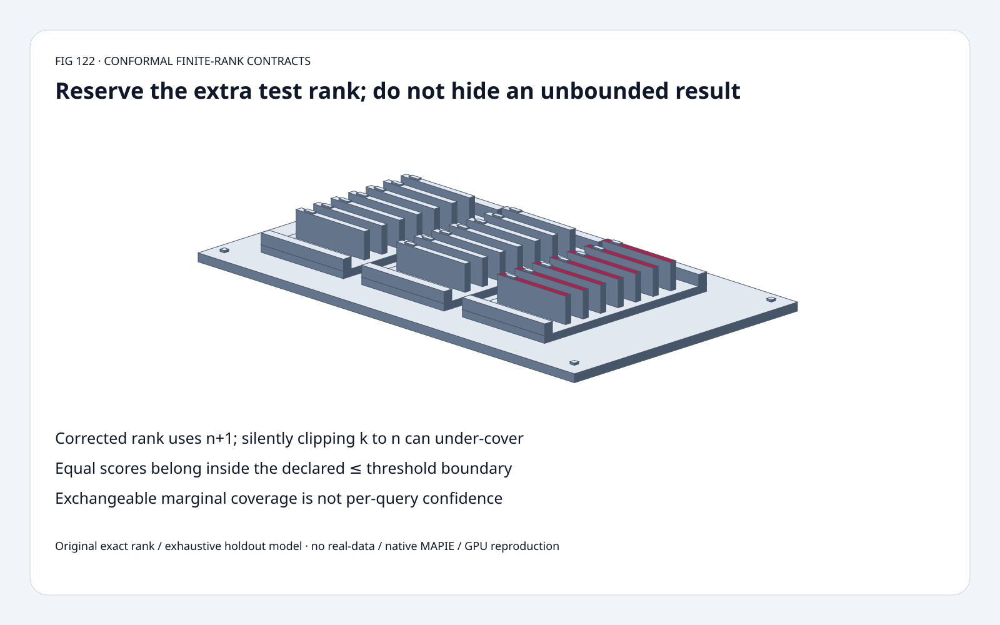
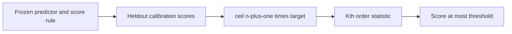
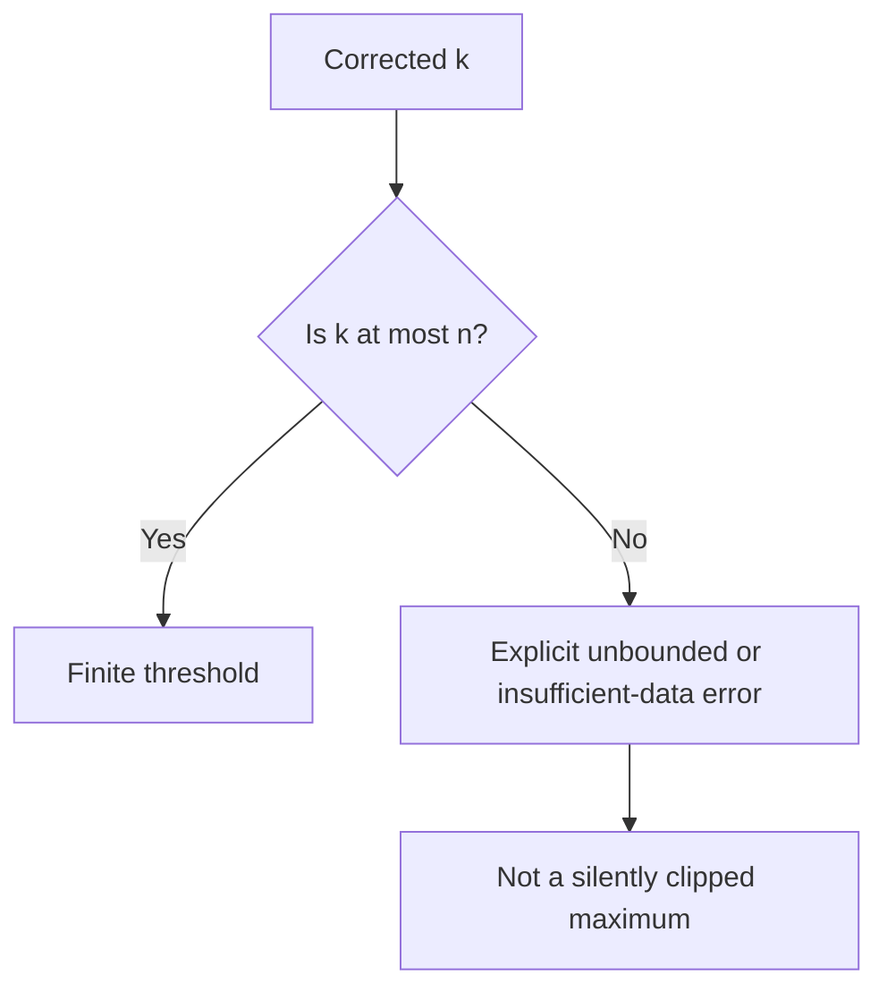
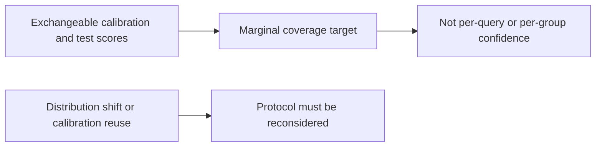

# Conformal calibration FAQ: finite rank, unbounded thresholds and marginal coverage

> **Language**: [中文](split-conformal-finite-rank-unbounded-boundary-selection-faq.md) | English
>
> **Round 122 · 2026-11-14 (night round 31)** · [SVG](../../assets/svg/split-conformal-finite-rank-unbounded-boundary-selection-faq-summary.svg) · [7 cards](../reports/split-conformal-finite-rank-unbounded-boundary-selection-cards.html) · [H5](../reports/split-conformal-finite-rank-unbounded-boundary-sizer.html) · [Data](../../experiments/conformal_rank_contract_selection/report.json)
>
> **Synthetic, `independently_reproduced=false`.** Original exact rank and exhaustive fixed-world holdouts, separate CPU selection timing. No native MAPIE, real-data coverage or model-quality reproduction.



## 1. Executive summary: use n+1, and expose when no finite threshold exists

For split-conformal nonnegative scores, use
`k=ceil((n+1)*(1-alpha))`, the kth smallest calibration score.
If k>n, the mathematical extension is **unbounded**, not the maximum
calibration score.

Original n=9, alpha=3/20 targets **85%**:
correct rank **9**, naive `ceil(n*(1-alpha))` rank **8**.
In an explicitly synthetic ten-score exchangeable world,
exhaustive holdouts give **9/10 versus 8/10** coverage.

At alpha=1/20, k=10>9: unbounded covers **10/10**;
silently clipping to the maximum covers **9/10**, below the 95% target.
These are fixed-world enumerations, not deployment performance.
Pinned MAPIE's November 10 tree update is educational content,
not new conformal theory.

## 2. Architect Q&A: coverage under which protocol?

### Q1: Why does the corrected rank involve n+1?

The calibration scores and new test score must be exchangeable under
a valid, frozen score construction. The heldout test participates
in the ordering of **n+1** scores. Reserving that extra rank produces
the finite-sample marginal target.

A raw empirical percentile with denominator n can choose a lower
order statistic. In the original world `[1,...,10]`, every identity
is held out once, with the other nine used for calibration.
The correct threshold misses only the maximum; the naive rank also
misses the second highest.

This enumeration is a mathematical control with a fixed score
mechanism, not a model refitted differently per holdout.

### Q2: If k>n, why not just use the largest observed score?

That invents a finite threshold with a different coverage law.
The original model returns the explicit tagged object
`{"kind":"unbounded","value":null,...}`.
Null is not zero or missing evidence: the tag defines its mathematical
meaning. Operationally, an unbounded prediction set may be useless.

The pinned regression helper either allows an infinite result through
its `unbounded` option or explicitly rejects insufficient calibration.
Different API/direction wrappers have additional checks; we do not
claim every MAPIE API implements our scalar model identically.

For this **single-threshold mathematical** condition,
finite k requires `n>=ceil((1-alpha)/alpha)`.
At alpha=1/20 that is **19**. This is not a universal minimum sample
size for every native estimator, wrapper or two-sided construction.

### Q3: Do ties need inclusive comparison?

For the modeled score set, use `score<=threshold`.
On ten identical scores of 2, inclusive boundaries cover **10/10**;
changing to strict `<` covers **0/10**.
Ties can make marginal coverage conservative.

Score-order permutations and positive scale changes preserve the
original exact rank/set law. They do not grant immunity to changes
in score fitting or the calibration/test distribution.

### Q4: Is 95% a confidence value for each query or subgroup?

No. This is a **marginal coverage target** under the calibration
protocol, not a posterior correctness probability for one query,
not calibrated LLM decision confidence, and not a per-group guarantee.

Temporal distribution shift, dependent streams, subgroup selection,
or model/score tuning on the same calibration data can invalidate
the simple exchangeability argument.
Freeze the predictor/score mechanism independently of heldout
calibration, or use a method whose different protocol is justified.

### Q5: What is measured, and what does the budget mean?

Default logical assumptions: 1,000 float64 scores **8,000 bytes**;
optional full sorted copy **8,000 bytes**; 128 float64 interval pairs
**2,048 bytes**. Corrected rank at alpha=1/20 is **951**.

These are selected payloads, not actual allocation, peak HBM,
latency for scoring or measured real-data coverage.
The H5 accepts at most 64 nonnegative integer teaching scores;
its vector length is independent of the larger budget count.

## 3. Visual architecture: freeze scores, reserve the test rank, expose the boundary







## 4. Selection matrix: statistical protocol before threshold utility

| Choice | Good fit | Gate |
| :--- | :--- | :--- |
| Corrected finite rank | Valid split-conformal score protocol | n+1 and inclusive ties |
| Explicit unbounded | Mathematically honest small-n boundary | May have no useful finite output |
| Insufficient-data error | API requires finite sets | Never fabricate a finite fallback |
| Naive empirical percentile | Its own descriptive statistic | Not this coverage guarantee |
| Shift/conditional methods | Different justified protocol | Not automatic from marginal calibration |
| CPU rank-selection choice | Same exact threshold | Not model-scoring latency |

## 5. Hands-on evidence: exhaustive ranks, ties and two CPU selectors

```powershell
python -m experiments.conformal_rank_contract_selection.run --check
python -m unittest discover -s tests -p test_conformal_rank_contract_selection.py -q
```

Eight tests cover independent integer rank inequalities, finite/unbounded
boundaries, exhaustive holdout controls, ties, permutations/scaling,
invalid inputs, exact finite minimum, Node/Python tagged-result parity
and sealed samples.

| Precomputed scores | Corrected k | Stdlib heap (ms) | Full sorted (ms) |
| :--- | ---: | ---: | ---: |
| 32 | 27 | 0.006567 | 0.000700 |
| 128 | 104 | 0.027667 | 0.002667 |
| 512 | 411 | 0.141533 | 0.012800 |
| 2,048 | 1,640 | 0.691767 | 0.037867 |

Alpha=1/5 for load tiers; identical finite thresholds.
Heap selection is **slower in these samples**; large k and implementation
differences matter. Two warmups, seven alternating repeats,
three operations/sample; median repeat means.
Score fitting/generation, inference, native MAPIE and GPU excluded.
No browser visual inspection.

## 6. Sources, provenance and readiness

- [Pinned MAPIE helpers](https://github.com/scikit-learn-contrib/MAPIE/blob/d5ea5e07aea09a897726fd8641c193850a5c540d/mapie/utils.py): corrected quantile, explicit unbounded/insufficient-data and wrapper checks.
- [November 10 tree update](https://github.com/scikit-learn-contrib/MAPIE/commit/d5ea5e07aea09a897726fd8641c193850a5c540d): educational content, not a new theorem.
- [Conformal introduction](https://arxiv.org/abs/2107.07511): established finite-sample uncertainty-set theory; contextual citation, no text/implementation copied.
- [BSD-3-Clause license](https://github.com/scikit-learn-contrib/MAPIE/blob/d5ea5e07aea09a897726fd8641c193850a5c540d/LICENSE): upstream rights retained.

Original exact ranks, exhaustive controls, CPU orchestration and art;
real-data/conditional coverage, model quality, native latency and
peak HBM remain null.
