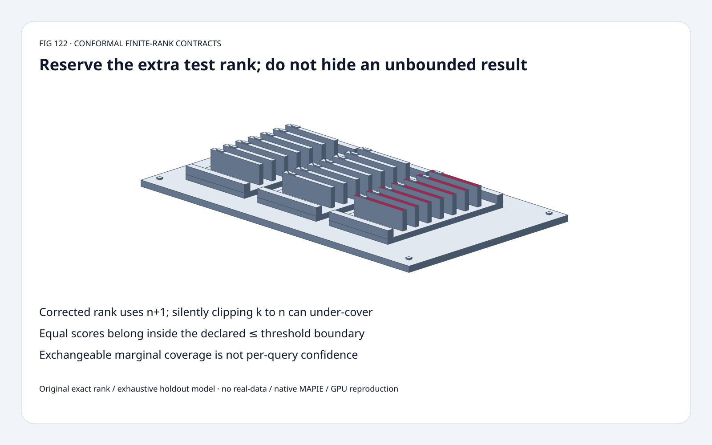
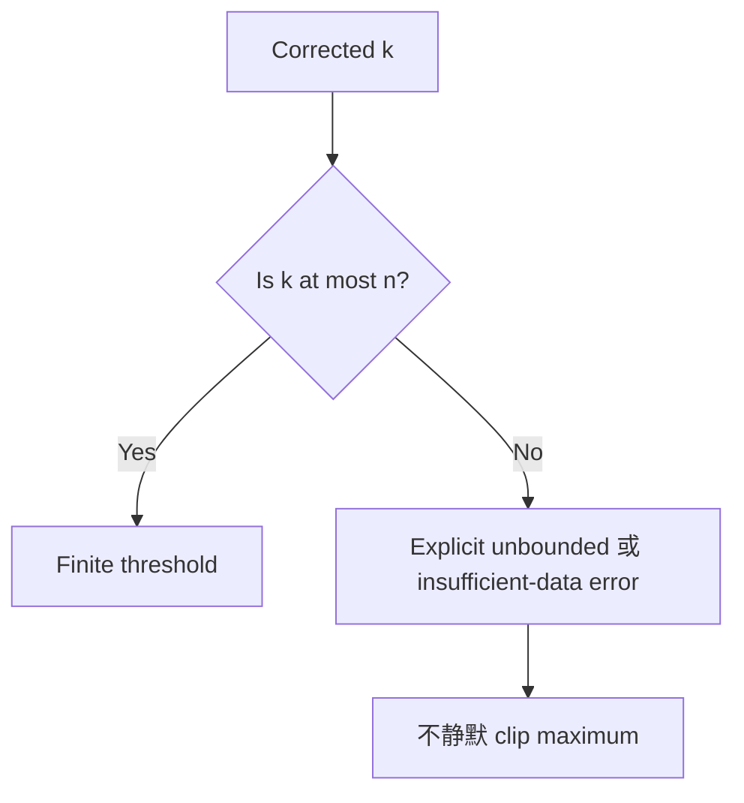
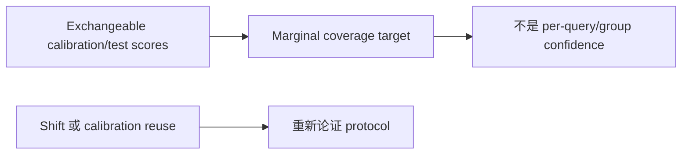

# Conformal Calibration FAQ：Finite Rank、Unbounded 与 Marginal Coverage

> **语言**：中文 | [English](split-conformal-finite-rank-unbounded-boundary-selection-faq.en.md)
>
> **Round 122 · 2026-11-14（夜班第 31 轮）** · [高清 SVG](../../assets/svg/split-conformal-finite-rank-unbounded-boundary-selection-faq-summary.svg) · [七卡](../reports/split-conformal-finite-rank-unbounded-boundary-selection-cards.html) · [H5](../reports/split-conformal-finite-rank-unbounded-boundary-sizer.html) · [数据](../../experiments/conformal_rank_contract_selection/report.json)
>
> **Synthetic，`independently_reproduced=false`。** 原创 exact rank、
> exhaustive fixed-world holdouts、CPU selection；
> 不复现 native MAPIE、real-data coverage 或 model quality。



## 一、先看结论：使用 n+1，不能藏起没有 Finite Threshold 的边界

Split-conformal nonnegative scores：
`k=ceil((n+1)*(1-alpha))`，取 calibration 第 k 小。
k>n 时数学扩展是 **unbounded**，不是 maximum calibration score。

原创 n=9、alpha=3/20，目标 **85%**，
corrected rank **9**，naive `ceil(n*(1-alpha))` **8**。
Synthetic 十分数 exchangeable world 穷举 holdout，
coverage **9/10 vs 8/10**。

Alpha=1/20 时 k=10>9；
unbounded **10/10**，静默 clip 到最大值 **9/10**，低于 95%。
这不是部署性能；MAPIE 11 月 10 日 tree 更新是 educational content，
不冒充新 conformal theory。

## 二、架构师 Q&A：哪种 Protocol 下的 Coverage？

### Q1：为什么用 n+1？

在有效 frozen score construction 下，
calibration 与 new test score 应 exchangeable；
test 参与 **n+1** 排序，需预留其 rank。
Raw empirical percentile 的 n 分母可能选到更低 order statistic。

原创 world `[1,...,10]` 每个身份 heldout 一次，
其余九个 calibration；
corrected 只漏最大值，naive 也漏第二大。
这是 fixed score mechanism 的数学 control，
不是每个 holdout 重训不同模型。

### Q2：k>n 为什么不能直接用最大 Score？

会伪造另一种 finite threshold/coverage law。
原创返回明确 tag：
`{"kind":"unbounded","value":null,...}`；
null 不是零或 missing evidence，kind 定义数学含义。
Unbounded 在业务上可能毫无 finite utility。

固定 regression helper 可通过 `unbounded` 允许 infinity，
否则显式拒绝 insufficient calibration；
不同 API/direction wrappers 有额外 checks，
不声称全 MAPIE APIs 等同 scalar prototype。

本 **single-threshold 数学条件** finite k 要求
`n>=ceil((1-alpha)/alpha)`；
alpha=1/20 最少 **19**。
这不是所有 native estimators/wrappers/two-sided methods 的通用 minimum。

### Q3：Ties 要 Inclusive 吗？

本 score-set law 使用 `score<=threshold`。
十个相同 score=2，inclusive **10/10**；
换成 strict `<` 则 **0/10**，ties 可造成 conservative coverage。

Permutation、positive scaling 保持原创 exact rank/set law，
不代表 score fitting 或 calibration/test distribution 改变后仍成立。

### Q4：95% 是每 Query 或 Subgroup 的 Confidence 吗？

不是。它是 protocol 下的 **marginal coverage target**，
不是单 query posterior correctness、LLM decision confidence
或 per-group guarantee。

Temporal shift、dependent streams、subgroup selection、
同 calibration data 上调模型/score，
都可能破坏简单 exchangeability。
应独立 freeze predictor/score，或论证其他方法的不同 protocol。

### Q5：实际测了什么，Budget 是什么？

默认 1,000 float64 scores **8,000 bytes**，
optional sorted copy **8,000 bytes**，
128 float64 interval pairs **2,048 bytes**；
alpha=1/20 的 corrected rank **951**。

是 selected payloads，不是 allocation/peak HBM/scoring latency/
real-data coverage。H5 最多 64 个 integer teaching scores，
vector length 与大 budget count 独立。

## 三、三张架构图：Freeze Score、预留 Test Rank、暴露边界






## 四、选型矩阵：Statistical Protocol 先于 Threshold Utility

| 选择 | 适合 | Gate |
| :--- | :--- | :--- |
| Corrected finite rank | 有效 split-conformal protocol | n+1、inclusive ties |
| Explicit unbounded | 诚实的 small-n 数学边界 | 可能无 finite utility |
| Insufficient-data error | API 要 finite sets | 不伪造 fallback |
| Naive percentile | 描述统计本身 | 不承诺此 coverage law |
| Shift/conditional method | 其他已论证 protocol | 不能从 marginal 自动推出 |
| CPU selector | Same exact threshold | 不等于 model-scoring latency |

## 五、动手证据：Exhaustive Ranks、Ties 与 CPU Selectors

```powershell
python -m experiments.conformal_rank_contract_selection.run --check
python -m unittest discover -s tests -p test_conformal_rank_contract_selection.py -q
```

8 tests：独立 rank inequalities、finite/unbounded、
exhaustive holdouts、ties、permutation/scaling、invalid inputs、
exact minimum、Node/Python tagged parity、sealed medians。

| Scores | Corrected k | Stdlib Heap（ms） | Full Sorted（ms） |
| :--- | ---: | ---: | ---: |
| 32 | 27 | 0.006567 | 0.000700 |
| 128 | 104 | 0.027667 | 0.002667 |
| 512 | 411 | 0.141533 | 0.012800 |
| 2,048 | 1,640 | 0.691767 | 0.037867 |

Load tiers alpha=1/5，finite thresholds 相同；
本组 **heap 更慢**，large k/实现差异有影响。
2 warmups、7 alternating repeats、3 ops/sample，取 repeat means median；
排除 score fit/generation、inference、native MAPIE、GPU；
未做浏览器视觉验收。

## 六、来源、许可、溯源与 Readiness

- [固定 MAPIE helpers](https://github.com/scikit-learn-contrib/MAPIE/blob/d5ea5e07aea09a897726fd8641c193850a5c540d/mapie/utils.py)：quantile correction、unbounded/insufficient-data、wrapper checks。
- [11 月 10 日 tree](https://github.com/scikit-learn-contrib/MAPIE/commit/d5ea5e07aea09a897726fd8641c193850a5c540d)：educational content，非新 theorem。
- [Conformal Introduction](https://arxiv.org/abs/2107.07511)：既有 finite-sample theory，未复制文本/实现。
- [BSD-3-Clause LICENSE](https://github.com/scikit-learn-contrib/MAPIE/blob/d5ea5e07aea09a897726fd8641c193850a5c540d/LICENSE)：上游权利保留。

Exact ranks、exhaustive controls、CPU orchestration、视觉原创；
real-data/conditional coverage、model quality、native latency、peak HBM 均 null。
