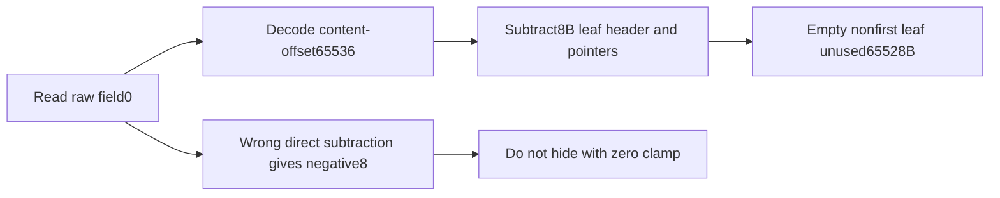
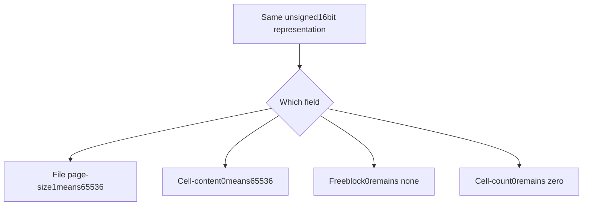
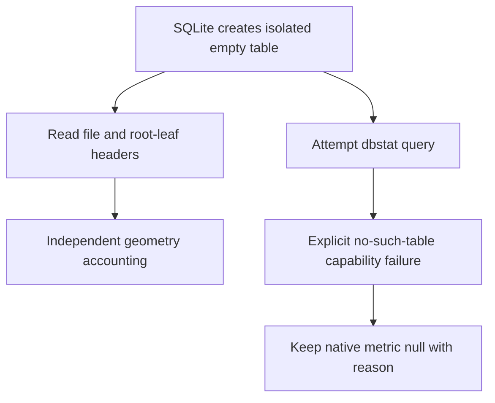

# AI Infra storage observability FAQ: SQLite64KiB pages, field sentinels and space accounting

> **Language**: English | [中文](sqlite-64k-page-size-content-offset-sentinels-selection-faq.md)  
> **Round 143 · 2026-11-14 daytime**: binary representation boundaries and metadata-storage accounting, independent of the preceding WAL-snapshot study.  
> **Verified daily change**: SQLite's Nov14fix corrects dbstat unused bytes on an empty64KiB page; it fixes observation of an existing format, not a new page format.

**Executive finding:** A64KiB empty table-leaf content-offset raw0means65536. Subtracting its8B header leaves65528B unused; arithmetic before decoding gives−8. **Do not globally replace every zero with65536**: first-freeblock0means none and cell-count0means zero. The file-header page-size field instead uses**1**for65536. Actual SQLite3.49.1raw pages confirm these fields; local dbstat is unavailable, so its outputs remain null rather than falsely reproducing the new native fix.

**Artifacts**: [H5 workbench](../reports/sqlite-64k-page-size-content-offset-sentinels-sizer.html) · [seven cards](../reports/sqlite-64k-page-size-content-offset-sentinels-selection-cards.html) · [1600px SVG](../../assets/svg/sqlite-64k-page-size-content-offset-sentinels-selection-faq-summary.svg) · [sealed report](../../experiments/sqlite_page_sentinel_selection/report.json)

## Q1: Why does today's dbstat change matter to metadata storage?

The pinned Nov14commit at02:31:55UTC fixes unused-byte accounting on an empty65536B page. Both implementation patch and empty-table regression were read. A two-byte field cannot directly encode65536, so representation must be decoded before space arithmetic. Clamping a negative dashboard value to zero would hide the representation error.



This concerns page-level observability in AI agent metadata, embedding-index sidecars and local control-plane databases. It does not evaluate vector search, WAL concurrency or native performance, and makes no invented popularity-ranking claim.

## Q2: Why must apparently similar fields be decoded separately?

| Field context | Raw value | Meaning |
| :--- | ---: | :--- |
| File header offset16,page-size u16BE | 1 | Page size65536B |
| Leaf header offset5,content-start u16BE | 0 | Content offset65536 |
| First freeblock u16BE | 0 | No freeblock,not offset65536 |
| Cell count u16BE | 0 | Zero cells |

Page sizes are powers of two from512through65536. File-page-size0does not represent a valid512/65536page. The model validates sizes, fields and booleans. Content-offset0conflicting with a4096B page or reserved tail is explicitly rejected, not silently normalized.



H5 only budgets table-leaf0x0dheaders without freeblocks. It is not a general SQLite-file validator and does not treat an interior page as an8B leaf header.

## Q3: How do first-page prefixes, reserved bytes and cell pointers change the budget?

Page1has a100B file header before its B-tree header. Leaf headers use8B; each cell pointer uses2B. Usable=`page_size−reserved`. Without freeblocks, unused=`decoded_content−file_header−8−2×cells+fragmented`. Real freeblock-chain lengths also contribute to free space, but this model does not parse them.

| Original scenario | Content raw | Decoded unused |
| :--- | ---: | ---: |
| 4096B empty nonfirst leaf | 4096 | 4088B |
| 65536B empty nonfirst leaf | 0 | 65528B |
| 65536B empty first-page geometry | 0 | 65428B |
| 65536B,reserved32B,empty nonfirst leaf | 65504 | 65496B |
| 65536B,three opaque cells of9/17/33B | 65477 | 65463B |

The last row has59B content and6B pointers; pointer bytes are not record payload. Opaque cells contain original placeholder bytes, **not valid SQLite record encoding**. The first-page example is geometry, not a complete openable SQLite database.

## Q4: What did native SQLite establish, and what remains missing?

Two isolated databases contain only an original empty table, with4096and65536B pages. The fixture queries rootpage and reads **its own generated file bytes**; both roots are page2:

| Actual raw-page observation | 4096B | 65536B |
| :--- | :--- | :--- |
| File-header page-size raw | 4096 | 1 |
| Leaf content-offset raw | 4096 | 0 |
| Cell count / first freeblock | 0 / 0 | 0 / 0 |
| Independent model-decoded unused | 4088B | 65528B |
| Native dbstat unused | **null,module unavailable** | **null,module unavailable** |



Local3.49.1lacks dbstat. Only exact `no such table: dbstat` is classified as capability absence; other OperationalErrors are rethrown. There is no silent fallback, zero substitution, host upgrade or claim that a newly patched binary passed. Source-verified upstream fix/regression and locally measured raw headers are separate evidence.

## Q5: Does the CPU decoding comparison establish faster SQLite scans?

| Original8B header decodes | struct.unpack (ms) | Manual shifts (ms) |
| ---: | ---: | ---: |
| 64 | 0.009733 | 0.016867 |
| 256 | 0.039900 | 0.067767 |
| 1024 | 0.161167 | 0.270000 |
| 4096 | 0.706933 | 1.141033 |

Both repeatedly decode the same prevalidated8B empty64KiB leaf header and return tuples, not distinct physical pages. Two warmups, seven alternating repeats and three operations per sample yield median repeat means. C-backed unpack versus Python shifts measures original language-level conversion, excluding complete validation, SQLite/dbstat, disk, cache misses and allocation peaks. It is not a performance result for the new fix.

## Q6: How can the study be reproduced and production boundaries checked?

```powershell
python -m unittest discover -s tests -p test_sqlite_page_sentinel_selection.py -q
python -m experiments.sqlite_page_sentinel_selection.run --check
# --measure deliberately replaces original CPU and benign raw-page fixture records.
```

Eight tests cover field-specific sentinels,40independent interval-conservation cases, first/reserved/nonempty pages, actual raw headers and missing metrics, invalid fields/pages/fragments, Node/Python geometry parity and sealed evidence. Temporary databases are cleaned from known subdirectories after connections close. Prior browser refusal remains respected; visual browser inspection was not performed.

Sources: [today's pinned fix](https://github.com/sqlite/sqlite/commit/9b0f74e9615f1c79e43fa876b84f8a5952030e8a), [dbstat.c](https://github.com/sqlite/sqlite/blob/9b0f74e9615f1c79e43fa876b84f8a5952030e8a/src/dbstat.c), [stat regression](https://github.com/sqlite/sqlite/blob/9b0f74e9615f1c79e43fa876b84f8a5952030e8a/test/stat.test), [file format](https://www.sqlite.org/fileformat2.html). SQLite source is public domain; models, prose and visuals are original, with no implementation mirror.

Production needs module capability, version/backport, page type, reserved extensions, freeblocks, fragmentation, record varints, overflow, B-tree and file validation. The model explicitly rejects nonzero freeblocks as unsupported, not as proof a real file is corrupt. Main provenance is `synthetic`, `independently_reproduced=false`, with raw headers and CPU separately `measured`. Patched native-dbstat certification, throughput and storage latency remain unknown/null.
