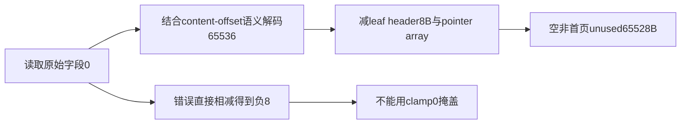
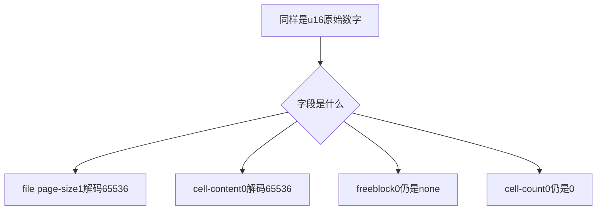
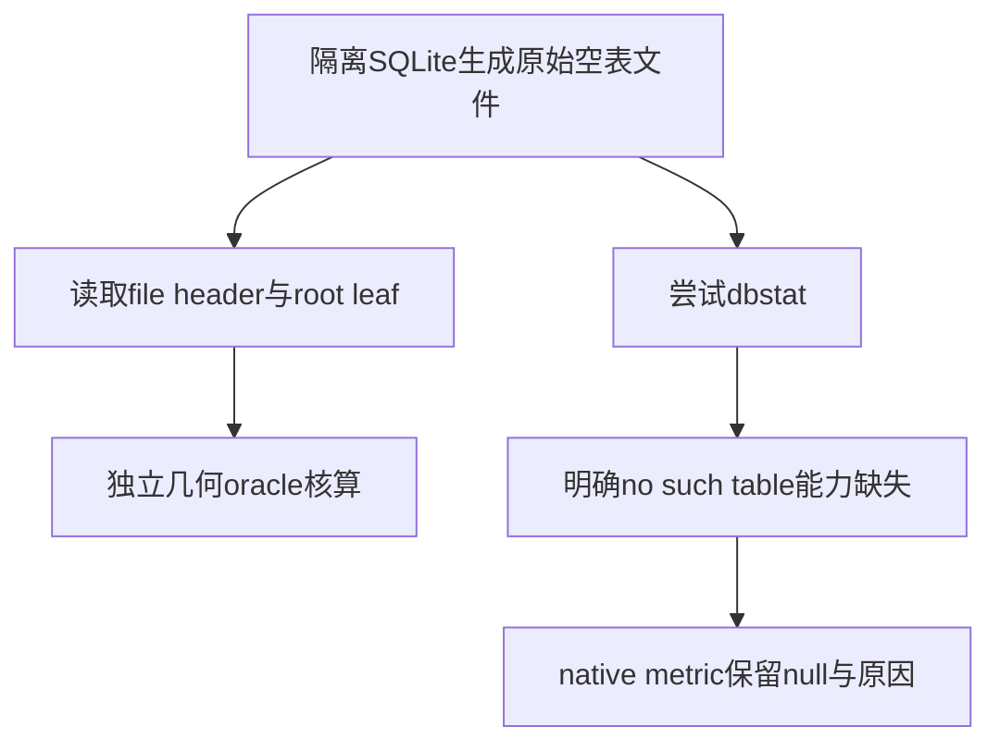

# AI Infra 存储可观测性 FAQ：SQLite 64KiB 页、字段 Sentinel 与空间核算

> **语言**：中文 | [English](sqlite-64k-page-size-content-offset-sentinels-selection-faq.en.md)  
> **Round 143 · 2026-11-14 白班**：binary-format表示边界与metadata storage accounting；独立于上一轮WAL事务快照。  
> **当日已核验变化**：SQLite11月14日修正空64KiB页的dbstat unused核算；这是既有格式的观测修正，不是新发明页格式。

**结论速览**：64KiB空table-leaf页的content-offset字段原始值0代表65536，减8B页头后应有65528B unused；未解码就计算得到−8。**不能全局把所有0替换成65536**：first-freeblock0仍是“无freeblock”，cell-count0仍是0。file-header page-size字段又采用**1**表示65536。实际SQLite3.49.1原始页确认了这些字段，但本机dbstat模块不存在，其输出保留null，不冒充已原生复现新版修复。

**交付**：[H5工作台](../reports/sqlite-64k-page-size-content-offset-sentinels-sizer.html) · [7-Card](../reports/sqlite-64k-page-size-content-offset-sentinels-selection-cards.html) · [1600px SVG](../../assets/svg/sqlite-64k-page-size-content-offset-sentinels-selection-faq-summary.svg) · [封存数据](../../experiments/sqlite_page_sentinel_selection/report.json)

## Q1：今天的dbstat变化为什么值得metadata存储工程关注？

11月14日02:31:55UTC固定commit修正空65536B page的unused计算；实际读取了dbstat实现patch及对应空表回归。原始2byte字段无法直接容纳65536，需要先解释sentinel，再计算空间。若dashboard把错误的负值直接clamp为0，会掩盖表示层错误，而不是修复容量指标。



应用场景是AI agent metadata、嵌入索引sidecar和本地控制面数据库的页级观测；本轮不测试向量查询、WAL并发或native性能，也不宣称新fix具有“热门榜排名”。

## Q2：三个看起来相似的字段，为什么必须分别解码？

| 字段语境 | 原始值 | 正确含义 |
| :--- | ---: | :--- |
| file header offset16，page size u16BE | 1 | page size65536B |
| leaf header offset5，content start u16BE | 0 | content offset65536 |
| first freeblock u16BE | 0 | 无freeblock，不是offset65536 |
| cell count u16BE | 0 | 零个cell |

SQLite page size支持512..65536的2次幂；不能把file-page-size0当合法512/65536。原型对字段/大小/boolean严格校验；content-offset0若与4096B page或reserved tail冲突，显式拒绝，不把不可能几何默认为有效。



H5只计算table-leaf0x0d、无freeblock的header级几何；不是通用SQLite文件validator，不接受interior页来冒充8B leaf header。

## Q3：首页、reserved bytes和cell pointers怎样改变预算？

page1在B-tree页头前还有100B file header；leaf header为8B，cell pointer每个2B。usable=`page_size−reserved`。本原型无freeblock，unused=`decoded_content−file_header−8−2×cells+fragmented`。真实格式还有freeblock chains，其总长度也属于free space，但本模型不解析。

| 原创scenario | content raw | decoded unused |
| :--- | ---: | ---: |
| 4096B空非首页 | 4096 | 4088B |
| 65536B空非首页 | 0 | 65528B |
| 65536B空首页几何 | 0 | 65428B |
| 65536B，reserved32B，空非首页 | 65504 | 65496B |
| 65536B，3个opaque cells，长度9/17/33 | 65477 | 65463B |

最后一行content region59B、pointer array6B，不能把pointer bytes算作record payload。opaque cells是原创占位byte内容，**不是合法SQLite record encoder**。首页空leaf只是几何场景，不宣称它是一份完整可打开的SQLite数据库。

## Q4：原生SQLite究竟验证了什么，缺失了什么？

在实验目录内创建两个仅含空表的隔离数据库，分别选4096与65536B page；查询rootpage后读取**自己生成的文件bytes**。两者rootpage均为2：

| 实际原始页观察 | 4096B | 65536B |
| :--- | :--- | :--- |
| file-header page-size raw | 4096 | 1 |
| table-leaf content-offset raw | 4096 | 0 |
| cell count / first freeblock | 0 / 0 | 0 / 0 |
| 独立原型解码unused | 4088B | 65528B |
| native dbstat unused | **null，模块不可用** | **null，模块不可用** |



本机3.49.1没有dbstat；仅对确切`no such table: dbstat`记录能力缺失，其他OperationalError重新抛出。没有静默fallback、补0、改装SQLite或声称新patched binary通过。上游fix及回归属于source-verified证据，和本地raw-page测量分开。

## Q5：CPU解码对照是否说明SQLite扫描速度提升？

| 原创8B header解码次数 | struct.unpack（ms） | manual shifts（ms） |
| ---: | ---: | ---: |
| 64 | 0.009733 | 0.016867 |
| 256 | 0.039900 | 0.067767 |
| 1024 | 0.161167 | 0.270000 |
| 4096 | 0.706933 | 1.141033 |

两路重复解码同一个预校验8B空64KiB leaf header，并都输出tuples；不是读取不同physical page。2warmups、7轮交替repeat、每样本3操作，中位数。C-backed unpack与Python位运算只展示原创language-level conversion成本，排除完整validation、SQLite engine/dbstat、disk、cache miss和allocator peak。不能转述为SQLite新fix的性能收益。

## Q6：如何复现并设置生产使用边界？

```powershell
python -m unittest discover -s tests -p test_sqlite_page_sentinel_selection.py -q
python -m experiments.sqlite_page_sentinel_selection.run --check
# --measure 主动替换原创 CPU 与 benign raw-page fixture 记录
```

八项测试覆盖字段特定sentinel、40组独立interval守恒oracle、首页/reserved/nonempty、实际SQLite原始headers与缺失metric、错误页/字段/fragment、Node/Python几何parity与封存数据。临时DB关闭后在已知子目录定向清理。此前浏览器拒绝仍受尊重，未执行视觉浏览器检查。

来源：[当日固定fix](https://github.com/sqlite/sqlite/commit/9b0f74e9615f1c79e43fa876b84f8a5952030e8a)、[对应dbstat.c](https://github.com/sqlite/sqlite/blob/9b0f74e9615f1c79e43fa876b84f8a5952030e8a/src/dbstat.c)、[stat回归](https://github.com/sqlite/sqlite/blob/9b0f74e9615f1c79e43fa876b84f8a5952030e8a/test/stat.test)、[文件格式](https://www.sqlite.org/fileformat2.html)。SQLite source为public domain；原创模型、图与文档无实现镜像。

生产需核验模块编译能力、实际版本/回补、页类别、reserved extension、freeblocks、fragmentation、record varints、overflow、页树和文件完整性。本模型遇到freeblock非0会显式拒绝，不能借此判断真实文件损坏。主报告`synthetic`、`independently_reproduced=false`；独立raw headers与CPU分别`measured`。native patched-dbstat认证/吞吐/storage latency均未知/null。
