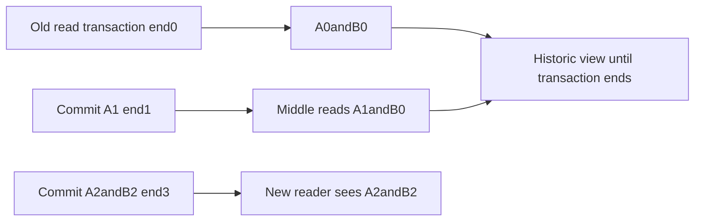
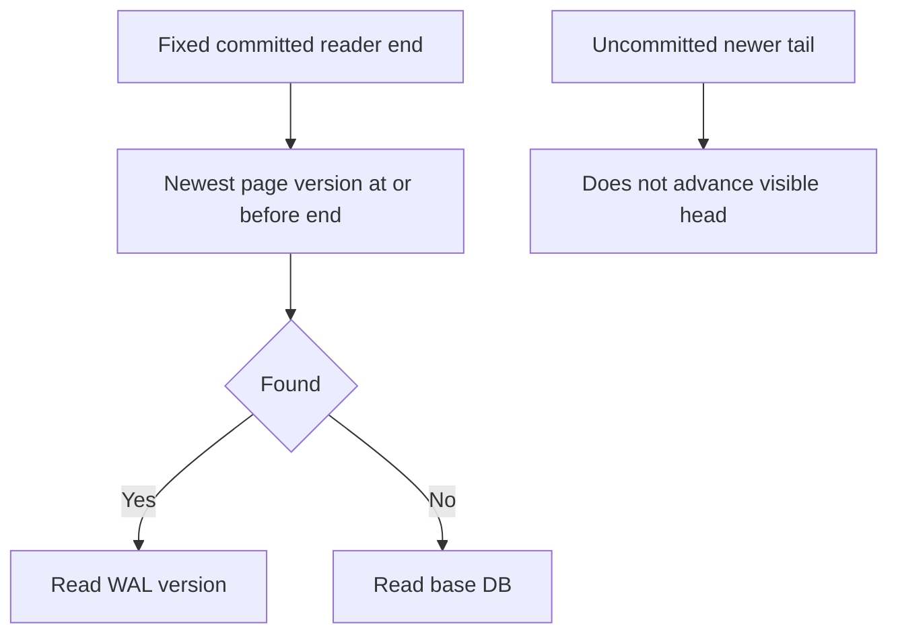
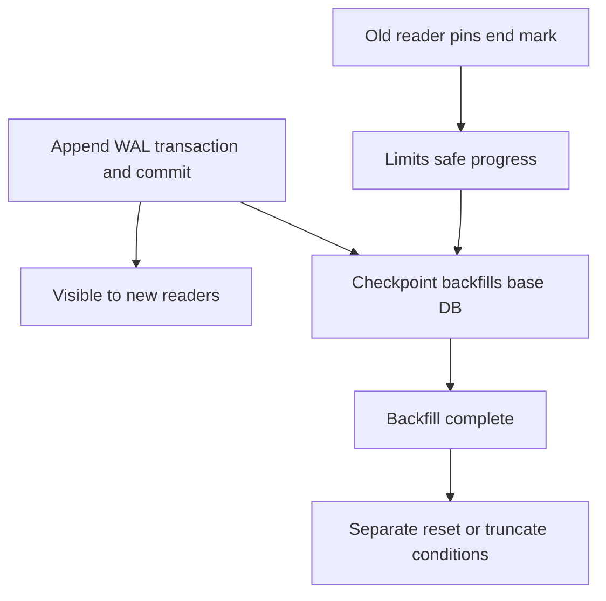

# AI Infra metadata FAQ: SQLite WAL snapshots, reader end marks and checkpoint completion

> **Language**: English | [中文](sqlite-wal-reader-endmark-checkpoint-visibility-selection-faq.md)  
> **Round 142 · 2026-11-14 daytime**: transactional visibility in AI metadata/index control planes—not SQLite throughput or crash-durability certification.  
> **Runtime caution**: the isolated local fixture uses SQLite3.49.1. Verify documented WAL-reset fixes/backports in deployment; passing this test does not certify an older runtime.

**Executive finding:** **Commit visibility, completed checkpointing, WAL reset/truncation and power-loss durability are separate**. Two original-model readers retainA0/B0andA1/B0while latest isA2/B2. The separate native fixture returns PASSIVE`(0,2,0)`: status0but two log frames remain uncheckpointed. TRUNCATE with held readers returns`(1,2,0)`; after release it returns`(0,0,0)`and the WAL is0B.

**Artifacts**: [H5 workbench](../reports/sqlite-wal-reader-endmark-checkpoint-visibility-sizer.html) · [seven cards](../reports/sqlite-wal-reader-endmark-checkpoint-visibility-selection-cards.html) · [1600px SVG](../../assets/svg/sqlite-wal-reader-endmark-checkpoint-visibility-selection-faq-summary.svg) · [sealed report](../../experiments/wal_snapshot_checkpoint_selection/report.json)

## Q1: Does a WAL reader always see the latest commit?

No. An established read transaction retains its committed end mark. In the original fixture, old readsA0/B0; the writer commitsA1; middle readsA1/B0; the writer then atomically commitsA2/B2. Old and middle keep their earlier values while a new autocommit reader seesA2/B2.



Default `BEGIN DEFERRED` alone need not establish the snapshot. Another native connection begins early without reading, then first selects after later commits and seesA2/B2. Our `reader(name)` directly represents an **already established** read snapshot, not an idle BEGIN state.

WAL permits reader/writer overlap, but ordinary SQLite still permits only one writer at a time. This is not conflict-free multi-writer operation or a promise that every call avoids BUSY.

## Q2: Which page version is visible, and can an uncommitted tail be read?

Select the newest version no later than the reader's end mark, otherwise use the base database. Original sequence:

| Model frame | Page/value | Commit end |
| ---: | :--- | :--- |
| 1 | page1=A1 | Yes |
| 2 | page1=A2 | No,part of next transaction |
| 3 | page2=B2 | Yes |
| 4(extra perturbation) | page2=UNCOMMITTED | No |

End1seesA1/B0; end3seesA2/B2. A fourth model record must not expose UNCOMMITTED. Original logical recovery discards that tail and retains three records. Actual SQLite additionally validates headers, salts and checksums; boolean commit markers do **not** verify torn writes, binary WAL or crash recovery.



The native SQL fixture updates two **logical rows**, not the model's two physical database pages. Native SQLite records two WAL frames while the model uses three original page-version records across two transactions. They are not asserted to have identical frame counts.

## Q3: Why can a long reader obstruct checkpoints without preventing commits?

Writers append versions to WAL. Checkpointing must copy safe content into the base DB without invalidating older readers' base views. Our conservative model limits safe end to the oldest active snapshot:0/3backfilled with both readers,1/3after old releases,3/3after middle releases. Three log records still remain until explicit reset.



This is a fixed-page, single-writer sequential explanation. Native WAL-index read-mark slots, database-only readers and restart protocols are more nuanced. Our “any active reader blocks reset” gate is deliberately conservative, not the native locking algorithm.

## Q4: How should PASSIVE, FULL, RESTART and TRUNCATE results be interpreted?

PASSIVE does not wait for readers/writers and does not invoke the busy handler; it may finish only partially. FULL attempts to wait for its required conditions and backfill all frames. RESTART additionally waits until readers no longer use WAL so the next writer can restart it. TRUNCATE additionally reduces the log to zero bytes before successful return. These stronger modes can return BUSY rather than forcibly complete.

| Benign native fixture | `(busy,log,checkpointed)` | Meaning |
| :--- | :--- | :--- |
| Held old read transactions,PASSIVE | `(0,2,0)` | **Zero is not full progress** |
| Held readers,TRUNCATE,timeout0 | `(1,2,0)` | Truncation incomplete |
| End readers,TRUNCATE again | `(0,0,0)`,WAL0B | That operation's observed success only |

Handle status and progress together. Other errors may produce−1outputs; do not silently treat them as zero frames. Another checkpointer can also cause checkpoint-lock BUSY. Commit does not imply checkpointing or immediate file shrinking.

## Q5: What do frame budgets and original CPU timings establish?

The selected nonempty WAL layout is32B header plus `frames×(24B frame header+page bytes)`. Three4096B-page frames yield12392B. This excludes the base DB, SHM, filesystem allocation and retained capacity, and is not a binary encoder. A successfully truncated native file can be0B rather than retain the32B header.

| Original frames /64queries per path | Prebuilt page-version index (ms) | Reverse scan (ms) |
| ---: | ---: | ---: |
| 64 | 0.012667 | 0.056167 |
| 256 | 0.014467 | 0.063067 |
| 1024 | 0.015200 | 0.071467 |
| 4096 | 0.017300 | 0.070767 |

Two warmups, seven alternating repeats and three operations per sample yield median repeat means; index construction is excluded. The workload repeatedly cycles through32page IDs, usually giving short reverse searches: **it does not demonstrate linear slowdown with total WAL length**. Neither path measures SQLite's WAL-index, SQL, locks, disk, fsync or checkpoint latency.

## Q6: How can the study be reproduced and deployment boundaries checked?

```powershell
python -m unittest discover -s tests -p test_wal_snapshot_checkpoint_selection.py -q
python -m experiments.wal_snapshot_checkpoint_selection.run --check
# --measure deliberately replaces original CPU and benign SQLite fixture records.
```

Eight tests cover an independent immutable transaction-state oracle,0→1→3backfill, hidden uncommitted tails, reset gates, native old/new/deferred-first-read snapshots and checkpoint statuses, invalid inputs/payloads, Node/Python parity and sealed evidence. Temporary databases live only under this experiment and are cleaned after closing connections. No production data, concurrent race or corruption test is used. Prior browser refusal remains respected; visual browser inspection was not performed.

Sources: [WAL semantics and WAL-reset version notice](https://www.sqlite.org/wal.html), [checkpoint_v2](https://www.sqlite.org/c3ref/wal_checkpoint_v2.html), [DEFERRED transactions](https://www.sqlite.org/lang_transaction.html), [WAL format](https://www.sqlite.org/fileformat2.html#walformat), [pinned wal.c](https://github.com/sqlite/sqlite/blob/9a9446f3b088bf3b8215311fbbdcc60a46045bed/src/wal.c). SQLite source is public domain; no implementation is mirrored. The Oct23source watch fixes a read-only-SHM recovery-error race, not the invention of WAL.

The official notice identifies WAL-reset fixes in3.51.3and specific backports3.44.6/3.50.7. Local3.49.1backport status was not audited; this fixture does not establish that the fix is present. The host SQLite was not modified. Production also needs patch/VFS verification, same-host shared-memory constraints, network-filesystem restrictions, busy handling, bounded readers, synchronous settings, backup APIs and crash recovery. Do not discard WAL when copying a live main database.

The main report is `synthetic`, `independently_reproduced=false`; original CPU records and the separate native contract fixture are `measured`. Native checkpoint latency, power-loss durability and race probability remain unknown/null.
