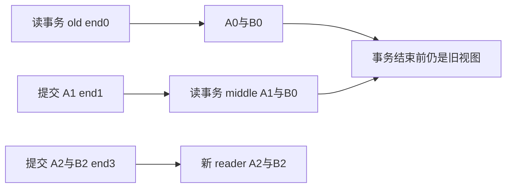
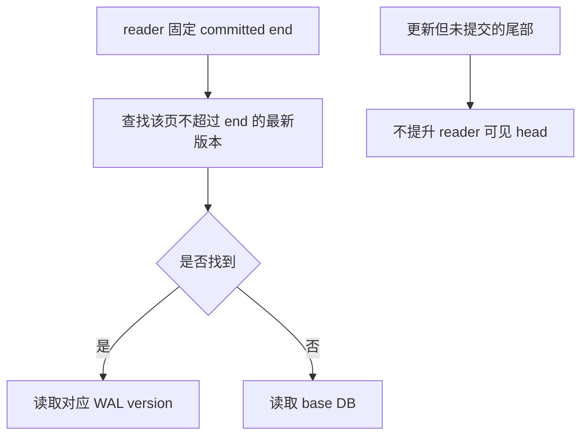
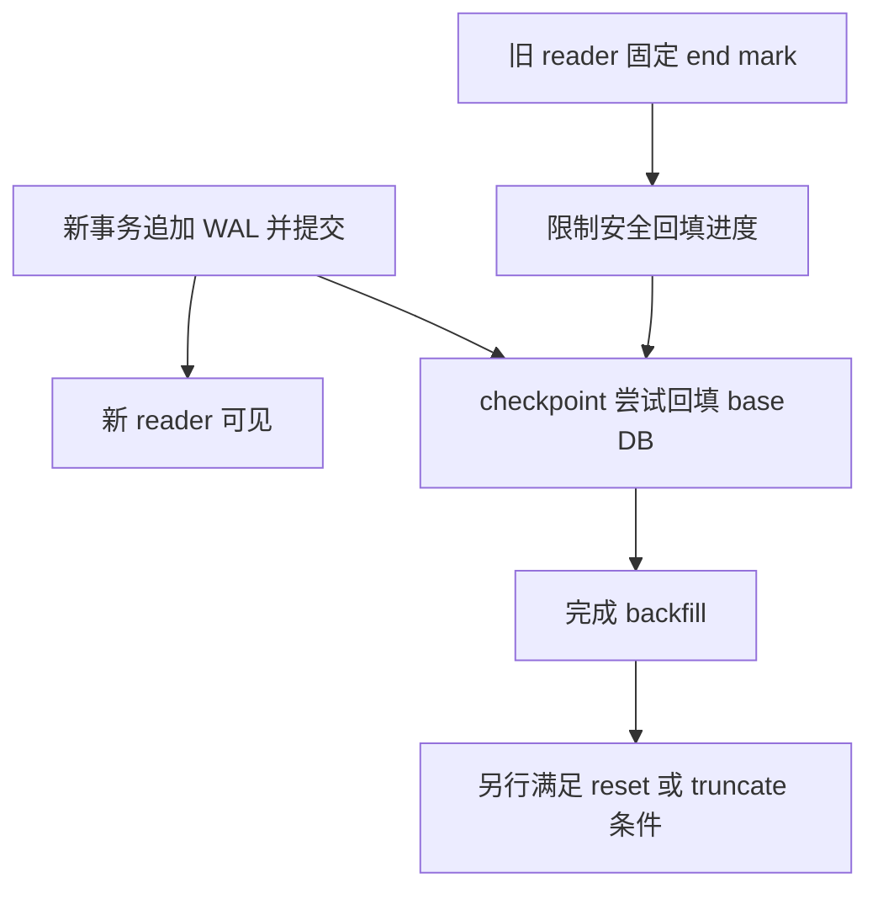

# AI Infra 元数据存储 FAQ：SQLite WAL 快照、Reader End Mark 与 Checkpoint 完成边界

> **语言**：中文 | [English](sqlite-wal-reader-endmark-checkpoint-visibility-selection-faq.en.md)  
> **Round 142 · 2026-11-14 白班**：AI 元数据/索引控制面中的事务可见性，不是SQLite吞吐或崩溃持久性认证。  
> **运行时提醒**：本机隔离fixture为SQLite3.49.1；部署须另核验官方WAL-reset修复版本/回补，不能因本测试通过就判定旧版本适合生产。

**结论速览**：**COMMIT可见、checkpoint回填完成、WAL reset/truncate和断电持久性不是同一件事**。原创模型的两个旧reader分别保留A0/B0与A1/B0，latest已是A2/B2。独立原生SQLite fixture的PASSIVE返回`(0,2,0)`——状态0但2个log frame尚未回填；持有reader时TRUNCATE为`(1,2,0)`，释放后为`(0,0,0)`且WAL文件为0B。

**交付**：[H5工作台](../reports/sqlite-wal-reader-endmark-checkpoint-visibility-sizer.html) · [7-Card](../reports/sqlite-wal-reader-endmark-checkpoint-visibility-selection-cards.html) · [1600px SVG](../../assets/svg/sqlite-wal-reader-endmark-checkpoint-visibility-selection-faq-summary.svg) · [封存数据](../../experiments/wal_snapshot_checkpoint_selection/report.json)

## Q1：AI 元数据用 WAL 后，reader是不是总能看到最新提交？

不是。WAL reader在读事务建立时固定committed end mark，事务期间保持该视图。原创fixture：old先读到A0/B0；writer提交A1；middle读到A1/B0；writer再原子提交A2/B2。之后old、middle仍读各自旧值，新的autocommit reader看见A2/B2。



特别注意：默认`BEGIN DEFERRED`本身不必建立读snapshot。原生fixture另有连接提前BEGIN但不读，等后续提交后才首次SELECT，实际得到A2/B2。原型的`reader(name)`直接表示**已经建立**读事务的快照，不模拟“只BEGIN尚未访问”的中间状态。

WAL支持reader与writer重叠，但普通SQLite同一时刻只有一个writer；不能宣传为多writer无冲突或任何操作永不BUSY。

## Q2：读页应选哪个 WAL 版本，未提交尾部能否直接读取？

应选不超过该reader end mark的最新page version，否则回到base database。原创顺序：

| Model frame | page/value | commit end |
| ---: | :--- | :--- |
| 1 | page1=A1 | 是 |
| 2 | page1=A2 | 否，属于下一事务 |
| 3 | page2=B2 | 是 |
| 4（额外扰动） | page2=UNCOMMITTED | 否 |

end1的reader看到A1/B0，end3看到A2/B2；仅仅存在第4个模型record不应暴露UNCOMMITTED。原创logical recovery删除未提交尾部，剩3records。真实SQLite还验证header、salts、checksums等，本模型的boolean commit marker**不能**验证torn write、二进制WAL或崩溃恢复。



SQLite SQL fixture更新的是两个**逻辑row**，不是原型的两个物理数据库页。因此native测到2个WAL frame，而原型两次事务含3个原创page-version record；不把这两个计数混为一致性断言。

## Q3：为什么长reader会阻碍checkpoint，却不必阻止writer提交？

writer先把新的事务版本追加到WAL；checkpoint要把安全内容回填base DB，不能破坏旧reader仍需要的base视图。原创保守模型将safe end限制在最早active snapshot：old与middle都在时回填0/3；释放old后1/3；再释放middle后3/3。此时原型仍保留3条log record，只有显式reset才清空。



这是解释snapshot/backfill关系的固定页、单writer、顺序模型。native WAL-index有read-mark slots、database-only readers和重启协议；原型“任何active reader均禁止reset”的规则更保守，不能当作真实SQLite锁算法。

## Q4：PASSIVE、FULL、RESTART、TRUNCATE该怎样读结果？

PASSIVE不等待reader/writer结束，不调用busy handler，可能只完成部分工作。FULL尝试等待满足条件并回填全部；RESTART进一步等reader不再使用WAL，以便下次writer从头复用；TRUNCATE进一步在成功返回前把log截到0B。FULL/RESTART/TRUNCATE等待条件无法满足时可返回BUSY，不是“强制成功清理”。

| 原生单线程隔离fixture | 结果`(busy,log,checkpointed)` | 含义 |
| :--- | :--- | :--- |
| 保持旧读事务，PASSIVE | `(0,2,0)` | **0不等于全部回填** |
| 保持旧读事务，TRUNCATE，timeout0 | `(1,2,0)` | 未完成截断 |
| 结束旧读事务，再TRUNCATE | `(0,0,0)`，WAL0B | 仅该次操作已观察成功 |

需要同时处理状态与progress；其他错误可导致−1等输出，不能一律算作frame0。若有另一checkpointer，checkpoint lock争用本身也可BUSY。正常commit并不等于checkpoint，更不等于文件立即缩小。

## Q5：frame字节预算与原创CPU timing说明什么？

所选非空WAL layout为32B header + `frames×(24B frame header+page bytes)`。3frames×4096B page得到12392B。不是base DB+SHM、filesystem实际分配、保留文件容量或内存预算；也不是二进制encoder。成功TRUNCATE的原生0B文件不必保留32B header。

| 原创frame数 / 每路64queries | 预建page-version index（ms） | reverse scan（ms） |
| ---: | ---: | ---: |
| 64 | 0.012667 | 0.056167 |
| 256 | 0.014467 | 0.063067 |
| 1024 | 0.015200 | 0.071467 |
| 4096 | 0.017300 | 0.070767 |

2warmups、7轮交替repeat、每样本3操作，取repeat均值中位数；index构建排除。此负载32个page ID反复出现，reverse scan通常只需短距离回看，**不是**随着全WAL长度线性变慢的实验证据。两路都不是SQLite WAL-index、SQL query、locks、disk、fsync或checkpoint latency。

## Q6：如何复现、处理运行时版本与上线边界？

```powershell
python -m unittest discover -s tests -p test_wal_snapshot_checkpoint_selection.py -q
python -m experiments.wal_snapshot_checkpoint_selection.run --check
# --measure 主动替换原创 CPU samples 与 benign SQLite fixture 记录
```

八项测试覆盖独立immutable transaction-state oracle、0→1→3回填、未提交尾部不可见、reset gating、原生SQLite旧/新/延迟首次读与checkpoint状态、错误输入/payload、Node/Python trace parity与封存数据。原生DB只在本实验的TemporaryDirectory创建，连接关闭后定向清理；无生产数据、并发race或corruption测试。此前浏览器拒绝仍受尊重，未执行视觉浏览器检查。

来源：[WAL语义及WAL-reset版本提醒](https://www.sqlite.org/wal.html)、[checkpoint_v2](https://www.sqlite.org/c3ref/wal_checkpoint_v2.html)、[DEFERRED事务](https://www.sqlite.org/lang_transaction.html)、[WAL文件格式](https://www.sqlite.org/fileformat2.html#walformat)、[固定wal.c](https://github.com/sqlite/sqlite/blob/9a9446f3b088bf3b8215311fbbdcc60a46045bed/src/wal.c)。SQLite源为public domain；无实现镜像。10月23日source watch是read-only SHM recovery error竞态修正，不是新发明WAL。

官方另记录WAL-reset修复自3.51.3及特定回补3.44.6/3.50.7；本机3.49.1的回补状态未审计，不能据本fixture通过推断修复存在。未修改系统SQLite。生产还须核验部署patch、VFS/同机共享内存、网络文件系统限制、busy处理、reader时长、synchronous策略、backup API与崩溃恢复；复制live main DB时不能随意丢弃其WAL。

主报告`synthetic`、`independently_reproduced=false`；原创CPU与独立原生contract fixture分别`measured`。native checkpoint latency、断电持久性、race概率均未知/null。
