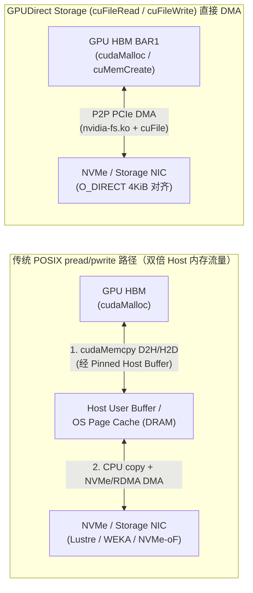

# 训练存储、数据加载与分布式 Checkpoint 恢复路径：从 PyTorch DCP 两阶段协同到 GPUDirect Storage DMA

- **组件归属**：AI Infra 全栈研究第 4 层（并行文件系统、对象存储、NVMe、GPUDirect Storage、数据与 Checkpoint 管线）与第 7 层（分布式训练状态持久化与容错恢复）
- **面向对象**：熟悉云存储与分布式系统、需要补齐 PyTorch Distributed Checkpoint（DCP）源码级协调路径与 GPUDirect Storage（`cuFile`）PCIe/NVMe DMA 边界的解决方案架构师
- **核验日期**：`2026-10-16`（UTC+08:00）
- **证据等级**：
  - `specification` / `implementation`：NVIDIA GPUDirect Storage（GDS）Overview Guide（Release 13.2，文档标注 `Last Updated: Mar 12, 2026`）；固定版本 `pytorch/pytorch@1eba9b3aa3c43f86f4a2c807ac8e12c4a7767340`（`v2.6.0`）源码
  - `own-offline`：本仓库原创标准库解析算例 [`experiments/checkpoint_recovery/`](../../experiments/checkpoint_recovery/README.md)
  - **未包含**：真实 Lustre/WEKA/NVMe-oF 集群打流、PCIe 分析仪采样或 `cuFile` 硬件实测（`own-hardware` 未执行）

---

## 1. 一手源码与规范锚点

| 来源 ID | 仓库 / 文档与固定版本 | 源码路径 / 章节与 Git Blob SHA | 核心核验内容 |
|---|---|---|---|
| `nvidia-gds-overview` | NVIDIA GPUDirect Storage Overview Guide (`v13.2`, `2026-03-12`) | `https://docs.nvidia.com/gpudirect-storage/overview-guide/index.html` (`Sec 1–3`) | `cuFileRead`/`cuFileWrite` 绕过 Host Page Cache 的 DMA 路径、`nvidia-fs.ko` 角色、Compatibility Mode 退化条件与 NVLink 动态路由 |
| `pytorch-dcp-saver` | `pytorch/pytorch@1eba9b3aa3c43f86f4a2c807ac8e12c4a7767340` (`v2.6.0`) | `torch/distributed/checkpoint/state_dict_saver.py` (`blob: 8df80c21b42d00eca9b306a0962f474780c99045`, `L175–434`) | `save` / `async_save` 入口、`_save_state_dict` 两阶段 `reduce_scatter("plan")` 与 `all_reduce("write")` 协同协议 |
| `pytorch-dcp-filesystem` | `pytorch/pytorch@1eba9b3aa3c43f86f4a2c807ac8e12c4a7767340` (`v2.6.0`) | `torch/distributed/checkpoint/filesystem.py` (`blob: 079608c7230629e33346c0ed10ff80a915bee016`, `L166–556`) | `_OverlappingCpuLoader` vs `_SerialCpuLoader` 选择条件、`_split_by_size_and_type` LPT 贪心分桶、`finish` 中 `.metadata.tmp` 原子重命名 |
| `pytorch-dcp-planner` | `pytorch/pytorch@1eba9b3aa3c43f86f4a2c807ac8e12c4a7767340` (`v2.6.0`) | `torch/distributed/checkpoint/default_planner.py` (`blob: f76805f7c3b3ca30495b096d061e9b352f3553cd`, `L185–520`) & `_dedup_save_plans.py` (`blob: dd37634a0aa64bb5e849375a4fcedb39617b998e`) | `DefaultSavePlanner.create_global_plan` 跨 Rank 副本去重负载均衡与 `_validate_global_plan` 分片零重叠/守恒校验 |
| `pytorch-dcp-staging` | `pytorch/pytorch@1eba9b3aa3c43f86f4a2c807ac8e12c4a7767340` (`v2.6.0`) | `torch/distributed/checkpoint/staging.py` (`blob: 22eed63c1cc517bc18f777d8943045115b440f06`, `L66–153`) | `BlockingAsyncStager` 的 `pin_memory=True` 锁页内存缓存、`cuda_stream` 异步 D2H 拷贝与同步栅栏 |

---

## 2. 关键实现路径与数据移动架构

### 2.1 传统 POSIX Page-Cache 反弹 vs GPUDirect Storage（`cuFile`）直接 DMA

在训练 Checkpoint 持久化与恢复（以及大块预tokenized 语料/激活张量换入换出）中，GPU 显存（HBM）与外部存储（本地 NVMe 或远端 NVMe-oF / Lustre / WEKA / NFS）之间存在两条截然不同的数据路径：



根据 NVIDIA GPUDirect Storage Overview Guide（`Sec 1.1–3.3`）：

1. **消除 Host Page Cache 双拷贝**：传统 POSIX 路径下，即使应用使用 `cudaHostAlloc` 锁页缓冲，标准文件系统读写默认仍经过操作系统 Page Cache，使单次 Checkpoint 写出在 Host DRAM 上产生 **1 次 PCIe D2H 写入 + 1–2 次 Host 内存拷贝 + 1 次存储 DMA 读取**，Host 内存带宽与 CPU 核开销往往先于 NVMe 介质饱和。
2. **`cuFile` 与 `nvidia-fs.ko` 的 DMA 重映射**：应用通过 `cuFileHandleRegister`、`cuFileBufRegister`（注册 GPU 显存虚拟地址至 BAR1 映射）并调用 `cuFileRead` / `cuFileWrite`。`nvidia-fs.ko` 内核模块截获存储驱动的 DMA 映射请求，将原本指向 Host 页表的物理地址替换为 GPU BAR1 PCIe 地址。
3. **跨 Root Complex 动态路由（Dynamic Routing）**：当目标 GPU 与 Storage NIC / NVMe 挂载在不同 CPU Socket 或不同 PCIe Root Port 下，且跨 Root Port P2P DMA 受限时，GDS 支持先经 PCIe P2P DMA 写入与 Storage NIC 同 Root Port 的中转 GPU 显存，再通过高速 **NVLink** 转发至目标 GPU，避免回落到跨 Socket QPI/UPI 主机内存。
4. **Compatibility Mode 静默退化边界（架构师必查反例）**：
   - 若文件未以 `O_DIRECT` 打开或读写偏移/长度/显存地址未按文件系统块大小（通常 `4096 B`）对齐（注：CUDA 12.2 / GDS 1.7+ 对页对齐缓冲可自动补开 `O_DIRECT` 句柄，但未对齐传输仍需内部锁页缓冲）；
   - 若显存由 `cudaMallocManaged`（Unified Virtual Memory, UVM）分配而非显式 `cudaMalloc` / `cuMemCreate`；
   - 若注册缓冲区超出 GPU BAR1 窗口上限或缺少 `nvidia-fs.ko`（CUDA 12.8+ 仅对本地 NVMe 与 DOCA SNAP 免除 `nvidia-fs`）；
   - 则 `cuFile` 不会报错中断，而是自动退化为 **Compatibility Mode**——在内部通过 POSIX 锁页 Host Buffer 中转，恢复双倍 Host DRAM 流量。

---

### 2.2 PyTorch DCP（`torch.distributed.checkpoint`）两阶段集体协同协议

在 FSDP / DTensor / TP+PP 混合并行训练中，模型权重与优化器状态被切分为跨 Rank 的分片（`ShardedTensor` / `DTensor`）与跨 Rank 重复的标量/嵌入/非分片层。`state_dict_saver.py`（`L341–434`）中的 `_save_state_dict` 通过 `_DistWrapper` 执行严格的两阶段集体协同：

1. **阶段一：`reduce_scatter("plan", local_step, global_step)`（全局计划生成、去重与完备性校验）**
   - **local_step（每个 Rank 本地）**：调用 `planner.create_local_plan()`（`default_planner.py:194–211`），将本 Rank `state_dict` 转换为 `SavePlan(items=[WriteItem, ...])`，区分普通张量（`WriteItemType.TENSOR`）、分片张量（`WriteItemType.SHARD`）与字节对象（`WriteItemType.BYTE_IO`）。
   - **global_step（Coordinator Rank 汇总）**：
     1. 调用 `dedup_save_plans(all_plans, self.dedup_save_to_lowest_rank)`（`_dedup_save_plans.py:16–60`）：扫描所有 Rank 计划中具有相同 `MetadataIndex`（`(fqn, offset)`）的副本写入项。
     2. **关键去重负载均衡不变量**：`DefaultSavePlanner` 默认设置 `dedup_save_to_lowest_rank = False`（`default_planner.py:182`）。此时 `dedup_save_plans` 维护每个 Rank 的计划累计字节数 `plan_to_size[plan_idx]`，并通过：
        ```python
        select_plan_idx = min(plan_indices, key=lambda plan_idx: plan_to_size[plan_idx])
        plan_to_size[select_plan_idx] += write_item.tensor_storage_size() or 1
        ```
        将每个副本张量贪心分配给**当前计划写出字节数最小的 Rank**，并从其余 Rank 的 `SavePlan` 中移除！若错误开启 `dedup_save_to_lowest_rank = True`，所有重复张量会全部堆积到 Rank 0，造成严重的 Rank 0 I/O 尾延迟木桶效应。
     3. 调用 `_validate_global_plan(global_plan, metadata)`（`default_planner.py:471–520`）：对每个分片张量校验三项硬约束——分片无越界（`_check_box_bounds`）、任意两分片无重叠（`_check_box_overlap`）、所有分片体积之和严格等于全局张量体积（`chunks_volume == tensor_volume`）。
     4. 调用 `storage_writer.prepare_global_plan(plans)`（`filesystem.py:456–465`）：为每个 Rank 的计划分配唯一文件前缀 `__<rank>_`。

2. **阶段二：`all_reduce("write", write_data, finish_checkpoint)`（并行落盘与元数据原子发布）**
   - **write_data（每个 Rank 本地）**：调用 `FileSystemWriter.write_data(plan, planner)`（`filesystem.py:467–536`），写出 `__<rank>_<thread_idx>.distcp` 数据文件。
   - **finish_checkpoint（Coordinator Rank 汇总）**：收集所有 Rank 返回的 `WriteResult`（记录每个张量分片在哪个 `.distcp` 文件的哪个 `offset` 与 `size_in_bytes`），调用 `FileSystemWriter.finish(metadata, results)`（`filesystem.py:538–556`）：
     ```python
     with (self.path / f"{_METADATA_FN}.tmp").open("wb") as metadata_file:
         pickle.dump(storage_md, metadata_file)
         if self.sync_files:
             os.fsync(metadata_file.fileno())
     (self.path / f"{_METADATA_FN}.tmp").replace(self.path / _METADATA_FN)
     ```
     **容错恢复语义**：只有当所有 Rank 数据文件写完（若 `sync_files=True` 则每个 `.distcp` 在 `_write_files_from_queue:313` 已执行 `os.fsync`）且 Coordinator 将 `.metadata.tmp` `fsync` 并原子 `replace` 为 `.metadata` 后，该 Checkpoint 才对 `dcp.load` 可见。中途任意 Rank 崩溃只会留下未被引用的 `.distcp` 或 `.metadata.tmp`，不会破坏上一版已提交 Checkpoint。

---

### 2.3 单 Rank 写盘内幕：LPT 贪心分桶与 `thread_count > 1` 时的 D2H 流水退化

阅读 `torch/distributed/checkpoint/filesystem.py`（`L166–265`）揭示了两个直接影响 Checkpoint 耗时的源码级机制：

1. **按大小降序的 LPT（Longest Processing Time First）贪心分桶（`_split_by_size_and_type:216–246`）**：
   - 单 Rank 开启 `thread_count = T` 个写盘线程时，DCP 先将 `BYTE_IO` 项均匀轮询入桶，再将所有 `TENSOR/SHARD` 写入项按字节数 `_item_size(wi, planner)` **降序排序**，每次把当前最大张量放入累计字节数最小的桶：
     ```python
      buckets: List[List[WriteItem]] = [[] for _ in range(bins)]
     bytes_per_bucket = [0 for _ in range(bins)]
     tensor_w.sort(key=lambda wi: _item_size(wi, planner), reverse=True)
     for wi in tensor_w:
          _, idx = min((bytes_per_bucket[i], i) for i in range(bins))
         bytes_per_bucket[idx] += _item_size(wi, planner)
         buckets[idx].append(wi)
     ```
   - 这保证了同 Rank 多线程写盘的木桶上界受最大单张量尺寸 $\max_k B_k$ 与平均桶大小 $\frac{1}{T}\sum B_k$ 共同约束。

2. **`_OverlappingCpuLoader` 仅在 `thread_count == 1` 时生效的源码陷阱（`filesystem.py:249–265`）**：
   - `FileSystemWriter` 默认设置 `per_thread_copy_ahead = 10_000_000`（`10 MB`）。`_OverlappingCpuLoader`（`L166–213`）创建独立 CUDA Stream，在后台将 GPU 张量通过 `tensor.to(device="cpu", non_blocking=True)` 异步预取至 CPU，当在途字节数 `in_flight_data >= inflight_threshhold`（`10 MB`）时调用 `self.stream.synchronize()` 排空并交由写盘循环消费。
   - **然而在 `_write_files_from_queue`（`L249–265`）中**：
     ```python
     use_cuda = torch.cuda.is_available()
     # TODO: overlapping copy and write doesn't work well with multiple threads,
     # because of the synchronize() call in the loader.
     if thread_count == 1 and use_cuda and copy_ahead > 0:
         loader_cls = functools.partial(_OverlappingCpuLoader, inflight_threshhold=copy_ahead)
     else:
         loader_cls = _SerialCpuLoader
     ```
   - **架构师必知结论**：如果用户在同步 `dcp.save()` 中盲目将 `thread_count` 从 `1` 调大到 `4`（且张量仍在 GPU 上），DCP 会因多线程 CUDA Stream 同步争用问题**关闭 `_OverlappingCpuLoader`，回退到 `_SerialCpuLoader`（每个写盘线程对每个张量同步调用 `tensor.cpu()`）**！要同时获得快速 D2H 与多线程并发写盘，必须配合 `dcp.async_save()` 先在主线程用 `BlockingAsyncStager` 完成整批锁页 D2H 暂存，再让后台多线程从 CPU 锁页内存并发写盘。

---

### 2.4 `dcp.async_save` 与 `BlockingAsyncStager` 的同步边界

在 `state_dict_saver.py`（`L232–338`）与 `staging.py`（`L66–153`）中，`async_save` 将 Checkpoint 拆分为**阻塞主训练流的前台暂存（Staging）**与**后台线程的集体写盘（Background Persist）**：

1. **必须使用支持 CPU 的 ProcessGroup**：`async_save` 在后台线程中执行 `reduce_scatter("plan")` 与 `all_reduce("write")`。若传入纯 `nccl` 后端，后台 CPU 线程发起集体通信将与前台训练步的 NCCL Kernel 发生流/锁冲突；因此 `state_dict_saver.py:276–282` 强制要求启用 `cpu:gloo,cuda:nccl` 混合后端或 CPU 通信组。
2. **`BlockingAsyncStager.stage(state_dict)`（`staging.py:114–152`）**：
   - 若设置 `cache_staged_state_dict=True`，首次调用时通过 `_create_cpu_state_dict(state_dict, pin_memory=True, share_memory=False)` 预分配一套与模型/优化器同形状的 **Host 锁页内存（Pinned Memory）镜像**，后续 Checkpoint 复用该块锁页内存，消除每次 `cudaMallocHost` 引起的页表锁开销；
   - 在独立 `self._cuda_stream` 上等待当前训练默认流完成（`self._cuda_stream.wait_stream(torch.cuda.current_stream())`），发起 `_copy_state_dict(..., non_blocking=True)`，并在返回前调用 `self.synchronize_staging()`（`self._cuda_stream.synchronize()`）。
   - 因此，训练循环仅在 **GPU $\rightarrow$ Host Pinned RAM 的 PCIe D2H 传输窗口**内被阻塞（毫秒至亚秒级），随后立即进入下一训练步，而耗时的数秒级并行文件系统写入在后台 `ThreadPoolExecutor(max_workers=1)` 中异步完成。

---

## 3. 核心公式、单位假设与反证条件

设训练集群有 $R$ 个 Ranks（`world_size`），单 Rank 拥有分片张量集合 $\{S_1, \dots, S_k\}$（总字节 $B_{\text{sharded}} = \sum_i S_i$）以及跨 Rank 完全相同的副本张量集合 $\{D_1, \dots, D_m\}$（总字节 $B_{\text{rep}} = \sum_j D_j$）。

1. **跨 Rank 去重与单 Rank 最大写出字节数**：
   - 未去重集群总写出量：$B_{\text{naive}} = R \cdot (B_{\text{sharded}} + B_{\text{rep}})$；
   - DCP 去重后集群总写出量：$B_{\text{dedup}} = R \cdot B_{\text{sharded}} + B_{\text{rep}}$，节省字节数 $\Delta B = (R - 1) B_{\text{rep}}$；
   - 若 `save_to_lowest_rank = True`，Rank 0 写出上界为 $B_{\text{rank0}}^{\text{lowest}} = B_{\text{sharded}} + B_{\text{rep}}$；
   - 若 `save_to_lowest_rank = False`（默认贪心均衡），当副本张量可均分时，最重 Rank 写出字节数降至：
     $$B_{\max}^{\text{balanced}} = B_{\text{sharded}} + \max_{r \in [0, R)} B_{\text{rep}}^{(r)} \ge B_{\text{sharded}} + \left\lceil \frac{B_{\text{rep}}}{R} \right\rceil$$

2. **训练步阻塞耗时（$T_{\text{stall}}$）与完整持久化耗时（$T_{\text{persist}}$）**：
   - 设单 Rank PCIe D2H 有效单向带宽为 $BW_{\text{pcie}}$（`bytes/s`），Host 内存拷贝有效带宽为 $BW_{\text{ram}}$，单 Rank 存储写上限为 $BW_{\text{storage,rank}}$，集群共享并行文件系统总写带宽上限为 $BW_{\text{storage,cluster}}$，元数据 `fsync + rename` 栅栏开销为 $T_{\text{meta}}$。
   - 单 Rank 实际可用存储写带宽受节点接口与集群总带宽分摊共同约束：
     $$BW_{\text{eff,rank}} = \min\!\left(BW_{\text{storage,rank}},\; \frac{BW_{\text{storage,cluster}}}{R}\right)$$
   - 当 Rank 内使用 $T$ 个写盘线程、LPT 分桶后的最大单桶字节数为 $B_{\text{bucket,max}}$ 时，存储写出阶段耗时下界为：
     $$T_{\text{storage}} = \max\!\left(\frac{B_{\text{bucket,max}}}{BW_{\text{eff,rank}} / T},\; \frac{B_{\text{dedup}}}{BW_{\text{storage,cluster}}}\right)$$
   - **路径 A（同步 `dcp.save` + `thread_count > 1` $\rightarrow$ `_SerialCpuLoader`）**：
     $$T_{\text{stall}}^{\text{serial}} = T_{\text{persist}}^{\text{serial}} = \frac{B_{\max}^{\text{balanced}}}{BW_{\text{pcie}}} + \frac{2 B_{\max}^{\text{balanced}}}{BW_{\text{ram}}} + T_{\text{storage}} + T_{\text{meta}}$$
   - **路径 B（异步 `dcp.async_save` + `BlockingAsyncStager`）**：
     $$T_{\text{stall}}^{\text{async}} = \frac{B_{\max}^{\text{balanced}}}{BW_{\text{pcie}}} + \frac{B_{\max}^{\text{balanced}}}{BW_{\text{ram}}}, \qquad T_{\text{persist}}^{\text{async}} = T_{\text{stall}}^{\text{async}} + T_{\text{storage}} + \frac{2 B_{\max}^{\text{balanced}}}{BW_{\text{ram}}} + T_{\text{meta}}$$
   - **路径 C（GPUDirect Storage `cuFile` 直接 DMA，满足 4 KiB 对齐且无 UVM）**：
     $$\text{Host Bounce Bytes} = 0, \qquad T_{\text{persist}}^{\text{GDS}} = \max\!\left(\frac{B_{\max}^{\text{balanced}}}{BW_{\text{pcie}}},\; T_{\text{storage}}\right) + T_{\text{meta}}$$

3. **一阶 Young-Daly 最优 Checkpoint 周期与有效训练 Goodput**：
   - 在集群平均无故障时间 $\text{MTBF}$（秒）远大于单次训练步阻塞时间 $T_{\text{stall}}$ 的泊松故障假设下，使“Checkpoint 阻塞损耗 + 故障回滚重算损耗”最小化的一阶最优保存间隔为：
     $$\tau_{\text{opt}} \approx \sqrt{2 \cdot T_{\text{stall}} \cdot \text{MTBF}}$$
   - 计入故障后从存储加载恢复耗时 $T_{\text{load}}$ 后的稳态有效训练时间占比（Goodput Fraction）近似为：
     $$\eta_{\text{goodput}} \approx 1 - \sqrt{\frac{2 \cdot T_{\text{stall}}}{\text{MTBF}}} - \frac{T_{\text{load}}}{\text{MTBF}}$$

---

## 4. 原创 CPU/Offline 算例验证结果

运行 `python experiments/checkpoint_recovery/run.py --check`（详见 [`experiments/checkpoint_recovery/results.json`](../../experiments/checkpoint_recovery/results.json)），对 $R = 8$ Ranks、单 Rank 分片状态 `15.0 GiB`（`16,106,127,360 B`? 算例取 `[4, 4, 2, 2, 1, 1] GiB = 14.0 GiB = 15,032,385,536 B`）加跨 Rank 重复张量 `2.0 GiB`（`2,147,483,648 B`）、$\text{MTBF} = 24\text{ h}$ 的五个对照场景复算如下：

| 场景 ID (`case_id`) | Loader 路径 (`loader_mode`) | 均衡去重后单 Rank 最大写出 | Rank 0 最大线程桶 (`max_thread_bucket_bytes`) | Host 内存反弹字节/Rank | 训练步阻塞 $T_{\text{stall}}$ (s) | 完整落盘 $T_{\text{persist}}$ (s) | 最优周期 $\tau_{\text{opt}}$ (min) | 稳态 Goodput 占比 |
|---|---|---:|---:|---:|---:|---:|---:|---:|
| `dcp_sync_multi_thread_serial_fallback` | `serial_cpu_loader_multi_thread_fallback` | `15.57 GB` (`14.5 GiB`) | `4.29 GB` (`4.0 GiB`) | `31.14 GB` | `4.28659` | `4.28659` | `14.3442` | `0.989989` |
| `dcp_sync_single_thread_overlapping_loader` | `overlapping_cpu_loader_single_thread` | `15.57 GB` (`14.5 GiB`) | `15.57 GB` (`14.5 GiB`) | `31.14 GB` | `3.653083` | `3.653083` | `13.2419` | `0.990762` |
| `dcp_async_save_pinned_cpu_stager` | `async_blocking_stager_then_cpu_threads` | `15.57 GB` (`14.5 GiB`) | `4.29 GB` (`4.0 GiB`) | `31.14 GB` | **`0.506001`** | `4.481206` | **`4.9283`** | **`0.996526`** |
| `cufile_gds_direct_dma_aligned` | `cufile_gds_direct_dma` | `15.57 GB` (`14.5 GiB`) | `4.29 GB` (`4.0 GiB`) | **`0`** | `1.867987` | **`1.867987`** | `9.4691` | `0.993403` |
| `cufile_gds_unaligned_compat_fallback` | `serial_cpu_loader_multi_thread_fallback` | `15.57 GB` (`14.5 GiB`) | `4.29 GB` (`4.0 GiB`) | `31.14 GB` | `4.28659` | `4.28659` | `14.3442` | `0.989989` |

### 关键反证与架构洞察

1. **去重节省与 Rank 0 倾斜消除**：8 Ranks 未去重总写出量为 `137.44 GB`（`128 GiB`）；`dedup_save_plans` 将总写出量降至 `122.41 GB`（`114 GiB`，节省 `15.03 GB`）。更重要的是，默认 `dedup_save_to_lowest_rank = False` 将单 Rank 最大写出量从 `17.18 GB`（`16.0 GiB`）压低到 `15.57 GB`（`14.5 GiB`，降低 `1.103x`）。
2. **为什么同步多线程 `thread_count = 4` 在本算例中反而比单线程慢？**
   - 当集群共享存储总带宽为 `40 GB/s`（8 Ranks 平摊每 Rank `5.0 GB/s`）时，单 Rank 存储带宽上限已被集群总带宽卡在 `5.0 GB/s`；
   - 此时把 `thread_count` 从 `1` 改为 `4` 不仅因大张量（`4 GiB`）导致桶不均衡比 `bucket_imbalance_ratio = 1.103448`（最重桶 `4.0 GiB` 只分到 `1.25 GB/s` 线程带宽，存储阶段耗时从 `3.114 s` 升至 `3.436 s`），还触发了 `filesystem.py:252` 的 `_SerialCpuLoader` 退化，失去 D2H 与写盘重叠（$T_{\text{stall}}$ 从 `3.653 s` 退化到 `4.287 s`）。
3. **`async_save` 与 GDS 的互补定位**：
   - `dcp.async_save` 将训练步同步阻塞 $T_{\text{stall}}$ 从 `4.287 s` 压缩至 **`0.506 s`**（仅 Pinned Host 暂存耗时），使最优 Checkpoint 间隔从 `14.34 min` 缩短至 `4.93 min`，减少故障回滚丢步损失；但它需要在 Host 侧常驻一套与单 Rank 训练状态等大的 Pinned DRAM 缓冲，且产生 `31.14 GB/rank` 的 Host 内存读写；
   - GPUDirect Storage（`cuFile`）将 Host 内存反弹降至 `0 B`，并将完整落盘与**故障重启加载耗时（$T_{\text{load}}$）**压缩至 `1.868 s`，适合 Host DRAM 容量受限或需要极速重启恢复（Fast Restart）的大规模集群；但若触发 4 KiB 未对齐或 UVM 分配（`cufile_gds_unaligned_compat_fallback`），会静默退化回 `4.287 s`。

---

## 5. 面向解决方案架构师的检查清单与可证伪问题

1. **Host 内存配额核查**：启用 `dcp.async_save` 且 `cache_staged_state_dict=True` 时，每张 GPU 对应的 Host 进程必须预留至少 $1\times$ 单 Rank 状态大小（含模型分片 + FP32 主权重 + Adam `exp_avg`/`exp_avg_sq`）的 `ulimit -l`（Pinned Memory）与物理 DRAM 余量；8 卡节点若单 Rank 状态为 `48 GiB`，仅 Staging 缓冲即需 `384 GiB` 锁页内存。
2. **并行文件系统元数据风暴防护**：DCP 每个 Rank 生成 `thread_count` 个 `.distcp` 文件，1024 Ranks × 4 线程单次 Checkpoint 创建 `4096` 个文件与 1 个 `.metadata.tmp`。在 Lustre MDS 成为瓶颈时，应降低 `thread_count` 或评估拼装聚合写入，而非盲目拉高线程数。
3. **后续可证伪问题**：
   - 在 PyTorch 后续版本中，若引入基于 `cuFile` 的原生 `GDSStorageWriter` 或 `PinnedMemoryStager` 多流分块流水，能否消除 `thread_count > 1` 时的 `_SerialCpuLoader` 退化？
   - 当训练步周期短于后台 `async_save` 的存储落盘耗时 $T_{\text{persist}}$ 时，连续触发第二次 `async_save` 将在 `_staging_future` / `_save_future` 处同步等待上一次写盘完成，此时实测训练吞吐抖动与理论 $T_{\text{stall}}$ 的偏离度是多少？
