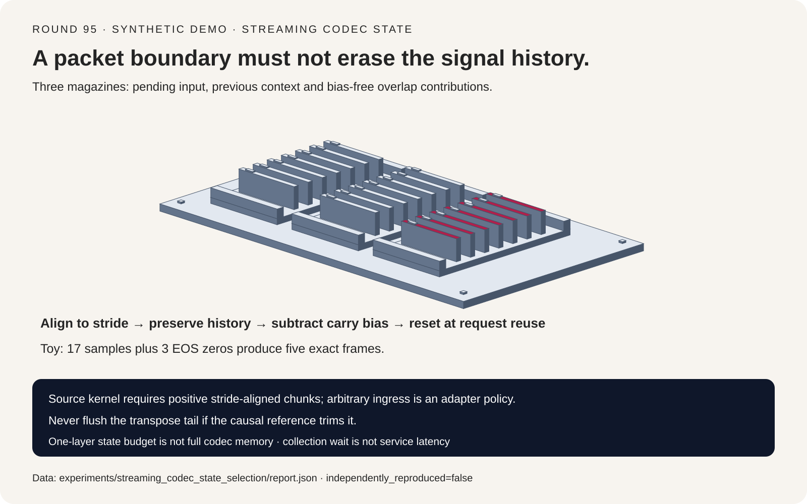
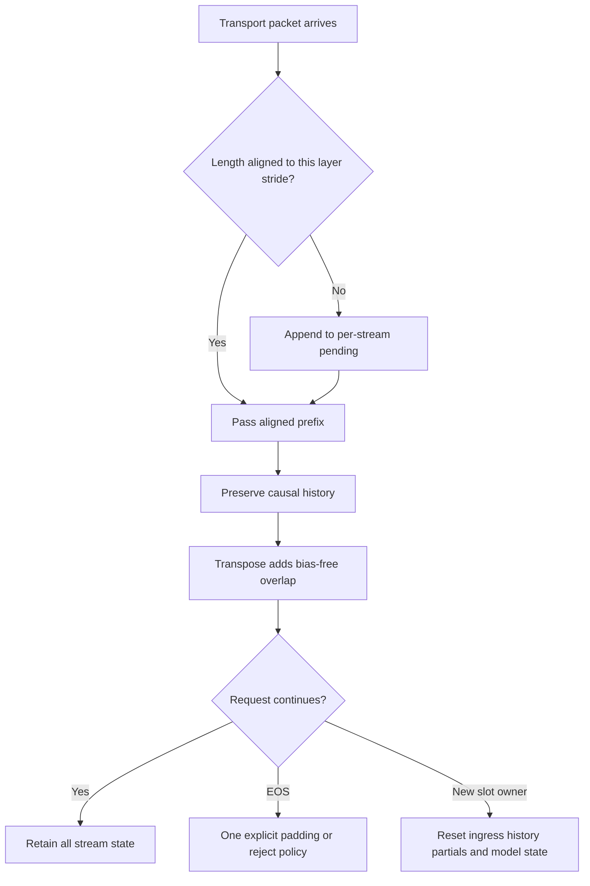
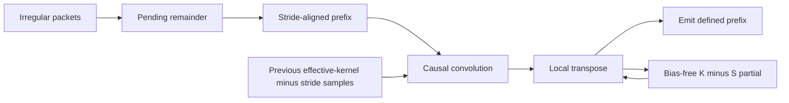
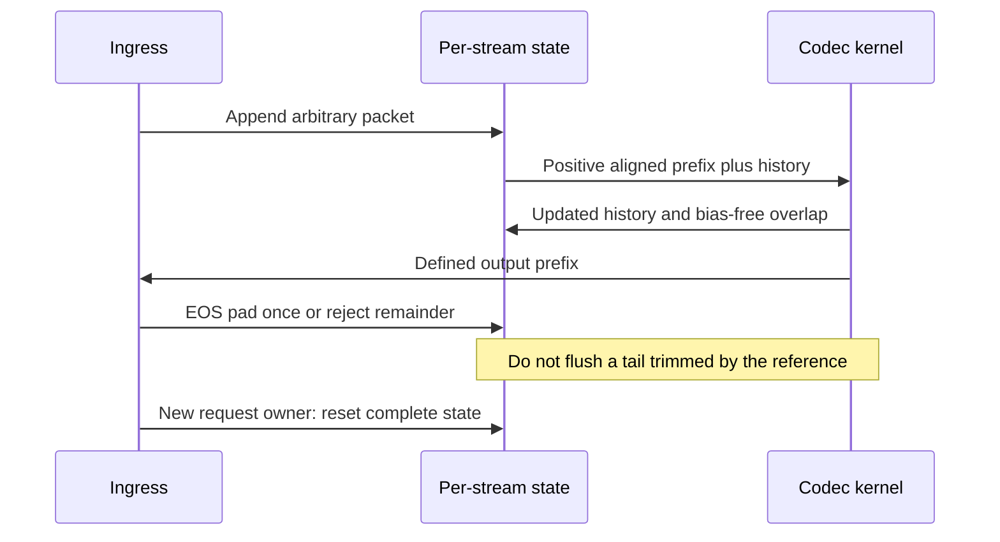

# Streaming codec state FAQ: stride-aligned ingress, bias-free overlap-add and request-slot reset

> **Language**: [中文](streaming-codec-convolution-state-stride-overlap-add-selection-faq.md) | English
>
> **Round 95 · 2026-11-14 (fourth round of the November 13 night)** · [SVG](../../assets/svg/streaming-codec-convolution-state-stride-overlap-add-selection-faq-summary.svg) · [7-card report](../reports/streaming-codec-convolution-state-stride-overlap-add-selection-cards.html) · [H5 workbench](../reports/streaming-codec-convolution-state-stride-overlap-add-sizer.html) · [Sealed data](../../experiments/streaming_codec_state_selection/report.json)
>
> **`synthetic` · `independently_reproduced=false`**: original scalar convolution/state-machine checks and buffer/collection formulas. No Mimi execution, GPU latency, subjective listening score, audio quality or service P99.



## 1. Executive summary: packet boundaries must not reset model history

**A streaming codec needs three different buffers: incomplete ingress samples,
causal convolution history and transposed-convolution overlap contributions.**
Correct KV-cache handling elsewhere does not preserve these convolution states.

| Boundary | Required behavior | Failure |
| :--- | :--- | :--- |
| Arbitrary transport packet | Retain incomplete stride frames in an ingress adapter | Drop or independently pad each remainder |
| Aligned kernel step | Preserve the chosen convolution history | Reset at every packet |
| Transpose chunk seam | Add bias-free carried contributions | Count output bias twice |
| End of stream | Apply an explicit padding/reject policy once | Invent per-packet endings or flush a trimmed tail |
| Reused request slot | Clear pending input, history, overlap and relevant model state | Attach another request to stale context |

The original fixture has 17 scalar samples, seven taps and stride four.
Packets `[1,2,5,3,6]` become aligned kernel calls; a single three-zero EOS pad
produces **five** frames, matching the independent offline formula. Dropping
transport remainders produces only **two**, so its numeric error remains
`null` rather than a misleading zip-truncated zero.

This is a deeper state-lifecycle study, not a repeat of the
[real-time voice pipeline/transport guide](voice-realtime-speech-llm-pipeline-selection-faq.en.md).
The pinned [Kyutai source change](https://github.com/kyutai-labs/moshi/commit/fd014fc2d2e2f18b809c41d2da11dbc3817efcdf)
dates to April 24, 2025 and adds reset support. These are established mechanics,
not a purported November 2026 algorithm release or a popularity ranking.

## 2. Architect Q&A: why does a correct offline codec crack at chunk seams?

### Q1: Can I pass each WebRTC or WebSocket packet directly into a codec layer?

Not from the transport boundary alone. At the pinned source,
`StreamingConv1d.forward` requires **positive input length divisible by the
layer's stride**. Its persistent history assumes that alignment. An arbitrary
packet may contain less than one stride or end halfway through it.

The original adapter appends incoming samples to `pending`, passes only
`floor(len(pending)/S)×S` samples to the kernel and retains the remainder.
An empty output while buffering is valid; it is not permission to drop input.
At EOS it either right-pads the final remainder once or explicitly rejects it.
This adapter is a harness policy, **not an upstream arbitrary-chunk API claim**.

Layer-specific sample rates and cumulative stride matter in a codec stack.
A chunk aligned for the first layer may be misaligned for a downstream
strided layer. Do not copy raw PCM packet sizes into every feature stage.

### Q2: Is convolution history always `kernel_size−1` samples?

No. First establish the padding and output alignment convention. The pinned
constant-causal implementation uses:

```text
effective_kernel = (K−1) × dilation + 1
history = effective_kernel − stride
```

For `K=7`, `S=4`, `dilation=1`, that is three prior samples. The first output
window ends at real sample index three; after an EOS-padded partial frame,
the chosen reference yields `ceil(input_length/S)` outputs.

The offline reference independently sums taps at positions
`frame×S − history + tap×dilation`, using zero outside the original signal.
The streaming path concatenates retained history with an aligned chunk,
then updates history from that joined buffer.

This is not interchangeable with another library's `K−1` left padding,
replicate initialization, lookahead or centered convolution. Replicate
padding, normalization across time and other stateful layers need their own
proof; they are outside this toy.

### Q3: Why must transposed-convolution carry remove bias?

An untrimmed transposed-convolution chunk produces `n×S + K−S` samples.
The last `K−S` contain contributions that overlap the next chunk. The next
local transpose call already adds its own output bias:

```text
raw = local_transpose(frames) + bias
raw[:K−S] += old_partial
new_partial = raw[-(K−S):] − bias
emit raw[:n×S]
```

The cache must hold contributions **without another output bias**. In the
original transpose toy, keeping bias `0.4` in the carry produces maximum
boundary error `0.4` despite matching the reference's 24-sample output shape.
Correct bias-free carry matches within `5.55e-17`.

The chosen causal offline reference trims its final `K−S` tail. Therefore
the streaming path does **not** flush that tail as extra audible samples.
Another decoder might define a different ending; specify it before testing.
`K=S` has no overlap, so a `[-0:]` slice must not accidentally cache everything.

### Q4: When should a slot reset, and what must reset together?

Normal chunks of one request continue the same state. A new independent
request using that scheduler slot must start clean. Clearing transformer KV
alone leaves causal history, transpose overlap or incomplete ingress behind.

The pinned source has per-slot `reset_mask` handling for previous context,
first-chunk flags and transpose partials. The original scalar harness instead
owns separate objects per logical stream and tests interleaved processing.
Its ingress reset clears pending samples, convolution history, closed/EOS
state together; its transpose reset clears overlap.

The stale-context control has maximum error `0.34` on the next request.
Resetting before reuse restores parity. This tests lifecycle correctness;
it is not a vulnerability finding about the upstream implementation.
Cancellation/barge-in, batch compaction and slot remapping must include
every stateful stage and any already queued output.

### Q5: Does a small convolution cache prove the codec is low-memory or fast?

No. The default illustrative pair has matching input/output channel counts:
32 streams, 64 channels, `K=7`, `S=4`, two bytes per scalar. Each of three
buffers is `12 KiB`: convolution history, transpose overlap, and an ingress
remainder upper bound. Total is **36 KiB for this pair only**.

This excludes all other layers, transformer state, RVQ, model weights,
activations, allocator metadata and scheduler bookkeeping. Dilation increases
causal history but not this undilated transpose branch. Feature-stage rate
is a separate input; it is not automatically raw PCM rate.

Smaller chunks reduce the collection-wait bound but can increase launch
overhead and lower arithmetic efficiency. The workbench does not invent a
GPU throughput curve to bridge that gap.

## 3. Visual architecture: selection tree, buffers and EOS sequence







## 4. Selection matrix and fit boundaries

| Integration | Continuity | Ending | Decision |
| :--- | :--- | :--- | :--- |
| Aligned ingress plus persistent per-stream state | Matches selected offline convention | Explicit EOS pad/reject | Reference path |
| Fresh convolution for every packet | History disappears | Many artificial beginnings | Reject as an equivalent stream |
| Drop every packet remainder | Samples and phase disappear | Truncated frame count | Reject before comparing numeric error |
| Carry biased transpose tail | Shape can match, seams do not | Duplicated bias | Reject |
| Reuse slot without resetting all state | Cross-request history survives | New request has old context | Reject |
| Another padding/alignment convention | Possibly correct for its own model | Must use its own reference | Separate proof, not this parity claim |

Hold input, weights, bias, padding, dilation, stride and EOS contract fixed.
Test a single large chunk, one-sample packets, irregular partitions, different
streams interleaved, reset/reuse, cancellation and actual low-precision output.
The toy tests scalar arithmetic, not multi-channel/grouped kernels or the
complete codec's perceptual behavior.

## 5. Worked example and seven cards: verify shape before waveform error

All values come from the [sealed JSON](../../experiments/streaming_codec_state_selection/report.json):

| Path | Output/reference samples | Maximum error | Gate |
| :--- | ---: | ---: | :--- |
| Aligned ingress, one EOS pad | `5 / 5` | `1.11e-16` | Pass |
| Reset history on each processed chunk | `5 / 5` | `0.34` | Fail |
| Drop packet remainders | `2 / 5` | `null` | Shape failure |
| Bias-free transpose carry | `24 / 24` | `5.55e-17` | Pass |
| Transpose carry includes bias | `24 / 24` | `0.4` | Fail |
| New request with stale context | `2 / 2` | `0.34` | Fail |
| Reset slot before new request | `2 / 2` | `1.11e-16` | Pass |

The gate requires equal shape and maximum absolute error below `1e-12`.
One 17-sample packet, `[4,4,4,5]` packets and seventeen one-sample packets all
produce the same five outputs under the same EOS policy.

For `M` streams, `C` channels and `b` bytes per scalar, this illustrative pair:

```text
conv_history_bytes = M C b [(K−1)d + 1 − S]
transpose_partial_bytes = M C b (K−S)
pending_input_bound_bytes = M C b (S−1)
collection_bound_ms = 1000 × chunk_stage_samples / stage_rate_hz
```

At an assumed continuous `24,000` stage samples/s, processing chunks of
`240 / 480 / 960 / 1,920` samples have collection bounds
`10 / 20 / 40 / 80 ms`. The separately assumed full-input baseline has
24,000 samples and a `1,000 ms` collection bound.

These are not measured P50/P99 or voice-to-voice latency. Computation,
network, scheduling, jitter buffers and playout remain unknown. Deterministic
formulas have no measured repeats/median; audio quality and confidence remain
`null`.

## 6. Reproduction, pinned source and deployment checks

```powershell
python -m experiments.streaming_codec_state_selection.run
python -m experiments.streaming_codec_state_selection.run --check
python -m unittest tests.test_streaming_codec_state_selection
```

The [self-contained H5](../reports/streaming-codec-convolution-state-stride-overlap-add-sizer.html)
varies stream count, channels, stride, dilation, scalar bytes and stage rate.
The static seven-card deck has `default-src 'none'; style-src 'unsafe-inline'`,
no script and no external fonts/requests. Only the calculator enables inline
JavaScript. Browser visual inspection was not performed after browser access
was denied; no alternate browser route was used.

Source anchors:

- [Pinned convolution implementation](https://github.com/kyutai-labs/moshi/blob/fd014fc2d2e2f18b809c41d2da11dbc3817efcdf/moshi/moshi/modules/conv.py): stride assertions, previous-context allocation, reset masks, partial overlap and bias removal.
- [Reset-support commit](https://github.com/kyutai-labs/moshi/commit/fd014fc2d2e2f18b809c41d2da11dbc3817efcdf): dated source provenance, not a current release claim.
- [Upstream LICENSE](https://github.com/kyutai-labs/moshi/blob/fd014fc2d2e2f18b809c41d2da11dbc3817efcdf/LICENSE): original rights remain upstream; no source or model weights mirrored.

Before rollout, capture actual waveform differences across kernel precision,
padding conventions, cumulative stride, request cancellation, state reset,
batched slot compaction and EOS. Profile the full model's memory and
end-to-end service separately; do not promote scalar parity into an audio
quality or service-SLA guarantee.
