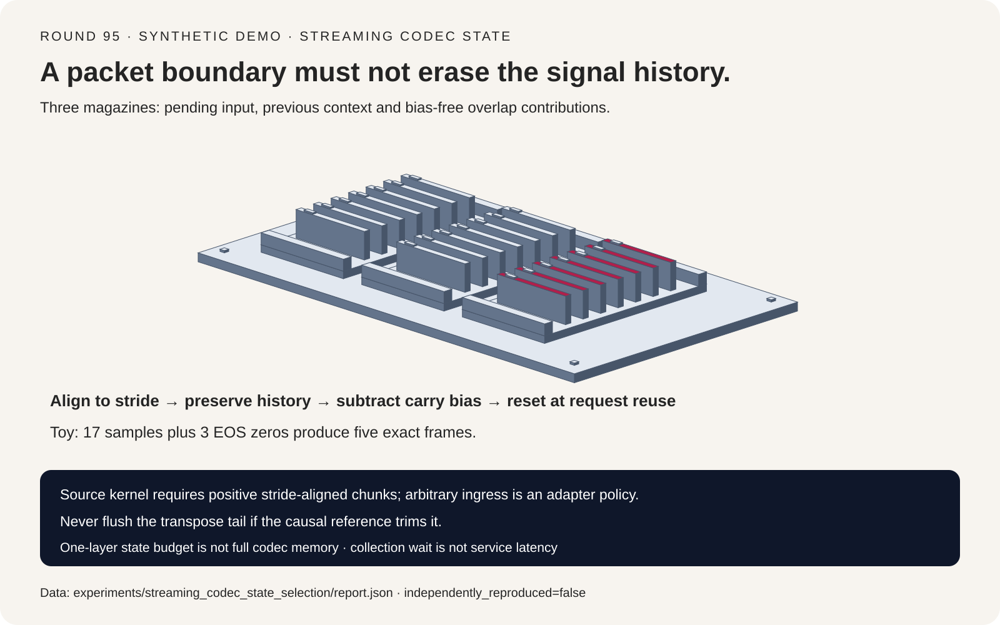
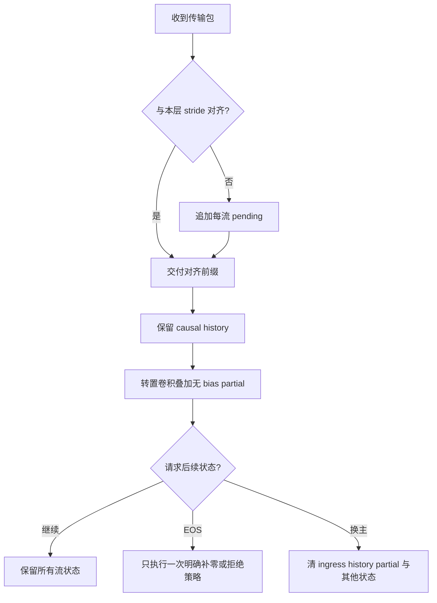
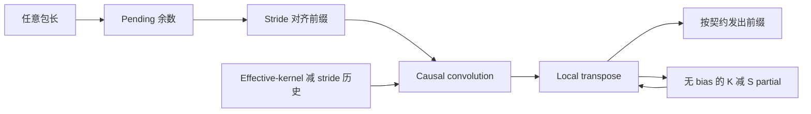
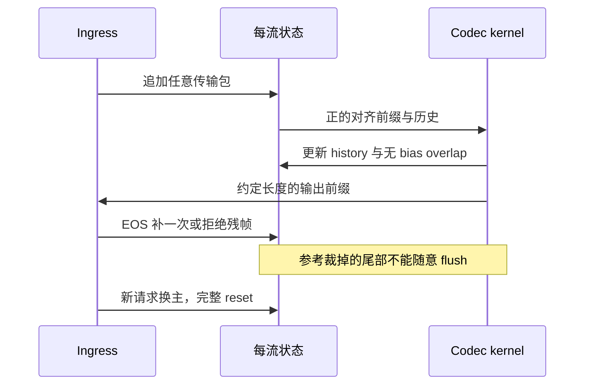

# 流式 Codec 卷积状态选型 FAQ：Stride 对齐、无 Bias Overlap-Add 与请求槽位重置

> **语言**：中文 | [English](streaming-codec-convolution-state-stride-overlap-add-selection-faq.en.md)
>
> **Round 95 · 2026-11-14（11 月 13 日夜班第 4 轮）** · [高清 SVG](../../assets/svg/streaming-codec-convolution-state-stride-overlap-add-selection-faq-summary.svg) · [七卡报告](../reports/streaming-codec-convolution-state-stride-overlap-add-selection-cards.html) · [H5 工作台](../reports/streaming-codec-convolution-state-stride-overlap-add-sizer.html) · [封存数据](../../experiments/streaming_codec_state_selection/report.json)
>
> **`synthetic` · `independently_reproduced=false`**：原创标量卷积状态机检查与缓冲/采集等待公式；没有执行 Mimi、没有 GPU 延迟、主观试听、音质或服务 P99 结论。



## 1. 核心结论速览：传输包边界不能变成模型历史重置点

**流式 codec 至少要分清三本账：未凑齐 stride 的 ingress、因果卷积历史、转置卷积的重叠贡献。** 其他位置的 Transformer KV 管理正确，并不代表这些卷积状态也正确。

| 边界 | 正确做法 | 常见错误 |
| :--- | :--- | :--- |
| 任意传输包 | ingress adapter 暂存不完整 stride | 每包丢尾或独立补零 |
| 对齐的 kernel 调用 | 保留该 padding 约定要求的历史 | 每个 packet 重建卷积状态 |
| 转置卷积 seam | 叠加不含重复 bias 的贡献 | 将 bias 随 partial 再加一次 |
| EOS | 仅统一执行一次明确补零/拒绝策略 | 每包都当结束，或乱 flush 已裁尾段 |
| 请求槽位换主 | 清 ingress、history、partial 及其他模型状态 | 新请求沿用旧请求上下文 |

原创 fixture：17 个标量样本、七个 tap、stride 四。任意包长 `[1,2,5,3,6]` 经 adapter 对齐，只在 EOS 补三个零，输出**五帧**并对齐独立离线公式。若每包丢余数，则只剩**两帧**，数值误差保持 `null`，不拿 zip 截断后的假零误差遮掩形状失败。

本轮不是重写已有[实时语音 pipeline/传输选型](voice-realtime-speech-llm-pipeline-selection-faq.md)，而是下钻 codec 的状态生命周期。固定 [Kyutai 源码变更](https://github.com/kyutai-labs/moshi/commit/fd014fc2d2e2f18b809c41d2da11dbc3817efcdf) 日期为 2025-04-24，内容涉及 reset 支持。这是成熟机制，不冒充 2026 年 11 月新算法发布或热度排名。

## 2. 架构师 Q&A：离线正确的 Codec，为何一流式就出现接缝？

### Q1：WebRTC/WebSocket 每来一个包，可以直接喂每层 codec 吗？

不能只看传输边界。固定源码的 `StreamingConv1d.forward` 明确要求输入长度**为正，且能被该层 stride 整除**。它的历史缓存依赖这种对齐。一个传输包可能不足一个 stride，也可能结束在帧中间。

原创 adapter 将样本追加到 `pending`，仅将 `floor(len(pending)/S)×S` 的前缀交给 kernel，保留余数。缓冲期间没有输出是合法状态，不代表可以丢输入。EOS 时统一补一次末尾零，或显式拒绝残帧。这是 **harness adapter 策略，不是上游支持任意 chunk 的 API 声明**。

多层 codec 还要跟踪各层 stage rate 和累计 stride。第一层对齐不代表下游层一定对齐，不能把 PCM packet 长度照搬到每个特征层。

### Q2：历史缓存不就是 `kernel_size−1` 吗？

不一定，先明确输出对齐与 padding 约定。固定源码在 constant-causal 路径使用：

```text
effective_kernel = (K−1) × dilation + 1
history = effective_kernel − stride
```

`K=7`、`S=4`、`dilation=1` 时是三个历史样本。第一帧窗口结束在真实输入索引三；EOS 残帧统一补齐后，所选参考输出 `ceil(input_length/S)` 帧。

独立离线公式在 `frame×S − history + tap×dilation` 处取样，超出原始信号范围视为零；流式路径则把历史与对齐 chunk 拼接，再从拼接缓冲尾部更新历史。

它不能与其他库的 `K−1` 左补零、replicate 首帧、lookahead 或居中卷积混用。Replicate padding、跨时间 normalization 与其他有状态模块需要自己的等价性证明，不在本 toy 范围内。

### Q3：为什么转置卷积 overlap cache 必须去掉 bias？

未裁剪的转置卷积 chunk 产生 `n×S + K−S` 个样本。末尾 `K−S` 是下个 chunk 需要叠加的未来贡献；但下次局部转置卷积已经会加一遍输出 bias：

```text
raw = local_transpose(frames) + bias
raw[:K−S] += old_partial
new_partial = raw[-(K−S):] − bias
emit raw[:n×S]
```

所以 carry 应存贡献，而不是又一遍 bias。本轮 transpose toy 的 bias 为 `0.4`，若随 carry 保留它，即使输出形状同样为 24 个样本，seam 最大误差仍为 `0.4`。正确无 bias carry 的误差为 `5.55e-17`。

所选 causal 离线参考会裁掉最终 `K−S` 尾部，因此流式也**不把这些尾贡献 flush 成额外可听样本**。其他 decoder 可定义不同结束契约，但要先说清再比较。`K=S` 时没有 overlap，不能用 `[-0:]` 意外缓存全部输出。

### Q4：什么时候 reset，哪些状态必须一起 reset？

同一请求的普通 chunk 应延续状态；调度槽位交给新的独立请求时必须清空。只清 Transformer KV，仍可能留下历史卷积、转置 partial 或 ingress 残样本。

固定源码用每槽位 `reset_mask` 处理 previous、first-chunk 标记与 transpose partial。原创标量 harness 为每条逻辑流保留独立对象，并测试交错执行；ingress reset 同时清 pending、卷积历史、closed/EOS 状态，transpose reset 清 overlap。

旧上下文复用的负对照在新请求上产生最大 `0.34` 误差；换主前 reset 后恢复一致。这是生命周期正确性验证，**不是声称上游存在漏洞**。取消、barge-in、batch compact 与槽位重映射还必须同步处理其他有状态层和已排队输出。

### Q5：卷积 cache 很小，是否说明整个 codec 很省显存、很快？

不是。默认示例只预算输入/输出通道数相同的一个层对：32 条流、64 通道、`K=7`、`S=4`、每标量两字节。三类缓冲各 `12 KiB`，即卷积 history、transpose partial、ingress 余数上界，合计 **36 KiB，仅针对该层对**。

没有计其他 codec 层、Transformer 状态、RVQ、模型权重、激活、分配器和调度对象。Dilation 增大 causal history，不改变本例无 dilation 的 transpose 分支。特征层采样率是独立参数，不能一律套原始 PCM rate。

小 chunk 能降低采集等待上界，却可能增加 launch 开销、降低计算效率。工作台不会虚构 GPU 吞吐曲线来填补这块未知。

## 3. 可视化架构：选型树、三种缓冲与 EOS 时序







## 4. 选型矩阵与适用边界

| 集成方式 | 连续性 | 结束语义 | 判断 |
| :--- | :--- | :--- | :--- |
| 对齐 ingress 与每流持久状态 | 符合选定离线约定 | 显式 EOS pad/reject | 参考路径 |
| 每包新建卷积 | 丢历史 | 多个伪起点 | 不能冒充同一条连续流 |
| 每包丢余数 | 丢样本与相位 | 输出帧数减少 | 先判形状失败 |
| Carry 包含 bias | 长度能匹配，seam 不匹配 | bias 重复叠加 | 拒绝 |
| 槽位不清状态就换主 | 跨请求上下文残留 | 新请求夹带旧历史 | 拒绝 |
| 不同 padding/对齐约定 | 对自身模型可能正确 | 必须使用自身参考 | 单独证明，不冒用本轮结论 |

A/B 固定输入、权重、bias、padding、dilation、stride 和 EOS 契约。比较整段、单样本包、任意分块、交错流、重置复用、取消以及真实低精度输出。本轮只验证标量机制，不验证多通道/grouped kernel 或完整 codec 的感知音质。

## 5. 算例与七卡报告：先检查形状，再比较波形误差

所有数值来自[封存 JSON](../../experiments/streaming_codec_state_selection/report.json)：

| 路径 | 输出/参考样本数 | 最大误差 | 结论 |
| :--- | ---: | ---: | :--- |
| 对齐 ingress，一次 EOS pad | `5 / 5` | `1.11e-16` | 通过 |
| 每个处理块清 history | `5 / 5` | `0.34` | 失败 |
| 丢弃每包余数 | `2 / 5` | `null` | 形状失败 |
| 无 bias transpose carry | `24 / 24` | `5.55e-17` | 通过 |
| Carry 含 bias | `24 / 24` | `0.4` | 失败 |
| 新请求沿用旧 history | `2 / 2` | `0.34` | 失败 |
| 换主前 reset | `2 / 2` | `1.11e-16` | 通过 |

门槛是形状相同，且最大绝对误差小于 `1e-12`。一个 17 样本包、`[4,4,4,5]` 与十七个单样本包，在相同 EOS 策略下都产生同样五帧。

对 `M` 条流、`C` 通道、每标量 `b` 字节，示例层对：

```text
conv_history_bytes = M C b [(K−1)d + 1 − S]
transpose_partial_bytes = M C b (K−S)
pending_input_bound_bytes = M C b (S−1)
collection_bound_ms = 1000 × chunk_stage_samples / stage_rate_hz
```

假定本层连续输入速率 `24,000` samples/s，处理块 `240 / 480 / 960 / 1,920` 样本的采集等待上界为 `10 / 20 / 40 / 80 ms`。独立假定的整段基线为 24,000 样本，等待上界 `1,000 ms`。

这不是实测 P50/P99 或 voice-to-voice latency。计算、网络、调度、jitter buffer 与播放仍未知。确定性公式没有实测 repeat/median，audio quality 与 confidence 保持 `null`。

## 6. 复现步骤、一手源码与上线检查

```powershell
python -m experiments.streaming_codec_state_selection.run
python -m experiments.streaming_codec_state_selection.run --check
python -m unittest tests.test_streaming_codec_state_selection
```

[自包含 H5](../reports/streaming-codec-convolution-state-stride-overlap-add-sizer.html) 可修改流数、通道、stride、dilation、标量字节与 stage rate。静态七卡 CSP 是 `default-src 'none'; style-src 'unsafe-inline'`，无脚本、外部字体或请求；仅计算器允许 inline JavaScript。浏览器权限拒绝后未绕道进行视觉检查。

源码锚点：

- [固定卷积实现](https://github.com/kyutai-labs/moshi/blob/fd014fc2d2e2f18b809c41d2da11dbc3817efcdf/moshi/moshi/modules/conv.py)：stride 断言、previous 分配、reset mask、partial overlap 与 bias removal。
- [Reset 支持提交](https://github.com/kyutai-labs/moshi/commit/fd014fc2d2e2f18b809c41d2da11dbc3817efcdf)：标明来源日期，不伪装成当日新发布。
- [上游 LICENSE](https://github.com/kyutai-labs/moshi/blob/fd014fc2d2e2f18b809c41d2da11dbc3817efcdf/LICENSE)：原作者权利保留于上游，未镜像其实现或模型权重。

上线前按真实 kernel 精度、padding、累计 stride、取消、reset、批槽位重排与 EOS 检查波形差异。完整模型显存与端到端服务单独剖析，不能把标量一致性升级为音质或 SLA 承诺。
