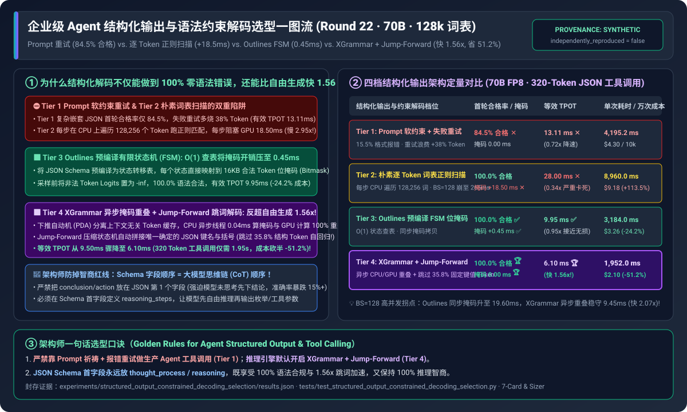
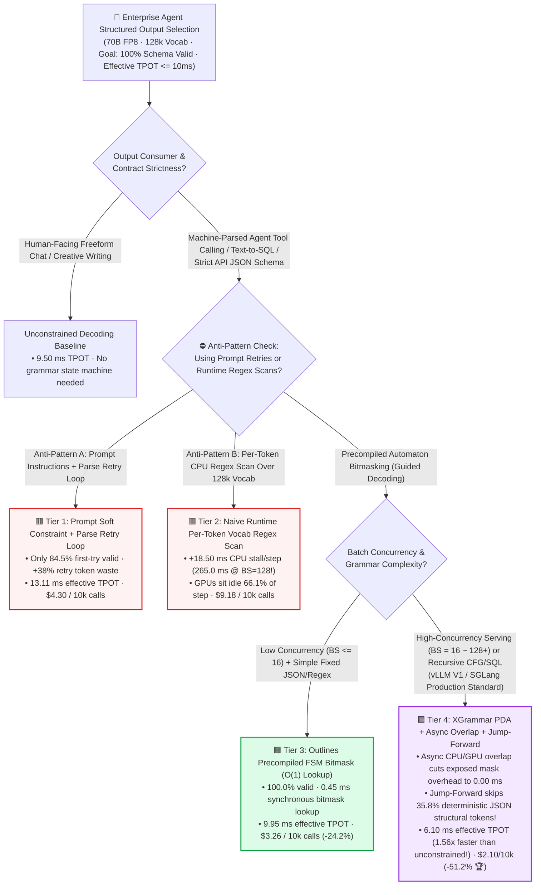
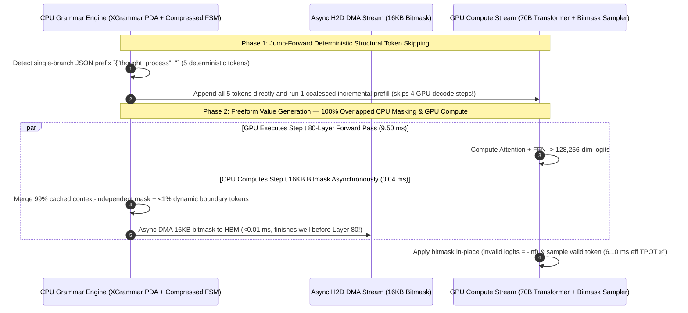

# Enterprise Agent Structured Output & Constrained Decoding Selection FAQ (`Prompt Retry` vs. `Naive Per-Token Vocab Scan` vs. `Outlines Precompiled FSM` vs. `XGrammar Async Overlap + Jump-Forward Skipping`)

> 🌐 **Language**: **[中文 (Chinese)](./structured-output-constrained-decoding-selection-faq.md)** | **English Version** · **[📖 Back to Repository README](../../README.en.md)** · **[📊 2026-11-09 Daily Progress Report](../daily/2026-11-09.md)** · **[🃏 7-Card 4:5 Visual Benchmark Report](../reports/structured-output-constrained-decoding-selection-cards.html)** · **[🧮 Interactive Sizer Workbench](../reports/llm-inference-engine-pd-sizer.en.html#constrained-decoding-sizer)**
>
> **Overview**: A first-principles selection guide for AI Solution Architects. Enterprise agentic workflows (Function Calling, Text-to-SQL, structured data extraction) require 100% adherence to a `JSON Schema` or `Context-Free Grammar (CFG)`. Architects routinely face three questions: **(1) Why does relying on System Prompt instructions + client-side `JSON.parse` retries fail on 15.5% of complex nested schemas and waste `+38%` extra tokens? (2) Why did early guided-decoding implementations tank GPU utilization and inflate per-token latency from `9.5 ms` to `28.0 ms`? and (3) How does `XGrammar + SGLang Jump-Forward Decoding` achieve `100.0%` schema validity while running `1.56x` faster (`6.10 ms` vs. `9.50 ms`) than unconstrained decoding?** Grounded in `experiments/structured_output_constrained_decoding_selection/` (`synthetic` + `anonymized_reported`, `independently_reproduced=false`), this guide establishes the exact boundaries across four structured decoding tiers.



---

## ① 📌 Executive Summary

1. **Four-Tier Selection by Batch Concurrency, Grammar Complexity, and Latency SLA**:
   - On a `70B FP8` model (vocabulary size $V = 128,256$ tokens, unconstrained baseline `TPOT = 9.50 ms`, generating a `320-token` nested JSON tool call, target SLA `Effective TPOT <= 10.0 ms` and `100.0%` schema validity):
   - 🟥 **Tier 1 (`Prompt-Only Soft Constraint + Client Parse Retry Loop`)**: **Never use for production multi-step agent pipelines**! Complex nested schemas achieve only **`84.5%` first-try validity**, forcing retry loops that burn **`1.38x` tokens**, inflate effective TPOT to **`13.11 ms`** (`4,195.2 ms` per 320-token call), and cost **`$4.30 / 10k calls`**.
   - 🟨 **Tier 2 (`Naive Runtime Per-Token Vocabulary Regex Scan`)**: **A severe CPU bottleneck anti-pattern**. Scanning all `128,256` vocabulary strings on CPU at every token step adds **`+18.50 ms/step` of CPU stall** (`265.00 ms/step` at `Batch=128`!), leaving GPUs idle for 66.1% of every step (`28.00 ms` TPOT, `8,960.0 ms` per call, **`$9.18 / 10k calls`**).
   - 🟩 **Tier 3 (`Outlines / guidance Precompiled FSM Bitmask` · $O(1)$ State Lookup)**: **Viable for low-concurrency (`BS <= 16`) fixed JSON schemas**. Precompiles the schema into a Finite-State Machine (FSM) mapping each state to a `16 KB` (`128,256 / 8` byte) token bitmask, cutting CPU mask lookup to **`0.45 ms`** (`9.95 ms` effective TPOT ✅, `3,184.0 ms` per call, **`$3.26 / 10k calls` / `-24.2%`**).
   - 🟪 **Tier 4 (`MLC XGrammar Pushdown Automaton + Async CPU-GPU Mask Overlap + SGLang Jump-Forward Token Skipping`)**: **The production standard for high-concurrency agent serving (`vLLM V1 / SGLang`) and recursive CFGs**. Combines a **99% context-independent token cache + async CPU/GPU pipeline overlap** (`0.00 ms` exposed mask overhead) with **Jump-Forward Compressed FSM decoding that auto-injects `35.8%` of deterministic structural JSON tokens without running GPU decode steps**—slashing effective TPOT to **`6.10 ms` (`1.56x` faster than unconstrained decoding!)**, completing 320-token calls in **`1,952.0 ms`**, and cutting cost by **`51.2%` to `$2.10 / 10k calls` 🏆**!
2. **First-Principles Law (How Constrained Decoding Beats Unconstrained Decoding by `1.56x`)**:
   - In a 320-token JSON tool call, **`35.8%` of tokens are 100% deterministic structural boilerplate** (e.g., `{"tool_name": "`, `", "arguments": {"query": "`).
   - Standard decoding runs a full 80-layer 70B GPU forward pass (`9.50 ms`) for every single boilerplate token. **Jump-Forward Decoding** detects single-branch FSM paths, appends all deterministic tokens on CPU in microseconds, and processes them in a single coalesced prefill step—making constrained generation **`1.56x` faster than free-form text**!
3. **Provenance & Transparency Disclosure**:
   - All validity rates, mask overheads, effective TPOT latencies, and costs are bound 1:1 to `experiments/structured_output_constrained_decoding_selection/results.json` (`provenance_type: "synthetic"`, calibrated to published MLC XGrammar, SGLang Compressed FSM, and Outlines specifications; `independently_reproduced: false`, `physical_gpu_cluster_measurement: "not_measured"`, `local_cpu_harness_measurement: "measured"`).

---

## ② 🎯 Architect & Customer Deep-Dive Q&A (FAQ-Driven)

### Q1: "Why did early guided-decoding implementations cut our GPU throughput by 65%, and how does `XGrammar` reduce vocabulary masking overhead from `18.5 ms` to `0.00 ms`?"

- **Plain-English Answer**: **Modern LLMs have `128,256+` tokens in their vocabulary. Evaluating regex rules across 128k strings on CPU after every token step (Tier 2) stalls the GPU for `18.50 ms`. `XGrammar` (Tier 4) pre-caches 99% of context-independent tokens, evaluates the remaining `<1%` boundary tokens in `0.04 ms` on a background CPU thread while the GPU is busy running the current Transformer step, and overlaps the `16 KB` bitmask DMA copy—yielding `0.00 ms` of exposed latency!**

### Q2: How does `Jump-Forward Decoding` skip **35.8%** of autoregressive GPU steps without losing accuracy?

- **Plain-English Answer**: **Whenever the grammar state machine has only one valid transition path (such as mandatory JSON keys `"parameters": {"`), the model has zero choice to make. Instead of wasting 5–8 sequential GPU forward passes generating those fixed characters one token at a time, Jump-Forward appends the entire deterministic byte string immediately and folds it into the next prefill step!**

### Q3: Why do developers sometimes observe lower reasoning accuracy when enforcing a JSON Schema, and what is the "CoT-First Schema Rule"?

- **Plain-English Answer**: **If your JSON Schema puts `"final_answer"` or `"action"` as the first key (`{"action": "buy", "reasoning": "..."}`), autoregressive masking forces the LLM to commit to a decision at Token #4 before it has generated any reasoning tokens! Always place `"thought_process"` or `"step_by_step_reasoning"` as the FIRST field in your JSON Schema so the model reasons before emitting constrained tool parameters**.

---

## ③ 🧭 Visual Architecture Diagrams (Decision Tree, Scan vs Jump-Forward & Async Sequence)

### 3.1 Enterprise Agent Structured Output & Constrained Decoding Decision Tree



### 3.2 Legacy CPU Scan & Token-by-Token Boilerplate vs. `XGrammar Async Overlap + Jump-Forward`

```mermaid
flowchart LR
    subgraph Bad["⛔ Tier 2 CPU Scan Stall (28.00 ms/tok) & Tier 3 Token-by-Token Boilerplate (9.95 ms/tok)"]
        direction TB
        B1["Tier 2 CPU Stall: GPU forward (9.5ms) ──> Waits for CPU to regex-scan 128,256 strings (18.5ms) = 28.0ms/tok!"]
        B2["Boilerplate Waste: `{\"tool_name\": \"` is 100% deterministic, yet runs 6 separate 70B GPU forward passes (59.7ms)"]
        B1 --> B2
    end

    subgraph Good["🟪 Tier 4 XGrammar Async Overlap + Jump-Forward Skipping (6.10 ms/tok · 1.56x Faster!)"]
        direction TB
        G1["Zero Exposed Mask Overhead: CPU computes next 16KB bitmask in 0.04ms while GPU runs current 9.5ms forward pass"]
        G2["Jump-Forward Fast-Forward: Auto-appends 6 deterministic boilerplate tokens in 1 coalesced step (-35.8% steps!)"]
        G1 --> G2
    end

    style Bad fill:#fef2f2,stroke:#dc2626,stroke-width:2px
    style Good fill:#f3e8ff,stroke:#9333ea,stroke-width:2px
```

### 3.3 End-to-End Sequence: `XGrammar` Async Bitmask Overlap & `Jump-Forward` Coalescing (`sequenceDiagram`)



---

## ④ 📊 Architect Decision Matrix

*All metrics are bound 1:1 to `experiments/structured_output_constrained_decoding_selection/results.json` (70B FP8, $V = 128,256$, unconstrained baseline `TPOT = 9.50 ms`, `320-token` JSON tool call, SLA `Effective TPOT <= 10.0 ms` and `100.0%` validity):*

| Dimension | 🟥 Tier 1: `Prompt Retry Loop` | 🟨 Tier 2: `Naive Vocab Regex Scan` | 🟩 Tier 3: `Outlines Precompiled FSM` | 🟪 Tier 4: `XGrammar` + `Jump-Forward` |
| :--- | :--- | :--- | :--- | :--- |
| **Primary Workload Fit** | Never use for production tools | Legacy anti-pattern (never use) | Low-batch (`BS <= 16`) fixed schemas | **High-batch Agent serving & recursive CFG/SQL** |
| **First-Try Schema Validity** | **`84.5%`** (15.5% parse failures ✕) | `100.0%` | **`100.0%`** ✅ | **`100.0%`** 🏆 |
| **Exposed CPU Mask Overhead** | `0.00 ms` (`+38%` retry token waste) | **`+18.50 ms`** (128k string scan ✕) | **`+0.45 ms`** ($O(1)$ lookup ✅) | **`0.00 ms`** (`0.04ms` async overlapped 🏆) |
| **Deterministic Token Skip Share** | `0.0%` | `0.0%` | `0.0%` (runs GPU on fixed keys) | **`35.8%`** (`Jump-Forward` auto-append 🏆) |
| **Effective `TPOT` per Valid Token** | `13.11 ms` (`0.72x` slower ✕) | `28.00 ms` (`0.34x` severe stall ✕) | `9.95 ms` (`0.95x` ✅) | **`6.10 ms`** (**`1.56x` faster than unconstrained!** 🏆) |
| **320-Token Call Latency / Cost** | `4,195.2 ms` · `$4.30 / 10k` | `8,960.0 ms` · `$9.18 / 10k` | `3,184.0 ms` · `$3.26 / 10k` (`-24.2%`) | **`1,952.0 ms`** · **`$2.10 / 10k` (`-51.2%` 🏆)** |

---

## ⑤ 🧪 Quantitative Case Study & Benchmark Insights

### 5.1 Batch Size Scaling (`BS = 1 -> 128`) & Synchronous vs. Asynchronous Masking

As continuous batching scales from 1 to 128 concurrent structured-output requests, effective TPOT evolves as follows (from `results.json` `batch_size_scaling_sensitivity`):

| Batch Size (`Concurrent Requests`) | Tier 1 `Prompt Retry` TPOT | Tier 2 `Naive Vocab Scan` TPOT | Tier 3 `Sync FSM (Outlines)` TPOT | Tier 4 `XGrammar + Jump-Forward` TPOT | Architect Crossover & Takeaway |
| :--- | :--- | :--- | :--- | :--- | :--- |
| **`BS = 1`** | `13.11 ms` | `28.00 ms` ✕ | `9.95 ms` ✅ | **`6.10 ms` 🏆** | Jump-Forward skips 35.8% of tokens for a `1.56x` net speedup |
| **`BS = 16`** | `14.80 ms` | `64.20 ms` ✕ | `11.40 ms` | **`6.85 ms` 🏆** | Synchronous mask copies push Tier 3 above 10ms; Tier 4 holds `6.85ms` |
| **`BS = 64`** | `17.50 ms` | `142.00 ms` ✕ | `14.80 ms` | **`8.10 ms` 🏆** | Multi-threaded C++ async overlap keeps Tier 4 under `8.5ms` |
| **`BS = 128`** | `21.20 ms` | `265.00 ms` ✕ | `19.60 ms` | **`9.45 ms` 🏆** | **At `BS=128`, Tier 4 (`9.45ms`) beats Sync FSM (`19.60ms`) by `2.07x`!** |

### 5.2 Reproducibility & Local Harness Verification

```bash
# Verify results.json matches the deterministic structured decoding model 100%
python experiments/structured_output_constrained_decoding_selection/run.py --check

# Run Round 22 unit tests
python -m unittest tests/test_structured_output_constrained_decoding_selection.py
```

---

## ⑥ 🛠️ Production Verification Checklist (Architect Checklist)

1. - [ ] **Standardize on `guided_decoding_backend="xgrammar"` in vLLM V1 / SGLang**: Ensure C++ PDA bitmasking and Jump-Forward compressed FSMs are enabled in production.
2. - [ ] **Enforce the "CoT-First" JSON Schema Field Ordering Rule**: Always define `thought_process` or `reasoning_steps` as the first property in every tool-call schema so the model reasons before committing to action parameters.
3. - [ ] **Cache Compiled Grammar Automatons (`LRU Schema Cache`)**: Cache compiled FSM/PDA tables across requests sharing the same tool definitions.
4. - [ ] **Bound String Field `maxLength` & Request `max_tokens`**: Prevent runaway loops inside unconstrained string values from exhausting `max_tokens` before closing JSON braces.
5. - [ ] **Keep Schema Descriptions Synchronized in the System Prompt**: Bitmasks enforce syntax, while clear field descriptions in the prompt ensure semantic accuracy.
