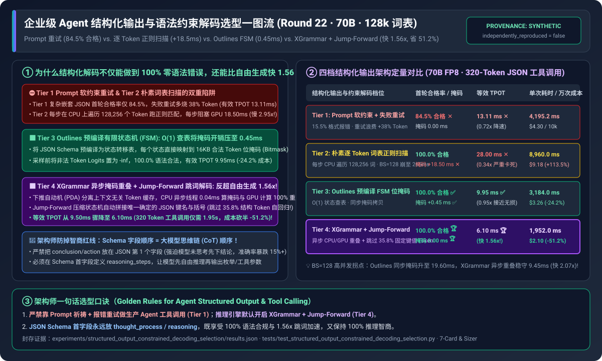
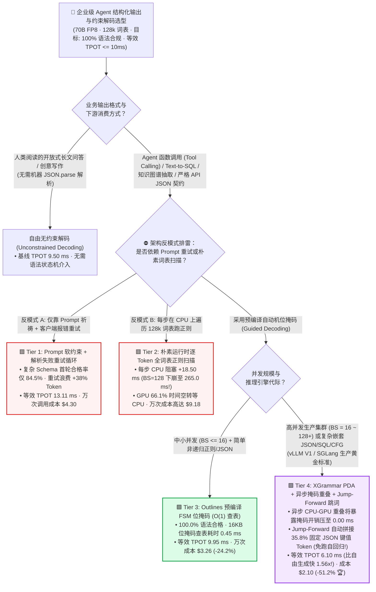
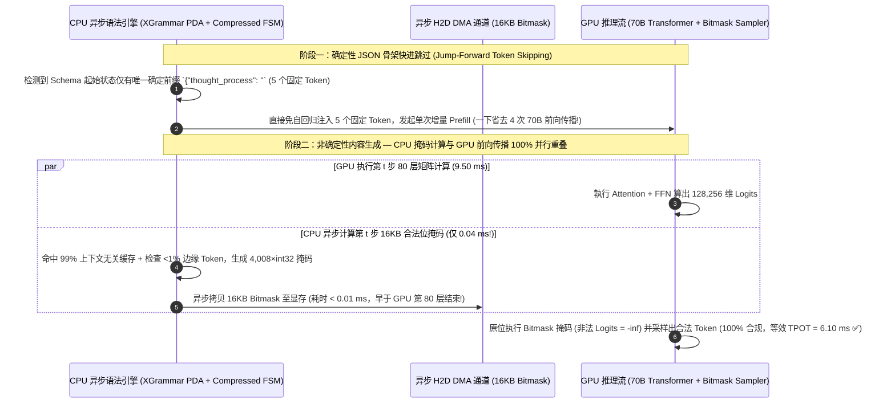

# 企业级 Agent 结构化输出与语法约束解码架构选型指南（`Prompt 软约束重试` vs. `朴素逐 Token 正则扫描` vs. `Outlines 预编译 FSM` vs. `XGrammar 异步掩码 + Jump-Forward 跳词加速`）

> 🌐 **Language**: **中文 (Chinese)** | **[English Version](./structured-output-constrained-decoding-selection-faq.en.md)** · **[📖 返回仓库根目录 README](../../README.md)** · **[📊 2026-11-09 每日进展日报](../daily/2026-11-09.md)** · **[🃏 7-Card 4:5 视觉评测报告](../reports/structured-output-constrained-decoding-selection-cards.html)** · **[🧮 交互式定容工作台](../reports/llm-inference-engine-pd-sizer.html#constrained-decoding-sizer)**
>
> **导读**：面向 AI Solution Architect 的第一性原理实战选型指南。在企业级多智能体工作流（Function Calling、Text-to-SQL、数据提取）中，下游微服务要求大模型 100% 输出严格符合 `JSON Schema` 或 `上下文无关文法（CFG）` 的结构化负载。架构师常面临三大困惑：**① 只在 System Prompt 里写“请只输出合法 JSON”为什么在复杂嵌套 Schema 下仍有 `15.5%` 的解析失败率，且报错重试白白多烧掉 `38%` 的算力？② 为什么早期开启 Guided Decoding 后，GPU 利用率暴跌、每 Token 延迟从 `9.5 ms` 恶化到 `28.0 ms`？③ 为什么新一代 `XGrammar + SGLang Jump-Forward` 不仅做到了 `100.0%` 零语法报错，反而比不加任何约束的自由解码还要快 `1.56 倍`（`6.10 ms` vs `9.50 ms`）？** 本文基于 `experiments/structured_output_constrained_decoding_selection/` 封存的确定性模型（`synthetic` + `anonymized_reported`，`independently_reproduced=false`），系统拆解四档结构化解码架构的底层机制与选型边界。



---

## ① 📌 核心结论速览（Executive Summary）

1. **按并发规模、语法复杂度（JSON Schema vs. 递归 CFG/SQL）与延迟 SLA 四档精准选型**：
   - 在运行 `70B FP8` 模型（词表大小 $V = 128,256$ Tokens，无约束自由解码基线 `TPOT = 9.50 ms`，生成平均 `320 Tokens` 的复杂嵌套工具调用 JSON，SLA 要求 `等效 TPOT <= 10.0 ms` 且 `语法合格率 = 100.0%`）基准下：
   - 🟥 **Tier 1（`Prompt 软约束 + 客户端 JSON.parse 失败重试循环`）**：**严禁用于生产级多步 Agent 工作流**！复杂嵌套 Schema 首轮语法合格率仅 **`84.5%`**（漏引号、尾逗号、幻觉字段、Markdown 废话包裹），触发回传报错重试导致实际 Token 消耗膨胀 **`1.38x`**，等效每有效 Token 耗时恶化至 **`13.11 ms`**（端到端单次调用 `4,195.2 ms`，万次调用成本 **`$4.30`**）。
   - 🟨 **Tier 2（`朴素运行时逐 Token 全词表正则扫描`）**：**灾难性的 CPU 阻塞反模式**。虽然将语法合格率提至 `100.0%`，但每生成 1 个 Token 都在 CPU 上用正则表达式实时遍历 `128,256` 个词表字符串，带来 **`+18.50 ms/step` 的 CPU 掩码计算阻塞**（在 `Batch=128` 下更恶化至 **`265.00 ms/step`**！），GPU 66.1% 的时间在空转等 CPU，单次耗时飙至 **`8,960.0 ms`**（万次成本 **`$9.18`**）。
   - 🟩 **Tier 3（`Outlines / guidance 预编译有限状态机 FSM 位掩码` · $O(1)$ 状态查表）**：**中小并发正则与固定 JSON Schema 的经典无损方案**。将 Schema 提前编译为确定性有限状态自动机（FSM），每个状态预存一张 `16 KB`（$128,256 / 8$ 字节）合法 Token 位掩码（Bitmask），将 CPU 查表开销从 `18.50 ms` 骤降至 **`0.45 ms`**（等效 TPOT **`9.95 ms` ✅**，单次耗时 `3,184.0 ms`，万次成本降至 **`$3.26` / 省 `24.2%`**）。
   - 🟪 **Tier 4（`MLC XGrammar 下推自动机 PDA + 异步 CPU-GPU 掩码重叠 + SGLang Jump-Forward 确定性跳词加速`）**：**高并发企业级 Agent 平台与递归语法（JSON/SQL/Python AST）的终局标准**。一方面通过 **上下文无关自适应 Token 缓存 + 异步 CPU 线程流水重叠** 将暴露的掩码延迟压至 **`0.00 ms`**；另一方面通过 **压缩状态机（Compressed FSM）直接拼接 JSON 中唯一确定的固定键名与符号（如 `{"tool_call": {"name": "`），直接跳过 `35.8%` 的结构化 Token 的 GPU 自回归前向计算**，使等效 TPOT 降至 **`6.10 ms`（比无约束自由解码还快 `1.56x`！）**，单次调用压缩至 **`1,952.0 ms`**，万次成本腰斩至 **`$2.10`（比 Tier 1 省 `51.2%` 🏆）**！
2. **第一性原理定性（为什么加上语法约束后，生成速度反而能比自由生成快 `1.56 倍`？）**：
   - 在一个 320 Token 的标准 JSON 工具调用中，有 **`35% ~ 45%` 的 Token 是由 Schema 100% 唯一决定的固定套话（Boilerplate）**——例如当模型刚输出完字段值 `"上海",` 后，根据 Schema 下一个字段名必然是 `"temperature_celsius": `（对应 6 个固定 Token）。
   - 普通解码必须老老实实跑 6 次 70B 大模型前向传播（耗费 $6 \times 9.5 = 57\text{ ms}$）去把这 6 个毫无悬念的 Token 一个个“猜”出来；而 **Jump-Forward Decoding（跳词解码）** 检测到当前 FSM 状态只有唯一出边字符串时，**直接由 CPU 将这 6 个 Token 追加到序列末尾并合并进下一次增量 Prefill 一次性算完**——用 1 次并行算子代替 6 次串行自回归，实现“越严格、越飞快”！
3. **证据口径与透明性声明**：
   - 本指南所有合格率、CPU 掩码耗时、等效 TPOT 与万次调用成本均绑定 `experiments/structured_output_constrained_decoding_selection/results.json`（`provenance_type: "synthetic"`，基于 MLC XGrammar、SGLang Compressed FSM 及 Outlines 公开论文与基准校准的确定性算例，`independently_reproduced: false`，未在物理 32 卡集群开展线上压测 `physical_gpu_cluster_measurement: "not_measured"`；本机 Python 单测与校验为 `local_cpu_harness_measurement: "measured"`）。

---

## ② 🎯 客户与架构师灵魂拷问 Q&A（FAQ-Driven）

### Q1：客户问：“为什么我们在开源推理引擎里一打开早期的 `guided_json` 参数，吞吐量就掉了一大半？`Outlines (Tier 3)` 和 `XGrammar (Tier 4)` 是怎么把 `18.5 ms` 的词表扫描压到 `0 ms` 的？”

- **直白结论**：**因为 Llama-3 / Qwen / DeepSeek 的词表高达 `128,256 ~ 152,000` 个 Token！如果在每生成一个 Token 的几毫秒间隙里，让 CPU 临时去遍历 12.8 万个词检查谁符合当前语法（Tier 2），CPU 单核要算 `18.5 ms`，而 GPU 算完一层只要 `9.5 ms`——相当于法拉利（GPU）每跑一米就要停下来等自行车（CPU）！**
- **第一性原理拆解（从 $O(V)$ 在线扫描到 $O(1)$ 预编译位掩码与 `XGrammar` 上下文无关分解）**：
  1. **`Outlines` 的预编译有限状态机（Tier 3）**：在请求开始前，把 JSON Schema 编译成状态图，并预先算出每个状态允许哪些 Token ID，存成一个仅 **`16,032 字节`（`4,008` 个 `int32` 整数，每比特代表 1 个 Token）** 的紧凑位掩码（Bitmask）。解码时 CPU 只需 $O(1)$ 查表把这 16KB 掩码拷给 GPU，由 GPU 内核一行代码将掩码为 `0` 的 Token Logits 设为 $-\infty$，耗时降至 **`0.45 ms`**。
  2. **为什么在大 Batch（`BS=128`）和递归语法（CFG）下，仅靠静态 FSM 依然不够？** 当支持嵌套括号、SQL 语法或动态 Schema 时，属于**上下文无关文法（CFG，需要带栈的下推自动机 PDA）**，状态空间无穷大，无法全部提前预编译；且当 `BS=128` 个请求同时在 CPU 上生成并拷贝掩码时，同步开销仍会累积到 `10~19 ms`。
  3. **`XGrammar`（Tier 4，vLLM / SGLang 默认引擎）的三大突破**：
     - **99% 上下文无关 Token 预分类缓存**：XGrammar 发现词表中 99% 的普通字符 Token 是否合法只取决于当前字节前缀，与自动机调用栈深度无关，因此可 100% 静态缓存；每次只需在运行时动态检查 `< 1%` 的跨边界边缘 Token（耗时压至 **`40 微秒 / 0.04 ms`**）！
     - **CPU-GPU 双流水线异步重叠（Async Overlap）**：当 GPU 正在跑第 $t$ 步的 80 层 Transformer 矩阵乘法（`9.50 ms`）时，CPU 后台线程已经根据第 $t-1$ 步采样的 Token 算好了第 $t$ 步的 Bitmask 并通过异步流拷入显存——**暴露在关键路径上的掩码延迟直接归零（`0.00 ms`）**！

### Q2：什么是 `Jump-Forward Decoding（确定性跳词解码）`？它是怎么在不损失任何精度的前提下，跳过 **35.8%** 的生成步数的？

- **直白结论**：**JSON 格式里充满了像 `{"function": "query_db", "parameters": {"sql": "` 这样完全固定的模板字符。`Jump-Forward` 能自动识别这些“唯一确定路径”，不跑 GPU 自回归解码，直接把整段固定字符串一步塞进 KV Cache！**
- **第一性原理拆解（压缩状态机 `Compressed FSM` 与 RadixCache 的联动）**：
  1. 当模型输出了一个左大括号 `{` 后，如果根据 JSON Schema 第一个必填字段叫 `"reasoning_steps"`，那么接下来的字符串 `"\n  \"reasoning_steps\": \""` 是 **100% 确定、没有任何其他合法分支** 的（即状态机从状态 $S_a$ 到 $S_b$ 是一条无分叉的单链）。
  2. 传统约束解码（Tier 3）虽然把其他 128,255 个 Token 的概率屏蔽成了 0、只留下唯一合法的 1 个 Token，但它**依然傻傻地让 70B 大模型跑完 80 层显存读取**去算出这唯一的一个 Token，连跑 7 步浪费 `66.5 ms`！
  3. **Tier 4 的 `Jump-Forward` 机制**：引擎直接快进（Fast-Forward）走完这条单链，一次性拼出完整的确定性字节串，调用 Tokenizer 转化为 7 个 Token，然后在下一步直接作为 7-Token 增量 Prefill（与跑 1 个 Decode Token 耗时几乎完全一样！）送入 GPU——直接砍掉 **`35.8%` 的无效自回归步数**，把等效 TPOT 从 `9.50 ms` 压到 **`6.10 ms`（快 `1.56x`）**！

### Q3：很多算法工程师反映：“开启强制 JSON Schema 约束后，虽然格式 100% 不报错了，但大模型的数学和逻辑推理能力好像下降了！”这是为什么？架构师该如何设计 Schema 彻底解决？

- **直白结论**：**模型变笨不是因为语法掩码本身，而是因为工程师把 Schema 的字段顺序写反了——把 `{"final_answer": "A", "reason": "..."}` 里的结论放在了第 1 个字段，逼着自回归大模型“不打草稿先蒙答案，再为错误答案强行编造理由”！**
- **第一性原理与生产级 Schema 黄金设计准则**：
  1. **自回归因果掩码的不可逆性**：Transformer 解码是严格从左到右的单向条件概率 $P(y_t \mid y_{<t}, x)$。如果 JSON Schema 的第一个键是 `"action"` 或 `"classification_label"`，模型在第 5 个 Token 就被迫锁死最终决策，此时它还没有生成任何中间推理 Token！
  2. **架构师 Schema 铁律——“先思后行（Chain-of-Thought First Field）”**：在定义任何 Pydantic / JSON Schema 时，**强制将第 1 个属性定义为 `"thought_process": str`（或 `"step_by_step_reasoning"`），将 `"tool_call"` / `"final_decision"` 放在最后一个属性**。这样模型先在 `"thought_process"` 字符串内部享受接近自由生成的完整思维链推理，随后在输出最终参数时享受 `XGrammar + Jump-Forward` 的 **100% 语法合规与 1.56x 极速跳词**！

---

## ③ 🧭 直观可视化图解（选型决策树 + 掩码扫描 vs 跳词重叠对比 + 异步流水时序图）

### 3.1 企业级 Agent 结构化输出与语法约束解码选型决策树



### 3.2 传统逐 Token 串行解码 vs. `XGrammar 异步掩码重叠 + Jump-Forward 确定性跳词` 路径对比图

```mermaid
flowchart LR
    subgraph Bad["⛔ Tier 2 朴素扫描 (28.00 ms/tok) & Tier 3 逐字硬算固定 JSON 键名 (9.95 ms/tok)"]
        direction TB
        B1["Tier 2 CPU 瓶颈: GPU 算完 1 步 (9.5ms) ──> 停下等 CPU 扫描 128,256 个词 (18.5ms) ──> 每步 28.0ms!"]
        B2["逐字硬算浪费: 输出 `{\"tool_name\": \"` 明明 100% 唯一确定，却仍跑 6 次 70B 前向传播 (耗时 59.7ms)"]
        B1 --> B2
    end

    subgraph Good["🟪 Tier 4 XGrammar 异步重叠 + Jump-Forward 跳词加速 (等效 6.10 ms/tok · 快 1.56x!)"]
        direction TB
        G1["异步零开销掩码: GPU 跑第 t 步 Transformer (9.5ms) 的同时，CPU 后台 0.04ms 算好位掩码 (0.00ms 暴露阻塞!)"]
        G2["Jump-Forward 快进: 识别单链状态，CPU 直接拼好 `{\"tool_name\": \"` 6 个 Token 一次性 Prefill 入库 (省去 35.8% 步数!)"]
        G1 --> G2
    end

    style Bad fill:#fef2f2,stroke:#dc2626,stroke-width:2px
    style Good fill:#f3e8ff,stroke:#9333ea,stroke-width:2px
```

### 3.3 `XGrammar` CPU-GPU 异步位掩码流水线与 `Jump-Forward` 快进时序图（`sequenceDiagram`）



---

## ④ 📊 架构师选型决策矩阵（Architect Decision Matrix）

*数据完全绑定 `experiments/structured_output_constrained_decoding_selection/results.json`（70B FP8 模型，词表 $V = 128,256$，自由解码基线 `TPOT = 9.50 ms`，生成 `320 Tokens` JSON 工具调用，SLA `等效 TPOT <= 10.0 ms` 且 `100%` 合格）：*

| 选型维度 | 🟥 Tier 1：`Prompt` 软约束 + 解析失败重试 | 🟨 Tier 2：朴素逐 Token 全词表正则扫描 | 🟩 Tier 3：`Outlines` 预编译 FSM 位掩码 | 🟪 Tier 4：`XGrammar` 异步重叠 + `Jump-Forward` |
| :--- | :--- | :--- | :--- | :--- |
| **核心适用场景** | 严禁用于生产自动化工具调用 | 严禁使用（早期玩具级实现） | 中小并发（`BS <= 16`）固定 JSON Schema | **高并发 Agent 平台、复杂嵌套 JSON / SQL / CFG 终局标准** |
| **首轮 JSON Schema 语法合格率** | **`84.5%`**（15.5% 解析崩溃需重试 ✕） | `100.0%` | **`100.0%`** ✅ | **`100.0%`** 🏆 |
| **每步暴露的 CPU 掩码开销** | `0.00 ms`（但重试浪费 `+38%` Token） | **`+18.50 ms`**（遍历 128k 词表 ✕） | **`+0.45 ms`**（$O(1)$ 状态查表 ✅） | **`0.00 ms`**（0.04ms 异步计算与 GPU 100% 重叠 🏆） |
| **确定性结构 Token 跳过比例** | `0.0%` | `0.0%` | `0.0%`（固定键名仍逐 Token 跑 GPU） | **`35.8%`**（`Jump-Forward` 自动拼接固定键值 🏆） |
| **等效每有效 Token 延迟 (`TPOT`)** | `13.11 ms`（`0.72x` 降速 ✕） | `28.00 ms`（`0.34x` 严重卡死 ✕） | `9.95 ms`（`0.95x` ✅） | **`6.10 ms`**（**比 9.50ms 自由生成快 `1.56x`！** 🏆） |
| **320-Token 单次调用耗时 / 万次成本** | `4,195.2 ms` · `$4.30 / 10k` | `8,960.0 ms` · `$9.18 / 10k` | `3,184.0 ms` · `$3.26 / 10k` (`-24.2%`) | **`1,952.0 ms`** · **`$2.10 / 10k` (`-51.2%` 🏆)** |

---

## ⑤ 🧪 简明定量算例与 Benchmark 洞察

### 5.1 并发 Batch Size 从 `BS=1 -> BS=128` 扩展下的 CPU 掩码瓶颈与异步重叠收益

当线上推理服务开启 Continuous Batching 同时处理 `1 ~ 128` 个并发结构化输出请求时，CPU 掩码生成对等效 TPOT 的影响如下（源自 `results.json` `batch_size_scaling_sensitivity`）：

| 并发批次大小 (`Batch Size`) | Tier 1 `Prompt 重试` TPOT | Tier 2 `朴素词表扫描` TPOT | Tier 3 `同步 FSM (Outlines)` TPOT | Tier 4 `XGrammar + Jump-Forward` TPOT | 架构师核心拐点解读 |
| :--- | :--- | :--- | :--- | :--- | :--- |
| **`BS = 1`**（单并发交互） | `13.11 ms` | `28.00 ms` ✕ | `9.95 ms` ✅ | **`6.10 ms` 🏆** | 单并发下 Tier 4 因跳过 35.8% 固定结构 Token，比自由生成快 `1.56x` |
| **`BS = 16`**（常规在线负载） | `14.80 ms` | `64.20 ms` ✕ | `11.40 ms` | **`6.85 ms` 🏆** | 16 个请求同步拷掩码使 Tier 3 轻微突破 10ms，Tier 4 稳守 `6.85ms` |
| **`BS = 64`**（高并发 Agent 池） | `17.50 ms` | `142.00 ms` ✕ | `14.80 ms` | **`8.10 ms` 🏆** | Tier 2 完全被 CPU 锁死；Tier 4 靠 C++ 多线程异步重叠保持 `< 8.5ms` |
| **`BS = 128`**（满载吞吐压测） | `21.20 ms` | `265.00 ms` ✕ | `19.60 ms` | **`9.45 ms` 🏆** | **BS=128 下 Tier 4 (`9.45ms`) 比同步 FSM (`19.60ms`) 快 `2.07x`！** |

### 5.2 复现命令与本地校验（Local CPU Harness Check）

```bash
# 校验封存算例 JSON 与确定性结构化约束解码模型 100% 一致
python experiments/structured_output_constrained_decoding_selection/run.py --check

# 运行 Round 22 单元测试
python -m unittest tests/test_structured_output_constrained_decoding_selection.py
```

---

## ⑥ 🛠️ 附录：生产环境 Agent 结构化输出核验清单（Architect Checklist）

1. - [ ] **推理引擎显式指定 `guided_decoding_backend="xgrammar"`**：在 vLLM V1 与 SGLang 生产部署中，确保默认结构化解码后端指向 C++ 加速的 `xgrammar`（并开启 `Jump-Forward` 压缩状态机），替代老旧的 Python 同步正则扫描。
2. - [ ] **JSON Schema 字段排序遵循“先推理、后结论（CoT-First）”原则**：所有工具调用与分类 Schema 的第 1 个必填键必须定义为 `reasoning` 或 `thought_process`，严禁让模型在第 1 个字段直接输出布尔值或枚举结论。
3. - [ ] **开启全局 Schema 编译结果 LRU 缓存**：对于企业内部高频复用的几十个标准 Tool Schema，确保推理引擎缓存已编译好的 FSM/PDA 状态表（避免每次请求重复耗费 `5~20 ms` 编译 Schema）。
4. - [ ] **为自由字符串字段设置 `maxLength` 或 `max_tokens` 护栏**：在约束解码下，如果模型在某个字符串字段内陷入重复循环，语法状态机会一直认为它“合法”直到耗尽 `max_tokens` 导致截断报错；必须对字段长度与 `repetition_penalty` 设限。
5. - [ ] **同步对齐 Prompt 描述与挂载的 JSON Schema**：虽然底层位掩码强制保证了输出语法合法，但如果 System Prompt 里没写清楚字段业务含义，模型会在合法的 JSON 壳子里填入幻觉参数——务必将 Schema 的 `description` 注入 Prompt。
