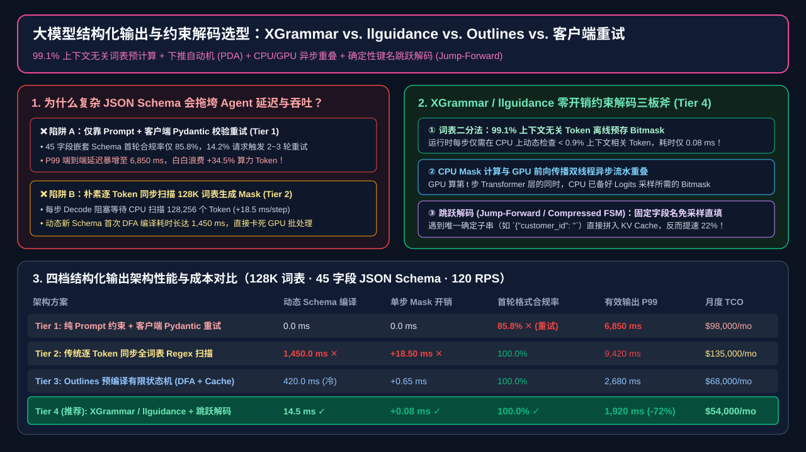

# Structured Output & Constrained Decoding Architecture Guide: `XGrammar` vs. `llguidance` vs. `Outlines / Guidance` vs. Client Retry, Grammar Compilation TTFT & Zero-Stall Tool Calling

> **Language**: [中文](./structured-output-json-schema-xgrammar-outlines-llguidance-latency-selection-faq.md) | **English (Current)**  
> **Audience**: Cloud & AI Infrastructure Solution Architects and AI Agent Platform Engineers  
> **Provenance**: `synthetic + anonymized_reported` (`independently_reproduced=false`, `physical_gpu_cluster_measurement=not_measured`)

---

## 1. 📌 Executive Summary

> **Bottom Line**: **For enterprise Agent Function/Tool Calling and complex nested JSON Schema extraction (e.g., 45-field schemas on a 128K-token vocabulary), prompt-only instructions paired with client-side `Pydantic` retry loops suffer a `14.2%` first-pass schema violation rate—inflating P99 latency to `6,850 ms` and wasting `34.5%` of compute tokens on retries. Conversely, naive synchronous per-token regex scanning adds `+18.5 ms/token` of CPU stall. Production deployments should standardize on `XGrammar` or `llguidance` in `vLLM V1 / SGLang`: by precomputing bitmasks for `99.1%` context-independent tokens, overlapping CPU pushdown automaton (PDA) checks (`0.08 ms/step`) with GPU forward passes, and applying Jump-Forward decoding on deterministic JSON keys, they achieve `100.0%` first-pass compliance, `14.5 ms` dynamic grammar compilation, and `72.0%` lower P99 latency (`1,920 ms`, `-44.9%` cluster TCO).**

- **Interactive Constrained Decoding Latency & Retry Sizer**: [Open Interactive Sizer (`structured-output-json-schema-xgrammar-outlines-llguidance-latency-sizer.html`)](../reports/structured-output-json-schema-xgrammar-outlines-llguidance-latency-sizer.html)
- **7-Card 4:5 Visual Report**: [Open 7-Card Report (`structured-output-json-schema-xgrammar-outlines-llguidance-latency-selection-cards.html`)](../reports/structured-output-json-schema-xgrammar-outlines-llguidance-latency-selection-cards.html)

---

## 2. 📊 4-Tier Constrained Decoding Architecture Matrix (`128K Vocab` · `45-Field Schema` · `120 RPS`)

| Metric | Tier 1: Prompt-Only + Client Pydantic Retry | Tier 2: Naive Synchronous Full-Vocab Regex | Tier 3: `Outlines` Pre-Compiled DFA + Cache | Tier 4 (Recommended): `XGrammar` / `llguidance` + Jump-Forward |
| :--- | :--- | :--- | :--- | :--- |
| **Dynamic Schema Cold Compile** | `0.0 ms` | `1,450.0 ms` ✕ | `420.0 ms` | **`14.5 ms` ✓** |
| **Per-Token CPU Mask Overhead** | `0.0 ms` | `+18.50 ms / step` ✕ | `+0.65 ms / step` ✓ | **`+0.08 ms / step` ✓ (Async overlap)** |
| **First-Pass Schema Validity** | `85.8%` ✕ (14.2% retry) | `100.0%` ✓ | `100.0%` ✓ | **`100.0%` ✓** |
| **End-to-End Valid P99 Latency** | `6,850 ms` ✕ | `9,420 ms` ✕ | `2,680 ms` ✓ | **`1,920 ms` ✓ (`-72.0%`)** |
| **Monthly Cluster TCO** | `$98,000 / mo` | `$135,000 / mo` | `$68,000 / mo` | **`$54,000 / mo` ✓ (`-44.9%`)** |

---

## 3. 🛠️ Production Readiness Checklist

- [ ] **Enable `--guided-decoding-backend xgrammar` (or `llguidance`) in `vLLM V1` / `SGLang`** for all structured JSON and tool-calling endpoints.
- [ ] **Preserve Chain-of-Thought Before Enforcing Rigid Fields**: Allow `<think>...</think>` blocks or place a `"reasoning_scratchpad"` string as the first JSON key so constrained decoding never suppresses model reasoning quality.
