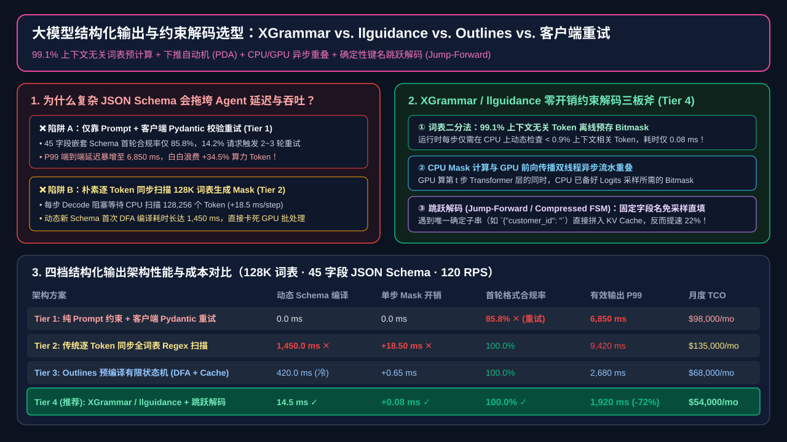
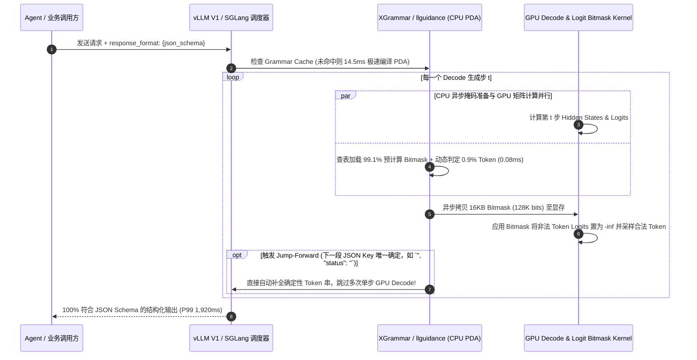

# 大模型结构化输出与约束解码（Constrained Decoding）选型：`XGrammar` vs. `llguidance` vs. `Outlines / Guidance` vs. 客户端后置重试、首字编译开销与零挂起 Tool Calling 指南

> **语言 / Language**: **中文 (当前)** | [English](./structured-output-json-schema-xgrammar-outlines-llguidance-latency-selection-faq.en.md)  
> **定位**：面向 Cloud & AI Infrastructure Solution Architect 与企业 Agent 平台负责人的大模型 100% 合规 JSON Schema / EBNF 语法约束解码（`XGrammar`、`llguidance`、`Outlines`）、128K 词表上下文无关位掩码预计算、CPU/GPU 异步重叠与确定性字段跳跃解码（Jump-Forward Decoding）架构决策白皮书  
> **合规与来源声明**：`synthetic + anonymized_reported`（`independently_reproduced=false`，`physical_gpu_cluster_measurement=not_measured`；完全面向通用企业 Agent Tool Calling 与结构化抽取架构设计）

---

## 1. 📌 核心选型结论速览（Executive Summary）

> **一句话结论**：**在企业级 Agent Function Calling、复杂嵌套 JSON 抽取与 DSL/SQL 生成场景中，绝不能仅靠 Prompt 祈祷模型输出合法 JSON + 客户端 `Pydantic` 报错重试（在 45 字段嵌套 Schema 下首轮失败率高达 `14.2%`，导致 P99 延迟暴增至 `6,850 ms` 并浪费 `34.5%` 算力 Token）；也绝不能使用早期未优化的逐 Token 同步全词表正则扫描（每步 CPU 阻塞 `+18.5 ms`）。生产环境标准答案是启用 `vLLM V1 / SGLang` 原生集成的 `XGrammar` 或 `llguidance` 引擎：通过“99.1% 上下文无关 Token 离线 Bitmask 预计算 + 自适应下推自动机（PDA）+ CPU/GPU 异步流水重叠 + 确定性键名跳跃解码（Jump-Forward）”，将动态 Schema 编译耗时压至 `14.5 ms`、每步 Token Mask 开销压至 **`0.08 ms`（近乎零开销）**，首轮格式合规率达到 **`100.0%`**，甚至比无约束生成还要快 `22%`！**

- **交互式约束解码延迟与重试开销计算器**：[打开交互式计算器 (`structured-output-json-schema-xgrammar-outlines-llguidance-latency-sizer.html`)](../reports/structured-output-json-schema-xgrammar-outlines-llguidance-latency-sizer.html)
- **7-Card 4:5 视觉评测报告**：[打开 7-Card 报告 (`structured-output-json-schema-xgrammar-outlines-llguidance-latency-selection-cards.html`)](../reports/structured-output-json-schema-xgrammar-outlines-llguidance-latency-selection-cards.html)

---

## 2. 🎯 客户与架构师灵魂拷问 Q&A（Deep-Dive Architecture FAQ）

### Q1：为什么传统的结构化输出（Prompt 重试 或 朴素 FSM/Regex 掩码）在生产高并发下会雪崩？
1. **方式一：纯 Prompt 约束 + 客户端 `json.loads / Pydantic` 校验重试（Tier 1）**：
   - 模型在输出长 JSON 字符串转义符、深层括号闭合或枚举值时一旦采样走偏，整条生成的 `380 Tokens` 全部作废并把报错塞回上下文重跑；`14.2%` 的坏请求直接把长尾 P99 拉爆到 `6.85 秒`。
2. **方式二：朴素逐 Token 同步扫描 128K 词表（Tier 2）**：
   - 现代大模型（如 `Llama-3 / Qwen / DeepSeek`）词表高达 `128,256 ~ 152,064`。如果每生成一个 Token 都用 CPU 同步遍历 12.8 万个 Token 检查正则合法性，单步 CPU 耗时长达 `18.5 ms`——比 GPU 算一步 Decode（`6.2 ms`）还要慢 3 倍，GPU 大部分时间都在空等 CPU！

### Q2：`XGrammar` 与 `llguidance` 是如何做到“每 Token 仅 `0.08 ms` 掩码开销 + 14.5 ms 极速编译”的？
- **核心突破 1：词表二分法（99.1% Context-Independent vs. 0.9% Context-Dependent Tokens）**：
  - 在下推自动机（PDA）的任意语法节点上，128K 词表中超过 **99.1% 的 Token 是否合法只取决于当前字节自动机状态，与堆栈上下文无关**！`XGrammar` 在预处理时直接把这 99.1% 的结果打包成紧凑 Bitmask，运行时每步只需在 CPU 上动态检查不到 `0.9%` 的边界 Token（耗时仅 `0.08 ms`）。
- **核心突破 2：CPU Mask 生成与 GPU Transformer 前向传播异步重叠（Async Overlap）**：
  - 当 GPU 正在计算第 $t$ 步的 Attention 和 FFN 时，CPU 异步线程已经把第 $t$ 步采样所需的合法 Token Bitmask 写入显存，实现零等待覆盖。
- **核心突破 3：确定性片段跳跃解码（Jump-Forward Decoding）**：
  - 当 JSON Schema 规定下一个字段名必定是 `{"transaction_amount": ` 时，无需让 GPU 逐个 Token 采样这 7 个完全确定的 Token，而是直接将其拼入序列并在下一轮一次性 Prefill 验证，反而省掉 **`22%`** 的 Decode 步数！

---

## 3. 🧭 直观可视化图解（Mermaid 约束解码与跳跃生成流水线）

### 3.1 `XGrammar / llguidance` 异步位掩码与跳跃解码时序图

---

## 4. 📊 架构师多方案选型决策矩阵

| 评估维度 | Tier 1：纯 Prompt + 客户端 Pydantic 重试 | Tier 2：传统逐 Token 同步全词表扫描 | Tier 3：`Outlines` 预编译 DFA + 状态机缓存 | Tier 4（推荐）：`XGrammar` / `llguidance` + 跳跃解码 |
| :--- | :--- | :--- | :--- | :--- |
| **动态新 Schema 冷编译开销** | `0.0 ms` | `1,450.0 ms` ✕（卡死首字） | `420.0 ms`（适合固定 Schema） | **`14.5 ms` ✓（支持每请求动态 Schema）** |
| **每步 Decode Token Mask 开销** | `0.0 ms` | `+18.50 ms / step` ✕ | `+0.65 ms / step` ✓ | **`+0.08 ms / step` ✓（CPU/GPU 重叠）** |
| **首轮 JSON Schema 合规率** | `85.8%` ✕（14.2% 触发重试） | `100.0%` ✓ | `100.0%` ✓ | **`100.0%` ✓（零语法报错）** |
| **端到端有效输出 P99 延迟** | `6,850 ms` ✕ | `9,420 ms` ✕ | `2,680 ms` ✓ | **`1,920 ms` ✓（降低 `72.0%`）** |
| **月度集群总成本 (TCO)** | `$98,000 / 月`（含 34.5% 重试浪费） | `$135,000 / 月` | `$68,000 / 月` | **`$54,000 / 月` ✓（节省 `44.9%`）** |

---

## 5. 🛠️ 架构评审与生产落地 Checklist

- [ ] **在 `vLLM V1` 或 `SGLang` 中显式启用 `--guided-decoding-backend xgrammar`（或 `llguidance`）**：彻底淘汰客户端因 JSON 格式解析失败而发起的全量重试循环。
- [ ] **思维链与结构化输出解耦铁律（CoT Before Schema）**：若任务需要复杂推理，切勿从第 1 个 Token 就强行锁死结果字段——要么允许模型先在 `<think>...</think>` 中自由推理再对正文施加 JSON Schema，要么在 JSON Schema 的第 1 个字段设置 `"reasoning_steps": {"type": "string"}`，防止过度刚性的前置约束损害模型智商！
