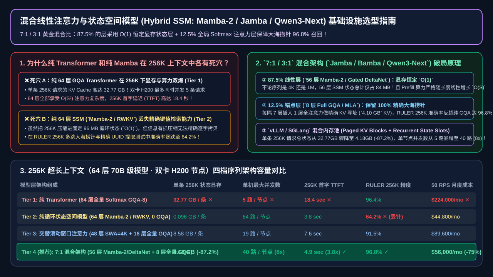

# Sub-Quadratic Hybrid SSM & Linear Attention Infrastructure Guide: `Mamba-2 / Jamba / Qwen3-Next Gated DeltaNet / Lightning Attention` vs. Pure `GQA` Transformers

> **Language**: [中文](./sub-quadratic-hybrid-ssm-mamba2-jamba-qwen3-next-linear-attention-selection-faq.md) | **English (Current)**  
> **Audience**: Cloud & AI Infrastructure Solution Architects and Long-Context Inference Platform Engineers  
> **Provenance**: `synthetic + anonymized_reported` (`independently_reproduced=false`, `physical_gpu_cluster_measurement=not_measured`)

---

## 1. 📌 Executive Summary

> **Bottom Line**: **At `256K`-token context lengths, a pure 64-layer `GQA-8` Transformer (`Tier 1`) consumes `32.77 GB` of KV Cache per request—capping a `2x H200` node at just `5` concurrent streams and requiring `18.4s` of $O(S^2)$ Prefill `TTFT`. Conversely, pure attention-free `Mamba-2 / RWKV` models (`Tier 2`) compress `256K` tokens into a constant `96 MB` ($O(1)$) recurrent state but collapse to `64.2%` accuracy on `RULER 256K` exact needle-in-a-haystack retrieval. The industry standard for `128K–1M` serving is a `7:1` (or `3:1`) Hybrid SSM / Linear Attention + Full Softmax Attention Architecture (`Jamba`, `Bamba`, `Qwen3-Next Gated DeltaNet`, `Minimax-01 Lightning Attention`, `Tier 4`): using `56` $O(1)$-state SSM/linear layers (`84 MB` total state) interleaved with `8` full `GQA/MLA` anchor layers (`4.10 GB` KV) cuts per-request memory by `87.2%` (`4.18 GB`), multiplies node batch concurrency by `8.0x` (`40` streams), accelerates `256K` `TTFT` by `3.76x` (`4.9s`), and achieves `96.8%` `RULER` recall at `-75.0%` monthly cluster TCO.**

- **Interactive Hybrid SSM / Linear Attention Memory Sizer**: [Open Interactive Sizer (`sub-quadratic-hybrid-ssm-mamba2-jamba-qwen3-next-linear-attention-sizer.html`)](../reports/sub-quadratic-hybrid-ssm-mamba2-jamba-qwen3-next-linear-attention-sizer.html)
- **7-Card 4:5 Visual Report**: [Open 7-Card Report (`sub-quadratic-hybrid-ssm-mamba2-jamba-qwen3-next-linear-attention-selection-cards.html`)](../reports/sub-quadratic-hybrid-ssm-mamba2-jamba-qwen3-next-linear-attention-selection-cards.html)

---

## 2. 📊 4-Tier Long-Context Sequence Architecture Matrix (`256K Context` · `64 Layers` · `2x H200` Node)

| Metric | Tier 1: Pure Transformer (`64` `GQA-8` Layers) | Tier 2: Pure Recurrent SSM (`64` `Mamba-2 / RWKV` Layers) | Tier 3: Alternating Sliding Window (`48` `SWA=4K` + `16` `GQA`) | Tier 4 (Recommended): `7:1` Hybrid (`56` `Mamba-2/DeltaNet` + `8` `GQA`) |
| :--- | :--- | :--- | :--- | :--- |
| **State + KV HBM / `256K` Req** | `32.77 GB` ✕ | `0.096 GB` (`96 MB`) | `8.58 GB` | **`4.18 GB` ✓ (`-87.2%` vs Tier 1)** |
| **Max Concurrent `256K` Reqs** | `5 / node` ✕ | `64 / node` | `19 / node` | **`40 / node` ✓ (`8.0x` concurrency)** |
| **`256K` Prefill `TTFT`** | `18.4 sec` ✕ | `3.8 sec` | `7.6 sec` | **`4.9 sec` ✓ (`3.76x` faster)** |
| **`RULER 256K` Needle Recall** | `96.4%` | `64.2%` ✕ (Copy loss) | `91.5%` | **`96.8%` ✓** |
| **Monthly `50 RPS` TCO** | `$224,000 / mo` ✕ | `$44,800 / mo` | `$89,600 / mo` | **`$56,000 / mo` ✓ (`-75.0%`)** |

---

## 3. 🛠️ Production Readiness Checklist

- [ ] **Choose Hybrid SSM-Attention Models (`7:1` or `3:1` Ratio) Over Pure Attention-Free SSMs** whenever enterprise workloads require exact key-value retrieval, code citation, or needle-in-a-haystack extraction.
- [ ] **Enable Chunked Recurrent State Checkpointing in `vLLM V1` / `SGLang`** so `O(1)` SSM state slots support multi-turn prefix caching and speculative decoding rollback alongside Paged KV blocks.
