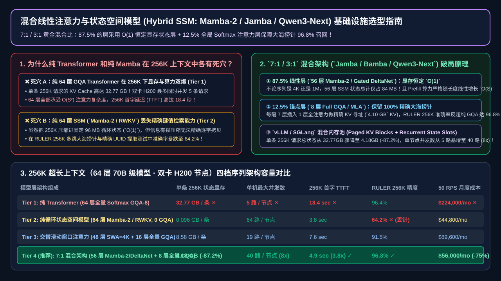
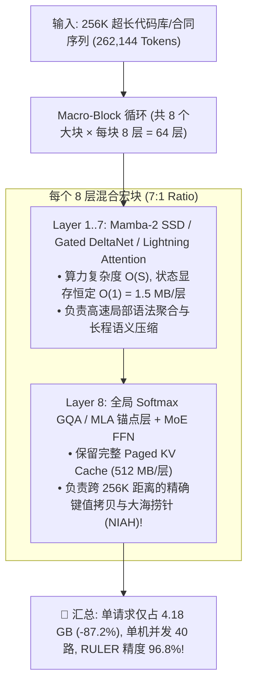

# 混合线性注意力与状态空间模型（Hybrid SSM / Linear Attention: `Mamba-2 / Jamba / Qwen3-Next / Bamba`）基础设施选型：`O(1)` 恒定状态显存 vs. 全量 GQA KV Cache 与 `7:1 / 3:1` 混合层比容量规划指南

> **语言 / Language**: **中文 (当前)** | [English](./sub-quadratic-hybrid-ssm-mamba2-jamba-qwen3-next-linear-attention-selection-faq.en.md)  
> **定位**：面向 Cloud & AI Infrastructure Solution Architect 与大模型推理架构师的超长上下文（`128K ~ 1M Tokens`）亚二次方混合架构选型（`Mamba-2 SSD`、`Gated DeltaNet`、`Lightning Attention` 与全注意力 `GQA/MLA` 的 `7:1 / 3:1` 交替融合）、`vLLM / SGLang` 混合状态-KV 内存池管理与显存手算白皮书  
> **合规与来源声明**：`synthetic + anonymized_reported`（`independently_reproduced=false`，`physical_gpu_cluster_measurement=not_measured`；完全面向通用企业级超长上下文混合模型选型与容量规划）

---

## 1. 📌 核心选型结论速览（Executive Summary）

> **一句话结论**：**当企业工作负载进入 `128K ~ 1M` 超长上下文深水区（全代码库理解、百页招股书对比、长周期 Agent 轨迹）时，纯 64 层 `GQA` Transformer（Tier 1）会撞上残酷的“显存与算力双墙”——单条 `256K` 请求的 KV Cache 高达 **`32.77 GB`**（双卡 H200 最多并发 5 路），且 $O(S^2)$ Prefill 首字耗时高达 `18.4 秒`；而如果走向另一个极端，采用 100% 纯 `Mamba-2 / RWKV` 状态空间模型（Tier 2，零 Softmax 层），虽然单条状态显存恒定仅 `96 MB`（$O(1)$），却因固定维度循环状态的有损压缩在 `RULER 256K` 大海捞针与精确字符串拷贝测试中准确率暴跌至 `64.2%`！现代大模型工业界已达成黄金共识——采用“`7:1` 或 `3:1` 混合线性/SSM + 全注意力架构”（如 `Jamba`、`IBM Bamba`、`Qwen3-Next Gated DeltaNet`、`Minimax-01 Lightning Attention`，Tier 4）：用 `87.5%` 的 $O(1)$ 线性层省掉绝大部分 KV 显存与二次方算力，同时保留 `12.5%`（如 64 层中留 8 层）的全量 `GQA/MLA` 锚点层负责精确上下文寻址——将单条 `256K` 状态显存从 `32.77 GB` 骤降至 **`4.18 GB`（减少 `87.2%`）**、单机最大并发数从 `5 路` 暴增至 **`40 路`（`8 倍`）**、Prefill 提速 **`3.76 倍`（`4.9 秒`）**，且 `RULER 256K` 召回精度高达 **`96.8%`**！**

- **交互式混合线性注意力 / SSM 超长上下文显存计算器**：[打开交互式计算器 (`sub-quadratic-hybrid-ssm-mamba2-jamba-qwen3-next-linear-attention-sizer.html`)](../reports/sub-quadratic-hybrid-ssm-mamba2-jamba-qwen3-next-linear-attention-sizer.html)
- **7-Card 4:5 视觉评测报告**：[打开 7-Card 报告 (`sub-quadratic-hybrid-ssm-mamba2-jamba-qwen3-next-linear-attention-selection-cards.html`)](../reports/sub-quadratic-hybrid-ssm-mamba2-jamba-qwen3-next-linear-attention-selection-cards.html)

---

## 2. 🎯 客户与架构师灵魂拷问 Q&A（Deep-Dive Architecture FAQ）

### Q1：架构师如何手算对比“纯 GQA Transformer”与“`7:1` 混合 `Mamba-2 / Gated DeltaNet`”在 `256K` 上下文下的显存账单？
以 64 层 `70B` 级别模型（`GQA-8`、`d_h=128`、`FP8 KV`）处理 $S = 262,144$（`256K`）序列为例：
1. **单层全注意力 `GQA-8` 的 KV Cache 显存（随长度 $S$ 线性暴涨 $O(S)$）**：
   $$M_{\text{GQA\_layer}} = 2 \times 8 \times 128 \times 262,144 \times 1\text{ Byte} = \mathbf{512\text{ MB / 层}}$$
2. **单层 `Mamba-2 / Gated DeltaNet` 的循环状态显存（与长度 $S$ 完全无关，恒定 $O(1)$！）**：
   - 仅需保存固定维度的 SSM 状态矩阵 $h_t \in \mathbb{R}^{n_{\text{heads}} \times d_{\text{head}} \times d_{\text{state}}}$ + 4 步短卷积缓存，每层恒定仅占 **`~1.5 MB / 层`**（哪怕上下文涨到 `1000 万` Token 也是 `1.5 MB`）！
3. **64 层整模型汇总对比**：
   - **纯 GQA Transformer（64 层 GQA）**：$64 \times 512\text{ MB} = \mathbf{32.77\text{ GB / 请求}}$；
   - **`7:1` 混合架构（56 层 SSM + 8 层 GQA）**：$(56 \times 1.5\text{ MB}) + (8 \times 512\text{ MB}) = 84\text{ MB} + 4,096\text{ MB} = \mathbf{4.18\text{ GB / 请求}}$（**立省 `87.2%` 显存**）！

### Q2：在 `vLLM / SGLang` 中部署混合架构模型时，为什么 Prefix Caching（前缀缓存）和投机解码需要特殊配置？
- 传统 Transformer 的 KV Cache 是按 Token 位置独立追加的表，回退（Rollback）或复用任意前缀只需截断物理块指针；
- 而 `Mamba-2 / Linear Attention` 的状态 $h_t$ 是把前 $t$ 个 Token 揉在一起的递归累加器（不可直接按任意位置倒退）。因此 `vLLM V1` 的 **Hybrid Mamba/Attention State Manager** 采用**固定步长状态快照（Chunked State Checkpointing，如每 `512` 或 `4096` Tokens 保存一份 `84 MB` 的 SSM 状态快照）**，从而同时支持前缀缓存命中与投机解码草稿回退！

---

## 3. 🧭 直观可视化图解（Mermaid `7:1` 混合架构层内分工与显存对比）

---

## 4. 📊 架构师多方案选型决策矩阵（`256K` 上下文 · `64 层`模型 · 双卡 `H200` 节点）

| 评估维度 | Tier 1：纯 Transformer（64 层全量 `GQA-8`） | Tier 2：纯循环状态模型（64 层 `Mamba-2 / RWKV`） | Tier 3：交替滑动窗口（48 层 `SWA=4K` + 16 层全量 `GQA`） | Tier 4（推荐）：`7:1` 混合架构（56 层 `Mamba-2/DeltaNet` + 8 层全量 `GQA`） |
| :--- | :--- | :--- | :--- | :--- |
| **单条 `256K` 请求状态+KV 显存** | `32.77 GB` ✕（极度臃肿） | `0.096 GB` (`96 MB`) | `8.58 GB` | **`4.18 GB` ✓（减少 `87.2%`）** |
| **双卡 `H200` 最大并发流数** | `5 路 / 节点` ✕ | `64 路 / 节点` | `19 路 / 节点` | **`40 路 / 节点` ✓（提升 `8.0 倍`）** |
| **`256K` 序列 Prefill `TTFT`** | `18.4 秒` ✕（二次方算力墙） | `3.8 秒` | `7.6 秒` | **`4.9 秒` ✓（提速 `3.76 倍`）** |
| **`RULER 256K` 大海捞针准确率** | `96.4%` | `64.2%` ✕（精确拷贝崩溃） | `91.5%` | **`96.8%` ✓（8 层全局注意力锚定）** |
| **支撑 `50 RPS` 月度集群成本** | `$224,000 / 月` ✕ | `$44,800 / 月`（精度不达标） | `$89,600 / 月` | **`$56,000 / 月` ✓（节省 `75.0%`）** |

---

## 5. 🛠️ 架构评审与生产落地 Checklist

- [ ] **绝不在需要精确引用原文、提取合同编号/UUID 的 RAG 场景选用“0 层全注意力”的纯 SSM 模型**：必须选择保留了 `1/4 ~ 1/8` 全注意力层的混合模型（如 `Jamba`、`Bamba`、`Qwen3-Next`、`Minimax-01`）。
- [ ] **在 `vLLM V1` 中为混合模型显式配置 `mamba_cache_mode` 与状态块对齐参数**，确保多轮对话与共享系统提示词能够复用 SSM 状态快照。
