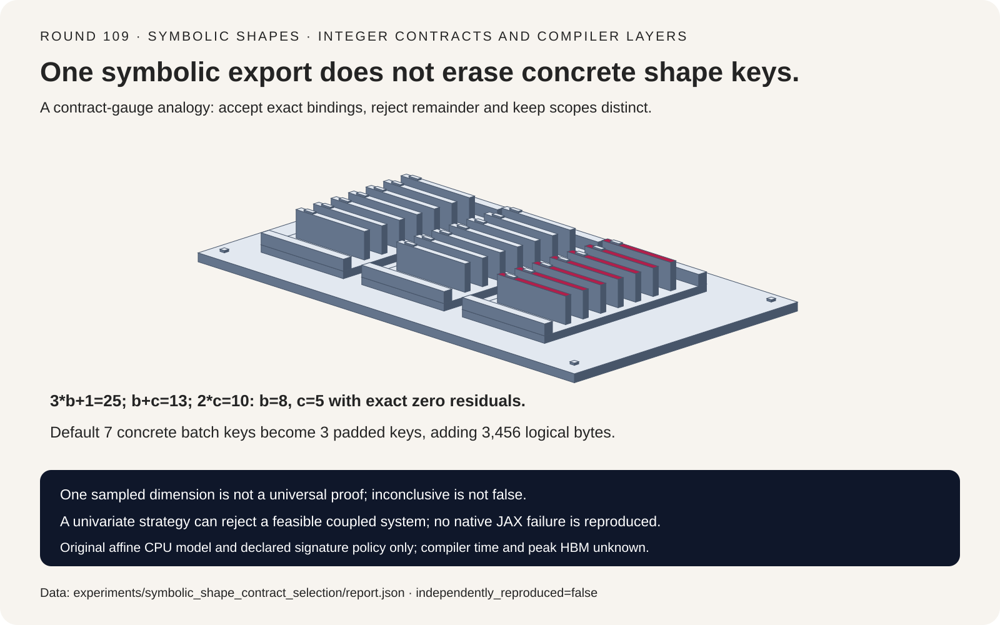
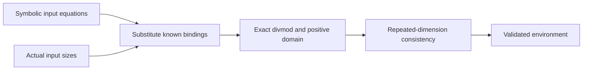
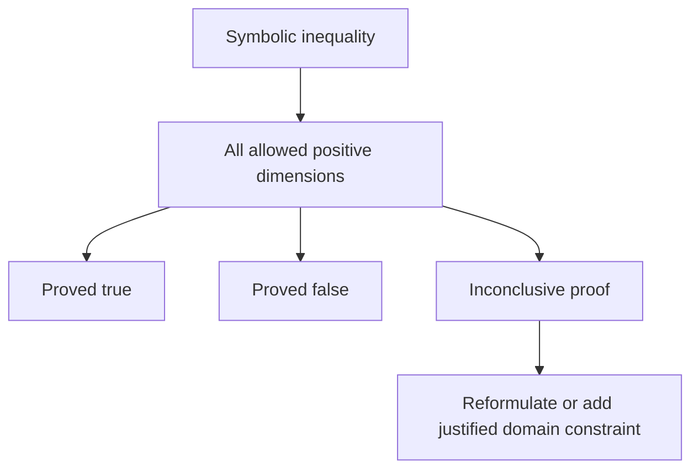
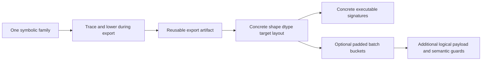

# Symbolic-shape FAQ: positive integer bindings, proof domains and export layers

> **Language**: [中文](symbolic-shape-export-dimension-contract-selection-faq.md) | English
>
> **Round 109 · 2026-11-14 (eighteenth round of the November 13 night)** · [SVG](../../assets/svg/symbolic-shape-export-dimension-contract-selection-faq-summary.svg) · [7-card report](../reports/symbolic-shape-export-dimension-contract-selection-cards.html) · [H5](../reports/symbolic-shape-export-dimension-contract-sizer.html) · [Sealed report](../../experiments/symbolic_shape_contract_selection/report.json)
>
> **Synthetic, `independently_reproduced=false`.** Only original Python affine solving and bounded enumeration were timed. No native JAX tracing, StableHLO lowering, compilation, executable cache or peak HBM was measured.



## 1. Executive summary: one polymorphic export is not one executable

The pinned November 4, 2026 JAX change optimizes symbolic polynomial
arithmetic and comparisons. This is a recent implementation capability;
shape-polymorphic export itself is longstanding. No daily-popularity
ranking or upstream performance improvement is independently measured.

JAX documentation separates tracing/lowering during export from
compilation for concrete input shapes. A shared symbolic artifact does
not imply every concrete shape uses one compiled executable.

| Layer | Preserve | Do not infer |
| :--- | :--- | :--- |
| Shape binding | Exact integer solution and runtime assertions | Floor division fixes a nonintegral dimension |
| Symbolic inequality | Proof over all allowed positive integers | One concrete example proves a branch universally |
| Scope | Shared scope identity and constraints | Same variable spelling means same scope |
| Export/cache | Symbolic family versus concrete keys | One artifact means one compilation event |

Our original three-equation fixture binds `b=8,c=5`. Seven explicit
batch sizes form seven concrete batch signatures; rounding to multiples
of eight gives three signatures but adds 3456 logical input bytes.
These are synthetic signature-policy counts, not observed JAX compile
events or a production optimization recommendation.

## 2. Architect Q&A: what does a symbolic dimension actually promise?

### Q1: How do input shapes determine dimension variables?

The inspected solver first handles linear univariate equations, then
uses solved variables to simplify remaining expressions. Our bounded
affine model uses:

```text
3*b + 1 = 25  -> b = 8, remainder 0
b + c   = 13  -> c = 5
2*c     = 10  -> exact consistency
```

Changing the first actual dimension to 24 leaves remainder two.
Changing it to one would bind `b=0`, outside the positive dimension
variable domain. Changing the final dimension to eleven contradicts
the earlier binding. All three are explicit errors, not clamping,
flooring or success-shaped defaults.

JAX dimension **variables** range over strictly positive integers.
That is not a blanket claim that every concrete array dimension or
constant shape dimension must be positive. The original Equation
allows nonnegative actual sizes but enforces positive solved variables.

### Q2: Does solver rejection prove that no mathematical solution exists?

No. The coupled system `a+b=10, a-b=2` has solution `a=6,b=4`,
confirmed by an independent finite exhaustive oracle. Neither equation
initially contains only one unknown, so the model's univariate
elimination strategy reports unsupported rather than solving it.

This distinction mirrors the inspected strategy boundary, not a
reproduction of every JAX failure. The original implementation supports
affine expressions only; native JAX has broader polynomial expressions,
division/modulo/min/max rules and constraint machinery. The finite
oracle proves only its declared bounded search result.

### Q3: Why is an inconclusive inequality not simply false?

For `2*b-5 >= 0`, `b=1` yields -3 while `b=8` yields 11.
Without a stronger domain, no single boolean works for every allowed
positive integer. The original proof routine raises `Inconclusive`.

Adding the valid domain restriction `b>=3` makes the minimum expression
value one, proving the inequality. That constraint also rejects inputs
with smaller `b`; it is not merely a compiler hint.

The inspected JAX docs describe incomplete symbolic inequality proofs:
some universally true expressions can still be beyond the proof rules.
Unknown must not be interpreted as runtime false. This discussion is
about inequalities; do not extend it to all symbolic equality behavior,
which has its own documented partial semantics.

### Q4: Why can two variables both named `b` fail when combined?

Symbolic expressions carry a `SymbolicScope` object. Separate calls
can create separate scopes, potentially with different constraints.
The source requires interacting expressions to share scope identity.
Reuse the intended scope explicitly rather than matching strings.

The original model uses immutable lower-bound scopes and identity
checks. It tests cancellation within one scope and rejects mixed-scope
arithmetic/equations. It does not reproduce JAX expression interning,
hashing or cache-hit rates.

### Q5: What does the bucketing workbench count—and exclude?

For batches `[1,2,3,5,8,13,21]`, width 64 and two-byte values,
the raw total is 53 rows and **6784 logical input bytes**.
Rounding each request to a multiple of eight yields
`[8,8,8,8,8,16,24]`: 80 rows and **10,240 bytes**.

The distinct batch keys fall from seven to three while padding adds
3456 bytes. One symbolic export artifact is an explicit assumed family,
not an observation. Dtype, feature width, target and shard layout are
held fixed; real executable keys and compiler caches can depend on more
details. Observed compilation events, executable bytes, native latency
and peak HBM remain null.

Padding is not semantically free. Reductions, normalization, attention,
loss denominators and output slicing may need valid-position handling.
The calculator does not validate application masks or claim that all
padded computations preserve results. Integer arithmetic is exact and
overflow/invalid inputs are rejected visibly.

## 3. Visual architecture: bind dimensions, prove domains, separate caches







## 4. Selection matrix: contract safety before cache-count claims

| Choice | Good fit | Gate before adoption |
| :--- | :--- | :--- |
| Symbolic export | Deploy a known input-shape family without Python retracing | Native export compatibility and runtime guards |
| Explicit concrete signatures | Predictable bounded workload | Real target/dtype/layout cache policy |
| Batch bucketing | Fewer selected batch keys | Padding overhead and valid-position semantics |
| Explicit constraints | Justified narrower accepted domain | Reject invalid callers; do not invent assumptions |
| Affine toy solver | Understand exact binding and failure categories | Not a general polynomial or native JAX solver |

## 5. Hands-on evidence: exact contracts and original CPU algorithms

```powershell
python -m experiments.symbolic_shape_contract_selection.run
python -m unittest discover -s tests -p test_symbolic_shape_contract_selection.py -q
python -m experiments.symbolic_shape_contract_selection.run --check
```

Recorded ARM64/Python 3.12.10 timings compare original affine binding
with a deliberately exhaustive independent oracle:

| Variable bound / oracle candidates | Binding, ms | Exhaustive oracle, ms |
| :--- | ---: | ---: |
| 8 / 64 | 0.003133 | 0.061300 |
| 16 / 256 | 0.003233 | 0.228600 |
| 32 / 1024 | 0.006867 | 1.091900 |
| 64 / 4096 | 0.004000 | 3.664767 |

Two warmups, seven alternating repeats, three operations per sample;
the table shows median repeat means. Both solve the declared valid
equations, and equality is checked outside timing. Raw shared-host
noise is retained. The oracle's quadratic candidate space does not
represent JAX comparison/compile complexity or quantify the upstream
optimization.

Eight focused tests cover equation permutations, independent bounded
solutions, signed coefficients, invalid bindings, scope identity,
universal inequality domains, exact Python/Node padding arithmetic,
sealed timing/artifacts, strict CSP and SVG bounds. Browser inspection
was not performed; the prior browser refusal remains respected.

## 6. Sources, provenance and limits

All JAX links use pin `99904d3b3b0e0b138f9a86f6115594243cd983f8`.

1. [November 4 symbolic-polynomial optimization](https://github.com/jax-ml/jax/commit/99904d3b3b0e0b138f9a86f6115594243cd983f8).
2. [`shape_poly.py`: scope, univariate solving and runtime shape assertions](https://github.com/jax-ml/jax/blob/99904d3b3b0e0b138f9a86f6115594243cd983f8/jax/_src/export/shape_poly.py).
3. [Shape-polymorphism documentation: tracing/lowering versus compilation, constraints and limits](https://github.com/jax-ml/jax/blob/99904d3b3b0e0b138f9a86f6115594243cd983f8/docs/export/shape_poly.md).
4. [Apache-2.0 LICENSE](https://github.com/jax-ml/jax/blob/99904d3b3b0e0b138f9a86f6115594243cd983f8/LICENSE).

Original arithmetic, solver, bounded oracle and SVG do not copy source
implementation, models or datasets. Upstream rights remain with their
holders. No native parser/compiler/runtime, general constraint engine,
observed executable count, real padding-mask equivalence, GPU quality
or peak-memory result is claimed. Seven static 4:5 cards use strict
self-contained CSP and bars from sealed data only.
