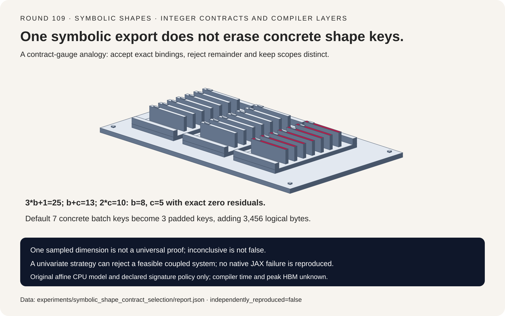
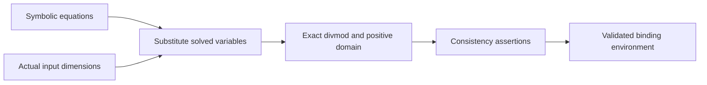
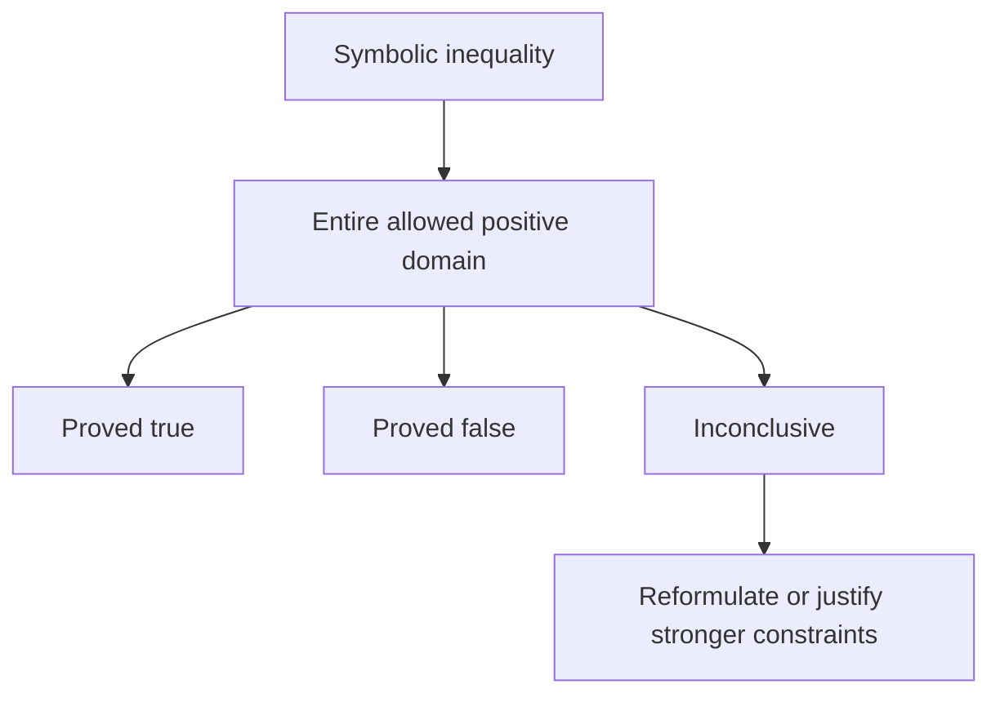
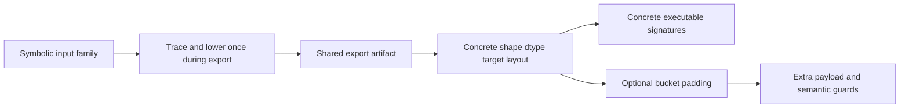

# 符号 Shape 选型 FAQ：整数维度绑定、证明域与 Export 编译分层

> **语言**：中文 | [English](symbolic-shape-export-dimension-contract-selection-faq.en.md)
>
> **Round 109 · 2026-11-14（11 月 13 日夜班第十八轮）** · [SVG](../../assets/svg/symbolic-shape-export-dimension-contract-selection-faq-summary.svg) · [七卡](../reports/symbolic-shape-export-dimension-contract-selection-cards.html) · [H5](../reports/symbolic-shape-export-dimension-contract-sizer.html) · [封存数据](../../experiments/symbolic_shape_contract_selection/report.json)
>
> **Synthetic，`independently_reproduced=false`。** 仅原创 Python affine solver 与有界穷举单独计时；未测 native JAX tracing、StableHLO lowering、compilation、executable cache 或 peak HBM。



## 1. 先给结论：一次 Polymorphic Export 不等于一个 Executable

固定的 JAX 2026-11-04 变更优化 symbolic polynomial arithmetic 与
comparisons，是近期实现能力变化；shape-polymorphic export 本身并非
新发明。这里不声称“今日最热”，也未独立测量该上游优化收益。

JAX 文档区分 export 阶段的 tracing/lowering 与 concrete shapes
对应的 compilation。共享一个 symbolic artifact，不代表所有 concrete
shape 都命中同一个 executable。

| 层次 | 必须保留 | 不能推导 |
| :--- | :--- | :--- |
| Shape binding | 整数解与 runtime assertions | Floor division 能修复非整除输入 |
| Symbolic inequality | 对整个正整数域的证明 | 一个 concrete example 就能证明分支 |
| Scope | 对象身份和域约束 | 变量名字相同就是同一 scope |
| Export/cache | 符号族与 concrete keys 分层 | 一个导出等于一次编译事件 |

原创三方程得到 `b=8,c=5`。默认七种 batch 签名补齐为八的倍数后只剩
三种，但增加 3456 logical input bytes。这是 synthetic signature
policy 算术，不是观察到的 JAX compile events，也不是直接上线建议。

## 2. 架构师 Q&A：符号维度究竟承诺了什么？

### Q1：输入 Shape 如何反推出维度变量？

固定源码先解 linear univariate equations，再把已解变量代入剩余表达式。
原创有界 affine 模型使用：

```text
3*b + 1 = 25  -> b=8，余数 0
b + c   = 13  -> c=5
2*c     = 10  -> 重复维度精确一致
```

首个实际维度改为 24，求 `b` 会有余数二；改为一会得到不合法的
`b=0`；最后维度改为十一会与前述解矛盾。三者都明确报错，不截断、
不 clamp，也不返回成功形状的默认值。

JAX 的 dimension **variables** 为严格正整数；这不意味着所有
concrete array dimensions 或 constant dimensions 都必须为正。
本模型实际 dimension 可以是非负整数，但解出的变量受正整数域限制。

### Q2：Solver 拒绝是否证明不存在数学解？

不是。`a+b=10, a-b=2` 有 `a=6,b=4`，独立 bounded exhaustive oracle
能找到它。但两式最初都有两个未知数，本模型的 univariate elimination
无法起步，必须报告 unsupported，而非声称 infeasible。

这是解释固定策略边界，不是复现 JAX 所有 failure。
原创模型只接受 affine expressions；native JAX 支持更广的 polynomial、
division/modulo/min/max 与 constraint 规则。有界 oracle 的结论也只
覆盖声明的有限搜索域。

### Q3：为什么 Inconclusive 不能简单当作 False？

`2*b-5 >= 0` 在 `b=1` 时表达式值为 -3，在 `b=8` 时为 11。
对所有正整数不能给一个统一真假；原创 proof routine 明确抛出
`Inconclusive`。

加入有依据的 `b>=3` 后，表达式最小为一，可以证明非负。
新约束同时拒绝较小输入，不只是 compiler hint。
JAX 的 symbolic inequality 证明也不完备：有些普遍成立的表达式仍可能
超出规则能力。Unknown 不能被解释为 runtime false。
这里讨论 inequality，**不推广到全部 symbolic equality**，后者有独立的
partial semantics。

### Q4：为什么两个都叫 `b` 的变量还不能混用？

表达式携带 `SymbolicScope` 对象。不同调用可能创建不同 scope，也可能
带不同约束；相互运算必须共享 scope identity，而不是只匹配字符串。
应显式复用预期 scope。

原创模型用 immutable lower-bound scopes 做身份检查，同 scope 内可相消，
不同 scope 的 arithmetic/equations 明确拒绝。不声称复现 JAX interning、
hashing 或 native cache-hit rate。

### Q5：H5 的 Bucketing 数字包含什么，不包含什么？

输入 batches `[1,2,3,5,8,13,21]`、width=64、每值两字节，
总计 53 行、**6784 logical input bytes**。逐请求补齐到八的倍数得到
`[8,8,8,8,8,16,24]`：80 行、**10,240 bytes**。

Distinct batch keys 从七降到三，padding 多出 3456 bytes。
一个 symbolic export artifact 是显式假设的同一输入族，不是观测值。
Dtype、feature width、target、shard layout 固定，真实 executable keys
还可能包含其他信息；observed compile events、executable bytes、
native latency 与 peak HBM 都保持 null。

Padding 也不语义免费：reduction、normalization、attention、loss
denominator 和 output slicing 可能需要 valid-position 处理。
工作台不认证应用 mask，也不声称所有补齐计算等价。
预算使用精确整数，非法或溢出输入显式报错。

## 3. 可视化架构：维度求解、证明域与缓存分层







## 4. 选型矩阵：先选安全契约，再谈 Cache 数量

| 路径 | 适合 | 上线门槛 |
| :--- | :--- | :--- |
| Symbolic export | 无需 Python retracing 的已知 shape 族 | Native export compatibility 与 runtime guards |
| Concrete signatures | 有界且可预测 workload | 实际 dtype/target/layout cache policy |
| Batch bucketing | 减少选定 batch keys | Padding 开销与有效位置语义 |
| Explicit constraints | 有依据的更窄输入域 | 真正拒绝域外调用，不编造假设 |
| Affine toy solver | 理解精确绑定与错误分类 | 不是 general polynomial/native JAX solver |

## 5. 动手验证：精确契约与原创 CPU 算法计时

```powershell
python -m experiments.symbolic_shape_contract_selection.run
python -m unittest discover -s tests -p test_symbolic_shape_contract_selection.py -q
python -m experiments.symbolic_shape_contract_selection.run --check
```

ARM64、Python 3.12.10 的原创绑定与刻意穷举 oracle：

| Variable bound / oracle candidates | Binding，ms | Exhaustive oracle，ms |
| :--- | ---: | ---: |
| 8 / 64 | 0.003133 | 0.061300 |
| 16 / 256 | 0.003233 | 0.228600 |
| 32 / 1024 | 0.006867 | 1.091900 |
| 64 / 4096 | 0.004000 | 3.664767 |

两次 warmup、七次交替次序 repeats，每 sample 三次操作取均值，再取
七个 repeat means 的 median。两条路径处理同一组有效方程，计时外
核对解；原始 shared-host 噪声保留。Oracle 的平方候选空间不代表
JAX comparison/compilation 复杂度，也不能量化该上游优化。

八项 focused tests 覆盖方程排列、独立有界解、负系数、非法绑定、
scope identity、普遍 inequality 证明、Python/Node 精确 padding、
封存数据、CSP 和 SVG 边界。此前 browser refusal 仍受尊重，未做浏览器检查。

## 6. 来源、归因与研究边界

JAX 固定 pin：`99904d3b3b0e0b138f9a86f6115594243cd983f8`。

1. [2026-11-04 symbolic polynomial 优化](https://github.com/jax-ml/jax/commit/99904d3b3b0e0b138f9a86f6115594243cd983f8)。
2. [`shape_poly.py`：scope、univariate solver、runtime assertions](https://github.com/jax-ml/jax/blob/99904d3b3b0e0b138f9a86f6115594243cd983f8/jax/_src/export/shape_poly.py)。
3. [Shape polymorphism 文档：tracing/lowering、compilation、constraints 与限制](https://github.com/jax-ml/jax/blob/99904d3b3b0e0b138f9a86f6115594243cd983f8/docs/export/shape_poly.md)。
4. [Apache-2.0 LICENSE](https://github.com/jax-ml/jax/blob/99904d3b3b0e0b138f9a86f6115594243cd983f8/LICENSE)。

原创算术、solver、bounded oracle 与 SVG 未复制 source 实现、模型或
数据集，上游权利保留。未复现 native parser/compiler/runtime、
完整 constraint engine、实际 executable count、真实 padding-mask
等价性、GPU 质量或 peak memory。七张静态 4:5 卡严格自包含 CSP，
全部数值条来自封存数据。
