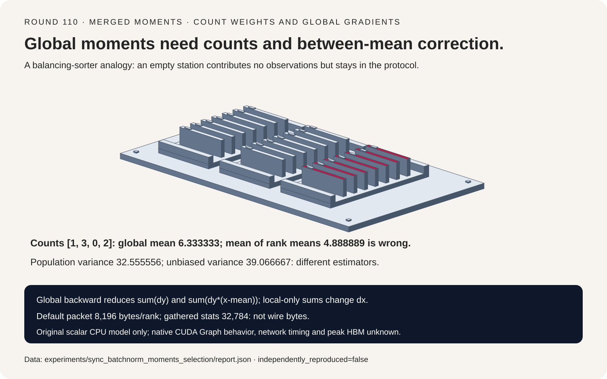
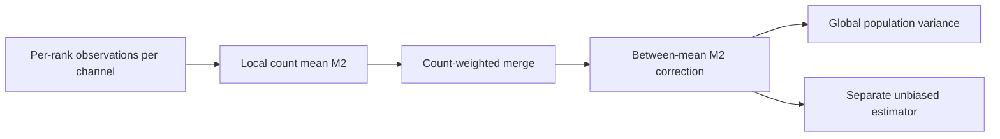
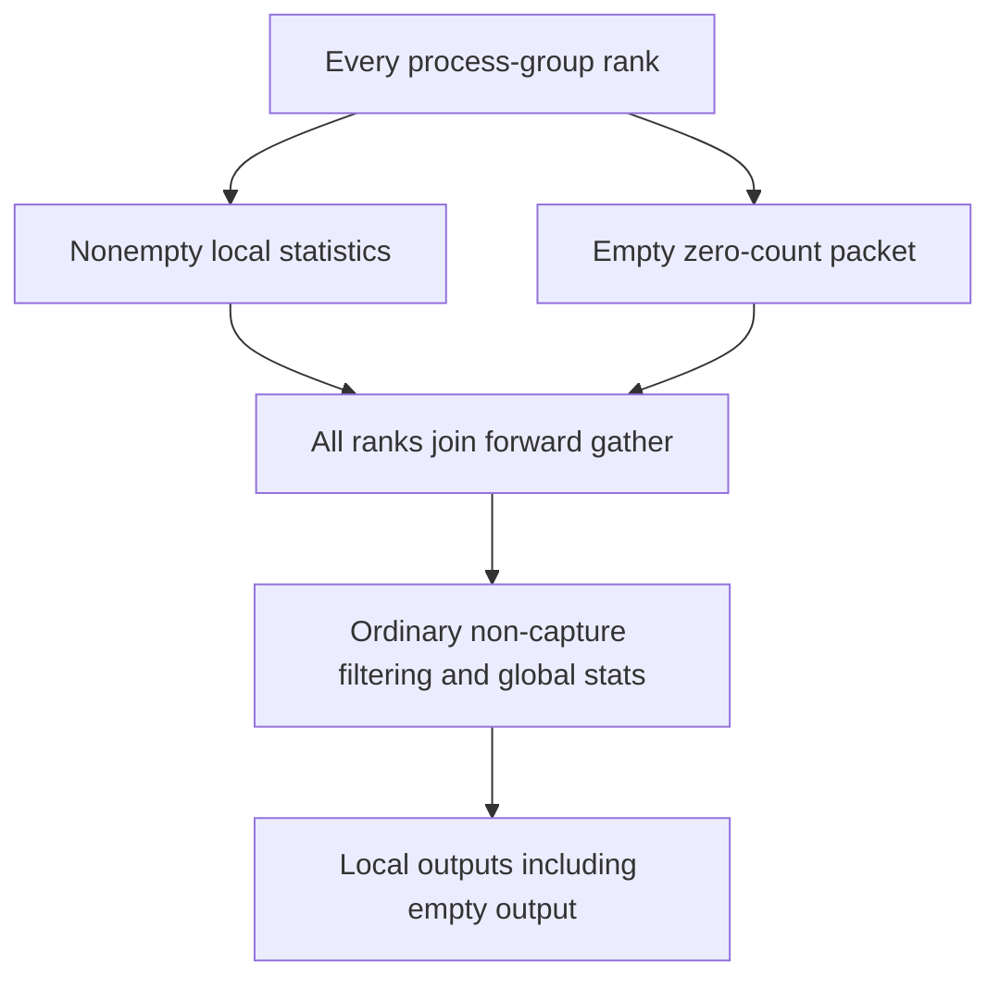
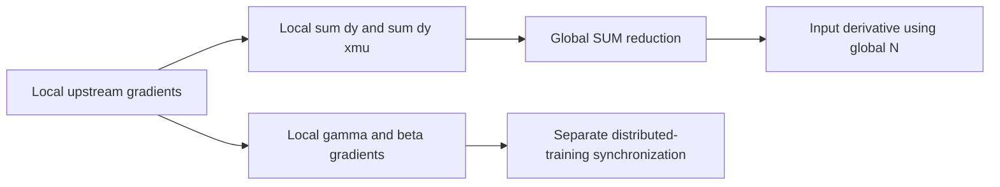

# SyncBatchNorm FAQ: count-weighted moments, empty ranks and global gradients

> **Language**: [中文](sync-batchnorm-count-weighted-moments-selection-faq.md) | English
>
> **Round 110 · 2026-11-14 (nineteenth round of the November 13 night)** · [SVG](../../assets/svg/sync-batchnorm-count-weighted-moments-selection-faq-summary.svg) · [7-card report](../reports/sync-batchnorm-count-weighted-moments-selection-cards.html) · [H5](../reports/sync-batchnorm-count-weighted-moments-sizer.html) · [Sealed report](../../experiments/sync_batchnorm_moments_selection/report.json)
>
> **Synthetic, `independently_reproduced=false`.** Only original Python moment merge/rescan operations were timed. No PyTorch/CUDA/NCCL execution, actual collective traffic, CUDA Graph empty-rank validation or peak HBM was measured.



## 1. Executive summary: ranks are not observations

The inspected PyTorch wrapper migrated to `all_gather_single` on
June 4, 2026. The native source pin is July 29. These are longstanding
synchronized-normalization mechanisms, not a November launch or a
daily-popularity claim.

Four ranks with per-channel counts `[1,3,0,2]` have global mean
**6.333333**, while the mean of nonempty rank means is **4.888889**.
Even count-weighting local variances gives **7.111111**, not the correct
global population variance **32.555556**: between-rank means matter.

| Contract | Preserve | Do not infer |
| :--- | :--- | :--- |
| Global moments | Count, mean and between-mean correction | Average local variances is enough |
| Empty shard | Numerical identity and protocol participation | No observations means skip collective |
| Global backward | Global sums for input derivatives | Global forward permits local-only backward |
| Estimator | Population forward versus unbiased running variance | The two denominators are interchangeable |

Original arithmetic uses one channel and exact rational references.
It models semantics, not the native packet's finite-precision behavior.

## 2. Architect Q&A: what crosses the rank boundary?

### Q1: How do unequal shards merge correctly?

For summaries `(n_a,mean_a,M2_a)` and `(n_b,mean_b,M2_b)`, let
`delta=mean_b-mean_a`. The merged mean shifts by
`delta*n_b/(n_a+n_b)`, and M2 gains
`delta²*n_a*n_b/(n_a+n_b)` in addition to the local M2 values.
That final term captures the separation of shard means.

The original shards are `[-3]`, `[1,7,9]`, `[]`, `[10,14]`.
Their six observations have M2 **195.333333**. Count-weighting local
variances without the between-mean term still loses most variance.

“Count” means observations **per channel**: for NCHW tensors it
includes batch and spatial positions, not just N or number of ranks.
The source computes input elements divided by channel count.

### Q2: Does the source actually gather M2 triples?

No. The inspected wrapper gathers `mean[C], invstd[C], count[1]`,
a record of `2*C+1` selected statistics values. Its native reduction
reconstructs local variance from inverse standard deviation and epsilon,
then merges counts and between-mean terms.

Our original model carries Python integer counts and M2 directly.
It does not reproduce low-precision invstd reconstruction, native
layout dispatch or packet datatypes. A mathematical M2 identity is
not a blanket guarantee of native numeric equivalence.

The H5 separately flags whether every count is exactly representable
in the selected float32/float64 packet format and whether each saved
rank count fits int32. Float32 does not represent every integer above
`2^24`: `2^24+1` fails, while `2^24+2` is representable. Neither flag
certifies a complete native execution.

### Q3: Can an empty rank skip the synchronization?

No. In the inspected ordinary wrapper path it sends a zero-count
packet and still joins forward gathering. Empty statistics are then
filtered. If input gradients are needed, the empty rank also joins
the backward reduction so nonempty peers are not left waiting.

The original moment identity has count zero, undefined mean and zero
additive M2. Undefined mean/variance are represented as `None`, not
silently treated as real zero observations. Global all-empty
normalization is explicitly rejected.

**CUDA Graph caveat:** the source skips its value-dependent filtering
branch during capture. This study does not execute or certify that
native empty-rank path, nor reproduce a native failure or hang.
Declared participant lists are protocol requirements, not measured
collective traces.

### Q4: Why does a synchronized forward need synchronized backward sums?

For a summed scalar loss with upstream gradients `dy`, global
population variance and inverse standard deviation `r`,

```text
dx = gamma*r * (
    dy - sum(dy)/N
    - (x-mean)*r*r*sum(dy*(x-mean))/N
)
```

The two sums must cover the same global observations that defined
forward mean and variance. The original correct derivative agrees
with central finite differences to **1.70e-11** maximum error.
Using rank-local sums with the same global forward moments instead
has maximum error **0.107658**.

The example uses `gamma=1.5`, `beta=-0.25`, `epsilon=0.1` and a
**summed** output loss. The inspected SyncBatchNorm backward returns
local parameter gradients; distributed training handles their
synchronization separately. DDP averaging and objective normalization
must be accounted for explicitly; this scalar sum-loss result does
not certify an arbitrary DDP mean-loss configuration.

### Q5: Which variance goes into forward and running statistics?

For N=6, population variance is `M2/N = 32.555556`.
Unbiased sample variance is `M2/(N-1) = 39.066667`.
The inspected native code uses population variance for normalization
and unbiased variance for the running-variance update.

Running-stat momentum uses `(1-m)*old + m*current`, distinct from
optimizer-momentum terminology. The original model exposes both
estimators but does not execute native running-buffer updates.
For one observation, unbiased variance is undefined, not silently
zero. This does not claim native SyncBatchNorm supports every
single-global-observation training configuration.

## 3. Visual architecture: summaries, participant protocol and derivatives







## 4. Selection matrix: statistical population and collective group must agree

| Choice | Good fit | Gate before adoption |
| :--- | :--- | :--- |
| Global BatchNorm | Intentionally shared per-channel population | Count-aware forward and backward in same group |
| Local BatchNorm | Intentionally local population | Do not label its outputs globally normalized |
| Summary merging | Stable partitioned statistics | Keep between-mean correction and numeric tolerances |
| Empty-rank support | Uneven local inputs | Preserve participation; test native capture path separately |
| Layer/GroupNorm | Different normalization axes | Not a transparent replacement for global BatchNorm |

## 5. Hands-on evidence: exact references, cancellation and selected payloads

```powershell
python -m experiments.sync_batchnorm_moments_selection.run
python -m unittest discover -s tests -p test_sync_batchnorm_moments_selection.py -q
python -m experiments.sync_batchnorm_moments_selection.run --check
```

For values `10^12 + [-3,-1,1,3]`, exact rational variance and merged
moments both give five. Raw `E[x²]-E[x]²` in the recorded Python
calculation gives **zero** through cancellation. This is an observed
wrong numeric result, not missing data coerced to zero.
Floating-point merging is not bitwise associative.

Recorded ARM64/Python 3.12.10 CPU timing:

| Observations/rank, four ranks | Merge summaries, ms | Two-pass feature rescan, ms |
| :--- | ---: | ---: |
| 16 | 0.004830 | 0.006920 |
| 64 | 0.004840 | 0.026730 |
| 256 | 0.004870 | 0.106440 |
| 1024 | 0.005170 | 0.465000 |

Two warmups, seven alternating repeats, ten operations per sample;
table is median repeat means. Summary construction, data movement,
network and native kernels are excluded. This comparison does not
measure end-to-end SyncBatchNorm or NCCL speed.

H5 defaults: four ranks, 1024 channels, count 256/rank, four-byte
statistics. Forward packet is **8196 bytes/rank**, selected gathered
buffer **32,784 bytes/rank**, backward payload **8192 bytes/rank**.
A hypothetical all-feature gather is 4,194,304 logical bytes/rank.
These are selected payloads, not actual wire traffic or peak memory.

Eight tests cover exact moments, rank permutations/repartition,
empty identities, cancellation, finite-difference derivatives,
estimator boundaries, float/int count representation, Python/Node
budget parity and sealed artifacts/CSP/SVG bounds. Prior browser
refusal is respected; no browser visual inspection was performed.

## 6. Sources, provenance and limits

PyTorch pin: `e5e96ce34777fb56e66232669a221c51955a57ef`.

1. [SyncBatchNorm wrapper: counts, empty participation, collectives and backward sums](https://github.com/pytorch/pytorch/blob/e5e96ce34777fb56e66232669a221c51955a57ef/torch/nn/modules/_functions.py).
2. [Native CUDA moment merge and population/unbiased denominators](https://github.com/pytorch/pytorch/blob/e5e96ce34777fb56e66232669a221c51955a57ef/aten/src/ATen/native/cuda/Normalization.cuh).
3. [BatchNorm documentation and running-stat semantics](https://github.com/pytorch/pytorch/blob/e5e96ce34777fb56e66232669a221c51955a57ef/torch/nn/modules/batchnorm.py).
4. [June 4 collective API migration](https://github.com/pytorch/pytorch/commit/d5ac244bf5271f6c986dc7ec11174bcfbab2b0ad).
5. [PyTorch LICENSE](https://github.com/pytorch/pytorch/blob/e5e96ce34777fb56e66232669a221c51955a57ef/LICENSE).

Primary redistribution terms were inspected; GitHub license metadata
is `NOASSERTION`, so no single SPDX identifier is invented. Upstream
rights remain with their holders. Original scalar algorithms, examples
and art copy no implementation, weights or datasets. No native
low-precision, graph-capture, DDP, collective failure, model-quality
or peak-HBM claim is made. Seven static 4:5 cards have strict
self-contained CSP; numeric bars derive only from sealed data.
