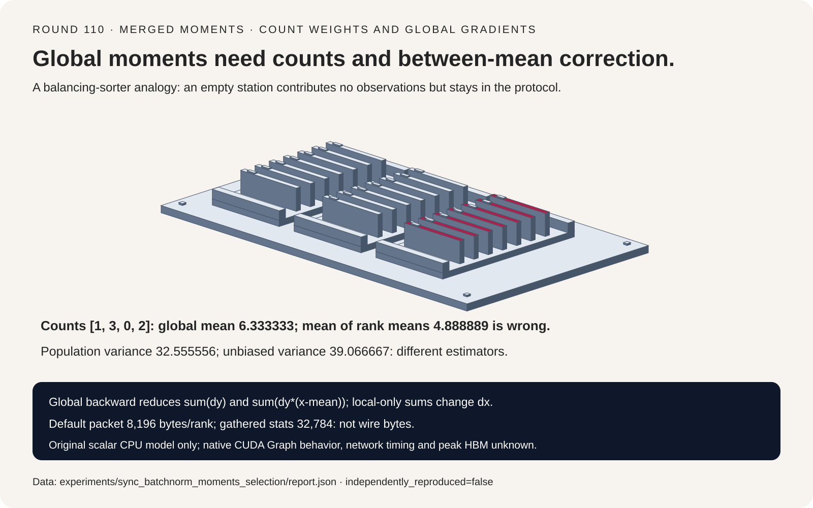
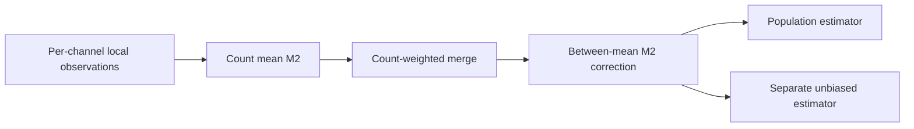
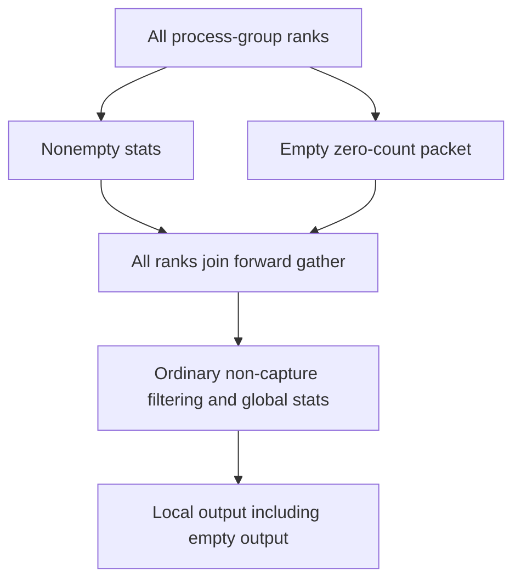
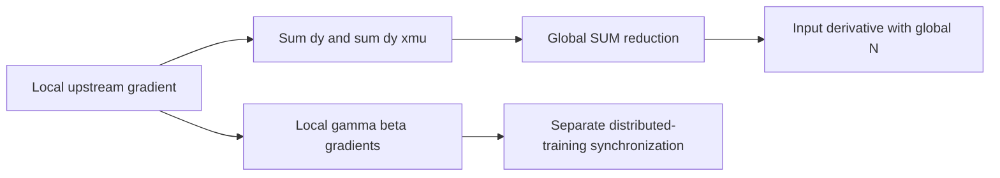

# SyncBatchNorm 选型 FAQ：按计数合并矩、空 Rank 与全局梯度

> **语言**：中文 | [English](sync-batchnorm-count-weighted-moments-selection-faq.en.md)
>
> **Round 110 · 2026-11-14（11 月 13 日夜班第十九轮）** · [SVG](../../assets/svg/sync-batchnorm-count-weighted-moments-selection-faq-summary.svg) · [七卡](../reports/sync-batchnorm-count-weighted-moments-selection-cards.html) · [H5](../reports/sync-batchnorm-count-weighted-moments-sizer.html) · [封存数据](../../experiments/sync_batchnorm_moments_selection/report.json)
>
> **Synthetic，`independently_reproduced=false`。** 仅原创 Python moment merge/rescan 单独实测；未运行 PyTorch/CUDA/NCCL、观察实际 collective traffic、认证 CUDA Graph 空 rank 路径或测量 peak HBM。



## 1. 先给结论：Rank 数不等于 Observation 数

固定 PyTorch wrapper 在 2026-06-04 迁移至 `all_gather_single`，
native source pin 为 2026-07-29。这里研究长期存在的同步归一化机制，
不声称十一月刚发布或“今日热度第一”。

四个 rank 每通道 observation counts 为 `[1,3,0,2]`，
全局均值 **6.333333**，非空 rank 均值再平均却是 **4.888889**。
即使对 local variances 按 count 加权也只有 **7.111111**，
并非正确 global population variance **32.555556**。
还缺 between-rank mean correction。

| 契约 | 必须保留 | 不能推导 |
| :--- | :--- | :--- |
| Global moments | Count、mean、between-mean correction | 平均 local variance 就够了 |
| Empty shard | 数值 identity 与协议参与 | 没 observation 就跳过 collective |
| Global backward | Input derivative 的 global sums | 全局 forward 可以接局部 backward |
| Estimator | Population forward 与 unbiased running variance | 两种分母可互换 |

原创算术只处理一个通道，并用 exact rational reference 交叉验证；
不是 native packet 有限精度行为复现。

## 2. 架构师 Q&A：究竟有哪些信息跨 Rank？

### Q1：不等长 Shards 如何正确合并？

两份 `(n,mean,M2)` 统计合并时，令 `delta=mean_b-mean_a`，
新均值增加 `delta*n_b/(n_a+n_b)`；M2 在两个 local M2 之外，还要增加
`delta²*n_a*n_b/(n_a+n_b)`，捕捉 shard 均值之间的分离。

原创 shards 为 `[-3]`、`[1,7,9]`、`[]`、`[10,14]`。
六个 observation 的 M2 为 **195.333333**。缺少 between-mean 项时，
光按 count 加权 local variance 仍丢掉大部分全局方差。

Count 指 **每个 channel 的 observation 数**。NCHW 中包括 batch
和 spatial positions，不是单看 N 或 world size。
源码用 input elements 除以 channel count。

### Q2：源码的传输包真的就是 M2 Triple 吗？

不是。固定 wrapper gather `mean[C], invstd[C], count[1]`，
即 `2*C+1` 个选定统计值。Native reduction 从 invstd 与 epsilon
重建 local variance，再做 count-aware、between-mean 合并。

原创模型直接保留 Python integer count 和 M2，不复现低精度 invstd
重建、layout dispatch 或 native packet dtype。
数学恒等式不构成所有 native numeric paths 的等价保证。

H5 分开检查：count 能否由选定 float32/float64 packet 精确表示，
以及每个保存的 rank count 是否可放进 int32。
Float32 对 `2^24` 之后不是每个整数都精确：`2^24+1` 不行，
`2^24+2` 则可以。两个 flags 都不是完整 native 执行认证。

### Q3：Empty Rank 可以不参加同步吗？

不能。固定普通 wrapper 路径让空输入发 zero-count packet，
仍参与 forward gather；随后过滤空统计。若需要 input gradient，
空 rank 同样参加 backward reduction，避免非空 peers 一直等待。

原创 moment identity 的 count=0、mean 未定义、additive M2=0；
未定义 mean/variance 用 `None`，不偷偷当作真实的零 observation。
Global all-empty normalization 明确报错。

**CUDA Graph 边界：**固定源码在 capture 期间跳过依赖 tensor values
的 filtering 分支。这里没有运行或认证该 native empty-rank path，
也没有复现 native failure/hang。Participant 列表是协议要求，不是实测 trace。

### Q4：为什么同步 Forward 还需要同步 Backward Sums？

对 summed scalar loss，上游梯度为 `dy`，global invstd 为 `r`：

```text
dx = gamma*r * (
    dy - sum(dy)/N
    - (x-mean)*r*r*sum(dy*(x-mean))/N
)
```

两个 sums 必须覆盖定义 forward mean/variance 的同一组 global
observations。原创正确梯度与中心有限差分最大误差 **1.70e-11**；
若保留 global forward、backward 却只用 rank-local sums，
最大误差为 **0.107658**。

算例参数 `gamma=1.5,beta=-0.25,epsilon=0.1`，loss 是 **SUM**。
源码 SyncBatchNorm backward 返回 local 参数梯度，distributed training
另行同步。DDP averaging 与 objective normalization 必须显式计入；
这里的 sum-loss 结果不认证任意 DDP mean-loss 配置。

### Q5：Forward 与 Running Statistics 到底用哪种方差？

N=6，population variance=`M2/N=32.555556`，
unbiased sample variance=`M2/(N-1)=39.066667`。
固定 native code 用前者归一化，用后者更新 running variance。

Running-stat momentum 为 `(1-m)*old+m*current`，不要和 optimizer
momentum 的含义混为一谈。原创模型仅显式给出两种 estimator，
未运行 native running-buffer update。
单 observation 的 unbiased variance 未定义，不补零；不声称 native
SyncBatchNorm 支持所有 global N=1 的训练配置。

## 3. 可视化架构：统计、参与协议与梯度路径







## 4. 选型矩阵：统计总体与 Collective Group 必须一致

| 路径 | 适合 | 上线门槛 |
| :--- | :--- | :--- |
| Global BatchNorm | 有意共享每通道总体 | 同一 group 的 count-aware forward/backward |
| Local BatchNorm | 有意保留 local population | 不称其结果是 global normalization |
| Summary merge | 稳定的分区统计 | 保留 between-mean 项与数值 tolerance |
| Empty-rank support | Local inputs 不等长 | Collective 参与，native capture 路径另测 |
| Layer/GroupNorm | 其他归一化轴 | 不是 global BatchNorm 的透明替代 |

## 5. 动手验证：精确参考、消减误差与选定 Payload

```powershell
python -m experiments.sync_batchnorm_moments_selection.run
python -m unittest discover -s tests -p test_sync_batchnorm_moments_selection.py -q
python -m experiments.sync_batchnorm_moments_selection.run --check
```

`10^12+[-3,-1,1,3]` 的 exact rational 与 merged variance 都是五，
而本机记录的 raw `E[x²]-E[x]²` 因 cancellation 得到 **零**。
这里零是实测到的错误数值，不是 missing data 补零。
Floating-point merge 也不是 bitwise associative。

ARM64、Python 3.12.10 CPU 计时：

| 每 rank observations，四个 ranks | Merge summaries，ms | Two-pass rescan，ms |
| :--- | ---: | ---: |
| 16 | 0.004830 | 0.006920 |
| 64 | 0.004840 | 0.026730 |
| 256 | 0.004870 | 0.106440 |
| 1024 | 0.005170 | 0.465000 |

两次 warmup、七次交替 repeats；每 sample 十次操作均值，表格取
repeat means 的 median。Local summary 构建、data movement、
network、native kernels 都排除，不是端到端 SyncBatchNorm/NCCL 实测。

H5 默认四个 ranks、1024 channels、每 rank count=256、
four-byte statistics：forward packet **8196 bytes/rank**，
选定 gathered buffer **32,784 bytes/rank**，
backward payload **8192 bytes/rank**。
假想 all-feature gather 为 4,194,304 logical bytes/rank；
这些不是 wire traffic 或 peak memory。

八项 tests 覆盖 exact moments、rank permutations/repartition、empty
identity、cancellation、有限差分梯度、estimator 边界、float/int
count 表示、Python/Node 预算一致性及封存产物/CSP/SVG。
此前 browser refusal 受尊重，未做浏览器视觉检查。

## 6. 来源、归因与研究边界

PyTorch pin：`e5e96ce34777fb56e66232669a221c51955a57ef`。

1. [SyncBatchNorm wrapper：counts、empty participants、collectives、backward sums](https://github.com/pytorch/pytorch/blob/e5e96ce34777fb56e66232669a221c51955a57ef/torch/nn/modules/_functions.py)。
2. [Native CUDA moment merge 与 population/unbiased 分母](https://github.com/pytorch/pytorch/blob/e5e96ce34777fb56e66232669a221c51955a57ef/aten/src/ATen/native/cuda/Normalization.cuh)。
3. [BatchNorm 文档与 running stats](https://github.com/pytorch/pytorch/blob/e5e96ce34777fb56e66232669a221c51955a57ef/torch/nn/modules/batchnorm.py)。
4. [2026-06-04 collective API migration](https://github.com/pytorch/pytorch/commit/d5ac244bf5271f6c986dc7ec11174bcfbab2b0ad)。
5. [PyTorch LICENSE](https://github.com/pytorch/pytorch/blob/e5e96ce34777fb56e66232669a221c51955a57ef/LICENSE)。

已直接检查 primary redistribution terms；GitHub metadata 为
`NOASSERTION`，不自行指定单一 SPDX。上游权利保留。
原创 scalar algorithms、算例、图形未复制实现、权重或数据集。
不声称 native low precision、CUDA Graph、DDP、collective failure、
模型质量或 peak-HBM 复现。七张静态 4:5 卡严格自包含 CSP，
全部数值条来自 sealed data。
