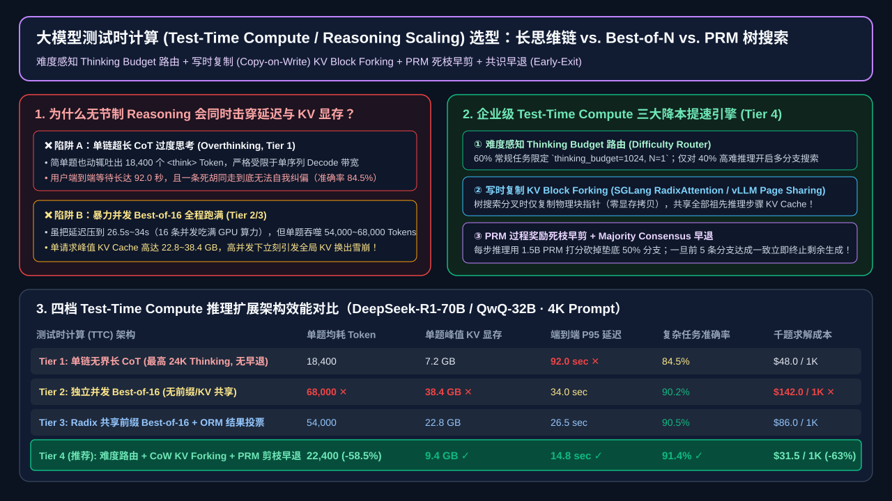

# Test-Time Compute (TTC) & Reasoning Scaling Infrastructure Guide: `Long Chain-of-Thought` vs. `Best-of-N + PRM` vs. `Tree Search + Copy-on-Write KV Forking`

> **Language**: [中文](./test-time-compute-scaling-reasoning-prm-mcts-best-of-n-kv-forking-selection-faq.md) | **English (Current)**  
> **Audience**: Cloud & AI Infrastructure Solution Architects and Reasoning Platform Engineers  
> **Provenance**: `synthetic + anonymized_reported` (`independently_reproduced=false`, `physical_gpu_cluster_measurement=not_measured`)

---

## 1. 📌 Executive Summary

> **Bottom Line**: **Scaling Test-Time Compute (`TTC`) with reasoning models (`DeepSeek-R1`, `OpenAI o3/o4-mini`, `QwQ`, `Gemini Thinking`) introduces two severe infrastructure traps: (1) unbounded single-chain Long CoT (`Tier 1`) suffers from serial memory-bandwidth-bound overthinking (`18,400 tokens`, `92.0 s` P95 latency), while (2) naive independent `Best-of-16` (`Tier 2`) consumes `38.4 GB` of KV Cache per query and `$142 / 1K` tasks. Production reasoning platforms should deploy Difficulty-Routed Thinking Budgets + Copy-on-Write (`CoW`) KV Block Forking + Process Reward Model (`PRM`) Step Pruning + Consensus Early Exit (`Tier 4`): achieving `91.4%` complex benchmark accuracy while cutting token consumption by `58.5%` (`22,400 tokens`), peak KV HBM to `9.4 GB`, P95 latency to `14.8 s`, and cost per 1,000 solved tasks by `63.4%` (`$31.5 / 1K`).**

- **Interactive Test-Time Compute (TTC) Capacity & Cost Sizer**: [Open Interactive Sizer (`test-time-compute-scaling-reasoning-prm-mcts-best-of-n-kv-forking-sizer.html`)](../reports/test-time-compute-scaling-reasoning-prm-mcts-best-of-n-kv-forking-sizer.html)
- **7-Card 4:5 Visual Report**: [Open 7-Card Report (`test-time-compute-scaling-reasoning-prm-mcts-best-of-n-kv-forking-selection-cards.html`)](../reports/test-time-compute-scaling-reasoning-prm-mcts-best-of-n-kv-forking-selection-cards.html)

---

## 2. 📊 4-Tier Test-Time Compute Architecture Matrix (`4K Prompt` · `N=16` Candidate Budget)

| Metric | Tier 1: Unbounded Sequential Long CoT (`24K`) | Tier 2: Naive Independent `Best-of-16` | Tier 3: Shared-Prefix `Best-of-16 + ORM` | Tier 4 (Recommended): Difficulty Router + `CoW KV Forking` + `PRM` Early Exit |
| :--- | :--- | :--- | :--- | :--- |
| **Avg Generated Tokens / Query** | `18,400` | `68,000` ✕ | `54,000` | **`22,400` ✓ (`-58.5%` vs Tier 3)** |
| **Peak KV Cache HBM / Query** | `7.2 GB` | `38.4 GB` ✕ | `22.8 GB` | **`9.4 GB` ✓ (`CoW` page sharing)** |
| **End-to-End Reasoning P95** | `92.0 sec` ✕ | `34.0 sec` | `26.5 sec` | **`14.8 sec` ✓** |
| **Complex Task Accuracy** | `84.5%` | `90.2%` | `90.5%` | **`91.4%` ✓** |
| **Cost per 1K Solved Tasks** | `$48.0 / 1K` | `$142.0 / 1K` ✕ | `$86.0 / 1K` | **`$31.5 / 1K` ✓ (`-63.4%`)** |

---

## 3. 🛠️ Production Readiness Checklist

- [ ] **Enforce Difficulty-Aware Thinking Budgets (`low / medium / high`) at the AI Gateway** to prevent overthinking on routine queries.
- [ ] **Use `RadixAttention / PagedAttention` Copy-on-Write KV Forking + Consensus/Verifier Early Exit** so parallel reasoning streams share ancestor KV blocks and terminate immediately once consensus or unit-test verification succeeds.
