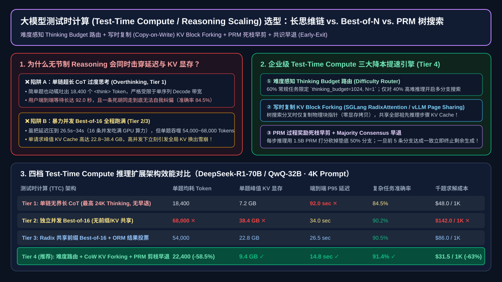
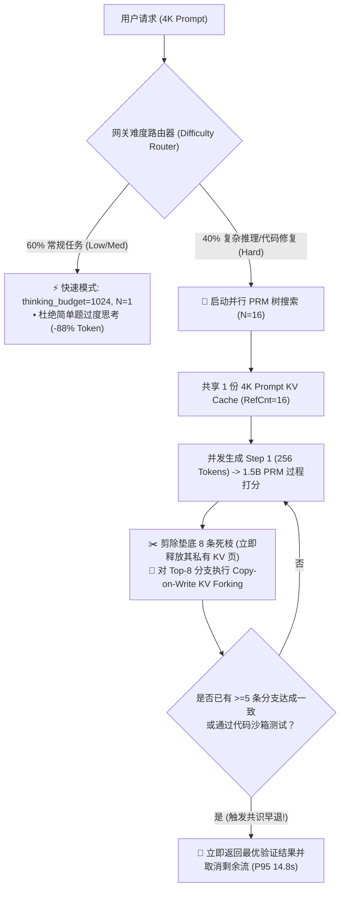

# 大模型测试时计算（Test-Time Compute / Reasoning Scaling）基础设施选型：`Chain-of-Thought (Thinking Budget)` vs. `Best-of-N + PRM 过程奖励模型` vs. `树搜索 + 写时复制 KV Forking` 容量指南

> **语言 / Language**: **中文 (当前)** | [English](./test-time-compute-scaling-reasoning-prm-mcts-best-of-n-kv-forking-selection-faq.en.md)  
> **定位**：面向 Cloud & AI Infrastructure Solution Architect 与企业推理平台负责人的深度推理模型（`DeepSeek-R1`、`OpenAI o3/o4-mini`、`QwQ`、`Gemini Thinking`）测试时算力扩展（`Sequential Long CoT` vs. `Parallel Best-of-N` vs. `PRM 树搜索`）、写时复制 `Copy-on-Write KV Block Forking` 与共识早退（Consensus Early-Exit）容量规划白皮书  
> **合规与来源声明**：`synthetic + anonymized_reported`（`independently_reproduced=false`，`physical_gpu_cluster_measurement=not_measured`；完全面向通用企业级深度推理模型服务架构设计与成本优化）

---

## 1. 📌 核心选型结论速览（Executive Summary）

> **一句话结论**：**测试时计算（Test-Time Compute, TTC）将大模型竞争从“预训练参数扩张”推向了“推理时用更多 Token 换取更高智力上限”，但无节制的 Reasoning 会引发灾难性的延迟与显存双重爆炸：① 纯单链无界长 CoT（Tier 1）在简单问题上也会过度思考（Overthinking）吐出 `18,400 Tokens`，端到端 P95 延迟高达 **`92.0 秒`**；② 朴素独立并发 `Best-of-16`（Tier 2）单题峰值吞噬 **`38.4 GB` KV Cache**，瞬间挤爆 GPU 显存！生产级标准答案是采用“难度感知 Thinking Budget 路由 + 写时复制（Copy-on-Write）KV Block Forking + PRM 过程奖励模型死枝早剪 + 多数派共识早退（Tier 4）”：将复杂任务准确率推升至 **`91.4%`** 的同时，单题平均 Token 消耗降低 **`58.5%`（`22,400 Tokens`）**、峰值 KV 显存降至 **`9.4 GB`**、端到端 P95 延迟从 `92 秒` 压至 **`14.8 秒`**，千题求解成本降低 **`63.4%`**！**

- **交互式测试时计算 (TTC) 容量与成本计算器**：[打开交互式计算器 (`test-time-compute-scaling-reasoning-prm-mcts-best-of-n-kv-forking-sizer.html`)](../reports/test-time-compute-scaling-reasoning-prm-mcts-best-of-n-kv-forking-sizer.html)
- **7-Card 4:5 视觉评测报告**：[打开 7-Card 报告 (`test-time-compute-scaling-reasoning-prm-mcts-best-of-n-kv-forking-selection-cards.html`)](../reports/test-time-compute-scaling-reasoning-prm-mcts-best-of-n-kv-forking-selection-cards.html)

---

## 2. 🎯 客户与架构师灵魂拷问 Q&A（Deep-Dive Architecture FAQ）

### Q1：“串行长思维链（Sequential Scaling）”与“并行多分支搜索（Parallel Scaling: Best-of-N / Beam / MCTS）”在底层 GPU 物理瓶颈上有什么本质区别？
- **串行扩展（Sequential CoT，生成 16K~32K `<think>` Tokens）**：
  - 单条请求的 Batch Size 为 `1`，每一步都严格受限于 **GPU HBM 显存带宽（Memory-Bandwidth Bound）**。哪怕整台 8 卡 H200 算力空置 90%，单条链吐完 18,400 个 Token 也必须硬生生串行跑 18,400 步（耗时 `92 秒`）！
- **并行扩展（Parallel Scaling，同一题并发分叉 `N=16` 条推理路径）**：
  - 在 `vLLM / SGLang` 中，同一道题的 `16` 条分支在 Decode 阶段被合并进同一个 Matrix Multiplication Batch，**读取 1 次模型权重即可同时推进 16 条推理分支**（充分利用 GPU Tensor Core 算力余量），因此把 92 秒的长串行等待变成了 `14.8 ~ 26.5 秒` 的宽并行探索！

### Q2：如何在并行树搜索（Tree Search / Beam Search）中把 KV Cache 显存开销砍掉 `75%+`？
1. **写时复制（Copy-on-Write, CoW）KV Block Forking**：
   - 利用 `PagedAttention / RadixAttention` 的物理块引用计数（`ref_count`），不仅 `4K` 初始 Prompt 的 KV 物理页被 16 条分支 100% 共享，在推理中途每完成一个推理步（如 `256 Tokens`）分叉新子路径时，也**只需递增祖先 KV Block 的引用计数（零显存拷贝）**，只有新分叉出的最后一个未满 Page 才分配新显存！
2. **过程奖励模型（PRM）死枝早剪 + 多数派共识早退（Majority Early-Exit）**：
   - 每生成 `256 Tokens` 推理步骤，由轻量级 `1.5B PRM` 评估各分支得分，立即 `free()` 掉垫底 50% 错误分支的独立 KV 页；一旦前 `5` 条高分分支得出相同的验证答案（或通过沙箱单元测试），立即终止其余所有分支的生成！

---

## 3. 🧭 直观可视化图解（Mermaid 测试时计算树搜索与 KV Forking 流程）

---

## 4. 📊 架构师多方案选型决策矩阵

| 评估维度 | Tier 1：单链无界长 CoT（最高 `24K` Thinking） | Tier 2：独立并发 `Best-of-16`（无 KV 共享） | Tier 3：`Radix` 共享前缀 `Best-of-16 + ORM` | Tier 4（推荐）：难度路由 + `CoW KV Forking` + `PRM` 早剪早退 |
| :--- | :--- | :--- | :--- | :--- |
| **单题平均生成 Token 数** | `18,400 Tokens` | `68,000 Tokens` ✕ | `54,000 Tokens` | **`22,400 Tokens` ✓（比 Tier 3 省 `58.5%`）** |
| **单题峰值 KV Cache 显存** | `7.2 GB` | `38.4 GB` ✕（极易 OOM） | `22.8 GB` | **`9.4 GB` ✓（写时复制 + 死枝立即释放）** |
| **端到端推理 P95 延迟** | `92.0 秒` ✕（串行干等） | `34.0 秒` | `26.5 秒` | **`14.8 秒` ✓（并行探索 + 共识早退）** |
| **复杂数学/代码任务准确率** | `84.5%` | `90.2%` | `90.5%` | **`91.4%` ✓（过程纠偏超越单链死磕）** |
| **每求解 `1,000` 道复杂任务成本** | `$48.0 / 1K` | `$142.0 / 1K` ✕ | `$86.0 / 1K` | **`$31.5 / 1K` ✓（比 Tier 3 省 `63.4%`）** |

---

## 5. 🛠️ 架构评审与生产落地 Checklist

- [ ] **严禁对全量业务流量无差别开启最高档 `reasoning_effort=high / max_thinking_tokens=32768`**：必须在网关前置轻量级难度分类器，对 `60%+` 常规查询限制 `thinking_budget <= 1024`。
- [ ] **在 `Best-of-N` 或树搜索任务中强制开启 `RadixAttention / PagedAttention` 前缀与中间态 `Copy-on-Write` 共享**，并在代码/SQL 场景接入外部确定性验证器（单元测试/语法执行器）触发提前终止（Early-Stop on First Pass）。
