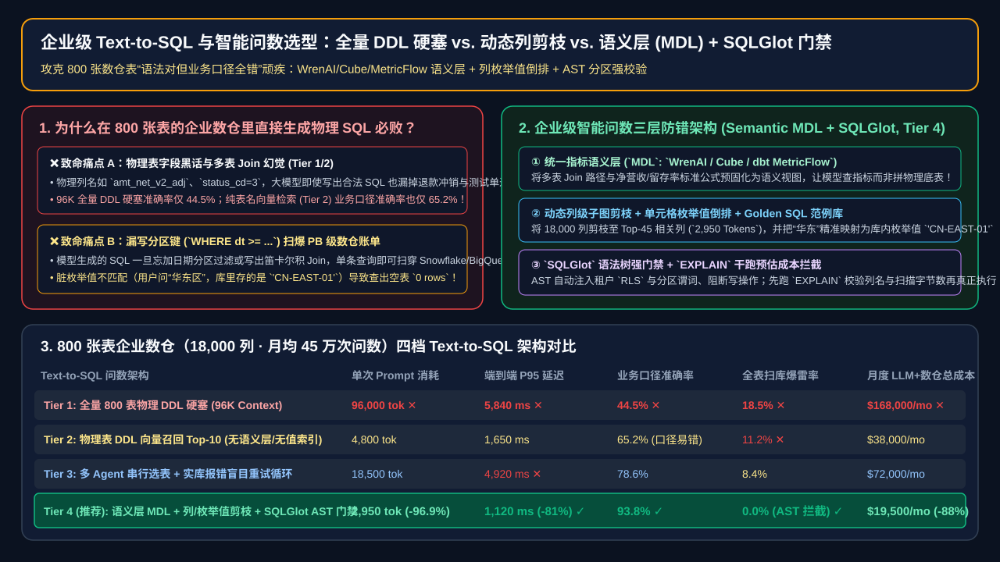

# Enterprise Text-to-SQL & Data Warehouse Agent Architecture Guide: Full DDL Dump vs. Dynamic Schema Pruning vs. Governed Semantic Layer (`MDL: WrenAI / Cube / MetricFlow`) + `SQLGlot` AST Gates

> **Language**: [中文](./text-to-sql-enterprise-semantic-layer-vanna-mdl-schema-pruning-execution-retry-selection-faq.md) | **English (Current)**  
> **Audience**: Cloud & AI Infrastructure Solution Architects and Enterprise Data Platform / BI Architects  
> **Provenance**: `synthetic + anonymized_reported` (`independently_reproduced=false`, `physical_gpu_cluster_measurement=not_measured`)

---

## 1. 📌 Executive Summary

> **Bottom Line**: **On an enterprise data warehouse (`Snowflake`, `Databricks`, `Microsoft Fabric`, `BigQuery`) with `800` physical tables and `18,000` cryptic columns (`450,000` BI queries/month), dumping all `96K` tokens of raw `CREATE TABLE` DDL into a frontier LLM (`Tier 1`) yields a dismal `44.5%` business execution accuracy, `5,840 ms` P95 latency, an `18.5%` runaway full-table scan rate, and `$168,000/month` in combined LLM + warehouse compute bills. Even Top-10 raw DDL vector retrieval (`Tier 2`) reaches only `65.2%` accuracy because LLMs guess wrong multi-table JOIN paths and KPI denominators. Production Data Agents standardize on a Governed Semantic Layer (`MDL: WrenAI / Cube / dbt MetricFlow`) + Column/Cell-Value LSH Pruning + Golden SQL Few-Shot RAG + `SQLGlot` AST & `EXPLAIN` Dry-Run Gate (`Tier 4`): compressing prompts by `96.9%` (`2,950 tokens`), cutting P95 latency to `1,120 ms`, eliminating unpartitioned full-table scans (`0.0%`), and lifting business KPI accuracy to `93.8%` (`+49.3 pts`, `-88.4%` TCO).**

- **Interactive Enterprise Text-to-SQL Accuracy & TCO Sizer**: [Open Interactive Sizer (`text-to-sql-enterprise-semantic-layer-vanna-mdl-schema-pruning-execution-retry-sizer.html`)](../reports/text-to-sql-enterprise-semantic-layer-vanna-mdl-schema-pruning-execution-retry-sizer.html)
- **7-Card 4:5 Visual Report**: [Open 7-Card Report (`text-to-sql-enterprise-semantic-layer-vanna-mdl-schema-pruning-execution-retry-selection-cards.html`)](../reports/text-to-sql-enterprise-semantic-layer-vanna-mdl-schema-pruning-execution-retry-selection-cards.html)

---

## 2. 📊 4-Tier Enterprise Text-to-SQL Architecture Matrix (`800 Tables` · `18,000 Columns` · `450K Queries/Mo`)

| Metric | Tier 1: Full `96K` Raw DDL Dump | Tier 2: Top-10 Raw DDL Vector RAG | Tier 3: 3-Agent Live Retry Loop | Tier 4 (Recommended): Semantic `MDL` + Column/Value Pruning + `SQLGlot` AST Gate |
| :--- | :--- | :--- | :--- | :--- |
| **Avg Prompt Tokens / Query** | `96,000` ✕ | `4,800` | `18,500` | **`2,950` ✓ (`-96.9%` vs Tier 1)** |
| **End-to-End Query P95 Latency** | `5,840.0 ms` ✕ | `1,650.0 ms` | `4,920.0 ms` ✕ | **`1,120.0 ms` ✓ (`-80.8%`)** |
| **Business Logic Accuracy** | `44.5%` ✕ | `65.2%` | `78.6%` | **`93.8%` ✓ (`+49.3 pts`)** |
| **Unpartitioned Scan Risk** | `18.5%` ✕ | `11.2%` ✕ | `8.4%` | **`0.0%` ✓ (`SQLGlot` AST enforced)** |
| **Monthly LLM + DW TCO** | `$168,000 / mo` ✕ | `$38,000 / mo` | `$72,000 / mo` | **`$19,500 / mo` ✓ (`-88.4%`)** |

---

## 3. 🛠️ Production Readiness Checklist

- [ ] **Never Force LLMs to Reconstruct Complex JOIN Paths or Financial KPI Formulas from Raw Physical Tables**: Expose pre-modeled `MDL` semantic views (`WrenAI`, `Cube`, `dbt MetricFlow`) and verified Golden SQL templates.
- [ ] **Gate All Generated SQL Through `SQLGlot` AST Rewriting + Warehouse `EXPLAIN` Dry Runs** to enforce read-only access, inject row-level security (`tenant_id`), require date-partition filters, and block queries exceeding scan byte budgets.
