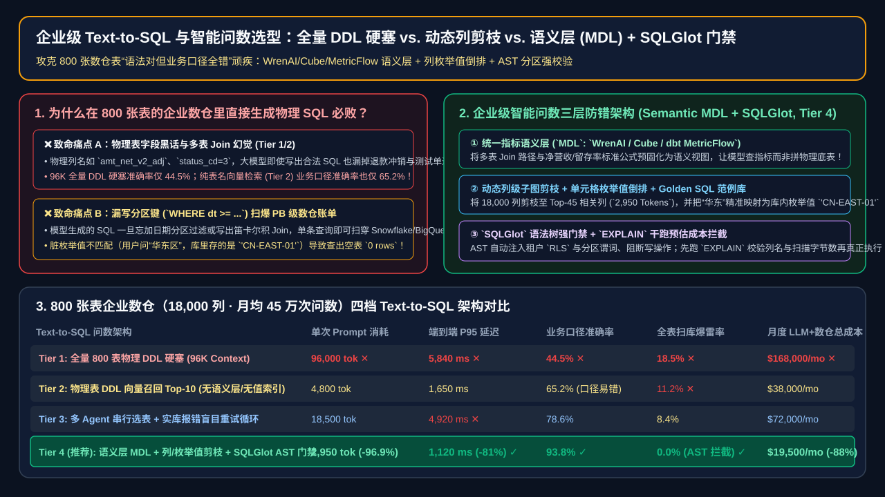
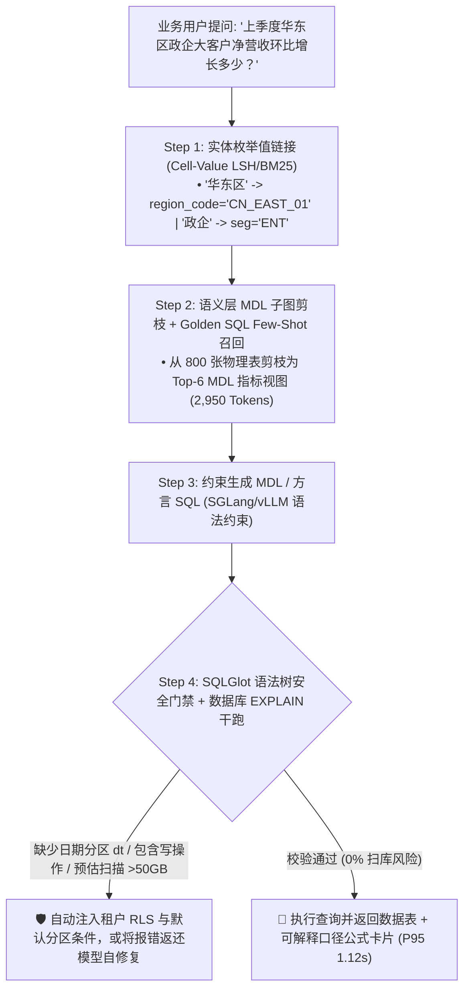

# 企业级 Text-to-SQL 与数据仓库智能问数（Data Agent / Semantic Layer）架构选型：全量 DDL 硬塞 vs. `动态列剪枝 (Schema Linking)` vs. `WrenAI / Cube / MetricFlow 语义层 (MDL) + SQLGlot 门禁` 指南

> **语言 / Language**: **中文 (当前)** | [English](./text-to-sql-enterprise-semantic-layer-vanna-mdl-schema-pruning-execution-retry-selection-faq.en.md)  
> **定位**：面向 Cloud & AI Infrastructure Solution Architect 与企业数据平台/BI 负责人的千表级数仓（`Snowflake`、`Databricks`、`Microsoft Fabric`、`BigQuery`）智能问数架构选型、统一指标语义层（`MDL: WrenAI / Cube / dbt MetricFlow`）、列级枚举值倒排检索（Cell-Value LSH Linking）与 `SQLGlot` 语法树安全防扫库门禁白皮书  
> **合规与来源声明**：`synthetic + anonymized_reported`（`independently_reproduced=false`，`physical_gpu_cluster_measurement=not_measured`；完全面向通用企业级数据仓库 BI 智能问数架构设计）

---

## 1. 📌 核心选型结论速览（Executive Summary）

> **一句话结论**：**在拥有 `800 张`物理底表、`18,000 个`晦涩字段（如 `amt_net_v2_adj`）的真实企业数据仓库中，让大模型直接对着原始物理表 `CREATE TABLE` DDL 写 SQL 是必败之路——把 `800` 张表硬塞进 `96K` 上下文（Tier 1）不仅单次耗时 `5.84 秒`、月烧 `$16.8 万`，业务口径准确率更只有惨淡的 **`44.5%`**；即便用向量库召回 Top-10 物理表（Tier 2），大模型虽然能写出语法合法的 SQL，却因漏掉“剔除测试单、冲销退货单”等隐性财务口径，业务准确率依然停留在 `65.2%`，且有 `11.2%` 的概率漏写分区键扫爆 PB 级数仓账单！生产环境唯一正解是采用“统一指标语义层（`MDL`: `WrenAI / Cube / dbt MetricFlow`）+ 列级/单元格枚举值倒排剪枝 + Golden SQL 范例库 + `SQLGlot` 语法树分区强门禁（Tier 4）”：将单次 Prompt 压缩至 **`2,950 Tokens`（减少 `96.9%`）**、端到端 P95 压至 **`1,120 ms`**，全表误扫爆雷率降至 **`0.0%`**，并将业务口径执行准确率推升至 **`93.8%`（提升 `+49.3 pts`，月成本降低 `88.4%`）**！**

- **交互式企业 Text-to-SQL 准确率与数仓 TCO 计算器**：[打开交互式计算器 (`text-to-sql-enterprise-semantic-layer-vanna-mdl-schema-pruning-execution-retry-sizer.html`)](../reports/text-to-sql-enterprise-semantic-layer-vanna-mdl-schema-pruning-execution-retry-sizer.html)
- **7-Card 4:5 视觉评测报告**：[打开 7-Card 报告 (`text-to-sql-enterprise-semantic-layer-vanna-mdl-schema-pruning-execution-retry-selection-cards.html`)](../reports/text-to-sql-enterprise-semantic-layer-vanna-mdl-schema-pruning-execution-retry-selection-cards.html)

---

## 2. 🎯 客户与架构师灵魂拷问 Q&A（Deep-Dive Architecture FAQ）

### Q1：为什么企业 Text-to-SQL 最大的坑不是“SQL 语法报错”，而是“SQL 跑通了但算出的高管财报数字全错”？
1. **口径歧义黑洞**：高管问“上季度华东区活跃政企客户净留存率（NDR）是多少？”，物理数仓里有 6 张订单表、3 张退款表、4 个状态码字段。如果让 LLM 临场去猜哪 5 张表怎么 `LEFT JOIN`、分母怎么去重，10 次有 4 次口径算错！
2. **语义层（Semantic Layer / Modeling Definition Language `MDL`）的降维打击**：
   - 使用 `WrenAI MDL`、`Cube` 或 `dbt MetricFlow`，预先将多表 Join 关系、维度（Dimensions）与官方认证指标公式（Measures，如 `net_arr = SUM(gross_amt - refund_amt) WHERE is_test = 0`）定义为受控语义视图；
   - 大模型只需生成针对**语义层视图/MDL 的极简查询**，再由语义层编译器 100% 确定性地展开为底层物理数仓方言 SQL！

### Q2：如何解决“用户提问词（‘华东’）与数据库实际存储枚举值（`'CN_EAST_01'`）对不上”导致的查出空表（0 Rows）？
- **单元格枚举值倒排与 MinHash LSH 链接（Cell-Value Linking）**：对数仓中所有低基数维度列（地区、产品线、部门、状态码）的 Distinct 枚举值建立 `BM25 + LSH / Embedding` 索引；当用户提问“华东区”时，前置实体链接器在 `8 ms` 内查出对应 `dim_region.region_code = 'CN_EAST_01'` 并作为显式提示词注释注入 Schema！

---

## 3. 🧭 直观可视化图解（Mermaid 语义层驱动的企业级 Text-to-SQL 四步闭环）

---

## 4. 📊 架构师多方案选型决策矩阵（`800` 张表 · `18,000` 列 · 月均 `45 万次`问数）

| 评估维度 | Tier 1：全量 800 表物理 DDL 硬塞 (`96K` Context) | Tier 2：物理表 DDL 向量召回 Top-10（无语义层） | Tier 3：多 Agent 串行选表 + 实库报错重试循环 | Tier 4（推荐）：语义层 `MDL` + 列/枚举值剪枝 + `SQLGlot AST` 门禁 |
| :--- | :--- | :--- | :--- | :--- |
| **单次查询消耗 Prompt Tokens** | `96,000 Tokens` ✕ | `4,800 Tokens` | `18,500 Tokens` | **`2,950 Tokens` ✓（比硬塞省 `96.9%`）** |
| **端到端问数 `P95` 延迟** | `5,840.0 ms` ✕ | `1,650.0 ms` | `4,920.0 ms` ✕（多轮重试慢） | **`1,120.0 ms` ✓（降低 `80.8%`）** |
| **业务指标口径执行准确率** | `44.5%` ✕（Join 幻觉严重） | `65.2%`（语法对但口径错） | `78.6%` | **`93.8%` ✓（提升 `+49.3 pts`）** |
| **未分区全表扫描爆雷风险率** | `18.5%` ✕（数仓账单炸裂） | `11.2%` ✕ | `8.4%` | **`0.0%` ✓（`SQLGlot` AST 强制拦截）** |
| **月度 LLM + 数仓计算总成本** | `$168,000 / 月` ✕ | `$38,000 / 月` | `$72,000 / 月` | **`$19,500 / 月` ✓（节省 `88.4%`）** |

---

## 5. 🛠️ 架构评审与生产落地 Checklist

- [ ] **严禁把未经 `SQLGlot` AST 解析校验的原始生成 SQL 直接发往生产数据仓库**：必须在 AST 层强制校验：① 仅允许 `SELECT` 只读语句；② 强制注入当前登录用户的行级租户过滤条件（`WHERE tenant_id = ...`）；③ 对大事实表强制检查是否包含分区键过滤（如 `dt >= ...`）。
- [ ] **在正式执行前先跑一次零成本 `EXPLAIN`（如 `BigQuery Dry-Run / Snowflake Explain`）**：既能在 `15 ms` 内抓出拼错的列名送回模型自修复，又能拦截预估扫描量超过阈值（如 `> 50 GB`）的烂查询！
