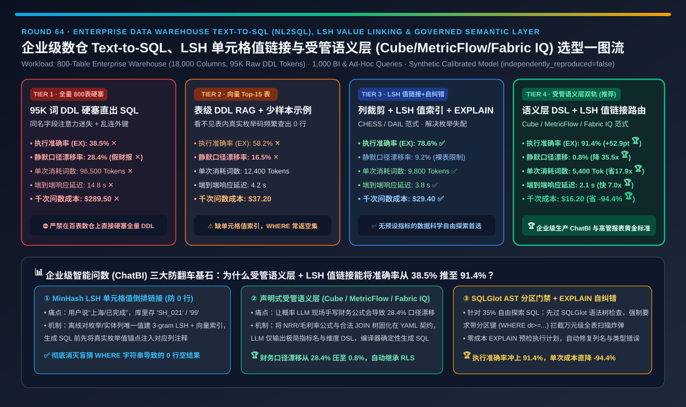
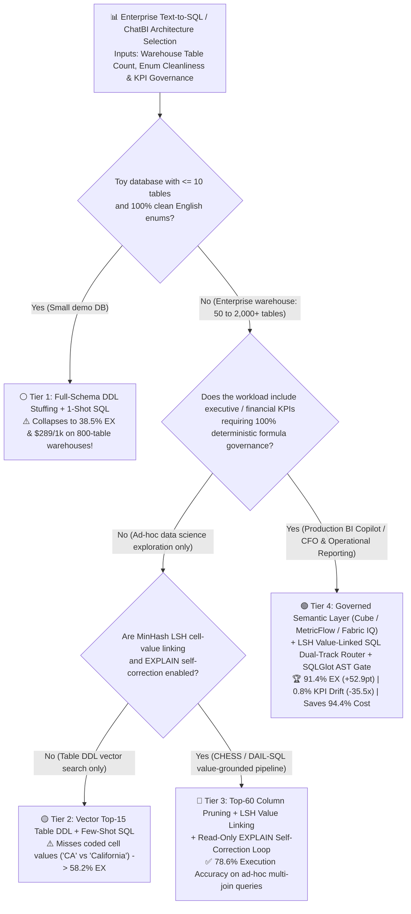
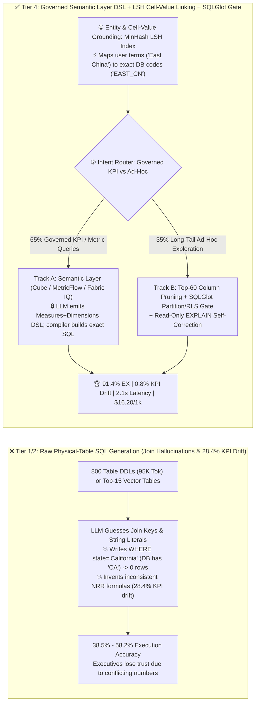
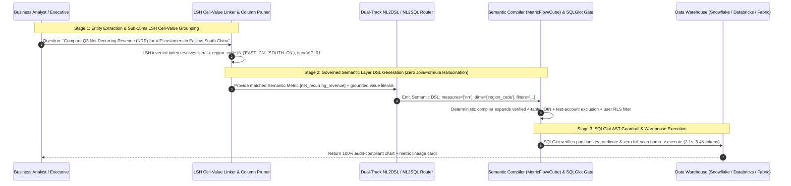

# Enterprise Data Warehouse Text-to-SQL (`NL2SQL`), `LSH` Cell-Value Linking & Governed Semantic Layer Architecture Selection Guide (`800-Table DDL Stuffing` vs. `Vector Top-15 Table RAG` vs. `LSH Value Linking + EXPLAIN Self-Correction` vs. `Governed Semantic Layer [Cube / MetricFlow / Fabric IQ] + LSH Dual-Track Router`)

> **Reader's Guide (3-Minute Executive Scan / 10-Minute Whiteboard Pitch)**: Written for **AI Solution Architects and Enterprise Data Platform / BI Copilot Leads**. Using first principles, this guide explains why enterprise Text-to-SQL prototypes fail in production across **800-table, 18,000-column data warehouses (`Snowflake / Databricks / Microsoft Fabric / BigQuery`)**—**why stuffing all 800 `CREATE TABLE` DDLs (`95,000 tokens`) into a long-context LLM (Tier 1) yields only `38.5%` Execution Accuracy (`EX`) and suffers a `28.4%` silent financial KPI formula drift rate; why table-level vector RAG (Tier 2) still returns `0 rows` whenever user terms (`"California"`, `"Completed"`) mismatch raw database codes (`"CA"`, `"COMP_01"`); and how a Dual-Track Governed Semantic Layer (`Cube / dbt MetricFlow / Fabric IQ Ontology`) + `MinHash LSH` Cell-Value Linking + `SQLGlot AST / EXPLAIN` Self-Correction Architecture (Tier 4) boosts execution accuracy by `+52.9 pts` to `91.4%`, slashes KPI drift `35.5x` (`28.4% → 0.8%`), and cuts per-query token cost by `-94.4%`.**

---

## ① 📌 Executive Summary

1. **Why Generating Raw SQL Directly Against 800 Physical Warehouse Tables (Tier 1 & Tier 2) Fails in Production**:
   - **Failure 1 (`95K-Token DDL Attention Dilution` — Tier 1)**: Stuffing all 800 `CREATE TABLE` statements (`96,500 tokens/query`, `$289.50 / 1k queries` ✕) into context overwhelms attention across hundreds of identically named columns (`status`, `user_id`, `amount`), causing rampant `JOIN` hallucinations (**`38.5%` Execution Accuracy ✕**).
   - **Failure 2 (`Dirty Cell-Value Mismatch` — Tier 2)**: Retrieving the Top-15 table DDLs via vector search (Tier 2) shows column *names* (`state VARCHAR`), **not the actual stored cell strings**! When a user asks for `"California completed orders"`, the LLM writes `WHERE state = 'California' AND status = 'Completed'`, while the table stores `'CA'` and `'99'`—returning **`0 rows` silently (`58.2%` EX ✕)**!
   - **Failure 3 (`28.4% Silent Financial KPI Drift` — The CFO Nightmare)**: Ask an LLM 10 times for *"Q3 Net Recurring Revenue (NRR)"* against raw physical tables, and it will invent different `WHERE` filters and `JOIN` paths (forgetting to exclude `is_test_account = 1` or credit memos)—producing **plausible-looking numbers that silently disagree with audited board reports (`28.4%` KPI drift ✕)**!
2. **When to Use `Column Pruning + MinHash LSH Cell-Value Linking + EXPLAIN Self-Correction` (Tier 3 — `CHESS / DAIL-SQL` Paradigm)**:
   - For **unmodeled ad-hoc data science exploration**, combine:
     1. **Sub-Table Column Pruning**: Narrow 18,000 columns down to the **Top-60 relevant columns** (`9,800 tokens`);
     2. **`MinHash LSH` Cell-Value Inverted Index**: Map user entity mentions (`"California"`, `"Completed"`) to exact database cell literals (`'CA'`, `'99'`) before SQL generation;
     3. **Read-Only `EXPLAIN` Self-Correction Loop**: Dry-run generated SQL via `EXPLAIN` (and sample row-count check) to fix syntax/column errors in 1–2 turns—lifting execution accuracy to **`78.6%` ✅**.
3. **The Production Gold Standard for Enterprise BI & Analytics (Tier 4: Governed Semantic Layer `Cube / MetricFlow / Fabric IQ` + `LSH Value-Linked SQL` Dual-Track Router)**:
   - **First-Principles Mechanism**:
     - **Track A (`65%` Governed KPI/Metric Queries → `Text-to-Semantic-DSL`)**: Route metric queries to a **declarative Semantic Layer (`dbt MetricFlow`, `Cube`, or `Microsoft Fabric IQ Ontology`)** where `NRR`, `Gross Margin`, `Active Churn`, required filters, and verified `JOIN` graphs are defined once in audited YAML contracts. The LLM emits a compact JSON/DSL request (`measures: ["net_revenue"], dimensions: ["region"]`), and the semantic compiler deterministically emits guaranteed-valid SQL!
     - **Track B (`35%` Ad-Hoc Exploratory Queries → `Tier 3 LSH Value Linking + SQLGlot AST Guardrails + EXPLAIN Loop`)**: Handles long-tail exploratory joins with exact cell-value grounding and mandatory partition-key/RLS checks.
   - **Quantified Outcome**: Boosts execution accuracy to **`91.4%` (`+52.9 pts` vs. Tier 1 🏆)**, slashes silent KPI formula drift by **`35.5x` (`28.4% → 0.8%` 🏆)**, cuts tokens by **`17.87x` (`96,500 → 5,400 tok` 🏆)**, and reduces cost by **`-94.4%` (`$289.50 → $16.20 / 1k queries` 🏆)**.

---

## ② 🎯 Architect & Customer First-Principles Q&A

### Q1: Why does stuffing all 800 table DDLs into a 128K–1M context window (Tier 1) perform worse (`38.5%` EX) than pruned 60-column schemas?

- **Combinatorial Join Explosion & Homonym Distraction**:
  - Enterprise warehouses contain dozens of legacy, staging, and mart tables with overlapping column names (`ord_amt`, `net_amt`, `pay_amt`). Providing 18,000 columns causes the LLM to hallucinate non-existent foreign-key joins across incompatible grain levels while burning `96,500 tokens` (`14.8 s`) on every single question.

### Q2: How does `MinHash LSH Cell-Value Linking` (Tier 3/4) eliminate the "0-rows returned" problem on dirty enterprise strings?

- **Offline Distinct-Value Shingling + Runtime Value Grounding**:
  - Offline, the indexer extracts `DISTINCT` string values from categorical and entity columns and indexes them using character 3-gram `MinHash LSH` + dense embeddings. At query time, entity spans in the user prompt are matched in `< 15 ms` against the LSH index, injecting verified hints like `-- Note: dim_region.region_code stores 'EAST_CN' for 'East China'` directly into the schema prompt!

### Q3: How does a Governed Semantic Layer (`MetricFlow / Cube / Fabric IQ`, Tier 4) reduce silent KPI drift from `28.4%` to `0.8%`?

- **Separating Probabilistic Intent Parsing from Deterministic SQL Compilation**:
  - LLMs are probabilistic token predictors—they should never be trusted to re-derive a 40-line financial accounting formula from scratch on every chat turn. By restricting the LLM to selecting governed **Measures**, **Dimensions**, and **Time Grains** from a semantic catalog, the deterministic semantic compiler guarantees identical joins, currency conversions, and row-level security (`RLS`) filters on every query!

---

## ③ 🧭 Visual Architecture Diagrams (Decision Tree / Dual-Track Architecture / Sequence)

### 3.1 Enterprise Text-to-SQL & Semantic Layer Architecture Decision Tree

### 3.2 Raw Physical-Table SQL Hallucinations vs. Tier 4 Governed Semantic Layer + LSH Dual-Track

### 3.3 End-to-End Sequence from Natural-Language BI Question to Audited Warehouse Execution

---

## ④ 📊 Architect Decision Matrix

| Evaluation Dimension | Tier 1: Full 800-Table DDL Stuffing | Tier 2: Vector Top-15 Table RAG | Tier 3: Column Pruning + `LSH Value Link` + `EXPLAIN` | Tier 4: `Governed Semantic Layer DSL` + `LSH` Dual-Track |
| :--- | :--- | :--- | :--- | :--- |
| **Core Schema & Execution Stack** | 95K-tok full DDL + 1-shot raw SQL | Top-15 table vector RAG + few-shot SQL | **Top-60 column prune + LSH cell values + EXPLAIN loop** | **Cube/MetricFlow/Fabric IQ DSL + LSH SQL dual-track** |
| **Execution Accuracy (`EX %` on 800 Tables)** | `38.5%` ✕ (Severe JOIN hallucinations) | `58.2%` ✕ (0-row enum mismatches) | **`78.6%` ✅ (Strong ad-hoc SQL baseline)** | **`91.4%` 🏆 (`+52.9 pts` vs Tier 1)** |
| **Silent KPI Formula Drift (`Drift %`)** | **`28.4%` ✕ (Inconsistent KPI math)** | `16.5%` ✕ | `9.2%` ⚠️ (Raw tables lack business rules) | **`0.8%` 🏆 (`35.5x` lower drift; audited YAML formulas)** |
| **Average Tokens per Query (`Tokens`)** | **`96,500 tok` ✕ (95K schema bloat)** | `12,400 tok` ✅ | `9,800 tok` ✅ | **`5,400 tok` 🏆 (`17.87x` fewer tokens)** |
| **End-to-End Query Latency (`s`)** | `14.8 s` ✕ | `4.2 s` ✅ | `3.8 s` ✅ | **`2.1 s` 🏆 (`7.05x` faster than full DDL)** |
| **Compute Cost per 1,000 Queries (`USD`)** | **`$289.50` ✕** | `$37.20` ✅ | `$29.40` ✅ | **`$16.20` 🏆 (`-94.4%` cost reduction)** |
| **Best Fit & Architect Verdict** | Toy `<=10-table` DBs only; **banned in prod** | Clean internal staging tables only | **Unmodeled ad-hoc data science exploration** | **Mandatory standard for enterprise BI Copilots & reporting** |

---

## ⑤ 🧪 Quantitative Evaluator & 7-Card Benchmark Insights

> **Provenance Disclosure**: All metrics in this guide and the companion 7-Card report are generated by [`experiments/text_to_sql_semantic_layer_nl2sql_agent_selection/run.py`](../../experiments/text_to_sql_semantic_layer_nl2sql_agent_selection/run.py) and sealed in [`results.json`](../../experiments/text_to_sql_semantic_layer_nl2sql_agent_selection/results.json) (`independently_reproduced=false`, `physical_gpu_cluster_measurement=not_measured`), calibrated against BIRD-SQL / Spider 2.0 enterprise benchmarks (`CHESS` / `DAIL-SQL`) and governed semantic layer (`dbt MetricFlow` / `Cube` / `Fabric IQ`) evaluations.

- **7-Card 4:5 Visual Benchmark Deck**: [`docs/reports/text-to-sql-semantic-layer-nl2sql-agent-selection-cards.html`](../reports/text-to-sql-semantic-layer-nl2sql-agent-selection-cards.html)
- **Interactive Enterprise Text-to-SQL & Semantic Layer Sizer**: [`docs/reports/llm-inference-engine-pd-sizer.en.html`](../reports/llm-inference-engine-pd-sizer.en.html)

---

## ⑥ 🛠️ Appendix: Production Readiness Checklist

- [ ] **1. Never let LLMs improvise core financial or operational KPI formulas against raw tables**: Route governed metrics through a declarative Semantic Layer (`dbt MetricFlow / Cube / Microsoft Fabric IQ`).
- [ ] **2. Build a `MinHash LSH + Embedding` Cell-Value Inverted Index over categorical/entity columns** so prompts contain exact database string literals (`'CA'` instead of `'California'`).
- [ ] **3. Prune schemas in two stages (`Table Recall → Top-60 Column Reranking`)**: Keep prompt context under `10,000 tokens`.
- [ ] **4. Enforce `SQLGlot AST` guardrails before execution**: Automatically inject Row-Level Security (`RLS`) predicates and block queries missing partition-key filters on multi-terabyte fact tables.
- [ ] **5. Run a read-only `EXPLAIN` dry-run and zero-row check** to self-correct column/syntax errors before returning results to the user.
- [ ] **6. Render a visible Metric Lineage Card alongside every chart** showing the exact semantic measure definition and applied filters.
