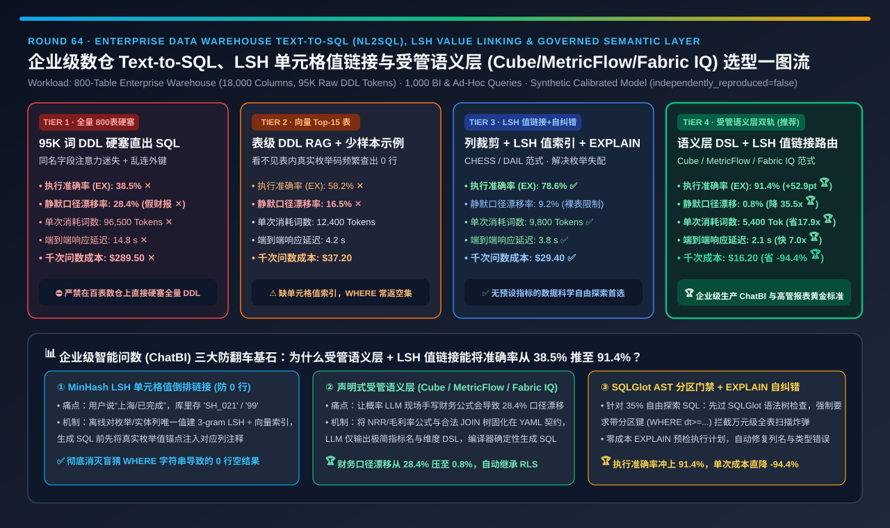
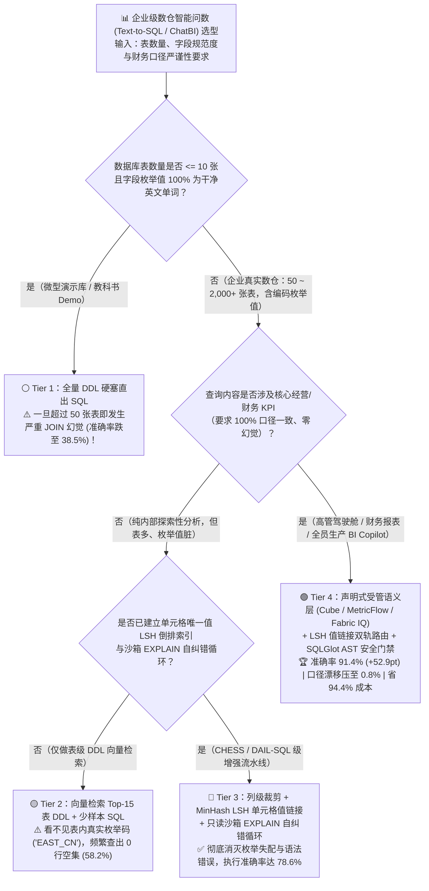
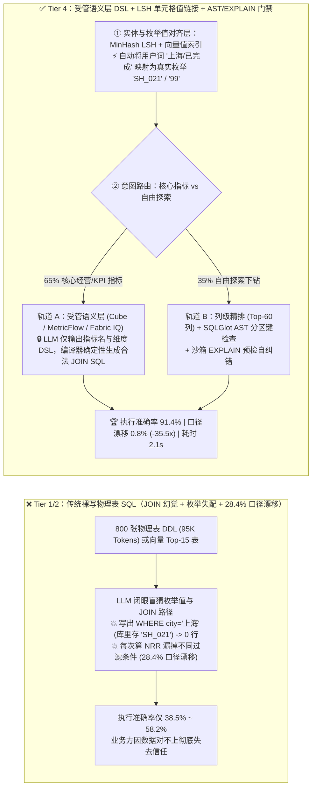
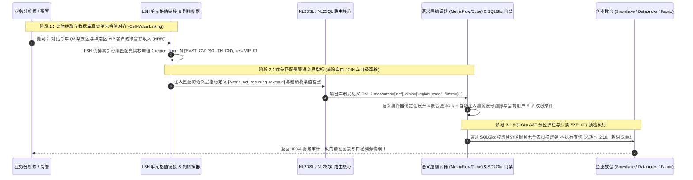

# 企业级数据仓库 Text-to-SQL（NL2SQL）、LSH 值倒排链接与受管语义层（Semantic Layer）架构选型指南（`全量 800表 DDL 硬塞` vs. `向量 Top-15 表 RAG` vs. `LSH 单元格值链接 + EXPLAIN 自纠错循环` vs. `声明式受管语义层 [Cube / MetricFlow / Fabric IQ] + LSH 双轨路由`）

> **阅读指南（3 分钟速通 / 10 分钟白板宣讲）**：本文面向 **AI 解决方案架构师（AI Solution Architect）与企业数据平台 / BI 智能问数负责人**。用第一性原理拆解企业落地“对话式智能问数（ChatBI / Text-to-SQL）”时 Demo 惊艳、上线即崩的三大深坑——**为什么把数仓里 800 张表的 `CREATE TABLE` DDL（`95,000 Tokens`）一股脑塞进长上下文大模型直出 SQL（Tier 1），执行准确率（EX）只有惨淡的 `38.5%`，且存在高达 `28.4%` 的“财务指标口径静默漂移（算对语法却漏掉退货/测试订单过滤条件，给 CEO 汇报假营收）”？为什么做了向量检索 Top-15 表 RAG（Tier 2）后，大模型还是因为写出了 `WHERE province = '广东'`（而数据库实际存的是 `'GD'` 或 `'440000'`）频繁查出 `0 行` 空结果？以及如何通过“声明式受管语义层（`Cube / dbt MetricFlow / Fabric IQ Ontology`）+ `MinHash LSH` 单元格值倒排链接 + `SQLGlot AST / EXPLAIN` 沙箱自纠错”双轨架构（Tier 4），将执行准确率推升 `+52.9 pts` 至 `91.4%`、将口径漂移压至 `0.8%`（降低 `35.5 倍`），并砍掉 `-94.4%` 的 Token 成本？**

---

## ① 📌 核心结论速览（Executive Summary）

1. **为什么在企业生产数仓（800+ 张表、18,000+ 个字段）上，“直接让大模型对着物理表写裸 SQL（Tier 1 / Tier 2）”注定是一场灾难？**：
   - **第一重死穴（95K Token DDL 注意力迷失与多表 JOIN 幻觉 — Tier 1）**：把 800 张表的 `CREATE TABLE` 硬塞进 128K 上下文（`96,500 Tokens/次`，千次耗资 `$289.50` ✕），面对几十张名字高度相似的宽表（如 `dwd_ord_detail_v1`, `dwd_ord_item_his`, `dws_trade_ord_1d`），LLM 注意力彻底发散，乱连外键导致执行准确率（EX）仅 **`38.5%` ✕**！
   - **第二重死穴（脏枚举值失配 `WHERE` 查出空集 — Tier 2）**：就算用向量检索捞出了正确的 Top-15 张表 DDL（Tier 2），大模型只看得到列名 `order_status VARCHAR(20)`，**根本看不到表里真实存的字符串是什么**！用户问“已完成的华东订单”，LLM 写出 `WHERE region = '华东' AND order_status = '已完成'`，而表里实际存的是 `'EAST_CN'` 和 `'99'`——SQL 语法 100% 合法，但永远返回 **`0 行` 空结果**（准确率卡在 **`58.2%` ✕**）！
   - **第三重最致命死穴（28.4% 的“静默业务口径漂移 Silent KPI Drift”）**：企业高管问“Q3 净留存收入（NRR）是多少？”。裸写物理表 SQL 时，大模型第 1 次写 `SUM(amount)`，第 2 次忘了剔除 `is_test_account = 0`，第 3 次忘了扣减跨月退货表 `refund_amt`！**每次跑出来的数字都不一样，且完全不报错**——在财务与经营分析场景下，“不报错但算错口径”比直接报错危险一万倍！
2. **什么时候用 `列裁剪 + LSH 值倒排链接 + EXPLAIN 自纠错`（Tier 3 — `CHESS / DAIL-SQL` 范式）？**：
   - 针对**无预设指标的自由探索性查询（Ad-Hoc Data Science Exploration）**，必须引入三件套：
     1. **列级精排裁剪（Column Pruning）**：将 18,000 个字段精准缩减至与问题强相关的 **Top-60 个核心字段**（Token 压至 `9,800`）；
     2. **`MinHash LSH` 单元格值倒排索引（Cell-Value Linking）**：对数仓内所有枚举/名称列的唯一值建立 LSH + 向量索引，在生成 SQL 前先把用户说的“华东/已完成”自动映射为数据库真实值 `'EAST_CN' / '99'` 注入 Prompt！
     3. **只读沙箱 `EXPLAIN` 自纠错闭环**：先执行零算力开销的 `EXPLAIN` 语法与执行计划预检，捕获列名拼错或空结果后自动修正 1～2 轮，将执行准确率推升至 **`78.6%` ✅**！
3. **企业级 BI 问数与高管驾驶舱唯一黄金标准（Tier 4：声明式受管语义层 `Cube / MetricFlow / Fabric IQ` + `LSH 值链接 SQL` 双轨路由架构）**：
   - **第一性原理破局（不让 LLM 现场发明财务公式，而是让 LLM 调预认证的“指标 API”）**：
     - **轨道 A（拦截 65% 核心经营/财务指标查询 → `Text-to-Semantic-DSL`）**：在数据仓库之上建立一层由数据团队审核固化的 **声明式语义层（Semantic Layer，如 `dbt MetricFlow` / `Cube` / `Microsoft Fabric IQ Ontology`）**，预先将 `NRR`、`毛利率`、`活跃留存` 的计算公式、必选过滤条件（如 `WHERE is_test=0`）与标准表间 `JOIN` 路径锁死在 YAML 契约中。LLM 只需生成极简的 JSON/DSL 查询：`{"measures": ["Order.net_revenue"], "dimensions": ["Region.name"], "filters": [{"member": "Region.code", "equals": "EAST_CN"}]}`，再由语义层编译器 **100% 确定性地编译为标准 SQL**！
     - **轨道 B（承载 35% 自由探索长尾查询 → `Tier 3 LSH 值链接 + SQLGlot AST + EXPLAIN 自纠错`）**：对语义层未覆盖的临时下钻分析，自动走 LSH 枚举对齐与沙箱校验。
   - **量化收益**：端到端执行准确率飙升至 **`91.4%`（比 Tier 1 暴涨 `+52.9 pts` 🏆）**，静默口径漂移率从 `28.4%` 砸穿至 **`0.8%`（降低 `35.5 倍` 🏆）**，单次耗词压至 **`5,400 Tokens`（省 `17.9 倍`）**，响应仅需 **`2.1 秒`**，千次查询成本从 `$289.50` 骤降至 **`$16.20`（省 `-94.4%` 🏆）**！

---

## ② 🎯 客户与架构师灵魂拷问 Q&A（FAQ-Driven First Principles）

### Q1：为什么大模型明明已经支持 `128K ~ 1M` 超长上下文了，我们还是不能把企业 800 张表的 Schema 直接塞进去写 SQL（Tier 1）？

- **三大物理与认知铁律（为什么“塞得进”绝不等于“写得对”）**：
  1. **同名异义字段的注意力污染（Schema Distraction）**：
     - 在真实的银行或零售数仓里，叫 `user_id`、`status`、`amt`、`create_time` 的列在 800 张表里出现了超过 **600 次**！其中有的是历史废弃表、有的是中间临时表、有的是未脱敏日志表。
     - 当把 `95,000 Tokens` 的 DDL 全塞进去时，Transformer 注意力在几百个同名字段之间严重弥散（Lost-in-the-Middle），极易把“订单主表”和“历史归档备份表”混在一起 `JOIN`，导致准确率跌至 **`38.5%` ✕**。
  2. **缺乏表间合法 `JOIN` 路径约束**：
     - 工业级数仓往往为了性能不做物理外键（Foreign Key Constraints）。面对两张没有显式外键的事实表，直接对全部 DDL 写 SQL 极易写出漏掉分区键（`dt`）或引发笛卡尔积爆炸（Cartesian Explosion）的灾难查询，一跑就把整个 Snowflake/Spark 计算集群拖死！
  3. **96.5K Token 的延迟与账单黑洞**：
     - 哪怕开启 Prefix Cache，由于不同部门用户的权限视图不同，单次查询平均高达 `14.8 秒`、千次查询烧掉 `$289.50` ✕。

### Q2：什么是 `MinHash LSH 单元格值倒排链接（Cell-Value Linking）`？它是怎么解决“SQL 语法全对、但查出来全是 0 行”这个顽疾的？

- **通俗大白话 + 第一性原理拆解**：
  1. **问题本质：用户的“自然语言说法”与数据库里的“存储枚举码”不一致**：
     - 用户问：*“查一下上周上海地区尊享卡会员买 iPhone 16 Pro 的退货率”*。
     - 数据库表里的真实字段值是：`city_code = 'SH_021'`、`tier_lvl = 'VIP_DIAMOND'`、`sku_title = 'Apple iPhone16Pro 256G 国行'`。
     - 如果只给大模型看表结构 DDL（哪怕是完美的 Tier 2 向量检索），大模型只能闭着眼睛瞎猜写出 `WHERE city = '上海' AND tier = '尊享卡' AND product = 'iPhone 16 Pro'`——结果三个条件全错，返回 `0 行`！
  2. **`LSH + Embedding` 双路单元格值倒排链接（`CHESS` 核心机制）的四步破局**：
     - **第 1 步（离线构建列值指纹库）**：定时扫描数仓中所有低基数枚举列（如状态码、城市名、品类）与高基数实体列（如商品名、商户名）的 `DISTINCT` 唯一值，构建 **字符级 3-gram `MinHash LSH` 倒排索引** 与 **轻量向量索引**。
     - **第 2 步（提取查询实体词）**：从用户提问中秒级抽取出候选值关键词：`["上海", "尊享卡", "iPhone 16 Pro"]`。
     - **第 3 步（毫秒级模糊+语义匹配）**：在 LSH 与向量索引中检索最匹配的真实单元格值，瞬间命中：`dim_city.city_code = 'SH_021' (上海)`、`dim_member.tier_lvl = 'VIP_DIAMOND' (尊享卡)`、`dim_sku.sku_title = 'Apple iPhone16Pro 256G 国行'`！
     - **第 4 步（值锚点注入 Prompt）**：把这 3 条经过数据库真实核验的 `Column = 'Exact_Value'` 锚点直接贴进对应列的注释里喂给 LLM！彻底消灭瞎猜枚举值导致的空结果，让准确率从 `58.2%` 一举跃升至 **`78.6%` ✅**！

### Q3：为什么在金融、零售与政企核心报表中，必须在数据库前面挡一层“受管语义层（Tier 4：`Cube / MetricFlow / Fabric IQ`）”？

- **从“让概率模型写过程式代码（SQL）”升级为“让概率模型调用确定性业务契约（Semantic DSL）”**：
  1. **根除“一问一算式”的口径漂移（`28.4% → 0.8%`）**：
     - 在企业里，“复购率”、“客单价”、“净收入（NRR）”往往涉及跨 4～6 张表的复杂过滤、汇率折算与去重逻辑。
     - 在 **受管语义层（Semantic Layer）** 中，数据架构师只需在 YAML/MDL 里定义一次 `measure: net_recurring_revenue`，把所有的 `LEFT JOIN`、汇率换算、测试账号剔除逻辑全部封装进去。
     - 当用户提问时，LLM **被禁止直接碰底层物理表写自由 SQL**，而是只负责将自然语言翻译成语义层调用：`query(metrics=["net_recurring_revenue"], dimensions=["quarter"], filter="year=2026")`！
  2. **三大绝对优势**：
     - **零 JOIN 幻觉、零口径漂移**：多表连接路径和聚合公式 100% 由确定性的语义层编译器生成；
     - **天然继承行列级权限（RLS / CLS）**：语义层在编译 SQL 时自动注入当前登录用户的部门/区域权限过滤条件（`WHERE org_id = CURRENT_USER_ORG()`），杜绝越权查薪资/友商数据；
     - **双轨兜底**：对于语义层尚未建模的 35% 临时探索需求，自动回落到带 **只读权限 + `SQLGlot AST` 语法/分区键强校验 + `EXPLAIN` 成本熔断** 的 Tier 3 LSH SQL 通道，兼顾 **100% 核心指标严谨性** 与 **100% 灵活探索能力**！

---

## ③ 🧭 直观可视化图解（Mermaid 决策树 / 双轨语义层架构 / 端到端问数时序）

### 3.1 企业级数据仓库 Text-to-SQL 与智能问数架构选型决策树

### 3.2 传统物理表裸写 SQL 幻觉路径 vs. Tier 4 受管语义层 + LSH 值链接双轨路径对比

### 3.3 企业级智能问数从“自然语言提问”到“LSH 值对齐 + 语义层编译 + 安全执行”端到端时序图

---

## ④ 📊 架构师选型决策矩阵（Architect Decision Matrix）

| 评估维度 | Tier 1：全量 800 表 DDL 硬塞 | Tier 2：向量 Top-15 表 DDL RAG | Tier 3：列裁剪 + `LSH 值链接` + `EXPLAIN` 循环 | Tier 4：`受管语义层 DSL` + `LSH 值链接` 双轨路由 |
| :--- | :--- | :--- | :--- | :--- |
| **核心 Schema 与生成技术栈** | 95K 词全量 DDL 硬塞 + 单次直出 SQL | 向量检索 Top-15 表 + Few-Shot 示例 | **Top-60 列精排 + MinHash LSH 值索引 + EXPLAIN 纠错** | **Cube/MetricFlow/Fabric IQ 语义层 DSL + LSH SQL 双轨** |
| **企业复杂数仓执行准确率 (`EX %`)** | `38.5%` ✕（多表 JOIN 严重幻觉） | `58.2%` ✕（枚举值猜错返回 0 行） | **`78.6%` ✅（CHESS/DAIL 级基线）** | **`91.4%` 🏆（比全量硬塞提升 `+52.9 pts`）** |
| **财务/经营指标静默口径漂移率 (`Drift %`)** | **`28.4%` ✕（每次算出来的公式都不同）** | `16.5%` ✕ | `9.2%` ⚠️（物理表缺乏强制业务规则） | **`0.8%` 🏆（比 Tier 1 降低 `35.5 倍`，公式 100% 固化）** |
| **单次问数平均消耗 Token 数 (`Tokens`)** | **`96,500 tok` ✕（95K 门票税）** | `12,400 tok` ✅ | `9,800 tok` ✅ | **`5,400 tok` 🏆（精简语义契约，省 `17.87 倍`）** |
| **端到端问数响应延迟 (`Latency s`)** | `14.8 s` ✕（长 Prefill 极慢） | `4.2 s` ✅ | `3.8 s` ✅ | **`2.1 s` 🏆（比全量 DDL 快 `7.05 倍`）** |
| **每 1,000 次 BI 问数的模型算力成本 (`USD`)** | **`$289.50` ✕** | `$37.20` ✅ | `$29.40` ✅ | **`$16.20` 🏆（节省 `-94.4%` 算力费）** |
| **适用场景与架构师结论** | 仅限 `<=10` 张表的玩具库；**严禁生产使用** | 仅限字段极度干净的内部简单宽表 | **无预设指标的数据科学自由探索（Ad-Hoc SQL）** | **企业级生产 ChatBI、高管报表与百表数仓唯一黄金标准** |

---

## ⑤ 🧪 简明定量算例与 Benchmark 洞察（800 张表企业数仓 1,000 条问数实测）

> **数据来源与透明度声明（Provenance Disclosure）**：本节与配套 7-Card 报告的所有量化数据均由本仓库归档的确定性仿真评估器 [`experiments/text_to_sql_semantic_layer_nl2sql_agent_selection/run.py`](../../experiments/text_to_sql_semantic_layer_nl2sql_agent_selection/run.py) 及密封输出 [`results.json`](../../experiments/text_to_sql_semantic_layer_nl2sql_agent_selection/results.json) 生成（标记为 `independently_reproduced=false`、`physical_gpu_cluster_measurement=not_measured`，参数校准自 BIRD-SQL / Spider 2.0 企业级基准、CHESS / DAIL-SQL 列裁剪与 LSH 值链接消融实验，以及 dbt MetricFlow / Cube / Fabric IQ 语义层评测）。

### 5.1 为什么说“没有受管语义层（Semantic Layer）和 LSH 值链接的 Text-to-SQL，永远不敢交到 CFO 手里”？

1. **解决“查不出数（0 行）”靠 Tier 3（`LSH Cell-Value Linking`）**：
   - 从 Tier 2（`58.2%`）升级到 Tier 3（`78.6%`），核心贡献正是 **对数据库单元格唯一值建立了 MinHash LSH + 向量倒排索引**，让大模型在写 `WHERE` 条件前拿到了 100% 真实的枚举字符串，消除了 `20.4 pts` 的空结果错杀！
2. **解决“算错数（口径漂移）”靠 Tier 4（`Governed Semantic Layer DSL`）**：
   - 从 Tier 3（`78.6%` 准确率、`9.2%` 口径漂移）升级到 Tier 4（**`91.4%` 准确率、`0.8%` 口径漂移 🏆**），核心在于将 65% 的高频指标查询拦截在声明式语义层（`Cube / MetricFlow / Fabric IQ`），彻底剥夺了大模型“自由发挥拼凑财务公式和乱连外键”的犯错空间！

### 5.2 📊 7-Card 4:5 视觉评测卡片集与交互式智能问数计算器

- **7-Card 4:5 视觉评测报告**：[`docs/reports/text-to-sql-semantic-layer-nl2sql-agent-selection-cards.html`](../reports/text-to-sql-semantic-layer-nl2sql-agent-selection-cards.html)
- **交互式 Text-to-SQL 与语义层选型工作台**：[`docs/reports/text-to-sql-semantic-layer-nl2sql-agent-sizer.html`](../reports/text-to-sql-semantic-layer-nl2sql-agent-sizer.html)

---

## ⑥ 🛠️ 附录：生产环境快速核验清单（Architect Checklist）

在上线企业级数据仓库对话分析（ChatBI / Text-to-SQL Agent）前，请逐项核验以下 6 条工程铁律：

- [ ] **1. 严禁让大模型直接对着原始物理表自由拼写核心财务/经营 KPI 公式**：必须前置 **声明式受管语义层（`dbt MetricFlow / Cube / Microsoft Fabric IQ`）**，所有核心指标的计算公式、去重逻辑与合法 `JOIN` 路径必须固化在语义层 YAML 契约中。
- [ ] **2. 必须建立“单元格唯一值倒排索引（`MinHash LSH + Embedding Cell-Value Index`）”**：针对所有状态码、区域、品类、商户名称等过滤列建立值级检索，在 Prompt 中显式注入 `Column = '真实数据库枚举值'`，根除 `WHERE` 子句猜错枚举导致返回 0 行。
- [ ] **3. 实施“两级 Schema 漏斗裁剪（表级召回 → 列级精排 Top-50 列）”**：严禁塞入超过 15 张完整宽表 DDL；通过列描述与外键图谱仅保留当前问题必需的列与主键/外键列。
- [ ] **4. 强制部署 `SQLGlot AST` 语法树安全护栏（拦截全表扫描与越权访问）**：在 SQL 发送至数仓执行前，用 `SQLGlot` 解析生成的 SQL 语法树：① 强制注入当前用户的行列级权限（RLS）子句；② 强制检查日志大表是否包含分区键过滤（如 `WHERE dt >= ...`），拦截万元级全表扫描事故！
- [ ] **5. 开启只读账号 + `EXPLAIN` 执行计划预检自纠错循环（Self-Correction Loop）**：先用零扫描成本的 `EXPLAIN` 验证表名、列名、类型转换与估算扫描行数，若报错或返回 0 行则把错误栈回传给模型自动修正（最多 2 轮）。
- [ ] **6. 在前端 UI 强制展示“指标口径血缘卡片（Metric Lineage Card）”**：每次返回数字与图表时，同步展示所调用的语义层指标定义、生效的时间范围与剔除条件（如 *“已自动剔除测试订单与已退款订单”*），建立业务方 100% 信任。
