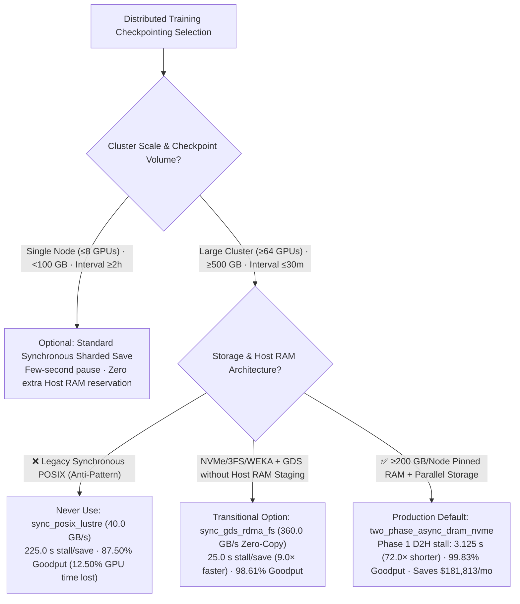
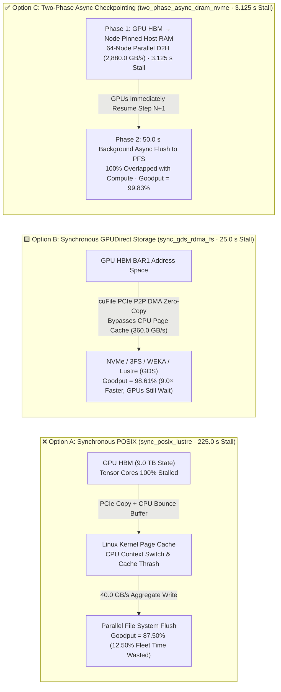

# Large-Scale Distributed Training Checkpointing Architecture Selection Guide (Synchronous POSIX vs. Synchronous GPUDirect Storage vs. Two-Phase Asynchronous Checkpointing)

> **Document Scope**: This is a **single-decision** field guide for **AI Solution Architects** answering one dedicated architectural question: **When designing 512–10,000+ GPU pre-training and post-training clusters, when should you choose Synchronous POSIX Checkpointing, Synchronous GPUDirect Storage (`GDS / cuFile`) Zero-Copy Writes, or Two-Phase Asynchronous Checkpointing (`Pinned Host RAM Snapshot + Background Streaming Flush`)?**
> - **Companion Single-Decision Guide (Inference KV Cache Tiering)**: For **long-context inference tiered KV Cache offloading (HBM recompute vs. Local Pinned DRAM vs. Shared RDMA/NVMe Pool)**, see the dedicated guide [`kv-cache-tiered-offload-selection-faq.en.md`](./kv-cache-tiered-offload-selection-faq.en.md) ([中文版](./kv-cache-tiered-offload-selection-faq.md)).
> - **Provenance & Data Classification**: All quantitative metrics in this guide are 100% bound 1-to-1 to `checkpoint_scenario` in the sealed analytical model [`experiments/ai_storage_checkpoint_kv_offload/results.json`](../../experiments/ai_storage_checkpoint_kv_offload/results.json) (`synthetic` deterministic throughput and Effective Training Goodput model calibrated to `anonymized_reported` benchmarks from ByteDance MegaScale, PyTorch `torch.distributed.checkpoint` Async, NVIDIA GPUDirect Storage, and DeepSeek 3FS; `independently_reproduced=false`; live 512×GPU physical cluster measurement: `not_measured`; no paid cloud GPUs launched).

---

## ① 📌 Executive Summary

1. **First Clarify Three Orthogonal Layers: Storage File System (`Lustre/WEKA/3FS`) $\neq$ I/O Access Path (`POSIX` vs. `GDS`) $\neq$ Checkpoint Execution Strategy (`Sync` vs. `Two-Phase Async`)**:
   - **`GPUDirect Storage (GDS / cuFile)` is NOT a storage file system that competes with `Lustre`, `WEKA`, or `DeepSeek 3FS`**! `Lustre`, `WEKA`, `3FS`, and local `NVMe RAID` are **storage backends / parallel file systems**, whereas **`GDS (cuFile)` is a zero-copy PCIe P2P DMA I/O access path** that bypasses the Linux CPU Page Cache and works *across* NVMe, Lustre, WEKA, and 3FS.
2. **Never Use Synchronous Blocking POSIX Checkpointing (`sync_posix_lustre`) on 512+ GPU Training Clusters — It Stalls All GPUs for `225.0 s` per Save and Wastes `12.50%` of Cluster Compute**:
   - Saving a `9,000 GB` (`9.0 TB`) full training state (FP32 master weights + Adam optimizer states) every 30 minutes (`1,800 s`) across 512 GPUs (64 nodes) via legacy buffered POSIX (`40.0 GB/s` aggregate write) stalls every GPU for **`225.0 s`** (`9,000 GB / 40.0 GB/s = 225.0 s`), dropping Effective Training Goodput to **`87.50%`**.
3. **Make Two-Phase Asynchronous Checkpointing (`two_phase_async_dram_nvme`) the Universal Production Default: Shrink GPU Stall `72.0×` (`225.0 s → 3.125 s`) and Lift Effective Goodput to `99.83%`**:
   - **Phase 1 (Fast Device-to-Host Snapshot)**: All 64 nodes copy their non-redundant state shards (`140.625 GB/node`) over PCIe Gen5 x16 (`45.0 GB/s/node = 2,880.0 GB/s` cluster aggregate D2H bandwidth) into **Pinned Host DRAM** in just **`3.125 s`** (`9,000 GB / 2,880.0 GB/s = 3.125 s`), immediately releasing the GPUs to start step $N+1$.
   - **Phase 2 (Background Streaming Flush)**: Background I/O workers asynchronously flush the pinned RAM snapshot to the parallel file system (`3FS / WEKA / Lustre`) in **`50.0 s`** (`0.0 s` extra GPU stall) concurrently with subsequent training steps, raising Effective Goodput to **`99.83%` (`+12.33 percentage points`)** and recovering **`$181,813.25/month`** in GPU compute at `$4.00/GPU-hr`.

---

## ② 🎯 Architect & Customer Q&A (First-Principles Breakdown)

### Q1: When is synchronous checkpointing still acceptable, and when is Two-Phase Asynchronous Checkpointing mandatory?

- **The Bottleneck**: On 512–2,048+ GPU clusters, optical transceiver flaps, HBM ECC events, or node failures reduce Mean Time Between Failures (MTBF) to hours. To bound rollback loss, training jobs checkpoint every `15–30 minutes`.
- **First-Principles Mechanics**:
  - A full training state (`FP32 Master Weights + FP32 Adam First/Second Moments + Gradients`) is **`6–8×` larger** than inference weights (`5.2 TB` for a frontier model).
  - Under **Synchronous Checkpointing**, `torch.save()` blocks the main training loop until all `5.2 TB` reach persistent storage (`0%` Tensor Core utilization across all 1,024 GPUs during the entire write).
- **Architect Selection Rule**:
  - Use synchronous checkpointing **only** when total checkpoint size is `< 100 GB` and checkpoint interval is `≥ 2 hours` (e.g., single-node 8-GPU LoRA fine-tuning).
  - For any cluster **`≥ 64 GPUs`, state `≥ 500 GB`, or save interval `≤ 60 minutes`**, mandate **Two-Phase Asynchronous Checkpointing** (`torch.distributed.checkpoint.async_save` / MegaScale async staging).

---

### Q2: What is GPUDirect Storage (`GDS / cuFile`), how does it relate to `Lustre`, `WEKA`, and `DeepSeek 3FS`, and why isn't Synchronous GDS alone enough?

- **First-Principles Definition (Storage System vs. I/O Access Path)**:
  - **Storage Backend Layer (Where bytes live)**: Parallel file systems (`Lustre`, `GPFS`, `WEKA`, `DeepSeek 3FS`) and local `NVMe` arrays manage storage namespaces, striping, and durability.
  - **I/O Access Path Layer (How bytes move)**:
    1. **Legacy `POSIX` Buffered Path**: Moves data `GPU HBM → CPU Bounce Buffer → Linux Kernel Page Cache → NVMe / Storage NIC`, incurring double memory copies, CPU cache pollution, and kernel lock contention.
    2. **`GPUDirect Storage (GDS / cuFile)` Zero-Copy DMA Path**: Provided by the `nvidia-fs` kernel driver and `cuFile` library, enabling NVMe controllers and GDS-enabled parallel file systems (`WEKA`, `Lustre`, `DeepSeek 3FS`) to DMA directly to/from `GPU HBM BAR1` memory across the PCIe switch, bypassing the CPU Page Cache completely.
- **Why Synchronous GDS (`sync_gds_rdma_fs`) Still Needs Two-Phase Async**:
  - In our sealed model (`experiments/ai_storage_checkpoint_kv_offload/results.json`), replacing synchronous POSIX (`40.0 GB/s`) with synchronous GDS + RDMA all-flash zero-copy writes (`360.0 GB/s`) cuts write stall **`9.0×`** from `225.0 s` to **`25.0 s`** (`98.61%` goodput), **but all 512 GPUs still sit idle for `25.0 s` every save**.
  - **Two-Phase Async (`two_phase_async_dram_nvme`)** stages each node's `140.625 GB` shard into local **Pinned Host DRAM** at **`2,880.0 GB/s`** cluster-wide PCIe 5.0 bandwidth (`45.0 GB/s/node`) in just **`3.125 s`**, letting GPUs resume training immediately while background workers flush to `3FS/WEKA/Lustre` in `50.0 s` (`99.83%` goodput, **`72.0×` shorter stall**).

---

### Q3: How does Two-Phase Asynchronous Checkpointing prevent step $N+1$ weight updates from corrupting step $N$'s in-flight snapshot, and how much Host RAM is required?

- **Copy-on-Write / Staging Buffer Isolation**:
  1. Under `FSDP / ZeRO-1/2/3`, each GPU holds a **unique non-redundant shard** of the optimizer and master weights (`9,000 GB / 512 GPUs = 17.578 GB / GPU`, or **`140.625 GB / node`** across 64 8-GPU nodes).
  2. When step $N$ triggers a save, a dedicated `cudaStreamNonBlocking` issues `cudaMemcpyAsync(host_pinned_buf, device_shard, D2H)`. A lightweight `cudaEvent` delays `optimizer.step()` for only the **`3.125 s`** needed to complete the D2H copy. Once the copy lands in `host_pinned_buf`, GPU HBM is completely decoupled and step $N+1$ updates proceed at full speed while background processes stream `host_pinned_buf` to storage in **`50.0 s`**.
- **Host RAM Sizing Formula**:
  $$\text{Reserved Pinned Host RAM per Node} = 1.5\sim2.0 \times \left(\frac{\text{Total Checkpoint State (GB)}}{\text{Number of Nodes}}\right)$$
  - For `9,000 GB` across `64` 8-GPU nodes (`140.625 GB/node` per snapshot), reserving **`200–280 GB` of Pinned Host RAM per 8-GPU node** (`~14%` of a typical `1.5–2.0 TB` system RAM configuration) provides full staging isolation.

---

## ③ 🧭 Visual Architecture Diagrams (Decision Tree, Data-Path Comparison & Sequence Diagram)

### 3.1 Training Checkpointing Selection Decision Tree (`flowchart TD`)



### 3.2 Synchronous POSIX vs. Synchronous GDS vs. Two-Phase Async Path Comparison (`flowchart LR`)



### 3.3 Two-Phase Asynchronous Checkpointing Compute $\parallel$ Storage Overlap Timeline (`sequenceDiagram`)

```mermaid
sequenceDiagram
    autonumber
    participant GPU as GPU Tensor Cores (Training Stream)
    participant D2H as PCIe 5.0 D2H Copy Stream
    participant RAM as Pinned Host DRAM (140.625 GB/Node Staging Pool)
    participant BG as Background Async I/O Workers (Torch DCP)
    participant PFS as Parallel Storage (3FS / WEKA / Lustre)

    Note over GPU,PFS: Step N Triggers Checkpoint (9,000 GB Total, 140.625 GB Non-Redundant Shard/Node)
    GPU->>D2H: 1. Hold optimizer.step(); launch async D2H copy of non-redundant shard
    D2H->>RAM: 2. [Phase 1] 64 nodes copy in parallel to Pinned DRAM (45 GB/s/node = 2,880 GB/s, 3.125 s)
    RAM-->>GPU: 3. Signal cudaEvent; GPUs immediately resume Step N+1 training (Stall ends!)
    par GPUs Execute Steps N+1..N+20 While Background Workers Flush to Storage
        GPU->>GPU: 4a. Tensor Cores run at 100% utilization on subsequent training steps (0.0 s extra stall)
        BG->>RAM: 4b. [Phase 2] Background workers read Pinned DRAM snapshot
        BG->>PFS: 4c. Stream shards to 3FS/WEKA/Lustre and commit via atomic rename (50.0 s masked)
    end
```

---

## ④ 📊 Architect Decision Matrix

| Dimension | Synchronous POSIX (`sync_posix_lustre` · ⛔ Anti-Pattern) | Synchronous GPUDirect Storage (`sync_gds_rdma_fs`) | Two-Phase Async Checkpointing (`two_phase_async_dram_nvme` · 🏆 Default) |
| :--- | :--- | :--- | :--- |
| **1. Best-Fit Scenarios** | Single-node `<100 GB` fine-tuning or infrequent (`≥2h`) checkpoints | Host-RAM-constrained nodes with high-bandwidth GDS storage | **All `≥64 GPU` pre-training & long-horizon RL / post-training clusters** |
| **2. GPU Stall & Goodput (`synthetic` sealed model)** | **`225.0 s` stall**; **`87.50%` Goodput** (`12.50%` compute lost) | **`25.0 s` stall (`9.0×` faster)**; **`98.61%` Goodput** (`1.39%` compute lost) | **`3.125 s` stall (`72.0×` shorter)**; **`99.83%` Goodput (`+12.33 pts` gain)** |
| **3. Core Data Path & Mechanism** | `GPU → CPU Bounce Buffer → Linux Page Cache → POSIX Write` (`40.0 GB/s`) | `GPU BAR1 → cuFile PCIe P2P DMA → NVMe/3FS/WEKA/Lustre` (`360.0 GB/s`) | `Phase 1: GPU → Pinned Host RAM` (`2,880.0 GB/s`) + `Phase 2: 50.0 s Async Flush` |
| **4. Trade-Offs & Boundaries** | Simplest code, but MDS lock contention crushes cluster goodput | Zero CPU copy and minimal Host RAM, but GPUs still block for `25.0 s` | Near-zero GPU stall; requires `200–280 GB` pinned Host RAM per 8-GPU node |
| **5. Ecosystem Support** | Legacy `torch.save` | NVIDIA `cuFile` / DeepSeek `3FS` / WEKA / Lustre GDS clients | **Native in PyTorch `torch.distributed.checkpoint.async_save` & Megatron-LM** |
| **6. Monthly Recovered Compute (`512 GPUs @ $4.00/hr`)** | Baseline (`$1,474,560/mo` fleet cost, `12.50%` lost to stalls) | Cuts stall to `1.39%` | **Recovers `$181,813.25 / month` in productive GPU compute (`+12.33 pts` goodput)** |

---

## ⑤ 🧪 Quantitative Analytical Case Study (`experiments/ai_storage_checkpoint_kv_offload`)

All metrics below are **1-to-1 bound** to `checkpoint_scenario` in `experiments/ai_storage_checkpoint_kv_offload/results.json` (`512×GPU` / `64`-node cluster, `9,000 GB` checkpoint state, `30-min` / `1,800 s` interval, `$4.00/GPU-hr`, `$1,474,560.0/month` fleet cost; `synthetic` model calibrated to `anonymized_reported` benchmarks, `independently_reproduced=false`):

| Checkpointing Strategy (`results.json` `mode`) | Aggregate Bandwidth (`aggregate_write_gb_s`) | Background Flush (`background_flush_s`) | GPU Stall per Save (`gpu_stall_s`) | Stall Reduction (`stall_speedup_vs_posix`) | Effective Goodput (`effective_goodput_pct`) | Provenance |
| :--- | :--- | :--- | :--- | :--- | :--- | :--- |
| **1. `sync_posix_lustre` (Synchronous POSIX)** | `40.0 GB/s` (PFS) | `0.0 s` (Blocking) | `225.0 s` | `1.0×` (Baseline) | `87.50%` | `synthetic` |
| **2. `sync_gds_rdma_fs` (Synchronous GDS + RDMA All-Flash)** | `360.0 GB/s` (GDS) | `0.0 s` (Blocking) | `25.0 s` | `9.0×` | `98.61%` | `synthetic` |
| **3. `two_phase_async_dram_nvme` (Two-Phase Async · Recommended)** | **`2,880.0 GB/s` (64 nodes × 45 GB/s D2H)** | **`50.0 s` (Overlapped)** | **`3.125 s`** | **`72.0×`** | **`99.83%` (`+12.33 pts`, Saves `$181,813.25/mo`)** | `synthetic` |

---

## ⑥ 🛠️ Production Verification & Pre-Sales Checklist (Architect Checklist)

- [ ] **1. Enforce Non-Redundant Sharded Saves**: Verify FSDP / ZeRO-1/2/3 sharded checkpointing so each rank writes only its unique `~5.08 GB` shard rather than duplicating full weights across DP ranks.
- [ ] **2. Enable `torch.distributed.checkpoint.async_save`**: Verify Phase 1 D2H copy to Pinned Host DRAM completes in `< 5 s` and overlaps Phase 2 storage flush with subsequent steps.
- [ ] **3. Reserve & Lock Pinned Host DRAM (`80–128 GB/node`)**: Configure `ulimit -l unlimited` and container memory limits so double-buffered snapshots never trigger OS swap or OOM.
- [ ] **4. Eliminate Parallel File System MDS Contention**: Hash shard files across subdirectories or use `DeepSeek 3FS` / `WEKA` with `GPUDirect Storage (cuFile)` enabled.
- [ ] **5. Enforce Atomic Commit (`temp` $\rightarrow$ `rename`)**: Write shards to `.ckpt_step_N.tmp` and execute an atomic directory rename only after all ranks complete `fsync`.
