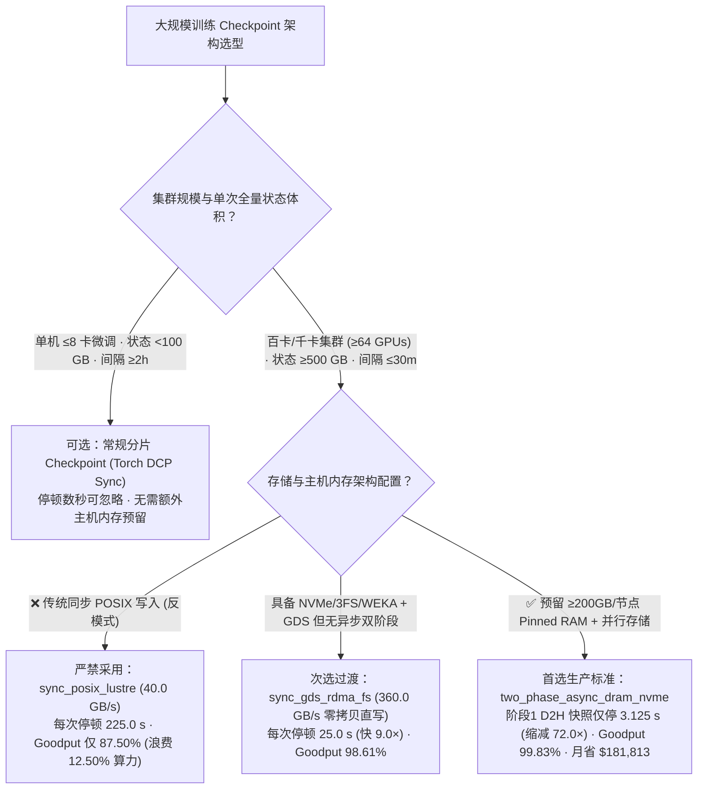
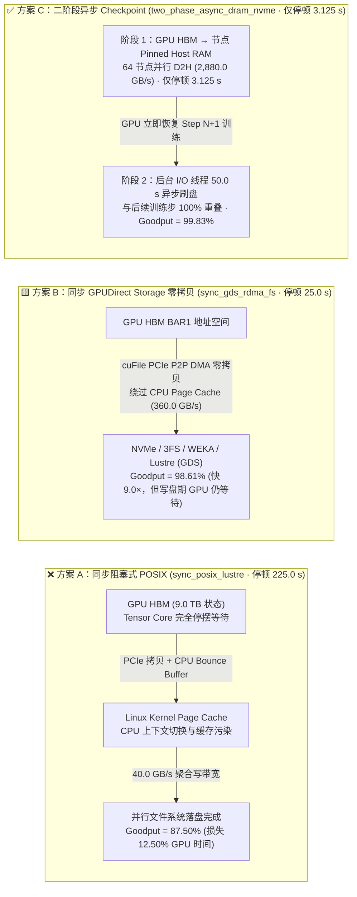
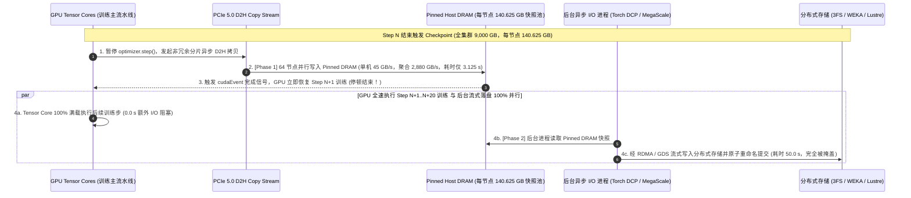

# 大规模分布式训练 Checkpoint 架构选型与原理解析指南（同步 POSIX vs. 同步 GPUDirect Storage vs. 二阶段异步 Checkpoint）

> **文档定位**：本文是面向 **AI Solution Architect（AI 解决方案架构师）** 的**单决策维度（Single-Decision）**实战选型指南，专门回答一个独立的核心架构问题：**在千卡/万卡大模型预训练与长周期后训练（Post-Training）集群中，如何在“传统同步 POSIX 阻塞写入”、“同步 GPUDirect Storage (GDS) 零拷贝直写”与“二阶段异步 Checkpoint（Two-Phase Async Checkpointing：Pinned RAM 快照 + 后台流式刷盘）”之间做架构选型？**
> - **关联姊妹篇（推理 KV 卸载单专题）**：若需评估**长上下文在线推理的分层 KV Cache 卸载选型（HBM 重算 vs 本地 Pinned DRAM vs 跨节点共享 RDMA/NVMe 池）**，请直接阅读独立专题 [`kv-cache-tiered-offload-selection-faq.md`](./kv-cache-tiered-offload-selection-faq.md)（[English](./kv-cache-tiered-offload-selection-faq.en.md)）。
> - **数据溯源与真实性声明（Provenance）**：文中算例 100% 逐项绑定本仓库封存的确定性存储吞吐与有效训练吞吐率（Goodput）算例 [`experiments/ai_storage_checkpoint_kv_offload/results.json`](../../experiments/ai_storage_checkpoint_kv_offload/results.json) 中的 `checkpoint_scenario`（数据分类：`synthetic` 确定性解析模型，校准自 `anonymized_reported` 公开文献基准 ByteDance MegaScale、PyTorch `torch.distributed.checkpoint` Async、NVIDIA GPUDirect Storage 与 DeepSeek 3FS；`independently_reproduced=false`；512×GPU 物理实集群压测标注为 `not_measured`；未启动付费云 GPU）。

---

## ① 📌 核心结论速览（Executive Summary）

1. **必须先厘清三大正交架构层级：存储文件系统（`Lustre/WEKA/3FS`）$\neq$ I/O 访问通路（`POSIX` vs `GDS`）$\neq$ Checkpoint 调度机制（`Sync` vs `Two-Phase Async`）**：
   - **`GPUDirect Storage (GDS / cuFile)` 不是与 `Lustre`、`WEKA` 或 `DeepSeek 3FS` 互斥的存储系统**！`Lustre / WEKA / 3FS / 本地 NVMe` 是底层的**存储文件系统/后端命名空间**；而 **`GDS (cuFile)` 是绕过 CPU Page Cache 的 PCIe P2P DMA 零拷贝访问通路**——上述分布式文件系统（Lustre、WEKA、3FS）与本地 NVMe 均可开启 GDS 通路。
2. **百卡/千卡训练严禁使用“同步阻塞式 POSIX Checkpoint”（`sync_posix_lustre`），它每次保存会让全集群停摆 `225.0 s`，吞噬 `12.50%` 的算力成本**：
   - 以 512 卡（64 台 8 卡节点）集群训练 `9,000 GB`（`9.0 TB`）分布式模型与优化器状态、每 30 分钟（`1,800 s`）保存一次为例：传统同步 POSIX 写入需经过 `GPU HBM → CPU Bounce Buffer → Linux Page Cache → 存储网卡`，受限于 `40.0 GB/s` 聚合写带宽，每次保存停顿 **`225.0 s`**（`9,000 GB / 40.0 GB/s = 225.0 s`），有效训练吞吐率（Effective Goodput）跌至 **`87.50%`**。
3. **生产百卡/千卡集群唯一推荐标准是“二阶段异步 Checkpoint（`two_phase_async_dram_nvme`）”：将 GPU 停顿从 `225.0 s` 压缩 `72.0×` 至 `3.125 s`，有效训练 Goodput 提升至 `99.83%`**：
   - **第一阶段（秒级设备到主机快照）**：64 台节点通过本地 PCIe Gen5 x16 将每节点 `140.625 GB` 非冗余分片状态并行拷贝至预留的 **Pinned Host DRAM（锁页内存，单节点 `45.0 GB/s`、全集群聚合 `2,880.0 GB/s`）**，训练主循环仅暂停 **`3.125 s`**（`9,000 GB / 2,880.0 GB/s = 3.125 s`，较同步 POSIX 缩短 `72.0×`），随后 GPU 立即恢复第 $N+1$ 步训练；
   - **第二阶段（后台非阻塞刷盘）**：独立后台 I/O 线程在 **`50.0 s`** 内将锁页内存中的快照流式写入并行文件系统（Lustre/WEKA/3FS），与前向/反向计算 100% 重叠（`0.0 s` 额外 GPU 停顿），有效训练 Goodput 跃升至 **`99.83%`（净增 `+12.33` 个百分点）**，按 `$4.00/GPU-hr` 计算每月挽回 **`$181,813.25`** 的空转算力成本。

---

## ② 🎯 客户与架构师灵魂拷问 Q&A（FAQ-Driven，第一性原理回答）

### Q1：客户在建设 512～2,048 卡训练集群时，什么时候还能用同步 Checkpoint，什么时候必须上“二阶段异步 Checkpoint”？

- **痛点背景**：在百卡以上集群中，光模块闪断、HBM ECC 错误或节点掉线的平均无故障时间（MTBF）往往缩减到数小时级别。为了减少故障回滚损失，算法团队必须每隔 `15～30 分钟` 保存一次 Checkpoint。
- **第一性原理拆解（为什么同步保存是一场全集群算力灾难？）**：
  - 一次大模型训练的完整状态（`Optimizer States + Master Weights + Gradients`）体积大约是推理权重的 **`6～8 倍`**（例如 405B～671B 模型加优化器状态高达 **`5.2 TB`**）。
  - 在 **同步阻塞模式（Synchronous Checkpointing）** 下，`torch.save()` 写在训练步（Step）的主循环里：在 `5.2 TB` 数据全部落盘并返回 `fsync` 成功之前，**全部 1,024 张 GPU 的 Tensor Core 处于 100% 停摆等待状态（0% 算力利用率）**！
- **架构师选型铁律**：
  - **仅当单次 Checkpoint 总量 `< 100 GB` 且保存间隔 `≥ 2 小时`**（如单机 8 卡 LoRA 微调或小模型实验）时，才允许使用同步保存；
  - **只要集群规模 `≥ 64 卡`、全量状态 `≥ 500 GB` 或保存间隔 `≤ 60 分钟`**，必须无条件启用 **PyTorch DCP (`torch.distributed.checkpoint.async_save`) / MegaScale 二阶段异步 Checkpoint**。

---

### Q2：什么是 GPUDirect Storage（GDS / `cuFile`）？它和 Lustre、WEKA、DeepSeek 3FS 是什么关系？只开同步 GDS 能替代二阶段异步吗？

- **第一性原理定义（厘清“文件系统”与“零拷贝 I/O 通路”的边界）**：
  - 许多初学者误把 `GDS` 当成一种新型存储系统，拿去和 `Lustre` 或 `3FS` 做二选一对比——**这是严重的架构概念混淆**。
  - **存储后端/文件系统层（Where data lives）**：`Lustre`、`IBM Spectrum Scale (GPFS)`、`WEKA`、`DeepSeek 3FS (Fire-Flyer File System)` 以及本地 `NVMe RAID` 负责管理磁盘块、分布式元数据与跨节点条带化。
  - **I/O 访问通路层（How bytes move）**：
    1. **传统 `POSIX` 路径（双拷贝 + CPU 瓶颈）**：数据必须先从 `GPU HBM` 经 PCIe 拷贝到主机内存的 `CPU Bounce Buffer` 和 `Linux Kernel Page Cache`，再由 CPU 内核线程拷贝给 NVMe 驱动或 RDMA 网卡。这不仅受限于 CPU 内存带宽，还会污染主机缓存并引发高昂的上下文切换。
    2. **`GPUDirect Storage (GDS / cuFile)` 路径（PCIe P2P 零拷贝直通）**：由 `nvidia-fs` 内核驱动与 `cuFile` API 提供。它允许本地 NVMe SSD 控制器或支持 GDS 的分布式文件系统客户端（**WEKA、Lustre、DeepSeek 3FS 均支持 GDS/RDMA 零拷贝通路**）通过 PCIe Switch 直接对 `GPU HBM BAR1` 地址发起点对点 DMA 读写，彻底绕过 CPU Page Cache。
- **为什么“只开同步 GDS（`sync_gds_rdma_fs`）”依然不够，必须结合“二阶段异步（`two_phase_async_dram_nvme`）”？**
  - 在封存算例（`experiments/ai_storage_checkpoint_kv_offload/results.json`）中，将同步 POSIX（`40.0 GB/s`）升级为同步 GDS + RDMA 全闪直写（`360.0 GB/s`），虽然把单次写入耗时从 `225.0 s` 缩短到了 **`25.0 s`（提速 `9.0×`）**，但在这 `25.0 s` 内 **512 张 GPU 依然无法启动下一步训练**（有效训练 Goodput 为 `98.61%`）。
  - 而在 **二阶段异步 Checkpoint（`two_phase_async_dram_nvme`）** 中：64 台节点利用全集群聚合的高达 **`2,880.0 GB/s`**（单机 `45.0 GB/s`）的机内 `GPU → Pinned Host RAM` PCIe 5.0 带宽，仅需 **`3.125 s`** 即可完成每节点 `140.625 GB` 的内存快照并立即恢复训练，随后由后台线程在 `50.0 s` 内流式写入持久化存储（`99.83%` Goodput，较同步 POSIX 停顿缩短 **`72.0×`**）！

---

### Q3：二阶段异步 Checkpoint 在底层是如何保证“边训练边写盘”不会把第 $N+1$ 步的新权重覆盖进第 $N$ 步快照的？需要预留多少主机内存？

- **底层防覆盖机制（Copy-on-Write / Staging Buffer 隔离）**：
  1. **显式 Staging 快照隔离**：当第 $N$ 步触发 Checkpoint 时，经过 `Zero-Redundancy Optimizer (ZeRO-1/2/3 / FSDP)` 分片后，每张 GPU 仅负责自己持有的 **唯一非冗余状态分片**（`9,000 GB / 512 GPUs = 17.578 GB / GPU`，每台 8 卡节点合计 **`140.625 GB`**）。
  2. **独立 CUDA D2H 流与同步事件**：框架在独立的高优先级 `cudaStreamNonBlocking` 上发起 `cudaMemcpyAsync(host_pinned_buf, device_shard, D2H)`。在短短 **`3.125 s`** 的 D2H 拷贝完成前，优化器 `optimizer.step()` 被一个轻量级 `cudaEvent` 阻塞，确保拷入 `host_pinned_buf` 的是第 $N$ 步严格一致的快照；一旦 `cudaEvent` 触发，`host_pinned_buf` 与 GPU HBM 彻底解耦，GPU 立即开始第 $N+1$ 步的前向/反向传播与参数更新，而后台进程在 **`50.0 s`** 内安全地将 `host_pinned_buf` 异步刷入并行文件系统。
- **架构师主机内存（Host RAM）定容公式**：
  $$\text{每节点需预留 Pinned Host RAM} = 1.5\sim2.0 \times \left(\frac{\text{全量 Checkpoint 状态总大小 (GB)}}{\text{集群节点总数}}\right)$$
  - 在 512 卡（64 台 8 卡节点）、`9,000 GB` Checkpoint 算例中，每台 8 卡节点每步分摊 **`140.625 GB`** 快照；预留 **`200～280 GB` 锁页主机内存**（占标准 8 卡机 `1.5 TB～2.0 TB` 系统内存的 `14%` 左右）即可实现安全的后台异步刷盘。

---

## ③ 🧭 直观可视化图解（Mermaid 决策树 + 同步 vs 二阶段异步路径图 + 时序图）

### 3.1 训练 Checkpoint 架构选型决策树（`flowchart TD`）



### 3.2 传统同步 POSIX 双拷贝阻塞 vs GDS 零拷贝 vs 二阶段异步流水路径对比图（`flowchart LR`）



### 3.3 二阶段异步 Checkpoint（Two-Phase Async Save）计算与存储重叠时序图（`sequenceDiagram`）



---

## ④ 📊 架构师选型决策矩阵（Architect Decision Matrix）

| 对比维度 | 同步阻塞式 POSIX (`sync_posix_lustre` · ⛔ 反模式) | 同步 GPUDirect Storage 零拷贝 (`sync_gds_rdma_fs`) | 二阶段异步 Checkpoint (`two_phase_async_dram_nvme` · 🏆 推荐) |
| :--- | :--- | :--- | :--- |
| **1. 核心适用场景** | 仅限 `<100 GB` 单机小模型或低频（`≥2h`）实验归档 | 主机内存极度受限（无空闲 Host RAM）、但具备 GDS/3FS 高速存储的集群 | **所有 `≥64 卡` 大模型预训练、长周期 RL/Post-Training 生产集群** |
| **2. 单次停顿与有效训练 Goodput（封存 `synthetic` 算例）** | 每次停顿 **`225.0 s`**；**Goodput `87.50%`**（损失 `12.50%` 算力） | 每次停顿 **`25.0 s`（快 `9.0×`）**；**Goodput `98.61%`**（损失 `1.39%` 算力） | **每次停顿仅 `3.125 s`（缩短 `72.0×`）**；**Goodput `99.83%`（`+12.33 pts` 增益）** |
| **3. 底层核心机制与 I/O 通路** | `GPU → CPU Bounce Buffer → Linux Page Cache → POSIX Write` (`40.0 GB/s`) | `GPU BAR1 → cuFile PCIe P2P DMA → NVMe/3FS/WEKA/Lustre` (`360.0 GB/s`) | `Phase 1: GPU → Pinned Host RAM` (`2,880.0 GB/s`) + `Phase 2: 50.0 s 后台异步刷盘` |
| **4. 优劣势与容灾边界** | 实现最简单，但并发写会打爆 MDS 元数据锁并拖垮 Goodput | 零 CPU 拷贝、不占主机内存；但写盘期间 GPU 仍需同步等待 `25.0 s` | 几乎消除 Checkpoint 停顿；若在 `3.125 s` 后的后台刷盘期整机断电，最多回滚到上一次快照 |
| **5. 生态开放度** | PyTorch 默认 `torch.save` | NVIDIA `cuFile` / DeepSeek `3FS` / WEKA / Lustre GDS 客户端 | **PyTorch `torch.distributed.checkpoint.async_save` / Megatron-LM 原生支持** |
| **6. 512 卡集群月度算力回收收益（`$4.00/GPU-hr`，月成本 `$1,474,560`）** | 基准（每月因 Checkpoint 空转损失约 `$184,320`） | 大幅降低 I/O 停顿 | **较同步 POSIX 每月净挽回 `$181,813.25` 算力价值（`+12.33` 个百分点 Goodput）** |

---

## ⑤ 🧪 简明定量算例与 Benchmark 洞察（`experiments/ai_storage_checkpoint_kv_offload`）

以下数据 **100% 逐项绑定** 本仓库封存的确定性算例 `experiments/ai_storage_checkpoint_kv_offload/results.json` 中的 `checkpoint_scenario`（`512×GPU` / `64` 节点集群，`9,000 GB` 全量 Checkpoint，保存间隔 `30 分钟 = 1,800 秒`，单卡成本 `$4.00/hr`，月度集群成本 `$1,474,560.0`；分类为 `synthetic`，校准自 `anonymized_reported`，`independently_reproduced=false`）：

| Checkpoint 架构方案 (`results.json` `mode`) | 聚合写入/快照带宽 (`aggregate_write_gb_s`) | 后台刷盘耗时 (`background_flush_s`) | 单次 GPU 阻塞停顿 (`gpu_stall_s`) | 停顿缩短倍数 (`stall_speedup_vs_posix`) | 有效训练吞吐率 (`effective_goodput_pct`) | 数据属性 (`provenance`) |
| :--- | :--- | :--- | :--- | :--- | :--- | :--- |
| **1. `sync_posix_lustre`（传统同步 POSIX 写入）** | `40.0 GB/s` (PFS) | `0.0 s` (全阻塞) | `225.0 s` | `1.0×` (Baseline) | `87.50%` | `synthetic` |
| **2. `sync_gds_rdma_fs`（同步 GDS + RDMA 全闪直写）** | `360.0 GB/s` (GDS) | `0.0 s` (全阻塞) | `25.0 s` | `9.0×` | `98.61%` | `synthetic` |
| **3. `two_phase_async_dram_nvme`（二阶段异步 · 推荐）** | **`2,880.0 GB/s` (64节点 × 45 GB/s D2H)** | **`50.0 s` (重叠掩盖)** | **`3.125 s`** | **`72.0×`** | **`99.83%` (`+12.33 pts`, 月省 `$181,813.25`)** | `synthetic` |

> **可复现核验命令**：
> ```powershell
> python experiments\ai_storage_checkpoint_kv_offload\run.py --check
> python -m unittest tests\test_ai_storage_checkpoint_kv_offload.py -v
> ```

---

## ⑥ 🛠️ 附录：生产环境快速核验与售前打单清单（Architect Checklist）

- [ ] **1. 启用非冗余分片保存（Sharded State Dict）**：核验训练脚本是否已开启 FSDP / ZeRO-1/2/3 分片保存（每个 Rank 仅写自己的非冗余分片），严禁让多个 DP Rank 重复写同一份全量权重。
- [ ] **2. 启用 PyTorch DCP 二阶段异步（`dcp.async_save`）**：确认使用 `torch.distributed.checkpoint.async_save` + Pinned Memory Staging Buffer，将 GPU 同步停顿严格控制在 `< 5 秒` 以内。
- [ ] **3. 预留并锁定主机 Pinned DRAM 配额**：在 Kubernetes Pod / Slurm 作业配置中为每台 8 卡训练节点预留 `80～128 GB` 锁页内存（`ulimit -l unlimited`），防止后台异步刷盘与上一轮快照发生内存踩踏。
- [ ] **4. 规避分布式文件系统 MDS 元数据风暴**：当 1,024+ Rank 同时创建分片文件时，按节点或子目录哈希分桶（Directory Sharding），或使用支持扁平高吞吐块寻址的 `DeepSeek 3FS` / `WEKA` + `GDS (cuFile)`。
- [ ] **5. 原子提交（Atomic Rename）防半截损坏**：确认后台刷盘阶段先写入临时目录 `.ckpt_step_N.tmp`，待全部 Rank `fsync` 校验通过后再执行原子重命名（Atomic Rename），确保随时断电也不会破坏上一个完好快照。
