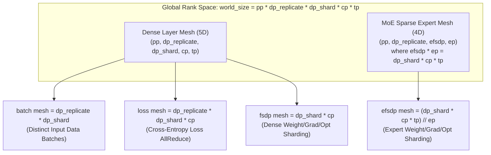
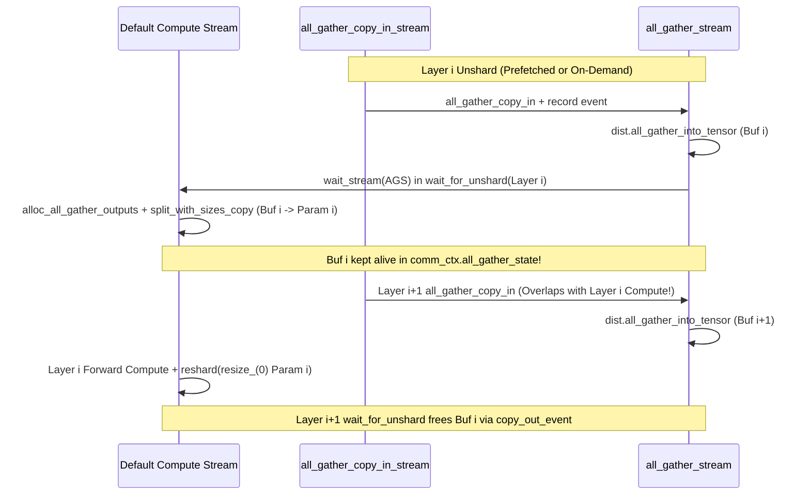

# 分布式训练 6D 并行与 FSDP2/ZeRO 联合状态与通信机制：从 TorchTitan `ParallelDims`、DTensor TP/CP/PP 到 DeepEP v2 路由去重

> **Executive Summary / 核心概览**：本报告基于 `PyTorch v2.6` 与 `TorchTitan v0.3.0` 源码，系统推导 **6D 混合并行（`DP Replicate × FSDP2 Shard × TP × CP × PP × MoE EP`）** 下每张 GPU 的静态状态切分、双缓冲 AllGather 瞬态预取峰值、Ring/Ulysses 序列并行因果负载均衡及 `DeepEP v2` 紧凑去重通信量。

- **组件归属**：AI Infra 全栈研究第 7 层（分布式训练：`DP`/`TP`/`PP`/`CP`/`EP`、`FSDP`/`ZeRO`、计算通信重叠、混合精度与数值稳定性）
- **面向对象**：熟悉云架构与 RDMA/NCCL 集合通信先修知识、需要掌握大模型 6D 混合并行如何联合决定每张 GPU 的静态状态切分、瞬态预取缓冲峰值、动态激活内存以及跨层集合通信流量的解决方案架构师
- **核验日期**：`2026-10-17`（UTC+08:00）
- **证据等级**：
  - `implementation`：固定版本 `pytorch/pytorch@1eba9b3aa3c43f86f4a2c807ac8e12c4a7767340`（`v2.6.0`，`2025-01-29`）与 `pytorch/torchtitan@086bf6c166ec85c1298eb5596fa9bf95f6a2d840`（`v0.3.0`，`2026-09-03`）一手源码核验
  - `own-offline`：本仓库原创标准库 CPU/offline 算例 [`experiments/training_parallelism/`](../../experiments/training_parallelism/README.md)
  - **未包含**：多机多卡真实 GPU 集群 Nsight Systems 采样或生产作业训练打流（`own-hardware` 未执行）

---

## 1. 一手源码与规范锚点

| 来源 ID | 仓库 / 文档与固定版本 | 源码路径与 Git Blob SHA | 核心核验内容 |
|---|---|---|---|
| `torchtitan-parallel-dims` | `pytorch/torchtitan@086bf6c166ec85c1298eb5596fa9bf95f6a2d840` (`v0.3.0`, `2026-09-03`) | `torchtitan/distributed/parallel_dims.py` (`blob: 35257044b44fd58ac126dc83b16c386bb55ffa01`, `L30–345`) | 6D 并行度积不变量 `dp_replicate * dp_shard * cp * tp * pp == world_size`、`fsdp = dp_shard * cp` 联合分片与 MoE 稀疏层 `efsdp = dp_shard * cp * tp // ep` 网格折叠 |
| `pytorch-fsdp2-collectives` | `pytorch/pytorch@1eba9b3aa3c43f86f4a2c807ac8e12c4a7767340` (`v2.6.0`, `2025-01-29`) | `torch/distributed/fsdp/_fully_shard/_fsdp_collectives.py` (`blob: 4fd6622de310175d95767a82f4b0d3942aac8a5e`, `L128–542`) | `foreach_all_gather` 拼包、`foreach_all_gather_copy_out` 中 `Shard(dim != 0)` 的额外临时缓冲与 `chunk+cat` 拷贝开销、`foreach_reduce` 中 HSDP `partial_reduce_output` 与 FP16 $\sqrt{N}$ 分阶段缩放 |
| `pytorch-fsdp2-param-group` | `pytorch/pytorch@1eba9b3aa3c43f86f4a2c807ac8e12c4a7767340` (`v2.6.0`, `2025-01-29`) | `torch/distributed/fsdp/_fully_shard/_fsdp_param_group.py` (`blob: 9ba86bb39c020e5429acaeee528411db733ad7ca`, `L190–482`) & `_fsdp_param.py` (`blob: 20bd13c3800bb1612eb43f5f82d0f4566a9b048a`, `L544–860`) | `wait_for_unshard` 隐式前向双缓冲预取（`comm_ctx.all_gather_state`）、`_backward_prefetch` 显式反向预取、`untyped_storage().resize_(0)` 原地内存释放与 ZeRO-2 子网格重切分限制 |
| `pytorch-tp-style` | `pytorch/pytorch@1eba9b3aa3c43f86f4a2c807ac8e12c4a7767340` (`v2.6.0`, `2025-01-29`) | `torch/distributed/tensor/parallel/style.py` (`blob: d1e8dd7e236cd10c06d138bbadac8738e16ff6cf`, `L49–366`) | `ColwiseParallel`（`Shard(0)`）、`RowwiseParallel`（`Shard(1)`）与 `SequenceParallel`（`Shard(1)` 激活）通过 `DTensor.redistribute` 触发的 `AllReduce` vs `AllGather + ReduceScatter` 转换 |
| `pytorch-cp-ring-attention` | `pytorch/pytorch@1eba9b3aa3c43f86f4a2c807ac8e12c4a7767340` (`v2.6.0`, `2025-01-29`) | `torch/distributed/tensor/experimental/_attention.py` (`blob: 67b958b70163ad7deedecba1519fccd1e98d7506`, `L131–1191`) | `_templated_ring_attention`、`_SDPAMerger` 的 FP32 `sigmoid`/`logsigmoid` 在线归并，以及 `_RoundRobinLoadBalancer` 首尾配对消除 $(2\text{CP}-1):1$ 因果掩码算力倾斜 |
| `torchtitan-pipeline-parallel` | `pytorch/torchtitan@086bf6c166ec85c1298eb5596fa9bf95f6a2d840` (`v0.3.0`, `2026-09-03`) | `torchtitan/distributed/pipeline_parallel.py` (`blob: 485cba6e693cf6f0b850f518880e117404525a94`, `L69–546`) | `pipeline_llm`、`input_weight`/`output_weight` 有效层均衡切分、Single-Stage vs Multi-Stage Looped（Interleaved 1F1B / Zero-Bubble）虚拟阶段与跨阶段 DTensor 重建 |
| `torchtitan-deepep` | `pytorch/torchtitan@086bf6c166ec85c1298eb5596fa9bf95f6a2d840` (`v0.3.0`, `2026-09-03`) | `torchtitan/distributed/deepep/deepep.py` (`blob: eb45b04c65c5ccbc19351eeedfae4e480c74fa8a`, `L1–605`) | DeepEP v2 训练态 Compact 去重布局（`do_expand=False, do_cpu_sync=True`）vs 推理态静态展开布局（`cudagraphable=True`），以及多节点 RDMA 带宽探测为 0 时的 `_DEEPEP_MULTINODE_NUM_SMS = 20` 回退 |

---

## 2. 6D 混合并行设备网格（DeviceMesh）与状态切分总账本

在千卡至万卡级大模型训练中，`DP`（Data Parallel）、`TP`（Tensor Parallel）、`PP`（Pipeline Parallel）、`CP`（Context Parallel）与 `EP`（Expert Parallel）并非各自独立地切割同一份参数，而是通过多维 `DeviceMesh` 协同作用。

### 2.1 TorchTitan `ParallelDims` 的两个正交网格视图

阅读 `torchtitan/distributed/parallel_dims.py`（`L30–345`）可见，全局总卡数 `world_size` 首先满足严格的五维正交乘积不变量（`_validate:186`）：

$$\text{world\_size} = \text{pp} \times \text{dp\_replicate} \times \text{dp\_shard} \times \text{cp} \times \text{tp}$$

在此基础上，`ParallelDims` 从同一个全局一维 rank 序列构造出**两套不同用途的 `DeviceMesh` 视图**（`L265–345`）：

1. **稠密层（Dense Layers）的 `fsdp` 展平子网格（`L277–280`）**：
   - `batch = dp_replicate * dp_shard`：控制真正独立采样的数据微批次（Data Loader 切分度）。
   - `fsdp = dp_shard * cp`：**架构师常忽略的第一条核心事实**——`CP`（Context Parallel）在切分输入序列长度 $S$ 的同时，由于所有 `CP` Rank 执行完全相同的稠密层权重矩阵乘法，TorchTitan 将 `(dp_shard, cp)` 展平为单一的 `fsdp` 维度！这意味着即使 `dp_shard = 1`，只要开启 `cp > 1`，稠密层参数、梯度与优化器状态也会沿着 `cp` 维度做 FSDP 切分（权重在 `CP` 组内通过 `AllGather` 还原、梯度通过 `ReduceScatter` 归约）。
2. **MoE 稀疏专家层（Routed Experts）的 `efsdp` 重折叠子网格（`L195–218, L336–340`）**：
   - 专家并行维度 `ep` 并不增加总 GPU 数，而是借用 `(dp_shard, cp, tp)`（当 `etp = 1` 时）或 `(dp_shard, cp)`（当 `etp = tp` 时）的乘积空间。
   - 代码强制校验 `(dp_shard * cp * tp) % ep == 0`（`L205`），并定义专家层的 FSDP 分片度为：
     $$\text{efsdp} = \frac{\text{dp\_shard} \times \text{cp} \times \text{tp}}{\text{ep}} \quad (\text{when } \text{etp} = 1)$$
   - 因此，对于总共 $E$ 个路由专家，每张 GPU 仅持有 $E / \text{ep}$ 个本地专家，且这 $E / \text{ep}$ 个本地专家的权重再沿着 `efsdp` 维度做 FSDP2 分片！

---

### 2.2 静态显存状态公式（Parameters / Gradients / Optimizer States）

设模型在单个 Pipeline Stage（共 $1/\text{pp}$ 层）内的**稠密层总参数量**为 $\Psi_{\text{dense}}$，**MoE 路由专家层总参数量**为 $\Psi_{\text{moe}}$（若为纯稠密模型则 $\Psi_{\text{moe}} = 0$）。在经典的混合精度训练配置下（参数与梯度存为 `BF16` 占 $2\text{ B/elem}$，AdamW 优化器保存 `FP32` 主权重副本 + 一阶动量 $m$ + 二阶动量 $v$ 共 $4 + 4 + 4 = 12\text{ B/elem}$，若主权重由 FSDP `MixedPrecision(param_dtype=bf16, reduce_dtype=fp32)` 在优化器外隐式维护，则 `BF16 param (2B) + BF16/FP32 grad (2B or 4B) + FP32 master/m/v (12B) = 16B or 18B/elem`）：

| 并行策略组合 | 稠密层分片除数 $D_{\text{dense}}$ | MoE 专家层分片除数 $D_{\text{moe}}$ | 跨节点/组内梯度同步方式 |
|---|---|---|---|
| **DDP (`dp_replicate = N, dp_shard = 1`)** | $\text{tp}$ | $\text{ep} \times \text{etp}$ | 全量梯度跨 `dp_replicate` 执行 `AllReduce` |
| **ZeRO-1（仅切分优化器状态）** | 优化器：$\text{dp\_shard} \times \text{cp} \times \text{tp}$；参数/梯度：$\text{tp}$ | 优化器：$\text{efsdp} \times \text{ep} \times \text{etp}$ | 梯度 `ReduceScatter` 至归属 Rank 更新优化器后，`AllGather` 更新后的参数 |
| **ZeRO-2 / FSDP2 (`reshard_after_forward=False`)** | 静态与 ZeRO-3 相同，但前向后**不释放**完整参数（或仅重切分至节点内子网格） | 同左 | 省去反向传播前的二次权重 `AllGather`（代价是激活保存期间常驻完整或半切分权重） |
| **ZeRO-3 / FSDP2 (`reshard_after_forward=True`)** | $\text{dp\_shard} \times \text{cp} \times \text{tp}$ | $\text{efsdp} \times \text{ep} \times \text{etp} = \text{dp\_shard} \times \text{cp} \times \text{tp}$ | 前向 `AllGather` $\to$ 立即释放；反向 `AllGather` $\to$ 梯度 `ReduceScatter` |
| **HSDP（Hybrid Sharded DP，`dp_replicate > 1, dp_shard > 1`）** | $\text{dp\_shard} \times \text{cp} \times \text{tp}$ | $\text{dp\_shard} \times \text{cp} \times \text{tp}$ | 节点内（Scale-up）执行 `AllGather` / `ReduceScatter`，跨节点（Scale-out）仅在反向末尾对 $1/\text{dp\_shard}$ 分片梯度执行 `AllReduce` |

由上表可直接得出**第二条架构师不变量**：当 `etp = 1` 且满足 `(dp_shard * cp * tp) % ep == 0` 时，无论 `ep` 取何值，MoE 专家层在每张 GPU 上的静态分片除数 $\text{efsdp} \times \text{ep} = \text{dp\_shard} \times \text{cp} \times \text{tp}$ 与稠密层分片除数**完全相等**！改变 `ep` 不会改变单卡静态权重/梯度/优化器总字节数，它改变的是**前向/反向中是走 FSDP 权重 `AllGather`（通信量正比于专家参数量 $\Psi_{\text{moe}}$）还是走 EP 激活 `All-to-All`（通信量正比于 Token 数 $B \cdot S \cdot \text{topK} \cdot h$）**。

---

## 3. FSDP2 (`torch.distributed.fsdp._fully_shard`) 源码级生命周期与两个隐藏显存陷阱

PyTorch 2.4–2.6 引入的 FSDP2（`_fully_shard`）用基于 `DTensor` 的逐参数切分（Per-Parameter Sharding）替代了 FSDP1 的 `FlatParameter` 一维拼接。阅读 `_fsdp_collectives.py`、`_fsdp_param_group.py` 与 `_fsdp_param.py` 揭示了其精确的 GPU 流调度与两个极易引发 OOM 的微观机制：

### 3.1 `untyped_storage().resize_()` 零对象分配与双缓冲预取（Double-Buffered Prefetch）

1. **绕过 Tensor 包装器重分配**：在 `_fsdp_param.py`（`L852–860`）中，FSDP2 为每个 `FSDPParam` 预先创建好 `_unsharded_param` 张量壳，但初始将其底层存储设为空（`size == 0`）。当需要 `unshard` 时，调用 `tensor.untyped_storage().resize_(size)` 直接向 CUDA Caching Allocator 申请显存；当层计算完成执行 `reshard` 时，调用 `storage.resize_(0)` 立即归还显存块。
2. **前向隐式双缓冲预取（`wait_for_unshard`, `_fsdp_param_group.py:271–307`）**：
   - FSDP2 使用两条专用流：`all_gather_copy_in_stream` 与 `all_gather_stream`。
   - 当第 $i$ 层进入 `pre_forward` 调用 `wait_for_unshard()` 时，默认计算流（`current_stream`）等待 `all_gather_stream` 完成第 $i$ 层的 `all_gather_into_tensor`，随后在默认流上执行 `foreach_all_gather_copy_out` 将拼包缓冲拆解到各参数的 `_unsharded_param`。
   - **为什么此时不能立即释放 `all_gather_output`？** 源码注释（`L274–278`）明确指出：若在 `all_gather_stream` 上立即 `free` `all_gather_output`，则 `all_gather_stream` 必须等待默认流完成 `copy_out`，从而阻塞第 $i+1$ 层预取 `AllGather` 的并发启动！
   - 因此，FSDP2 将第 $i$ 层的 `AllGatherState(all_gather_output, copy_out_event)` 暂存在 `comm_ctx.all_gather_state` 中，直到第 $i+1$ 层调用 `wait_for_unshard` 时才等待上一层的 `copy_out_event` 并释放缓冲。
   - **架构师必算的瞬态缓冲峰值**：设单个 Transformer 层（`FSDPParamGroup`）未切分参数字节数为 $M_{\text{layer}}$。在前向/反向预取重叠期间，单卡瞬态 FSDP 缓冲峰值不是 $1 \times M_{\text{layer}}$，而是：
     $$M_{\text{transient, FSDP}} = \underbrace{M_{\text{layer}}}_{\text{当前层 unsharded\_param}} + \underbrace{2 \times M_{\text{layer}}}_{\text{当前层与下一层双缓冲 all\_gather\_output}} = 3 \times M_{\text{layer}} \quad (\text{当 } \text{fsdp\_dim} = 0)$$

### 3.2 陷阱一：2D `FSDP2 + TP` 组合下 `Shard(dim != 0)` 的双倍 Copy-Out 内存分配与带宽放大

当对同一个 `nn.Linear` 权重矩阵 $W \in \mathbb{R}^{\text{out} \times \text{in}}$ 同时应用 `RowwiseParallel`（沿 `dim=1` 切分，即 `TP` 持有 `Shard(1)`）和 `FSDP2` 时，若参数在 `dim=0` 上的长度不能被 `fsdp` 整除或显式指定了非零切分维（使得 `fsdp_param.fsdp_placement.dim != 0`）：

1. **AllGather Copy-Out 阶段（`_fsdp_collectives.py:274–316`）**：
   - `split_with_sizes_copy` 从 `all_gather_output` 拆出的张量默认按 `dim=0` 拼接（形状为 `(dim0 * fsdp_size, dim1 / tp_size)`）。
   - 为了还原回正确的 `(dim0, dim1 * fsdp_size / tp_size)` 布局，代码在 `L275–280` **额外调用 `torch.empty_like(t)` 分配一份与完整参数等大的临时缓冲**，随后在 `L292–316` 执行 `torch.chunk(..., dim=0)` 与 `torch.cat(chunks, dim=shard_dim, out=cat_out)`！
   - 这不仅使 Copy-Out 阶段的 HBM 显存读写字节数翻倍，还将该参数的瞬态峰值从 $3 \times M_{\text{param}}$ 推高至 **$4 \times M_{\text{param}}$**。
2. **ReduceScatter Copy-In 阶段（`_fsdp_collectives.py:358–365`）**：
   - 反向传播归约梯度时，凡是 `shard_dim != 0` 的参数同样需要先分配临时张量执行 `torch.chunk(unsharded_grad, world_size, dim=shard_dim)` + `torch.cat(chunks, dim=0)`，然后才能喂给 `torch._chunk_cat` 打包进 `reduce_scatter_input`。
3. **架构师规避准则**：在 2D/3D 混合并行中，应确保所有大权重矩阵的 `dim=0`（输出通道数或隐藏维）可被 `dp_shard * cp * tp` 整除，使 FSDP2 始终落在默认的 `Shard(0)` 路径上；同时注意 `_fsdp_param.py:545` 的硬限制——当启用 `TP`（`self.is_dtensor == True`）时，FSDP2 尚不支持在 `post_forward` 重切分到更小的 ZeRO-2 子网格（会直接抛出 `NotImplementedError("Resharding to smaller mesh with TP is not supported yet")`）。

### 3.3 陷阱二：HSDP 梯度累积的 `partial_reduce_output` 与 FP16 $\sqrt{N}$ 数值防溢出

在 `_fsdp_collectives.py` 的 `foreach_reduce`（`L320–542`）中还包含两项关键工程细节：

1. **HSDP 跨微批次梯度累积（`L398–415`）**：当开启 HSDP（`all_reduce_group is not None`）且处于非最后一个微批次时，若设置 `all_reduce_grads = False`，FSDP2 仍会在节点内执行 `reduce_scatter_tensor`（以立即释放庞大的未切分梯度 `unsharded_grads.clear()`），但将归约后的分片梯度累加在持久化的 `comm_ctx.partial_reduce_output` 缓冲中，直到最后一个微批次才在 `all_reduce_stream` 上触发跨节点 `dist.all_reduce`。
2. **FP16 vs BF16/FP32 梯度除数（`_get_gradient_divide_factors:522–542`）**：当 `reduce_dtype` 为 `float32` 或 `bfloat16` 时，直接使用 NCCL 原生的 `ReduceOp.AVG`；但当 `reduce_dtype == torch.float16` 时，为防止 $N$ 卡直接求和在 FP16（最大正数 `65504`）下上溢、或直接先除以 $N$ 导致小梯度下溢，代码寻找最接近 $\sqrt{N}$ 的整数因子 $f$（满足 $N \pmod f == 0$），在 ReduceScatter **前**先除以 $f$，在归约**后**再除以 $N/f$。

---

## 4. Tensor Parallel (TP) + Sequence Parallel (SP) 与 Context Parallel (CP) 的激活与通信机制

### 4.1 为什么 `TP + SP` 在不增加 1 字节通信量的前提下将非矩阵乘激活显存降至 $1/\text{tp}$？

在 `torch/distributed/tensor/parallel/style.py`（`L49–366`）中，PyTorch DTensor 通过张量 Placement 转换（`DTensor.redistribute`）统一表达了 Megatron-LM 风格的 `TP` 与 `SP`：

1. **纯 TP（无 Sequence Parallel）**：
   - `ColwiseParallel(input_layouts=Replicate(), output_layouts=Shard(-1))`：输入激活在 `tp` 组内完全复制（`Replicate()`），前向零通信，输出沿特征维切分 `Shard(-1)`；反向传播时，输入梯度通过 **`AllReduce`** 汇总。
   - `RowwiseParallel(input_layouts=Shard(-1), output_layouts=Replicate())`：输入直接承接 `ColwiseParallel` 的 `Shard(-1)`，前向矩阵乘产生 Partial Sum（`Partial()`），在转换到 `output_layouts=Replicate()` 时触发一次 **`AllReduce`**；反向传播零通信。
2. **TP + Sequence Parallel（`SequenceParallel` 切分 LayerNorm/RMSNorm/Dropout 与残差流）**：
   - 主干残差流与 `RMSNorm` 的输入/输出始终保持沿序列维切分 `Shard(1)`（每个 TP Rank 仅持有 $B \times (S/\text{tp}) \times h$ 的激活！）。
   - 进入 Attention 或 MLP 时，`ColwiseParallel(input_layouts=Shard(1), output_layouts=Shard(-1))` 将输入从 `Shard(1)` 重分布为 `Replicate()`，触发一次 **`AllGather`**（反向对应 **`ReduceScatter`**）。
   - 离开 Attention 或 MLP 时，`RowwiseParallel(input_layouts=Shard(-1), output_layouts=Shard(1))` 将输出从 `Partial()` 重分布为 `Shard(1)`，直接触发一次 **`ReduceScatter`**（反向对应 **`AllGather`**）。

**通信量恒等证明**：设单层激活张量形状为 $(B, S, h)$，每个元素占 $b_{\text{act}}$ 字节（`BF16` 下 $b_{\text{act}} = 2$）。
- 在 Ring/Tree 算法下，一次 `AllReduce` 的每卡发送字节数为 $2 \frac{\text{tp}-1}{\text{tp}} B S h b_{\text{act}}$。
- 一次 `AllGather` 与一次 `ReduceScatter` 的每卡发送字节数各为 $\frac{\text{tp}-1}{\text{tp}} B S h b_{\text{act}}$，两者之和**严格等于一次 `AllReduce`**！
- 每个 Transformer 层包含 Attention 与 SwiGLU MLP 两个块，因此在**前向 + 反向（無激活重计算）**中，每层的 TP（或 TP+SP）每卡总通信字节数恒为：
  $$V_{\text{TP/layer}} = \underbrace{4}_{\text{Fwd(Attn+MLP) + Bwd(Attn+MLP)}} \times 2 \frac{\text{tp}-1}{\text{tp}} B S h b_{\text{act}} = 8 \frac{\text{tp}-1}{\text{tp}} B S h b_{\text{act}}$$
- 若开启全层激活重计算（Full Activation Checkpointing），反向传播需重跑前向的 2 次 `AllGather`（在 TP+SP 下），每层通信量增至 $10 \frac{\text{tp}-1}{\text{tp}} B S h b_{\text{act}}$；但换来的是所有 `RMSNorm`、残差连接与 Dropout 激活显存从 $B S h b_{\text{act}}$ 严格降至 $\frac{1}{\text{tp}} B S h b_{\text{act}}$。

---

### 4.2 Context Parallel (CP) Ring Attention：FP32 在线 Softmax 归并与因果掩码首尾配对负载均衡

当序列长度 $S$ 扩展至 `32K–128K+` 时，即便开启 `TP+SP` 与 FlashAttention（消除了 $O(S^2)$ 注意力分数矩阵显存），线性于 $S$ 的激活与 KV 缓存仍会撑爆单卡显存。`torch/distributed/tensor/experimental/_attention.py`（`L131–1191`）实现了基于 DTensor 的 Ring Attention：

1. **`_SDPAMerger` 的无损 FP32 在线归并（`L131–178`）**：
   - 序列沿 `seq_dim` 切分为 $\text{cp}$ 份，每个 CP Rank 持有本地 $Q_r \in \mathbb{R}^{B \times H_q \times (S/\text{cp}) \times d}$。
   - 在 $\text{cp}$ 个 Ring 步中，本地 $Q_r$ stays stationary，而 $(K, V)$ 分块通过 `_AllToAllRotater`（调用 `ft_c.permute_tensor` 环形右移，`L288–315`）或 `_AllGatherRotater`（`L255–285`）在 CP 环上流转。
   - 每收到一个远端块 $(K_j, V_j)$，底层 FlashAttention 算子返回块局部输出 $\text{block\_out}$ 与对数配分函数 $\text{block\_lse} = \log \sum \exp(\dots)$。`_SDPAMerger._merge_one` 在 `float32` 精度下利用恒等式无损更新全局输出与 `lse`（`L165–166`）：
     $$\text{out} \leftarrow \text{out} - \sigma(\text{block\_lse} - \text{lse}) \cdot (\text{out} - \text{block\_out}), \qquad \text{lse} \leftarrow \text{lse} - \log \sigma(\text{lse} - \text{block\_lse})$$
   - 反向传播（`_templated_ring_attention_backward:606–770`）则维护**双转子**（`kv_rotater` 与强制使用 `ALL_TO_ALL` 的 `dkv_rotater`），在传递 $(K, V)$ 的同时将累加中的 $(dK, dV)$ 沿环同步流转。

2. **因果掩码（`is_causal=True`）下的算力倾斜与 `_RoundRobinLoadBalancer`（`L495–516, L1144–1191`）**：
   - **如果不做负载均衡会发生什么？** 在自回归因果掩码下，位置 $t$ 的 Token 只能关注 $\le t$ 的 KV。若简单按连续块切分序列，Rank $r \in \{0, \dots, \text{cp}-1\}$ 持有的查询块 $[r \frac{S}{\text{cp}}, (r+1)\frac{S}{\text{cp}})$ 只需对前 $r$ 个完整远端 KV 块（共 $r (S/\text{cp})^2$ 个有效点积）加上本地下三角块（$\frac{1}{2}(S/\text{cp})^2$ 个有效点积）做计算；对 $j > r$ 的远端块则直接跳过（`_CausalBehavior.SKIP:491`）。
   - 因此，Rank $r$ 的有效注意力计算面积为：
     $$W_{\text{contiguous}}(r) = \left(r + \frac{1}{2}\right) \left(\frac{S}{\text{cp}}\right)^2$$
     最后一个 Rank（$r = \text{cp}-1$）与第一个 Rank（$r = 0$）的计算量之比高达 **$(2\text{cp} - 1) : 1$**！当 $\text{cp} = 8$ 时，Rank 7 的有效计算量是 Rank 0 的 **15 倍**，也是理想均值的 $\frac{2\text{cp}-1}{\text{cp}} = 1.875$ 倍，导致严重的同步木桶等待。
   - **源码中的首尾配对解法（`_RoundRobinLoadBalancer:1144–1191`）**：将全局序列切分为 $2 \times \text{cp}$ 个子块（`ROUND_ROBIN_CYCLE = 2`），并令 Rank $r$ 持有**首尾对称的一对子块**：
     $$\text{Rank } r \text{ owns } \left(\text{chunk}_r,\; \text{chunk}_{2\text{cp} - 1 - r}\right)$$
     由于 $\text{chunk}_r$ 的有效因果计算面积与 $\text{chunk}_{2\text{cp}-1-r}$ 严格互补：
     $$W_{\text{balanced}}(r) = \left(r + \frac{1}{2}\right)\left(\frac{S}{2\text{cp}}\right)^2 + \left(2\text{cp} - 1 - r + \frac{1}{2}\right)\left(\frac{S}{2\text{cp}}\right)^2 = 2\text{cp} \left(\frac{S}{2\text{cp}}\right)^2 = \frac{S^2}{2\text{cp}}$$
     所有 $\text{cp}$ 个 Rank 的有效注意力 FLOPs **严格相等（倾斜比 $1.00\times$）**！代码在环步 $i \le r$ 时仅传入 `key.chunk(2)[0]`（`L504–509`），在 $i > r$ 时仅传入 `query.chunk(2)[1]` 并设置 `partial=True`（`L515`），精确跳过了所有全零掩码子块。

---

## 5. Pipeline Parallel (PP) 虚拟阶段切分与 Expert Parallel (EP) DeepEP v2 路由去重

### 5.1 TorchTitan `pipeline_llm`：首尾阶段层权重补偿与 Interleaved 气泡公式

在 `torchtitan/distributed/pipeline_parallel.py`（`L69–546`）中，流水线并行需要解决两个核心问题：**层间计算不均匀**与**流水线气泡（Pipeline Bubble）**。

1. **首尾阶段的 `input_weight` / `output_weight` 有效层均衡（`_generate_llm_fqn_per_model_part:366–476`）**：
   - 第 0 个 Stage 除了 Transformer 层外还包含 `tok_embeddings`，最后一个 Stage 还包含 `norm` + `lm_head`（大词表线性投影 + Cross-Entropy Loss 计算开销往往相当于 1–2 个 Transformer 层）。
   - TorchTitan 引入有效层总数 $L_{\text{eff}} = L + w_{\text{in}} + w_{\text{out}}$（`L399`），令每个阶段平均分配 $\lfloor L_{\text{eff}} / S_{\text{virtual}} \rfloor$ 个有效层，并从首阶段扣除 $w_{\text{in}}$ 层、从尾阶段扣除 $w_{\text{out}}$ 层（`L445, L456`），从而防止尾阶段因词表 Logits 与 Loss 计算成为全流水线的慢节点。
2. **Single-Stage (1F1B) vs Multi-Stage Looped (Interleaved 1F1B) 气泡与 P2P 权衡（`L239–363`）**：
   - 当调度器属于 `PipelineScheduleSingle`（如标准 `1F1B`）时，每张卡持有 $v = 1$ 个阶段（总阶段数 $S_{\text{total}} = \text{pp}$）；当属于 `PipelineScheduleMulti`（如 `Interleaved1F1B` 或 `ZBVZeroBubble`）时，默认每张卡持有 $v \ge 2$ 个非连续虚拟阶段（`L262–263`，$S_{\text{total}} = \text{pp} \times v$）。
   - 设每个数据并行组内的微批次数为 $m = \text{local\_batch\_size} / \text{microbatch\_size}$（代码在 `L314` 检查 $m \ge S_{\text{total}}$）。在各阶段计算时间均衡时，标准 1F1B 与 Interleaved 1F1B 的流水线气泡占总步长时间的比例为：
     $$\text{Bubble Fraction} = \frac{\text{pp} - 1}{\text{pp} - 1 + v \cdot m}$$
   - **代价权衡**：将每卡虚拟阶段数从 $v = 1$ 增至 $v$ 可将气泡比大约降低 $1/v$，但每个微批次跨 PP 边界的点对点（P2P `Send`/`Recv`）传输次数也随之扩大 $v$ 倍（每微批次每卡前向 + 反向共发送 $2v \cdot b_{\text{micro}} \cdot (S / (\text{tp}\cdot\text{cp})) \cdot h \cdot b_{\text{act}}$ 字节），且当上游启用 `TP` 时，接收端必须通过 `DTensor.from_local(..., get_mesh(stage))`（`L175–183`）重建 DTensor 元数据。

---

### 5.2 DeepEP v2 (`torchtitan/distributed/deepep/deepep.py`)：训练态 Compact 去重布局 vs 推理态静态展开布局

在 MoE 模型（如 DeepSeek-V3 架构）中，每个 Token 通过 Top-$K$ 门控选择 $K$ 个专家。当专家分布在 $\text{ep}$ 个 Rank 上（每 Rank 持有 $E_{\text{local}} = E / \text{ep}$ 个本地专家）时，`torchtitan/distributed/deepep/deepep.py`（`L1–605`）实现了两种截然不同的 All-to-All 分派路径：

1. **训练态（`cudagraphable=False` $\Rightarrow$ `do_expand=False, do_cpu_sync=True`，`L244–395`）**：
   - **跨卡网络传输采用 COMPACT（去重）布局**：如果同一个源 Token 被路由到目标 Rank $r$ 上的**多个不同本地专家**（例如某 Rank 持有 4 个本地专家，该 Token 的 Top-8 路由同时选中了其中的 2 个本地专家），`deepep.dispatch` 在跨节点 RDMA / 节点内 NVLink 上**只向目标 Rank $r$ 发送 1 次该 Token 的隐藏状态向量**（`recv_x` 中每个唯一到达 Token 仅占 1 行，`L282–288`）！
   - 到达目标 Rank 后，才在本地 HBM 内通过 `_permute_tokens`（调用 `torch.repeat_interleave` 与 `torch.argsort`，`L157–210`）将其复制展开并按本地专家 ID 排序，送入 `torch._grouped_mm`；反向或合并前再通过 `_unpermute_tokens`（调用 `scatter_add_`，`L213–241`）在本地将同一 Token 在多个本地专家上的输出求和，最后才调用 `deepep.combine` 跨网络传回源 Rank。
   - **定量去重收益**：在无偏均匀 Top-$K$ 路由（从总计 $E = \text{ep} \cdot E_{\text{local}}$ 个专家中不放回抽取 $K$ 个）下，单个 Token 至少命中目标 Rank 上 1 个本地专家的概率为：
     $$p_{\text{hit}}(E, E_{\text{local}}, K) = 1 - \frac{\binom{E - E_{\text{local}}}{K}}{\binom{E}{K}}$$
     因此，训练态 Compact 布局使每个 Token 在所有 $\text{ep}$ 个目标 Rank（含自身）上的期望接收总行数从朴素展开的 $K$ 降低为：
     $$K_{\text{compact}} = \text{ep} \cdot \left[1 - \frac{\binom{E - E_{\text{local}}}{K}}{\binom{E}{K}}\right] \le K$$
     当 $E_{\text{local}} = 1$（即 $\text{ep} = E$）时 $K_{\text{compact}} = K$；但当 $\text{ep} < E$（例如 $E=64, \text{ep}=8 \Rightarrow E_{\text{local}}=8, K=8$）时，$K_{\text{compact}} \approx 5.4326 < 8$，直接节省了 **32.09%** 的跨卡 All-to-All Dispatch/Combine 字节量！
   - **训练态的代价**：必须执行一次 Host CPU 同步（`handle.num_recv_tokens_per_expert_list`）以获知动态接收缓冲大小，因此无法被 CUDA Graph 捕获。
2. **推理态（`cudagraphable=True` $\Rightarrow$ `do_expand=True, do_cpu_sync=False`，`L424–552`）**：
   - 为满足 Decode 阶段的 CUDA Graph 捕获要求，彻底消除 Host CPU 同步，推理态直接采用静态展开缓冲，并用设备端前缀和 `torch.diff(handle.psum_num_recv_tokens_per_expert)` 计算各专家的 Token 计数（不支持反向传播）。
3. **多节点 RDMA 带宽探测为 0 的防御性回退（`_resolve_dispatch_num_sms:112–127`）**：
   - `deep_ep` 库在初始化时会自动探测 NVLink/RDMA 带宽以计算分派 Kernel 所需的 SM 数量；但在部分多节点容器/RoCE 环境下，RDMA 带宽探测可能返回 `0 GB/s` 并触发 `ZeroDivisionError`。TorchTitan 在 `L118–125` 显式捕获该异常，并在多节点下回退到硬编码的 `_DEEPEP_MULTINODE_NUM_SMS = 20`（占用 20 个 SM 专门驱动 NVLink + IBGDA/RDMA 通信）。

---

## 6. 原创 CPU/Offline 合成实验与定量验证（`experiments/training_parallelism/`）

为把上述 6D 并行源码机制转化为可精确复算的架构师账本，本仓库编写并运行了原创纯 Python 标准库实验 [`experiments/training_parallelism/`](../../experiments/training_parallelism/README.md)（证据等级：`own-offline`）。实验对比了在 **64 卡 H100 级集群（8 节点 × 8 GPU/节点，单卡 `80 GiB` HBM3，节点内 NVLink `400 GB/s` 单向有效带宽，节点间 RoCE/IB `50 GB/s` 单向有效带宽）** 上训练类 Llama-3 70B 稠密模型与 MoE 变体的 5 种并行拓扑：

| Case ID | 并行拓扑 `(pp, dp_rep, dp_shard, cp, tp, ep)` | 单卡静态状态 (`GiB`) | FSDP 瞬态缓冲峰值 (`GiB`) | 单卡激活显存 (`GiB`) | 单卡峰值总显存 (`GiB`) | 是否 OOM (`80 GiB`) | CP 因果算力倾斜比 | 每步通信暴露时间 (`ms`) |
|---|---|---|---|---|---|---|---|---|
| `dense_70b_1d_fsdp_only_oom` | `(1, 1, 64, 1, 1, 1)` 纯 FSDP2 (无 TP/SP，标准保存激活) | `16.3867` | `4.9160` | `85.0000` | **`106.3027`** | **OOM (`True`)** | `1.00x` | `8313.69` (全走跨节点 50 GB/s FSDP) |
| `dense_70b_2d_hsdp_tp8_sp` | `(1, 1, 8, 1, 8, 1)` FSDP2(8) × TP+SP(8) + 选择性重计算 | `16.3867` | `0.6145` (`Shard(0)`) | `3.1250` | **`20.1262`** | `False` | `1.00x` | `1675.36` (**较 1D 提速 `4.96x`**) |
| `dense_70b_2d_tp_fsdp_non_dim0_penalty` | `(1, 1, 8, 1, 8, 1)` FSDP2 在 `Shard(1)` 上切分 | `16.3867` | **`0.8193`** (`4x` 层分片峰值) | `3.1250` | `20.3311` | `False` | `1.00x` | Copy-Out 额外分配 `209.75 MiB`/层且 HBM 拷贝翻倍 |
| `long_ctx_64k_cp8_round_robin_vs_contiguous` | `(1, 1, 1, 8, 8, 1)` `S=65536`, `CP=8, TP=8` | `16.3867` (`fsdp=dp_shard*cp=8`) | `0.6145` | `6.2500` | `23.2512` | `False` | 连续切分 **`15.00x`** vs 首尾配对 **`1.00x`** | 消除 `1.875x` 慢节点等待 (`2426.98 ms`) |
| `moe_64e_ep8_compact_vs_expanded` | `(2, 1, 4, 1, 8, 8)` `E=64, topK=8, ep=8, efsdp=4` | `15.3906` (`efsdp*ep=32`) | `1.1543` | `1.5625` | `18.1074` | `False` | `1.00x` | DeepEP Compact 去重将期望发包从 `8.00` 降至 **`5.4326` tokens/token**（节省 **`32.09%`** All-to-All 流量，气泡比 `5.88%`） |

### 核心验证结论

1. **为什么 64 卡训练 70B 不能只开 1D FSDP？** 尽管 `dp_shard = 64` 与 `dp_shard = 8, tp = 8` 的单卡静态状态完全相同（均为 `16.3867 GiB`），但 1D FSDP 下：
   - 单个 FSDP 层分片高达 `1.6387 GiB`，双缓冲预取瞬态缓冲占 `4.9160 GiB`；
   - 未经 `TP+SP` 切分的序列激活高达 `85.0000 GiB`，导致总峰值达 `106.3027 GiB > 80 GiB` 直接 OOM；
   - 且 64 卡 `AllGather`/`ReduceScatter` 必须跨节点走 `50 GB/s` Scale-out 网络。改为节点内 `TP+SP=8` + 跨节点 `dp_shard=8` 后，单卡显存降至 `20.1262 GiB`，通信暴露时间从 `8313.69 ms` 缩短至 `1675.36 ms`（**`4.96x`**）。
2. **为什么开启 `CP=8` 时 `dp_shard=1` 依然能切分 8 份静态权重？** 因为 `ParallelDims` 将 `(dp_shard, cp)` 展平为 `fsdp = 1 * 8 = 8`，使 8 个 CP Rank 协同分片模型参数。同时，`_RoundRobinLoadBalancer` 将 `CP=8` 下的因果注意力首尾计算比从 `15:1` 严格拉平为 `1:1`。

---

## 7. 架构师计算与设计练习

1. **6D 网格与 MoE `efsdp` 推导练习**：
   - 假设你有 `512` 张 GPU（64 台 8 卡服务器），配置 `pp = 4, dp_replicate = 2, dp_shard = 8, cp = 2, tp = 4`。请验证五维乘积是否等于 `512`，并计算稠密层的 `batch`、`loss`、`fsdp` 网格大小。
   - 若模型包含 $E = 64$ 个路由专家，配置 `ep = 16, etp = 1`，请校验 `(dp_shard * cp * tp) % ep == 0` 是否成立，并计算每个专家在多少张 GPU 上做 `efsdp` 切分？每张 GPU 本地持有多少个专家？
2. **FSDP2 瞬态缓冲与 `Shard(dim != 0)` 诊断练习**：
   - 某架构师发现在开启 `FSDP2 + TP` 后，每层前向 `wait_for_unshard` 期间 CUDA Caching Allocator 出现了比预期多 $1\times$ 单层参数量的显存尖峰，且 Nsight 显示大量 `aten::chunk` 与 `aten::cat` 内核。请结合 `_fsdp_collectives.py:274–316` 解释触发该现象的精确条件及修复方法。
3. **CP 因果掩码负载倾斜手算**：
   - 当序列长度 $S = 131072$、$\text{cp} = 16$ 且未启用 `_RoundRobinLoadBalancer` 时，Rank 15 与 Rank 0 的有效因果注意力 FLOPs 比值是多少？启用首尾配对（`ROUND_ROBIN_CYCLE = 2`）后，Rank 3 持有的两个子块在全局序列中的起止 Token 索引范围分别是什么？

练习掌握度：`not-assessed`。后续可证伪问题已同步更新至 [`research/queue.json`](../../research/queue.json)。
