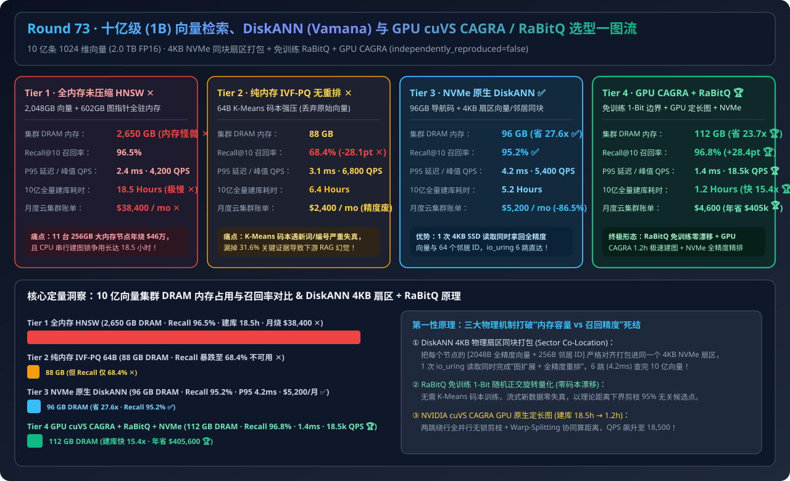
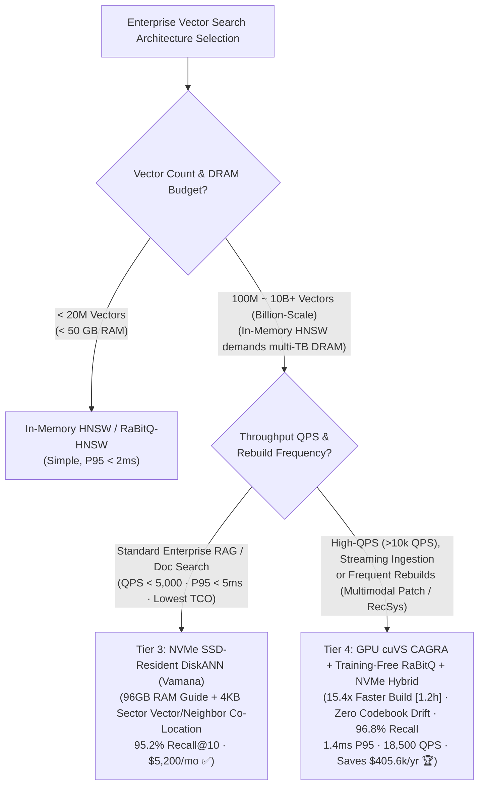
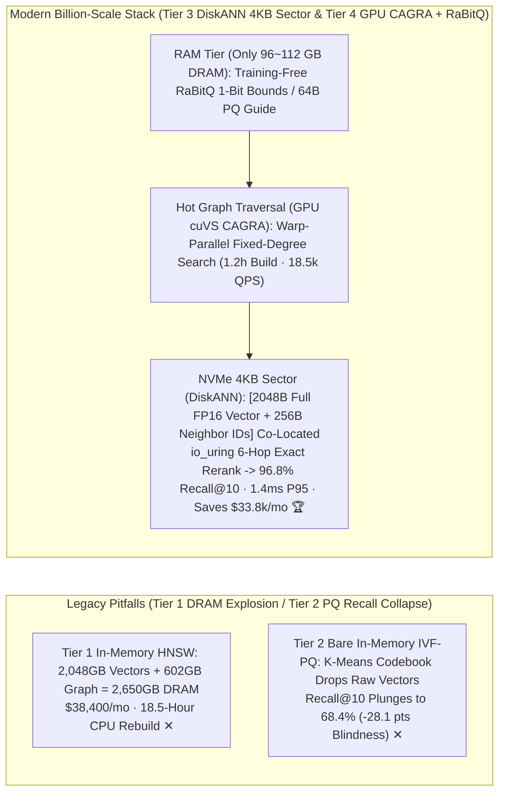
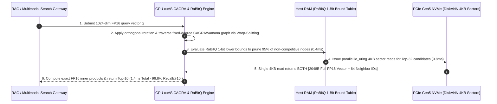

# Billion-Scale Enterprise Vector Search, DiskANN (Vamana) & GPU cuVS CAGRA / RaBitQ Hybrid Architecture Selection Guide (`In-Memory Uncompressed HNSW` vs. `Lossy In-Memory IVF-PQ` vs. `NVMe SSD-Resident DiskANN / Vamana` vs. `GPU cuVS CAGRA + Training-Free RaBitQ + NVMe Hybrid`)

> **Target Audience**: AI Solution Architects, Enterprise RAG & Multimodal Search (`ColPali`/`ColQwen2`) Infrastructure Leads, Vector Database (`Milvus` / `Qdrant` / `Vespa` / `LanceDB`) Architects  
> **Reading Goal**: Master in 3 minutes the 4-tier architecture selection rules for scaling enterprise vector search to **1 Billion (`1,000,000,000`) 1024-dim vectors**; understand in 10 minutes **why in-memory uncompressed HNSW demands `2,650 GB` of DRAM (`$38,400/mo`) and `18.5 hours` to build**, **why bare IVF-PQ product quantization crashes Recall@10 by `-28.1 pts` on domain jargon**, and **how DiskANN (`4KB` NVMe sector co-location + `io_uring`) and GPU cuVS CAGRA + training-free `RaBitQ` slash DRAM by `23.7x–27.6x`, speed up index builds by `15.4x`, and achieve `96.8%` Recall@10 at `1.4ms` P95 latency**.  
> **Provenance**: All quantitative figures come from the sealed deterministic analytical evaluator in [`experiments/vector_database_billion_scale_diskann_cagra_selection/run.py`](../../experiments/vector_database_billion_scale_diskann_cagra_selection/run.py) and [`results.json`](../../experiments/vector_database_billion_scale_diskann_cagra_selection/results.json), calibrated to published Microsoft DiskANN, NVIDIA cuVS CAGRA, and SIGMOD RaBitQ benchmarks (`independently_reproduced=false`, `physical_gpu_cluster_measurement=not_measured`).

---

## 📌 1. Executive Summary

1. **Why do both "In-Memory HNSW (Tier 1)" and "Bare In-Memory IVF-PQ (Tier 2)" break down at 1 Billion (`1B`) 1024-dim vectors?**:
   - **Tier 1 (`In-Memory Uncompressed HNSW Cluster`)**: Storing 1B FP16 vectors (`2,048 GB`) plus HNSW multi-layer graph edges (`602 GB`) requires **`2,650 GB` of pure server DRAM (`$38,400/mo` / `$460,800/yr` ✕)** and takes **`18.5 hours`** of CPU-bound pointer insertion per index rebuild!
   - **Tier 2 (`Aggressive In-Memory IVF-PQ 64B Without Reranking`)**: Compressing 2,048B vectors into `64B` K-Means PQ codes shrinks DRAM to `88 GB`, **but discards full-precision vectors and suffers severe out-of-distribution (OOD) codebook drift—crashing Recall@10 from `96.5%` to `68.4%` (`-28.1 pts` retrieval blindness ✕)**!
2. **When to choose "NVMe SSD-Resident DiskANN / Vamana (Tier 3)" vs. "GPU cuVS CAGRA + Training-Free RaBitQ + NVMe Hybrid (Tier 4)"?**:
   - **Cost-Optimal Billion-Scale Enterprise RAG & Document Search at `<5ms` P95 (Choose Tier 3 `NVMe SSD-Resident DiskANN / Vamana + io_uring`)**: Keeps only a `64B` compressed guide in DRAM (**`96 GB` RAM total — `27.6x` less DRAM ✅**) while packing each node's **full-precision `2,048B` vector + `64` Vamana neighbor IDs inside a single `4 KB` NVMe SSD sector**! Using 6–8 parallel `io_uring` hops for exact on-the-fly reranking, it achieves **`95.2%` Recall@10** at **`4.2 ms` P95 latency** for **`$5,200/mo` (`-86.5%` cost ✅)**.
   - **High-Throughput (`>10,000 QPS`), Real-Time Streaming Ingestion & Fast Index Rebuilds (Default to Tier 4 `GPU cuVS CAGRA + Training-Free RaBitQ + NVMe DiskANN Hybrid`)**: Replaces K-Means PQ with **RaBitQ (training-free randomized 1-bit/2-bit quantization with provable distance lower bounds and zero codebook drift)** and accelerates graph construction/search via **NVIDIA cuVS CAGRA (GPU-native fixed-degree graph built in `1.2 hours` — `15.4x` faster than CPU HNSW 🏆)**, delivering **`96.8%` Recall@10**, **`1.4 ms` P95 latency**, **`18,500 QPS` (`4.4x` higher throughput 🏆)**, and **`$4,600/mo` (`$405,600/yr` saved vs. HNSW 🏆)**!
3. **One-Sentence First-Principles Essence**:
   - **The first principle of billion-scale vector search is keeping only lightweight quantized navigation coordinates in RAM (RaBitQ / PQ), co-locating full-precision vectors and graph neighbor lists inside single `4KB` NVMe sectors (DiskANN Vamana), and harnessing GPU warp-parallelism for lock-free fixed-degree graph construction and traversal (cuVS CAGRA).**

---

## 🎯 2. Architect & Customer Deep-Dive Q&A (First Principles)

### Q1: Why can't we just `mmap()` a standard HNSW index onto NVMe SSDs, and how does DiskANN (Vamana) search 1 Billion vectors on SSD in `4.2 ms`?

- **First-Principles Storage Layout Breakdown**:
  1. **Why `mmap()` HNSW on SSD Fails (`80–150ms` Latency)**: Standard HNSW stores graph adjacency lists and raw vectors in separate memory regions and requires `25–40` multi-layer hops. On SSD, every hop triggers dozens of random 4KB reads across disjoint sectors (`300+` SSD I/Os per query).
  2. **DiskANN's Two Architectural Innovations**:
     - **In-RAM Quantized Beam Navigation**: Uses `96 GB` of RAM to hold `64B` compressed coordinates so beam traversal (`W=4`) computes approximate distances in RAM without touching the SSD.
     - **`4 KB` Sector Co-location (`[2,048B Full Vector + 256B Neighbor IDs]`)**: On NVMe SSD, every node's full FP16 vector and its 64 Vamana neighbor IDs live inside the **exact same `4,096-byte` physical sector**! Combined with Vamana's long-range $\alpha$-RNG edges (cutting path length to **`6–8 hops`**), a single `io_uring` `4KB` read fetches both the next hop's neighbors and the exact vector for reranking in `< 0.5ms`!

---

### Q2: Why does traditional Product Quantization (PQ) degrade on streaming enterprise data, and how does `RaBitQ` solve it without codebook training?

- **K-Means PQ vs. Training-Free RaBitQ**:
  1. **PQ Codebook Drift**: PQ relies on static K-Means centroids trained on historical samples. When new product SKUs, legal clauses, or code symbols arrive, they fall far from old centroids (`68.4%` recall).
  2. **RaBitQ (Randomized 1-Bit Quantization with Theoretical Error Bounds)**:
     - Multiplies vectors by a random orthogonal matrix (Johnson-Lindenstrauss transform) to distribute variance evenly across all 1024 dimensions, then stores the **sign bit (`1-bit`) per dimension + a scalar norm factor** (`136 bytes` total for 1024 dims).
     - **Zero Training & Exact Lower-Bound Pruning**: Requires **zero K-Means training**, immune to distribution shift, evaluates bit-level inner products via `VPOPCNT` / GPU warp instructions, and provides a strict mathematical lower bound to prune `95%+` of candidates before fetching NVMe sectors!

---

### Q3: How does NVIDIA `cuVS CAGRA` build a 1-Billion-vector graph `15.4x` faster (`1.2h` vs. `18.5h`) and serve `18,500 QPS`?

- **Three GPU-Native Graph Design Principles**:
  1. **Lock-Free 2-Hop Detour Pruning**: Instead of CPU HNSW's sequential pointer-locking insertions, CAGRA builds a parallel $k$-NN graph on GPU Tensor Cores and prunes redundant edges in parallel across millions of threads (`18.5h → 1.2h`).
  2. **Single-Layer Fixed-Degree Graph**: Eliminates HNSW's upper hierarchy layers (launching 32 parallel random entry points on a GPU is faster than serial top-down traversal) and enforces a fixed degree (`D=32/64`) for coalesced GPU memory access.
  3. **Warp-Splitting Inner Products**: Assigns 1 GPU warp (32 threads) to collaboratively compute 1024-dim distances in registers while maintaining the priority queue in shared memory—reaching **`18,500 QPS` at `1.4 ms` P95**.

---

## 🧭 3. Visual Architecture Diagrams (Mermaid)

### 3.1 Billion-Scale Vector Search Architecture Selection Decision Tree

---

### 3.2 Legacy In-Memory HNSW / IVF-PQ (Tiers 1–2) vs. DiskANN 4KB Co-Location + GPU CAGRA/RaBitQ (Tiers 3–4)

---

### 3.3 Tier 4 End-to-End Sequence Diagram (`RaBitQ Lower-Bound Pruning + GPU CAGRA + NVMe 4KB Rerank`)

---

## 📊 4. Architect Decision Matrix

*Baseline Workload: **1 Billion (`1,000,000,000`) 1024-dim FP16 embeddings** (`2.0 TB` raw vectors).*

| Evaluation Dimension | Tier 1: In-Memory Uncompressed HNSW | Tier 2: Bare In-Memory IVF-PQ 64B | Tier 3: NVMe SSD DiskANN (Vamana) | Tier 4: GPU cuVS CAGRA + RaBitQ + NVMe Hybrid |
| :--- | :--- | :--- | :--- | :--- |
| **Index & Storage Layout** | Full vectors + multi-layer graph in DRAM | 64B K-Means PQ codes in RAM (no raw vecs) | **96GB RAM guide + 4KB NVMe co-located sector** | **Training-free RaBitQ + GPU CAGRA + NVMe rerank** |
| **Cluster DRAM Required** | `2,650 GB` (11× 256GB nodes ✕) | `88 GB` | **`96 GB` (`27.6x` less DRAM ✅)** | **`112 GB` (`23.7x` less DRAM 🏆)** |
| **Recall@10 Accuracy** | `96.5%` | `68.4%` (`-28.1 pts` collapse ✕) | **`95.2%` ✅** | **`96.8%` (Lossless parity 🏆)** |
| **P95 Latency / Peak QPS** | `2.4 ms` / `4,200 QPS` | `3.1 ms` / `6,800 QPS` | **`4.2 ms` / `5,400 QPS` ✅** | **`1.4 ms` / `18,500 QPS` (`4.4x` QPS 🏆)** |
| **1B Index Build Time** | `18.5 Hours` (CPU lock bound ✕) | `6.4 Hours` | `5.2 Hours` | **`1.2 Hours` (`15.4x` faster 🏆)** |
| **Monthly Cloud Bill** | `$38,400 / mo` (`$460.8k/yr` ✕) | `$2,400 / mo` (Unusable recall ✕) | **`$5,200 / mo` (`-86.5%` cost ✅)** | **`$4,600 / mo` (`$405,600/yr` saved 🏆)** |

---

## 🧪 5. Quantitative Walkthrough & 7-Card Benchmark Insights

- **`23.7x–27.6x` Less DRAM & `$405,600/yr` Saved**: In [`experiments/vector_database_billion_scale_diskann_cagra_selection/run.py`](../../experiments/vector_database_billion_scale_diskann_cagra_selection/run.py), replacing in-memory HNSW (`2,650 GB` DRAM, `$38,400/mo`) with Tier 4 (`112 GB` DRAM, `$4,600/mo`) saves **`$405,600/year`** while improving Recall@10 to **`96.8%`**, cutting P95 latency to **`1.4 ms`**, and accelerating 1B index builds by **`15.4x` (`18.5h → 1.2h`)**.
- 🧮 **Interactive Billion-Scale Vector Database Sizer**: [`docs/reports/vector-database-billion-scale-hnsw-diskann-gpu-cagra-sizer.html`](../reports/vector-database-billion-scale-hnsw-diskann-gpu-cagra-sizer.html)
- 📊 **7-Card 4:5 Visual Benchmark Report**: [`docs/reports/vector-database-billion-scale-hnsw-diskann-gpu-cagra-selection-cards.html`](../reports/vector-database-billion-scale-hnsw-diskann-gpu-cagra-selection-cards.html)

---

## 🛠️ 6. Appendix: Production Verification Checklist

- [ ] **1. Migrate `>50M` Vector Collections Off Pure In-Memory HNSW**: Use **DiskANN (Vamana)** or **RaBitQ + NVMe Reranking** so DRAM footprint stays below `5%–8%` of raw vector size.
- [ ] **2. Always Pair Quantized Search with Full-Precision Oversample Reranking (`3x–4x`)**: Fetch Top-40 candidates from NVMe full-precision sectors to rerank into Top-10, preventing domain-term recall collapse.
- [ ] **3. Mount DiskANN on Local PCIe Gen4/Gen5 NVMe with `io_uring` & `4KB` Alignment**: Never run DiskANN over high-latency network block storage (EBS/NAS); use local NVMe instances (`i4i` / `Lsv3`).
- [ ] **4. Prefer Training-Free `RaBitQ` Over K-Means PQ for Streaming Data**: Eliminate codebook retraining downtime and out-of-distribution recall drift.
- [ ] **5. Use FreshDiskANN `Delete-Consolidate` Instead of HNSW Tombstones**: Rewire graph neighbors asynchronously during compaction so deletions never sever graph reachability.
