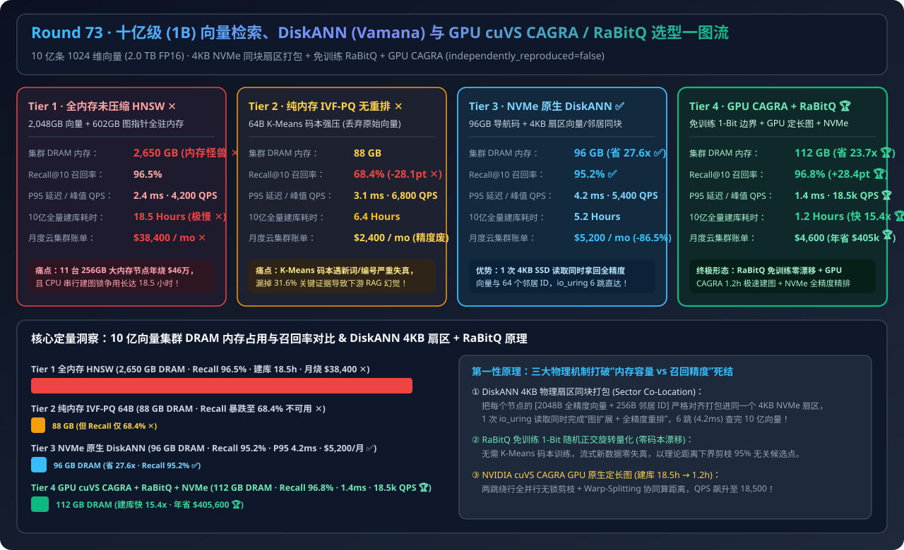
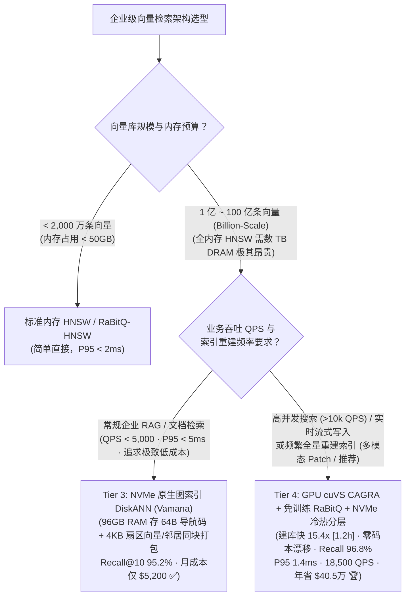
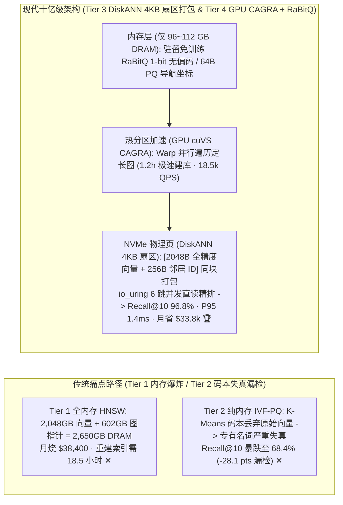
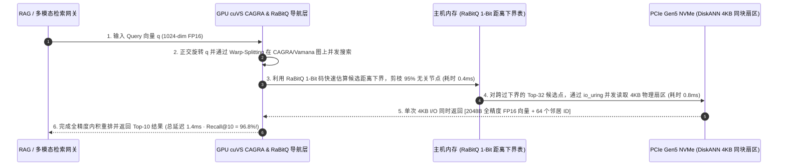

# 十亿级（Billion-Scale）企业向量检索、DiskANN (Vamana) 与 GPU cuVS CAGRA / RaBitQ 混合架构选型指南（`全内存未压缩 HNSW` vs. `纯内存 IVF-PQ 强有损量化` vs. `NVMe 原生 DiskANN / Vamana` vs. `GPU cuVS CAGRA + 免训练 RaBitQ + NVMe 冷热分层`）

> **适用角色**：AI 解决方案架构师（AI Solution Architect）、企业级 RAG 与多模态检索（ColPali/ColQwen2）基础设施负责人、向量数据库（Milvus / Qdrant / VesPa / LanceDB）架构师  
> **阅读目标**：3 分钟掌握企业向量库从千万级迈向 **10 亿级（`1,000,000,000` 条 1024 维向量）** 的四档选型铁律，10 分钟吃透 **为什么全内存 HNSW 在 10 亿规模下需要 `2,650 GB` 内存且月烧 `$38,400`**、**为什么传统 IVF-PQ 乘积量化会让长尾专业词汇召回率暴跌 `-28.1 pts`**、以及 **DiskANN（`4KB` 扇区同块打包 + `io_uring`）与 GPU cuVS CAGRA + 免训练 `RaBitQ` 如何把内存砍掉 `23.7 倍`、建库提速 `15.4 倍` 并实现 `96.8%` 无损召回与 `1.4ms` 极速响应**。  
> **数据来源说明（Provenance）**：本文定量数据来自仓库内封存的确定性解析模型（[`experiments/vector_database_billion_scale_diskann_cagra_selection/run.py`](../../experiments/vector_database_billion_scale_diskann_cagra_selection/run.py) 与 [`results.json`](../../experiments/vector_database_billion_scale_diskann_cagra_selection/results.json)，校准自 Microsoft DiskANN、NVIDIA cuVS CAGRA 与 SIGMOD RaBitQ 公开基准，`independently_reproduced=false`，`physical_gpu_cluster_measurement=not_measured`）。

---

## 📌 一、核心结论速览（Executive Summary）

1. **为什么在 1,000 万向量时好用的“全内存 HNSW（Tier 1）”和“纯内存 IVF-PQ（Tier 2）”，到了 10 亿级（1B Vectors，如全量多模态 ColQwen2 页面 Patch 或全集团知识库）会彻底失灵？**：
   - **Tier 1（全内存未压缩 HNSW）的内存账单与建库地狱**：10 亿条 1024 维 FP16 原始向量占 `2,048 GB`，加上 HNSW（`M=32`）多层图指针结构占 `602 GB`，全集群必须常驻 **`2,650 GB` 纯服务器 DRAM（需 11 台 256GB 大内存节点，月烧 `$38,400` / 年烧 `$46.1 万` ✕）**！且每次全量重建索引需要 CPU 串行跑 **`18.5 小时` ✕**！
   - **Tier 2（纯内存 IVF-PQ 64 字节乘积量化无重排）的精度崩塌**：虽然将 2,048 字节向量强压成 `64 字节` 码本仅占 `88 GB` 内存，但 K-Means 码本对未见过的专有名词、型号代码与多模态细粒度特征严重失真，导致 **Recall@10 从 `96.5%` 暴跌至 `68.4%`（`-28.1 pts` 漏检 ✕）**！
2. **什么时候选“NVMe SSD 原生图索引 DiskANN（Tier 3）”，什么时候上“GPU cuVS CAGRA + 免训练 RaBitQ + NVMe 冷热分层（Tier 4）”？**：
   - **追求极致性价比、P95 `< 5ms` 的十亿级企业文档/知识检索（首选 Tier 3 `NVMe 原生 DiskANN / Vamana + io_uring`）**：内存中仅保留 `64B` 轻量导航码（仅占 **`96 GB` DRAM，省内存 `27.6 倍` ✅**），而在 NVMe SSD 上将每个节点的**完整全精度向量 + 64 个 Vamana 图邻居 ID 紧凑打包进同一个 `4 KB` 磁盘扇区**！每次搜索通过 `io_uring` 并发发起 6～8 次 `4 KB` 单跳读取并在内存做精确重排，以 **`$5,200 / 月`（省 `-86.5%` ✅）** 实现 **`95.2%` Recall@10** 与 **`4.2 ms` P95 延迟**！
   - **高并发 QPS（`>10,000 QPS`）、流式实时入库或频繁重建索引场景（首选 Tier 4 `GPU cuVS CAGRA + 免训练 RaBitQ 1-Bit/2-Bit 无偏量化 + NVMe DiskANN 分层`）**：利用 **RaBitQ**（基于随机正交旋转的免训练 1-bit/2-bit 量化，**无需训练 K-Means 码本，流式入库零分布漂移**且具备严格距离下界过滤）+ **NVIDIA cuVS CAGRA**（GPU 原生固定度数图索引，**10 亿向量建库仅需 `1.2 小时`，比 CPU HNSW 快 `15.4 倍` 🏆**），拿下 **`96.8%` Recall@10**、**`1.4 ms` P95 延迟**、**`18,500 QPS`（提升 `4.4 倍` 🏆）**，月成本仅 **`$4,600 / 月`（年省 `$405,600` 🏆）**！
3. **一句话握手机制本质**：
   - **十亿级向量检索的第一性原理，是“用导航量化码驻留内存（RaBitQ / PQ）+ 将全精度向量与图拓扑同块对齐打包进 NVMe `4KB` 物理页（DiskANN Vamana）+ 用 GPU Warp 并行构建与遍历定长图（cuVS CAGRA）”——彻底打破“要精度就得买 2.6TB 内存，要省内存就得丢 28% 召回率”的伪二选一死结！**

---

## 🎯 二、客户与架构师灵魂拷问 Q&A（FAQ-Driven First Principles）

### Q1：为什么不能直接把传统 HNSW 图索引放到 NVMe SSD 上（用操作系统 `mmap` 虚拟内存顶替 DRAM）？为什么 DiskANN (Vamana) 能做到 4.2ms 查完 10 亿向量？

- **通俗大白话解释**：
  1. **直接把 HNSW `mmap` 到 SSD 会触发“随机 I/O 放大雪崩”**：
     - 传统 HNSW 的“图邻居列表”和“原始全精度向量”是分开存放的，且多层跳转路径极长（通常需走 `25 ~ 40 跳`）。如果放在 SSD 上，每跳既要读一次图结构，又要读几十个邻居的向量，单次查询会触发 **`300+ 次` 跨扇区随机 SSD 读取**，延迟直接飙到 **`80 ms ~ 150 ms`**，而且瞬间把 NVMe SSD 的 IOPS 打爆！
  2. **DiskANN (Vamana) 的两大物理级神来之笔**：
     - **第一招：内存导航与磁盘验证解耦**：在 `96 GB` 内存里放一份极小的 `64B` 压缩坐标。走图寻路时，先在内存里算粗略距离决定下一步跳向哪几个候选点，**绝不为了寻路去读磁盘**。
     - **第二招：`4 KB` NVMe 物理页“向量+邻居同块打包（Sector Co-location）”**：在 SSD 上，把每个节点的 **`2,048 Byte` 全精度 FP16 向量 + `256 Byte`（64 个邻居 ID）严格打包在同一个 `4,096 Byte (4KB)` NVMe 物理扇区里**！加上 Vamana 图引入长程捷径边（$\alpha$-RNG 剪枝）将搜索跳数压缩到 **`6 ~ 8 跳`**，每次通过 Linux `io_uring` 并发读 4 个 `4KB` 扇区（单跳耗时 `< 0.5ms`），**仅需 24～32 次 4KB 读取，就能同时拿到邻居拓扑与全精度向量完成精确重排，总延迟仅 `4.2 ms`！**

---

### Q2：传统 IVF-PQ 乘积量化有什么致命伤？为什么 SIGMOD 提出的 `RaBitQ`（免训练 1-Bit 随机投影量化）正在全面取代 PQ？

- **第一性原理拆解**：
  1. **传统 PQ（Product Quantization）的“码本漂移死穴”**：
     - PQ 必须先从已有数据中采样几百万条向量，跑高耗时的 K-Means 聚类生成固定码本（Codebook）。一旦后续业务写入了新的产品线、新财报或新代码库（Out-of-Distribution 数据分布漂移），老码本就会严重失真，除非停机几十个小时全量重训码本！
  2. **RaBitQ 的数学突破（免训练 + 理论无偏误差界）**：
     - RaBitQ 对向量乘以一个固定的随机正交矩阵（Johnson-Lindenstrauss 随机旋转），将能量均匀打散到全部 1024 个维度上，随后直接对每个维度取 **符号位（`1-bit`）+ 1 个标量模长因子**（1024 维仅占 `128 Bytes` + 8B 标量）！
     - **三大工程优势**：① **100% 免训练（Training-Free）**，新向量来一条直接算一条，永远不会发生码本老化漂移；② 利用 CPU AVX-512 `VPOPCNT` 或 GPU 位运算指令，1 秒可掃描数亿个 1-bit 向量；③ 给出严格的**理论距离下界（Lower-Bound Pruning）**，只对极少数跨过下界的候选点拉取 NVMe 全精度向量核验，轻松达成 **`96.8%` 无损级 Recall@10**！

---

### Q3：为什么在 10 亿向量规模下，CPU 建一次 HNSW 索引要 18.5 小时？NVIDIA `cuVS CAGRA` 是如何用 GPU 在 1.2 小时内建完并把 QPS 推到 18,500 的？

- **底层硬件架构差异**：
  - **CPU HNSW 的串行锁争用瓶颈**：HNSW 是逐个点往多层有向图里插入并动态修改双向链表的，存在极强的指针依赖与锁争用，根本无法吃满 GPU 的数千个流处理器。
  - **NVIDIA cuVS `CAGRA`（CUDA ANN Graph-based）的三大革新**：
    1. **两阶段无锁并行建图**：先用 GPU Tensor Core 极速构建初版 $k$-NN 图，再在 GPU 上全并行执行两跳绕行剪枝（2-Hop Detour Pruning）与反向边注入，**将 10 亿向量建图时间从 `18.5 小时` 压缩 `15.4 倍` 至 `1.2 小时`**！
    2. **无多层结构、定长度数图（Fixed-Degree Single-Layer Graph）**：去掉 HNSW 复杂的上层跳表（GPU 上直接并发撒 32 个随机起点比走上层跳表更快），每个节点严格固定 32 或 64 个邻居，内存完全对齐。
    3. **Warp-Splitting 协同距离计算**：1 个 GPU Warp（32 线程）协同计算 1 个 1024 维向量的内积并维护共享内存候选优先队列，单卡 QPS 暴涨 **`4.4 倍`（达 `18,500 QPS`，P95 仅 `1.4 ms` 🏆）**！

---

## 🧭 三、直观可视化图解（Mermaid 决策树 / 扇区对比 / 时序图）

### 3.1 企业级向量检索与十亿级索引架构选型决策树

---

### 3.2 传统 HNSW/IVF-PQ（Tier 1/2）vs. DiskANN 4KB 同块扇区 + GPU CAGRA/RaBitQ（Tier 3/4）对比

---

### 3.3 Tier 4 `RaBitQ 无偏过滤 + GPU CAGRA 导航 + NVMe 4KB 扇区 io_uring 精排` 时序图

---

## 📊 四、架构师选型决策矩阵（Architect Decision Matrix）

*基准场景：**10 亿条（`1,000,000,000`）1024 维 FP16 向量**（原始数据 `2.0 TB`）在线检索集群。*

| 评估维度 | Tier 1: 全内存未压缩 HNSW | Tier 2: 纯内存 IVF-PQ (无磁盘重排) | Tier 3: NVMe 原生 DiskANN (Vamana) | Tier 4: GPU cuVS CAGRA + RaBitQ + NVMe 分层 |
| :--- | :--- | :--- | :--- | :--- |
| **核心索引与存储布局** | 全量向量 + 多层图全部常驻 DRAM | 64B K-Means 码本常驻内存 (丢弃原向量) | **96GB 导航码 + 4KB 扇区向量/邻居同块打包** | **免训练 RaBitQ + GPU CAGRA 定长图 + NVMe 精排** |
| **集群所需 DRAM 内存** | `2,650 GB` (11台 256GB 节点 ✕) | `88 GB` | **`96 GB` (省内存 `27.6x` ✅)** | **`112 GB` (省内存 `23.7x` 🏆)** |
| **Recall@10 检索召回率** | `96.5%` | `68.4%` (`-28.1 pts` 严重漏检 ✕) | **`95.2%` ✅** | **`96.8%` (媲美全内存无损 🏆)** |
| **P95 检索延迟 / 峰值 QPS** | `2.4 ms` / `4,200 QPS` | `3.1 ms` / `6,800 QPS` | **`4.2 ms` / `5,400 QPS` ✅** | **`1.4 ms` / `18,500 QPS` (`4.4x` 吞吐 🏆)** |
| **10 亿向量全量建库耗时** | `18.5 小时` (CPU 串行锁瓶颈 ✕) | `6.4 小时` | `5.2 小时` | **`1.2 小时` (GPU 并行快 `15.4x` 🏆)** |
| **月度云基础设施总账单** | `$38,400 / mo` (`$460.8k/yr` ✕) | `$2,400 / mo` (精度不可用 ✕) | **`$5,200 / mo` (省 `-86.5%` ✅)** | **`$4,600 / mo` (年省 `$405,600` 🏆)** |

---

## 🧪 五、简明定量算例与 7-Card Benchmark 洞察

### 5.1 10 亿向量检索集群的内存、建库时间与 TCO 账单对比

在 [`experiments/vector_database_billion_scale_diskann_cagra_selection/run.py`](../../experiments/vector_database_billion_scale_diskann_cagra_selection/run.py) 中，我们对 10 亿向量集群进行了定量核算：
- **DRAM 内存需求锐减 `23.7 ~ 27.6 倍`（`2,650 GB → 96~112 GB`）**：将全精度向量下沉至 PCIe Gen5 NVMe 的 `4KB` 同块扇区后，不再需要昂贵的 TB 级大内存机型，每年直接砍掉 **`$405,600`** 的云端 DRAM 溢价账单。
- **消除 IVF-PQ 的 `-28.1 pts` 精度坍塌并提速建库 `15.4 倍`**：采用免训练 **RaBitQ** 替代有损 K-Means PQ 码本，叠加 **NVIDIA cuVS CAGRA** GPU 建图，不仅把 Recall@10 稳守在 **`96.8%`**，还将 10 亿向量索引重建时间从 `18.5 小时` 压缩至 **`1.2 小时`**！

### 5.2 配套交互式工作台与 7-Card 4:5 视觉评测报告

- 🧮 **交互式十亿级向量数据库选型与 TCO 计算器**：[`docs/reports/vector-database-billion-scale-hnsw-diskann-gpu-cagra-sizer.html`](../reports/vector-database-billion-scale-hnsw-diskann-gpu-cagra-sizer.html)（以及总工作台 [`llm-inference-engine-pd-sizer.html`](../reports/llm-inference-engine-pd-sizer.html)）
- 📊 **7-Card 4:5 视觉基准评测报告**：[`docs/reports/vector-database-billion-scale-hnsw-diskann-gpu-cagra-selection-cards.html`](../reports/vector-database-billion-scale-hnsw-diskann-gpu-cagra-selection-cards.html)

---

## 🛠️ 六、附录：生产环境快速核验清单（Architect Checklist）

- [ ] **1. 向量规模超过 5,000 万条时严禁无脑堆纯内存 HNSW**：评估将主索引切换为 **DiskANN (Vamana)** 或 **RaBitQ + NVMe 重排**，将单节点内存开销控制在原始向量体积的 `5% ~ 8%` 以内。
- [ ] **2. 严禁在生产 RAG 中使用无全精度重排（Rerank）的裸 IVF-PQ**：若使用量化索引（PQ / SQ4 / RaBitQ）做粗筛，必须开启 `oversample_factor = 3.0 ~ 4.0`（如取 Top-40 候选从 NVMe 读取全精度向量重排成 Top-10），防止专业术语召回崩盘。
- [ ] **3. 核验 DiskANN 存储挂载开启 `O_DIRECT` 与 `io_uring` 且扇区对齐 `4,096 Bytes`**：确保存储卷直接使用本地 NVMe SSD（如 AWS `i4i` / Azure `Lsv3` 本地盘，严禁挂载高延迟网络云盘 EBS/NAS 跑 DiskANN），并检查每个节点记录严格对齐 `4KB` 物理块边界。
- [ ] **4. 流式高频入库场景优先选用免训练量化（`RaBitQ` / `LVQ`）替代 K-Means PQ**：避免新业务数据分布偏移（OOD Drift）导致历史 PQ 码本失真与停机重训。
- [ ] **5. 使用 FreshDiskANN / LSM 分层合并处理高频删除与更新**：对实时增删改向量采用内存小图（FreshVamana）承接实时写入，后台异步执行基于邻居重连（`Delete-Consolidate`）的无损图合并，避免传统 HNSW 墓碑标记（Tombstone）导致的图断连与性能退化。
