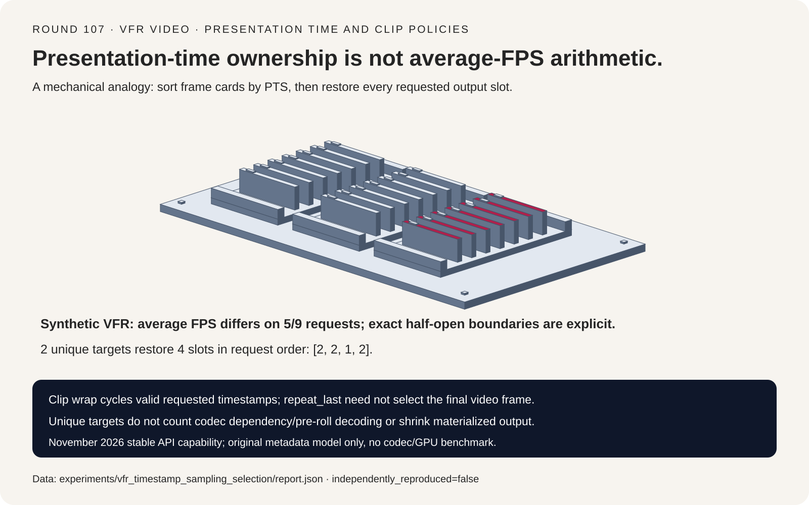
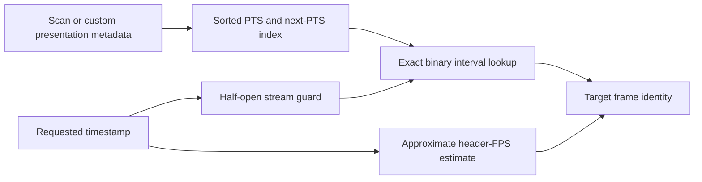
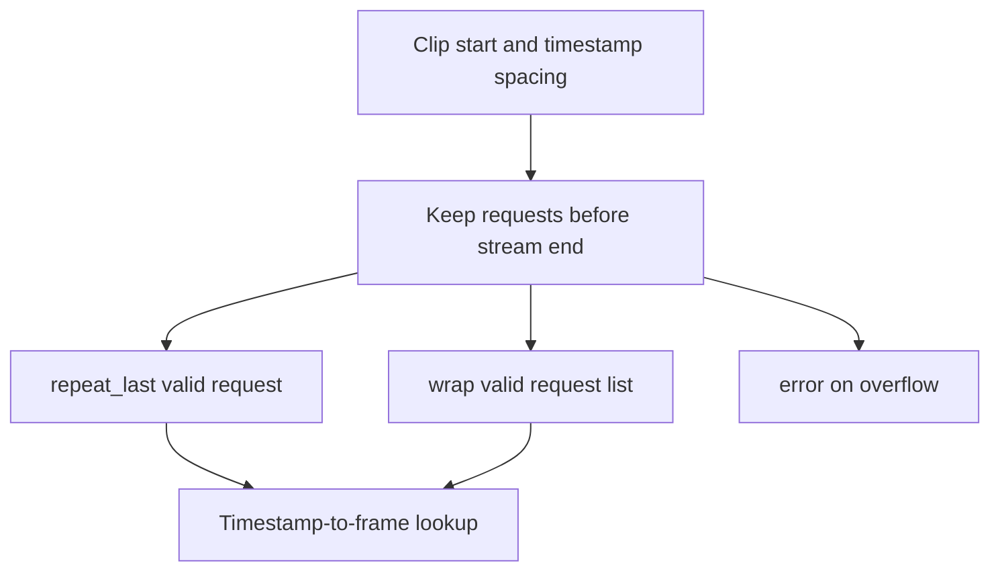
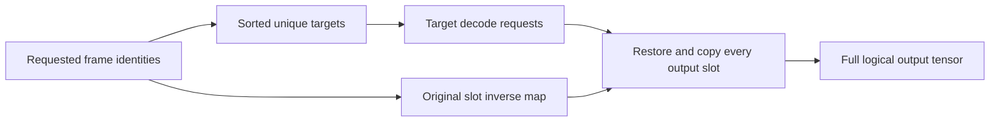

# VFR video FAQ: presentation-time sampling, clip tails and duplicate output slots

> **Language**: [中文](vfr-video-timestamp-clip-sampling-selection-faq.md) | English
>
> **Round 107 · 2026-11-14 (sixteenth round of the November 13 night)** · [SVG](../../assets/svg/vfr-video-timestamp-clip-sampling-selection-faq-summary.svg) · [7-card report](../reports/vfr-video-timestamp-clip-sampling-selection-cards.html) · [H5 workbench](../reports/vfr-video-timestamp-clip-sampling-sizer.html) · [Sealed report](../../experiments/vfr_timestamp_sampling_selection/report.json)
>
> **Synthetic, `independently_reproduced=false`.** Only original Python CPU metadata lookup was timed. No TorchCodec/FFmpeg/NVDEC execution, actual codec-decoded frame count, GPU throughput, video-model accuracy or peak-HBM observation.



## 1. Executive summary: a timestamp request is not an average-FPS frame number

The pinned November 9, 2026 TorchCodec change graduates low-level
decoder APIs from BETA to stable. This is a recent integration
capability, not the invention of presentation-time lookup or a claim
of daily popularity.

In the original five-frame variable-frame-rate fixture, the header
average FPS estimate selects a different frame on **five of nine**
timestamp requests. Exact presentation-time lookup and an independent
interval oracle agree. Approximate access is a documented different
contract, not a source bug.

| Contract | Preserve | Do not infer |
| :--- | :--- | :--- |
| Presentation time | Sorted PTS, stream origin, half-open ownership | Average FPS makes VFR uniform |
| Clip tails | Explicit repeat_last/wrap/error policy | Wrap means modulo over the video |
| Batch output | Original request order and repeated slots | Deduplicate means return fewer output rows |
| Decode work | Codec dependency and seek behavior | Unique requested targets count all decoded frames |

Original arithmetic uses unique increasing integer PTS with declared
next-PTS hold intervals. It is not a float-second, container-parser,
packet/frame-correspondence or decoder implementation reproduction.

## 2. Architect Q&A: which semantics survive batching and sampling?

### Q1: Why does average FPS select a different VFR frame?

At 1,000 ticks/second, PTS are `[1000,1040,1080,1200,1240]`
and stream end is 1400. Hold intervals are 40/40/120/40/160 ticks.
Even the aggregate average `5/.4=12.5 FPS` does not describe each
frame's presentation interval.

The exact rule is `PTS[i] <= t < next_PTS[i]`, with the last interval
ending at the declared stream end. At tick 1040, frame one—not zero—
owns the request. The source's approximate formula is
`floor((seconds-begin_seconds)*header_average_fps)`, which selects
zero there. In our nine-request fixture it disagrees five times.

By contrast, a five-frame constant-40-tick timeline and matching
25 FPS agree on all 200 valid integer-tick requests. This is a
controlled distinction between CFR and VFR, not a model-quality score.

### Q2: What do “exact” and stream origin mean?

The inspected exact path scans/indexes presentation timestamps, sorts
frame metadata and uses next-PTS binary lookup. Custom frame mappings
can supply accurate metadata without a full scan. Approximate mode
instead uses header metadata; the documented frame-index guarantee
is different.

The stream interval is `[begin,end)`. Our 1000-tick origin is not zero:
forgetting it produces raw indices 12–17 for a five-frame stream.
The model records that invalid negative control; it never silently
clamps indices into a valid-looking last frame.

Uniformly shifting PTS and requests, including to a negative origin,
preserves identities. Duplicate or nonincreasing PTS are rejected by
the toy rather than normalized by an unreviewed rule. Real container
timestamps, packet order, discontinuities and codec reordering require
native tests. Synthetic unsorted records merely demonstrate why the
presentation index is sorted; they do not simulate actual B-frame decoding.

### Q3: Can batching deduplicate target frames without changing output?

Yes, if every original slot and its order are restored. Requests
`[1190,1100,1041,1080]` target frame indices `[2,2,1,2]`.
Only target identities `[1,2]` are unique, but the result still needs
four slots with inverse map `[1,1,0,1]`.

The inspected batch path converts timestamps to frame indices,
leverages index deduplication and copies repeated output slots.
Returning only two sorted frames would change the API.

**Two unique target identities do not mean only two actual decoded
frames.** Codec reference dependencies, keyframe seeks and pre-roll
can decode additional frames. The original model keeps actual decoded
frame count and decoder latency null.

### Q4: Does the clip `wrap` policy wrap time around the whole video?

The inspected time-based sampler first builds valid requested
timestamps, then applies its padding policy to that list.

For start 1160, five requested frames and spacing 80 ticks, valid
timestamps are `[1160,1240,1320]`. Source-style wrap produces
`[1160,1240,1320,1160,1240]`, frame indices `[2,4,4,2,4]`.
Taking every raw timestamp modulo the entire stream instead produces
indices `[2,4,4,0,2]`: a different sampler.

`repeat_last` repeats the last **valid requested timestamp**, not
necessarily the video's final frame. Start 1190, spacing 300 and four
slots yields `[2,2,2,2]`, even though the final video frame has index
four. `error` explicitly rejects overflow. The exact stream endpoint
is excluded, not automatically clamped.

### Q5: Does deduplication shrink the returned tensor allocation?

Not a materialized output that preserves every slot. The H5 default
32 clips × 16 frames × 3 channels × 224 × 224 × one byte has
**512 slots and 77,070,336 logical tensor bytes**.

With 400 synthetic unique targets, a hypothetical separate unique
tensor would have 60,211,200 bytes. That is not a guaranteed decoder
allocation or actual memory saving. PTS/duration float64 metadata
takes 8192 bytes and int64 output indices 4096 bytes in the selected
logical budget.

Unique targets are user-supplied, not guessed from average FPS.
Codec surfaces, frame pitch, color conversion, intermediate tensors,
seek pre-roll and allocator state are excluded. None of these
payloads establishes peak HBM.

## 3. Visual architecture: index PTS, construct requests, restore slots







## 4. Selection matrix: choose temporal guarantees before decoder speed

| Choice | Good fit | Gate before adoption |
| :--- | :--- | :--- |
| Exact PTS lookup | Temporal identity matters | Correct indexed metadata; account for scan/custom mapping |
| Approximate metadata indexing | Accept documented estimate | Quantify VFR disagreements; preserve origin |
| Time-based clips | Real-time spacing matters | Half-open bounds and explicit tail policy |
| Index-based clips | Frame-count spacing is intended | Do not call it uniform temporal spacing on VFR |
| Batched target deduplication | Repeated frame requests | Restore slots/order; do not infer total decode work |

The high-level time sampler may use `1/average_fps` as its default
timestamp spacing. That does not make the timestamp lookup itself
an average-FPS index calculation: they are different stages.
The metadata-only budget certifies neither native dtype support nor
any CUDA backend configuration.

## 5. Hands-on: sealed lookup evidence, not decoder throughput

```powershell
python -m experiments.vfr_timestamp_sampling_selection.run
python -m unittest tests.test_vfr_timestamp_sampling_selection -q
python -m experiments.vfr_timestamp_sampling_selection.run --check
```

`--measure` explicitly replaces `latency.json`; ordinary generation
and checking never remeasure. Tests cover every integer tick of the
main interval, exact boundaries, origin shifts, CFR control, duplicate
slot reconstruction, clip policies and Python/JavaScript budget parity.

ARM64 Python 3.12.10 CPU medians, two warmups and seven alternating
repeats; each tier has 128 requests:

| Indexed frames | Binary lookup, ms | Linear interval oracle, ms |
| ---: | ---: | ---: |
| 64 | .0454 | .4262 |
| 256 | .0486 | 1.4783 |
| 1024 | .0642 | 9.8754 |
| 4096 | .0708 | 36.7872 |

The PTS table already exists. The linear oracle constructs interval
tuples on each call; both paths validate requests. Noisy shared-host
raw samples are retained. File scanning, I/O, codec decoding, seeks,
conversion and tensor output are excluded: these are not TorchCodec
or NVDEC performance results.

Seven static 900×1125 cards use strict CSP
`default-src 'none'; style-src 'unsafe-inline'`. H5 has only inline
code and visible input errors; the original SVG is 1600×1000.
No browser inspection was performed; the previous browser refusal
continues to be respected.

## 6. Sources, provenance and boundaries

- [November 9 stable low-level API graduation](https://github.com/pytorch/torchcodec/commit/be5a80b79e19d928125a660f3c8f067af1fe6866):
  a recent API milestone, not a new timestamp algorithm.
- [Pinned decoder interface](https://github.com/pytorch/torchcodec/blob/be5a80b79e19d928125a660f3c8f067af1fe6866/src/torchcodec/decoders/_video_decoder.py):
  exact/approximate guarantees, custom mappings and timestamp bounds.
- [Pinned native index and batch logic](https://github.com/pytorch/torchcodec/blob/be5a80b79e19d928125a660f3c8f067af1fe6866/src/torchcodec/_core/SingleStreamDecoder.cpp):
  PTS sorting, exact/approximate lookup, duplicate targets and copied slots.
- [Pinned time-based sampler](https://github.com/pytorch/torchcodec/blob/be5a80b79e19d928125a660f3c8f067af1fe6866/src/torchcodec/samplers/_time_based.py)
  and [padding policies](https://github.com/pytorch/torchcodec/blob/be5a80b79e19d928125a660f3c8f067af1fe6866/src/torchcodec/samplers/_common.py).
- [BSD-3-Clause license](https://github.com/pytorch/torchcodec/blob/be5a80b79e19d928125a660f3c8f067af1fe6866/LICENSE).

Upstream rights remain with their holders. No source implementation,
encoded video, dataset or model weights are vendored. Original metadata
and tensor shapes are synthetic; original CPU lookup timing is separately
measured. Actual decoded frame count, decoder/GPU latency, model quality
and peak HBM remain null.
