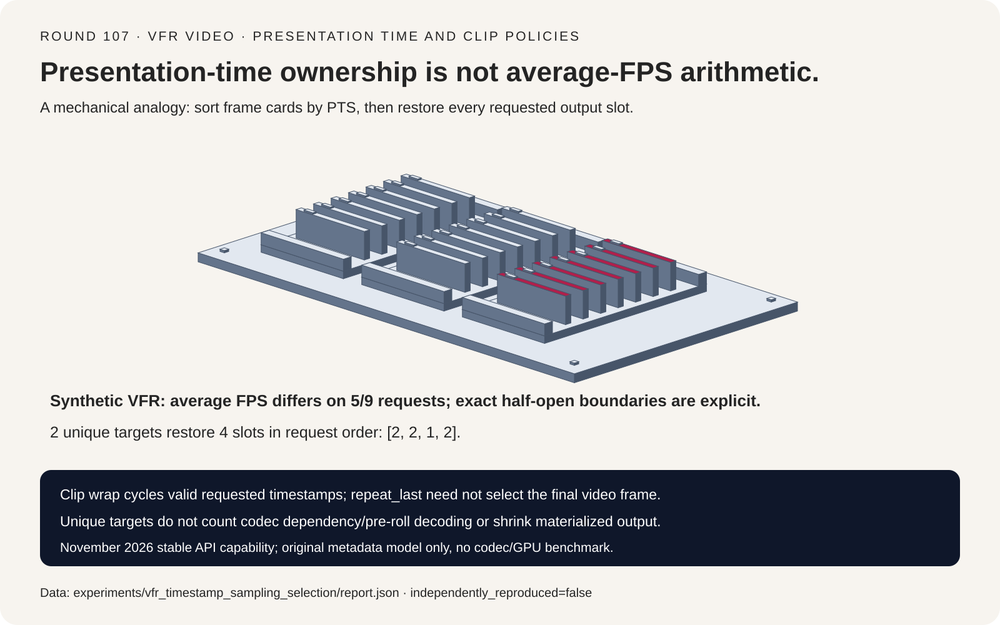
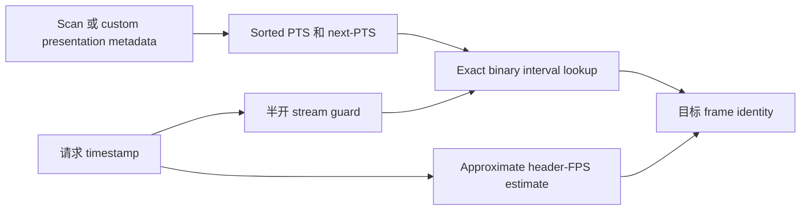
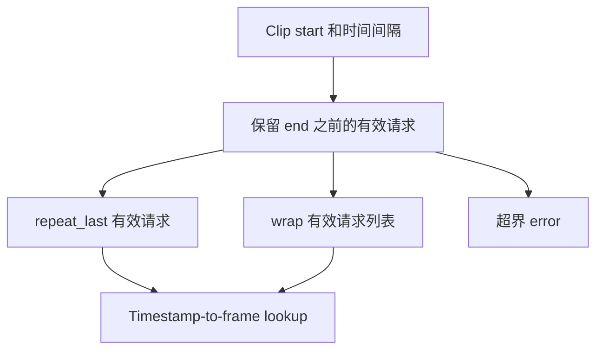
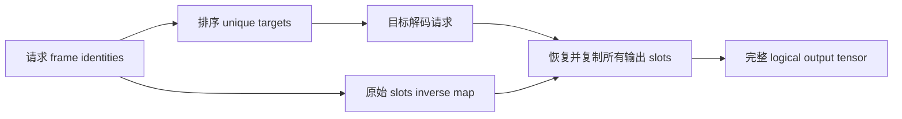

# VFR 视频采样选型 FAQ：PTS、Clip 尾部策略与重复输出位置

> **语言**：中文 | [English](vfr-video-timestamp-clip-sampling-selection-faq.en.md)
>
> **Round 107 · 2026-11-14（11 月 13 日夜班第十六轮）** · [高清 SVG](../../assets/svg/vfr-video-timestamp-clip-sampling-selection-faq-summary.svg) · [七卡报告](../reports/vfr-video-timestamp-clip-sampling-selection-cards.html) · [H5 工作台](../reports/vfr-video-timestamp-clip-sampling-sizer.html) · [封存数据](../../experiments/vfr_timestamp_sampling_selection/report.json)
>
> **Synthetic，`independently_reproduced=false`。** 仅原创 Python CPU metadata lookup 实测；未运行 TorchCodec/FFmpeg/NVDEC，未测实际 codec 解码帧数、GPU throughput、视频模型精度或 peak HBM。



## 1. 一句话结论：时间戳请求不是平均 FPS 换算出来的帧号

固定的 TorchCodec 2026-11-09 变更把 low-level decoder APIs 从 BETA
升级为 stable。这是近期集成能力，不代表 PTS 算法刚被发明，
也不声称未经核验的日榜热度。

原创五帧 variable-frame-rate 例子中，header average FPS 对九次时间戳请求
有 **五次**选择了不同帧。Exact PTS lookup 与独立 interval oracle
一致；approximate 本来就是不同契约，不是 source bug。

| 契约层 | 必须保留 | 不能推断 |
| :--- | :--- | :--- |
| Presentation time | Sorted PTS、stream origin、半开区间归属 | 平均 FPS 让 VFR 变成均匀帧率 |
| Clip 尾部 | 显式 repeat_last/wrap/error | Wrap 就是对整段视频时长取模 |
| Batch 输出 | 原始顺序和每个重复位置 | Deduplicate 就返回更少行 |
| Decode work | Codec dependency 与 seek 行为 | 唯一目标数等于实际解码帧数 |

原创模型使用唯一递增的整数 PTS 和声明的 next-PTS hold intervals，
不复现 float-second rounding、container parsing、
packet/frame 对应关系或真实 decoder。

## 2. 架构师 Q&A：哪些语义必须贯穿采样和批处理？

### Q1：平均 FPS 为什么会选到不同的 VFR 帧？

每秒 1000 ticks，PTS 为 `[1000,1040,1080,1200,1240]`，
stream end 为 1400；hold intervals 为 40/40/120/40/160 ticks。
即使 aggregate average 是 `5/.4=12.5 FPS`，
也描述不了每个 frame 的展示区间。

Exact 归属为 `PTS[i]<=t<next_PTS[i]`，最后一帧到声明的 end。
Tick 1040 属于 frame one，不属于 zero。
Source approximate 公式
`floor((seconds-begin_seconds)*header_average_fps)` 却选 zero；
九请求 fixture 有五处不同。

对照组是每帧 40 ticks、匹配 25 FPS 的五帧 CFR：
200 个合法整数 tick 全部一致。这是 CFR/VFR 的受控区别，
不是模型质量分数。

### Q2：Exact 与 stream origin 各承诺什么？

所查 exact 路径扫描/索引 presentation metadata，
排序后按 next-PTS 做 binary lookup；
custom frame mappings 可提供准确 metadata，省去完整扫描。
Approximate 则使用 header metadata，其 frame-index 保证不同。

Stream 区间是 `[begin,end)`。本例 begin 为 1000，不是零：
漏减 origin 会把五帧视频换算成 raw indices 12–17。
模型明确记录该非法负例，不 clamp 到最后一帧伪造成功结果。

PTS 与 requests 一起平移，包括平移到负 origin，
应保留相同 frame identity。
Toy 拒绝重复或非递增 PTS，不擅自定义 normalization。
真实 container timestamp、packet order、discontinuity 和 codec reorder
需 native tests。Synthetic 未排序记录只展示索引排序，
不是模拟真实 B-frame decode。

### Q3：Batch 去重能不改变返回结果吗？

可以，但必须恢复每个原始 slot 和顺序。
Requests `[1190,1100,1041,1080]` 对应 indices `[2,2,1,2]`，
只有 `[1,2]` 两个 unique target，却仍需四个输出位置，
inverse map 为 `[1,1,0,1]`。

所查 batch 路径先把 timestamps 变成 indices，
复用 index deduplication 并复制重复 output slots。
只返回两个排序后的 unique frames 会改变 API。

**两个 unique targets 不表示实际只解码两帧。**
Codec reference dependencies、keyframe seek 和 pre-roll
可能解码额外帧。本模型 actual decoded count 和 decoder latency 保持 null。

### Q4：Clip 的 wrap 是绕整段视频循环吗？

所查 time-based sampler 先构造仍在 stream end 之前的
**有效请求 timestamp list**，再对这个 list 应用 padding。

Start 1160、五帧、间隔 80 ticks，
有效请求为 `[1160,1240,1320]`；
source-style wrap 得到 `[1160,1240,1320,1160,1240]`，
帧号 `[2,4,4,2,4]`。
如果把 raw timestamps 对整段视频取模，
会变成 `[2,4,4,0,2]`，已经是另一种 sampler。

`repeat_last` 重复最后一个**有效请求时间**，
未必是视频最后一帧。
Start 1190、间隔 300、四个 slots 会得到 `[2,2,2,2]`，
尽管视频末帧 index 为四。
`error` 显式拒绝超界；精确 end 被排除，不自动 clamp。

### Q5：Deduplication 会缩小返回 tensor allocation 吗？

保留所有 slots 的 materialized output 不会。
工作台默认 32 clips × 16 frames × 3 channels × 224 × 224 × 一字节，
共 **512 slots、77,070,336 logical tensor bytes**。

输入假设 unique targets 为 400 时，
另一个假想 unique tensor payload 为 60,211,200 bytes，
不代表 decoder 保证分配它或节省这些内存。
所选 logical budget 的 PTS/duration float64 metadata 为 8192 bytes，
int64 output indices 为 4096 bytes。

Unique targets 是用户输入，不从平均 FPS 猜测。
Codec surfaces、pitch、color conversion、中间 tensor、
seek pre-roll、allocator 均未计入，因此不能冒充 peak HBM。

## 3. 可视化架构：索引 PTS、构造请求、恢复输出位置







## 4. 选型矩阵：先选时间保证，再比较 decoder 性能

| 选择 | 适用点 | 采用前的验收门 |
| :--- | :--- | :--- |
| Exact PTS | 时间位置必须准确 | 准确 metadata index；计入 scan/custom mapping 成本 |
| Approximate metadata index | 接受文档化的估算 | 核验 VFR 差异、保留 origin |
| Time-based clips | 真实时间间隔重要 | 半开边界与显式尾部策略 |
| Index-based clips | 明确需要按帧数间隔 | VFR 上不要称为等时间采样 |
| Batch target dedup | 有重复 frame requests | 恢复全部 slots/order；不要推断总 decode work |

高层 time sampler 可以把 `1/average_fps` 当作默认 timestamp spacing。
这不意味着它随后的 timestamp lookup 也用平均 FPS 换算帧号；
二者是不同阶段。Metadata-only 工作台不认证 native dtype 或 CUDA backend 配置。

## 5. 动手验证：封存 lookup 证据，不测 decoder throughput

```powershell
python -m experiments.vfr_timestamp_sampling_selection.run
python -m unittest tests.test_vfr_timestamp_sampling_selection -q
python -m experiments.vfr_timestamp_sampling_selection.run --check
```

`--measure` 显式替换 `latency.json`，普通生成和检查不重测。
测试覆盖主区间每个整数 tick、精确边界、origin 平移、CFR 对照、
重复 slot 恢复、clip policies 和 Python/JavaScript budget parity。

ARM64 Python 3.12.10 CPU median，两个 warmup、七轮交替；
每 tier 128 次请求：

| Indexed frames | Binary lookup / ms | Linear interval oracle / ms |
| ---: | ---: | ---: |
| 64 | .0454 | .4262 |
| 256 | .0486 | 1.4783 |
| 1024 | .0642 | 9.8754 |
| 4096 | .0708 | 36.7872 |

PTS table 已存在；linear oracle 每次构造 interval tuples，
两者都校验 requests。保留共享主机上的有噪声 raw samples，
不筛掉慢样本。文件扫描、I/O、codec decoding、seek、
转换与 tensor 输出均排除，因此不是 TorchCodec/NVDEC benchmark。

七卡为 900×1125 静态自包含 HTML，CSP
`default-src 'none'; style-src 'unsafe-inline'`。
H5 仅内联代码、输入错误可见；原创 SVG 为 1600×1000。
未做 browser 检查，继续尊重此前 browser-operation 拒绝。

## 6. 来源、许可证和边界

- [2026-11-09 stable low-level API graduation](https://github.com/pytorch/torchcodec/commit/be5a80b79e19d928125a660f3c8f067af1fe6866)：
  近期 API 里程碑，不是新的 timestamp 算法。
- [固定 decoder interface](https://github.com/pytorch/torchcodec/blob/be5a80b79e19d928125a660f3c8f067af1fe6866/src/torchcodec/decoders/_video_decoder.py)：
  exact/approximate、custom mappings 与 timestamp bounds。
- [固定 native index/batch logic](https://github.com/pytorch/torchcodec/blob/be5a80b79e19d928125a660f3c8f067af1fe6866/src/torchcodec/_core/SingleStreamDecoder.cpp)：
  PTS sorting、两种 lookup、重复 targets 与 slot copying。
- [固定 time-based sampler](https://github.com/pytorch/torchcodec/blob/be5a80b79e19d928125a660f3c8f067af1fe6866/src/torchcodec/samplers/_time_based.py)
  与 [padding policies](https://github.com/pytorch/torchcodec/blob/be5a80b79e19d928125a660f3c8f067af1fe6866/src/torchcodec/samplers/_common.py)。
- [BSD-3-Clause license](https://github.com/pytorch/torchcodec/blob/be5a80b79e19d928125a660f3c8f067af1fe6866/LICENSE)。

上游权利保留；未 vendoring source 实现、编码视频、数据集或权重。
原创 metadata/tensor shapes 为 synthetic，CPU lookup timing 单独 measured。
实际解码帧数、decoder/GPU latency、模型质量和 peak HBM 均保持 null。
