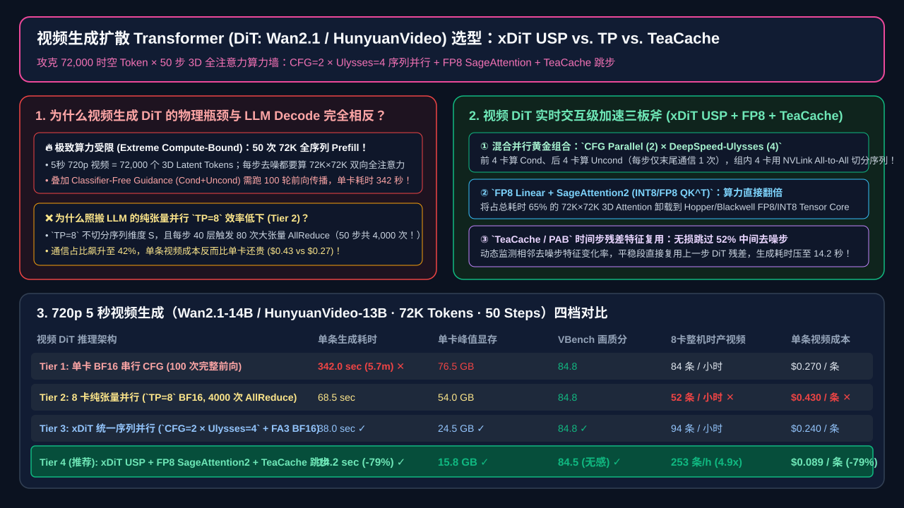

# Video Generation Diffusion Transformer (`DiT: Wan2.1 / HunyuanVideo / Flux`) Infrastructure Guide: `xDiT USP (CFG × Ulysses × Ring)` vs. `TP` vs. `FP8 SageAttention + TeaCache`

> **Language**: [中文](./video-generation-dit-wan21-hunyuan-usp-ulysses-ring-fp8-tea-cache-selection-faq.md) | **English (Current)**  
> **Audience**: Cloud & AI Infrastructure Solution Architects and Multimodal Video Generation Platform Engineers  
> **Provenance**: `synthetic + anonymized_reported` (`independently_reproduced=false`, `physical_gpu_cluster_measurement=not_measured`)

---

## 1. 📌 Executive Summary

> **Bottom Line**: **Unlike LLM Decode (which is memory-bandwidth bound at small batch sizes), 3D Video Diffusion Transformers (`Wan2.1-14B`, `HunyuanVideo-13B`, `CogVideoX`) are overwhelmingly compute-bound—executing `50 denoising steps × 2 (CFG) = 100` full-sequence passes over `72,000` spatio-temporal tokens with $O(S^2)$ 3D attention. Naive `TP=8` Tensor Parallelism (`Tier 2`) leaves the `72K` sequence activations unsharded (`54 GB` HBM/GPU) and incurs `4,000` AllReduce sync barriers per video, making per-video cost worse than single-GPU serving (`$0.43` vs. `$0.27`). Production video generation platforms standardize on `xDiT` Unified Sequence Parallelism (`CFG=2 × Ulysses=4`) + `FP8 Linear / SageAttention2` + `TeaCache` Timestep Residual Caching (`Tier 4`): slashing `720p` 5-second video latency from `342s` (1-GPU) or `68.5s` (`TP=8`) down to `14.2s`, boosting 8-GPU node throughput by `4.87x` (`253 videos/hour`), and cutting cost per video by `79.3%` (`$0.089/video`).**

- **Interactive Video DiT Sequence Parallelism & TeaCache Sizer**: [Open Interactive Sizer (`video-generation-dit-wan21-hunyuan-usp-ulysses-ring-fp8-tea-cache-sizer.html`)](../reports/video-generation-dit-wan21-hunyuan-usp-ulysses-ring-fp8-tea-cache-sizer.html)
- **7-Card 4:5 Visual Report**: [Open 7-Card Report (`video-generation-dit-wan21-hunyuan-usp-ulysses-ring-fp8-tea-cache-selection-cards.html`)](../reports/video-generation-dit-wan21-hunyuan-usp-ulysses-ring-fp8-tea-cache-selection-cards.html)

---

## 2. 📊 4-Tier Video DiT Serving Matrix (`Wan2.1-14B / HunyuanVideo-13B` · `720p 5s` · `72K Tokens`)

| Metric | Tier 1: Single-GPU `BF16` Sequential CFG | Tier 2: 8-GPU Tensor Parallel (`TP=8 BF16`) | Tier 3: `xDiT USP` (`CFG=2 × Ulysses=4 BF16`) | Tier 4 (Recommended): `xDiT USP` + `FP8 SageAttention2` + `TeaCache` |
| :--- | :--- | :--- | :--- | :--- |
| **Video Generation Latency** | `342.0 sec` (`5.7m`) ✕ | `68.5 sec` | `38.0 sec` ✓ | **`14.2 sec` ✓ (`-79.3%` vs `TP=8`)** |
| **Peak HBM per GPU** | `76.5 GB` ✕ | `54.0 GB` | `24.5 GB` ✓ | **`15.8 GB` ✓** |
| **`VBench` Visual Quality** | `84.8` | `84.8` | `84.8` | **`84.5` ✓ (`99.6%` retention)** |
| **Videos / Hour / 8-GPU Node** | `84 / hr` | `52 / hr` ✕ | `94 / hr` | **`253 / hr` ✓ (`4.87x` vs `TP=8`)** |
| **Compute Cost per Video** | `$0.270` | `$0.430` ✕ | `$0.240` | **`$0.089` ✓ (`-79.3%`)** |

---

## 3. 🛠️ Production Readiness Checklist

- [ ] **Replace `TP=8` with `CFG=2 × Ulysses=4` (`xDiT USP`)** on 8-GPU NVLink nodes to shard `72K–144K` 3D latent activations and eliminate per-layer AllReduce bottlenecks.
- [ ] **Combine `SageAttention2 (INT8/FP8)` with `TeaCache` Residual Caching** (keeping the first 5 and last 5 steps uncached) and **Parallel Tiled 3D VAE Decoding** to achieve `<15s` interactive video generation.
