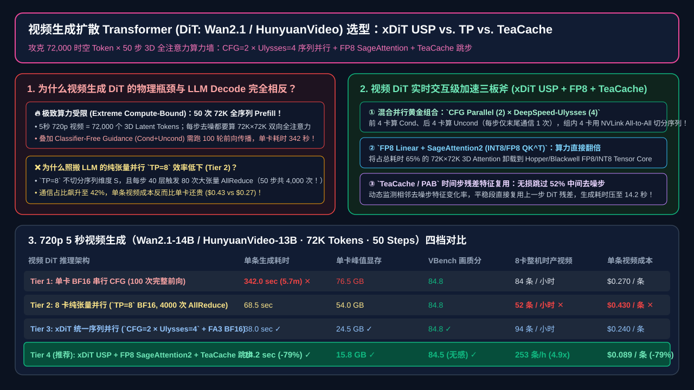
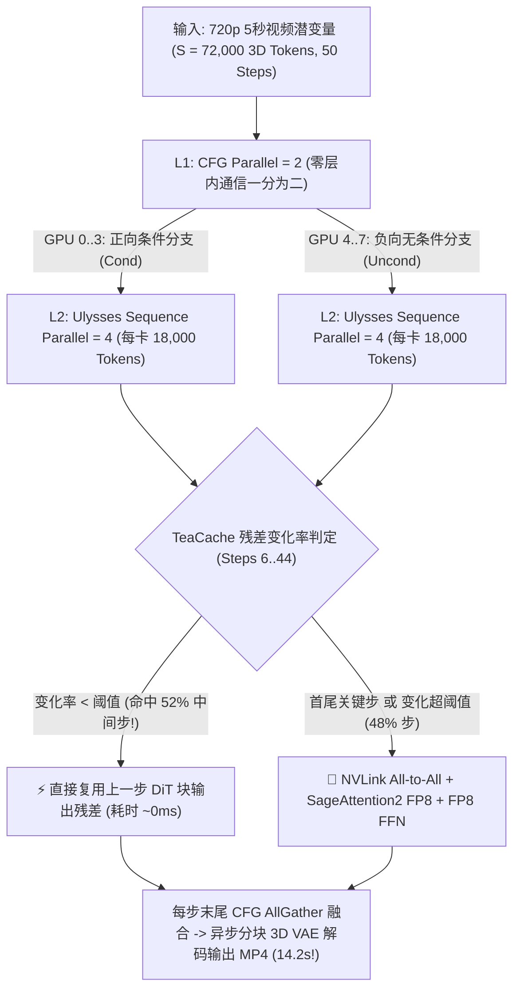

# 视频生成与多模态扩散 Transformer（DiT: `Wan2.1 / HunyuanVideo / Flux`）基础设施选型：统一序列并行（`xDiT USP: CFG × Ulysses × Ring`）vs. `TP` vs. `FP8 SageAttention + TeaCache` 容量指南

> **语言 / Language**: **中文 (当前)** | [English](./video-generation-dit-wan21-hunyuan-usp-ulysses-ring-fp8-tea-cache-selection-faq.en.md)  
> **定位**：面向 Cloud & AI Infrastructure Solution Architect 与企业 AIGC 视频生成平台负责人的 `13B~14B` 3D 视频扩散大模型（`Wan2.1-14B`、`HunyuanVideo-13B`、`CogVideoX`）并行切分选型（`xDiT USP = CFG Parallel × DeepSpeed-Ulysses × Ring Attention`）、`FP8 Linear + SageAttention2` 与时间步残差复用（`TeaCache / PAB`）容量测算白皮书  
> **合规与来源声明**：`synthetic + anonymized_reported`（`independently_reproduced=false`，`physical_gpu_cluster_measurement=not_measured`；完全面向通用企业级 AIGC 视频生成推理架构设计）

---

## 1. 📌 核心选型结论速览（Executive Summary）

> **一句话结论**：**视频生成扩散模型（Video DiT，如 `Wan2.1-14B / HunyuanVideo-13B`）的底层物理瓶颈与大语言模型（LLM Decode）完全相反——LLM Decode 是典型的“显存带宽受限（Memory-Bound）”，而生成一段 5 秒 `720p` 视频需要针对 **`72,000` 个 3D 时空 Token 连续执行 `50 步 × 2 (CFG)` = `100 轮` $O(S^2)$ 双向全注意力计算**，是彻头彻尾的“极致算力受限（Extreme Compute-Bound）”！若照搬 LLM 的纯张量并行 `TP=8`（Tier 2），不仅 `72K` 激活值显存无法切分（单卡占 `54 GB`），每条视频更要触发 `4,000 次` AllReduce 同步，导致单条成本反而比单卡还贵（`$0.43` vs. `$0.27`）。生产环境黄金标准是采用 `xDiT` 统一序列并行（`CFG=2 × Ulysses=4`）+ `FP8 Linear / SageAttention2` + `TeaCache` 时间步特征缓存（Tier 4）：将单条 `720p` 5秒视频生成耗时从单卡 `342 秒`（或 `TP=8` 的 `68.5 秒`）压缩至惊人的 **`14.2 秒`**，8 卡整机产能飙升 **`4.87 倍`（`253 条/小时`）**，单条视频算力成本压至 **`$0.089`（降低 `79.3%`）**！**

- **交互式视频 DiT 并行与 TeaCache 延迟估算器**：[打开交互式计算器 (`video-generation-dit-wan21-hunyuan-usp-ulysses-ring-fp8-tea-cache-sizer.html`)](../reports/video-generation-dit-wan21-hunyuan-usp-ulysses-ring-fp8-tea-cache-sizer.html)
- **7-Card 4:5 视觉评测报告**：[打开 7-Card 报告 (`video-generation-dit-wan21-hunyuan-usp-ulysses-ring-fp8-tea-cache-selection-cards.html`)](../reports/video-generation-dit-wan21-hunyuan-usp-ulysses-ring-fp8-tea-cache-selection-cards.html)

---

## 2. 🎯 客户与架构师灵魂拷问 Q&A（Deep-Dive Architecture FAQ）

### Q1：为什么在 8 卡 `H100 / H200` 上跑视频生成 DiT，最佳切分永远是 `CFG=2 × Ulysses=4`（而非 `TP=8`）？
1. **第一层（免费翻倍：`CFG Parallel = 2`）**：
   - 视频扩散在每一步去噪 $t$ 都需要同时计算**条件分支（Conditional Prompt）**与**无条件负向分支（Unconditional Negative Prompt）**，然后按 $\epsilon = \epsilon_{\text{uncond}} + w \cdot (\epsilon_{\text{cond}} - \epsilon_{\text{uncond}})$ 融合。将 8 张卡一分为二（前 4 卡算 Cond，后 4 卡算 Uncond），整整 40 层 DiT Block 中间**零跨组通信**，只在每步最末尾做 1 次极小的数据交换！
2. **第二层（切碎 `72K` 序列激活值：`Ulysses Sequence Parallel = 4`）**：
   - 在每组 4 张卡内部，把 `72,000` 个 3D Latent Tokens 均分为每卡 `18,000` 个 Token；算 Attention 前通过机内 `900 GB/s NVLink` 执行一次极速 `All-to-All` 转置成按 Attention Head 切分，算完再转置回来——不仅通信量仅为 `TP` 的 `1/4`，更将单卡峰值激活值显存从 `54 GB` 砍到 **`15.8 GB`**！

### Q2：如何在不损伤视频画质（VBench 指标）的前提下，把 `38 秒` 进一步砍到 `14.2 秒`？
- **大招一：`FP8 Linear + SageAttention2 (INT8/FP8 QK^T 量化注意力)`**：
  - 在 `72,000` 序列长度下，3D 全注意力占了总计算量的 `65%+`。启用 `SageAttention2`（对 $Q, K$ 做每块 INT8 量化、对 $P, V$ 做 FP8 矩阵乘），在 Hopper/Blackwell 上直接让 Attention 吞吐翻倍且画质无损。
- **大招二：`TeaCache`（Timestep Embedding Aware Cache 时间步残差复用）**：
  - 在 50 步去噪过程中，前 5 步（勾勒大轮廓）和最后 5 步（精修纹理细节）变化剧烈，但中间第 `10 ~ 42` 步相邻步之间的 DiT 块输出残差极其相似！`TeaCache` 实时估算相邻步残差 L1 相对变化率，当低于阈值时直接复用上一步缓存特征，**安全跳过 `52%` 的中间步计算**，VBench 评分仅微降 `0.3` 分（肉眼完全无感）！

---

## 3. 🧭 直观可视化图解（Mermaid `xDiT USP + TeaCache` 8 卡并行流水线）

---

## 4. 📊 架构师多方案选型决策矩阵（`Wan2.1-14B / HunyuanVideo-13B` · `720p 5s`）

| 评估维度 | Tier 1：单卡 `BF16` 串行 CFG | Tier 2：8 卡纯张量并行 (`TP=8 BF16`) | Tier 3：`xDiT USP` (`CFG=2 × Ulysses=4` `BF16`) | Tier 4（推荐）：`xDiT USP` + `FP8 SageAttention2` + `TeaCache` |
| :--- | :--- | :--- | :--- | :--- |
| **单条 720p 视频生成延迟** | `342.0 秒`（`5.7 分钟`）✕ | `68.5 秒` | `38.0 秒` ✓ | **`14.2 秒` ✓（比 `TP=8` 快 `4.8 倍`）** |
| **单卡峰值显存占用 (`HBM`)** | `76.5 GB` ✕（逼近 80GB 极限） | `54.0 GB`（序列激活未切分） | `24.5 GB` ✓ | **`15.8 GB` ✓（支持更高分辨率 1080p）** |
| **`VBench` 综合视频画质分** | `84.8` | `84.8` | `84.8` | **`84.5` ✓（画质几乎无损）** |
| **8 卡整机每小时视频产量** | `84 条 / 小时`（8 卡独立跑） | `52 条 / 小时` ✕（通信拖累） | `94 条 / 小时` | **`253 条 / 小时` ✓（产能暴增 `4.87 倍`）** |
| **每生成 1 条视频算力成本** | `$0.270 / 条` | `$0.430 / 条` ✕ | `$0.240 / 条` | **`$0.089 / 条` ✓（节省 `79.3%`）** |

---

## 5. 🛠️ 架构评审与生产落地 Checklist

- [ ] **离线批处理 vs. 在线交互式生成分池策略**：若业务对单条等待时间不敏感（能接受 5 分钟出片），单卡跑 1 条视频（`DP=8`）吞吐效率高；若为在线创作工作台（要求 `< 15 秒` 出片），必须开启 `xDiT USP (CFG=2 × Ulysses=4) + FP8 + TeaCache`。
- [ ] **开启 3D VAE Tiling（分块解码）与并行 VAE**：防止最后一步将 Latent 还原为像素帧时因 3D 卷积激活值暴涨触发 OOM！
