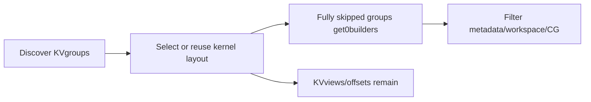
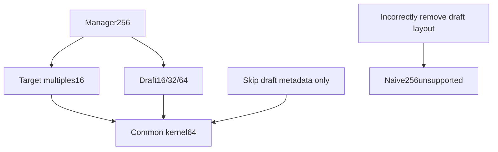
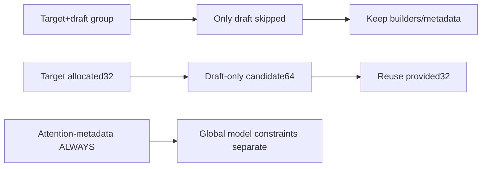

# AI Infra speculative-decode FAQ: context-K/V-only draft,metadata builders and KVkernel layout

> **Language**: English | [中文](vllm-context-kv-only-draft-metadata-layout-selection-faq.md)  
> **Round155 · 2026-11-14daytime**: same-day metadata/lifecycle correction;original plain per-layer planner,no native vLLM/Torch/CUDAgraphs.

**Finding:** Skipping draft metadata does not remove draft KVlayout.Original two-group/two-ubatch builders4→2,synthetic selected workspace4096→0B;kernel64,stride4,logical offsets32Banddense KVpayload524288Bremain.Attention-onlyCGUNIFORM_BATCH→ALWAYSis **not global readiness**.

**Artifacts**:[H5planner](../reports/vllm-context-kv-only-draft-metadata-layout-sizer.html) · [seven cards](../reports/vllm-context-kv-only-draft-metadata-layout-selection-cards.html) · [1600px SVG](../../assets/svg/vllm-context-kv-only-draft-metadata-layout-selection-faq-summary.svg) · [sealed report](../../experiments/draft_metadata_layout_selection/report.json)

## Q1: What is skipped,and what remains?

Pinned **Nov14,06:16:51UTC=14:16:51BJT**correction marks context-only draft layers as no-attention-metadata.Only groups whose**every member is skipped**receive zero builders.Workspace/attention-CG/metadata/RecoverSSMtraversal filters builder-free groups.



Not disabling specdecode or deleting KV.Source prepares all-backend kernel layout before builder gating;drafter reuses target's allocated kernel sizes.

## Q2: Why is builder-free not allocation-free?

Zero builders can retain kernel offsets.A zero builder axis yields no table elements,but arange(manager/kernel)still has entries.Original256/64means4offsets/group,int32logical16B,two groups32B.

Original unpadded widthceil(1024/64)=16withtwo ubatches/maxseq2gives512→256logical table bytes.Native block-table padding,packing,alignment/allocator peak are unmeasured.

4096Bworkspace is synthetic input.Source's new CPUfake getter returns an empty tensor,not measured GPUworkspace.An owned zero-byte buffer still has an ownership/getter event,unlike no owner.

## Q3: How do constraints and token addresses stay valid?



All groups choose the largest supported manager divisor,retaining64.Managerblock3/position250maps kernel15/position58:`3*256+250=15*64+58=1018`.All1024addresses have independent linear-address checks.

Original dense payload4blocks×256tokens×2layers×1head×64dimensions×2B×K/V2=524288Bunchanged.Excludes packed strides,Mamba,PPempty local stages,backend customization/nativepadding.

## Q4: What about mixed groups,provided32andCGscope?



An active target prevents whole mixed-group skipping.Mixed prototype keeps2builders/two metadata names;all-skipped keeps KVpayload/offsets.

Target-only32withdraft16/32/64requires reusing allocated32,not draft-only64.Source set_attn passes allocated sizes.Unused draft builders no longer narrow attention-CG,but additional model-state/capture/varlen/backend constraints remain.Native global readiness isnull.

## Q5: What does original constructor timing measure?

| Candidates | Retained | Gated(ms) | Eager then select(ms) |
| ---: | ---: | ---: | ---: |
| 16 | 4 | 0.000767 | 0.002667 |
| 64 | 16 | 0.002500 | 0.009933 |
| 256 | 64 | 0.009567 | 0.043367 |
| 1024 | 256 | 0.041467 | 0.186533 |

Original dict/private256Bzero-state constructors,25%retained;identical active objects.Two warmups,seven alternating repeats,three operations/sample,median repeat means.Submicrosecond small samples are not GPUperformance.

Excludes selection/input setup,shared native workspace,KVallocation,vLLM/Torch/CUDAgraphs/GPU.Private dummy state is not native shared workspace;candidate count is not model layer count.

## Q6: How can a real context-only drafter be validated?

```powershell
python -m unittest discover -s tests -p test_draft_metadata_layout_selection.py -q
python -m experiments.draft_metadata_layout_selection.run --check
# --measure only executes original CPUdummy constructors.
```

Eight tests covercommon constraints,builder/workspace/CGscope,1024addresses/offset/payload,mixed/allskip,ownedzero/provided32,invalid geometry/support,32randomcases/34Nodefixtures,and four sealed plans/constructor parity.

Sources:[Nov14correction](https://github.com/vllm-project/vllm/commit/165156b59ba013a6353b70237e11366900cb99d3),[initialization phases](https://github.com/vllm-project/vllm/blob/165156b59ba013a6353b70237e11366900cb99d3/vllm/v1/worker/gpu/attn_utils.py),[builders/kernel views](https://github.com/vllm-project/vllm/blob/165156b59ba013a6353b70237e11366900cb99d3/vllm/v1/worker/utils.py),[allocated-layout reuse](https://github.com/vllm-project/vllm/blob/165156b59ba013a6353b70237e11366900cb99d3/vllm/v1/worker/gpu/spec_decode/speculator.py),[CPUfake test](https://github.com/vllm-project/vllm/blob/165156b59ba013a6353b70237e11366900cb99d3/tests/v1/worker/test_attn_utils.py),[LICENSE](https://github.com/vllm-project/vllm/blob/165156b59ba013a6353b70237e11366900cb99d3/LICENSE).Rights retained,no implementation mirror.

Real acceptance checks packing/views/strides,builder ownership,consumers,RecoverSSM/ubatching,global capture,KVquality/latency.Main`synthetic`, `independently_reproduced=false`;CPUseparately`measured`.Native allocation/graph/quality unknown/null.Original60-solid cabinet is not hardware.No browser visual acceptance;prior refusal respected.
