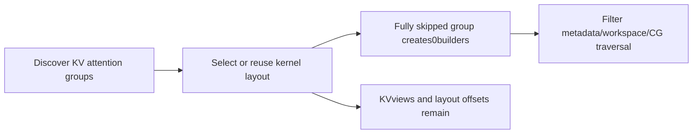
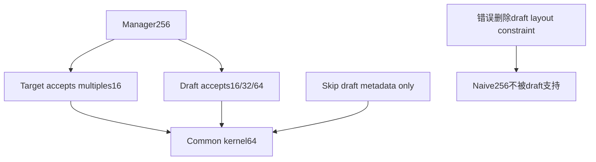
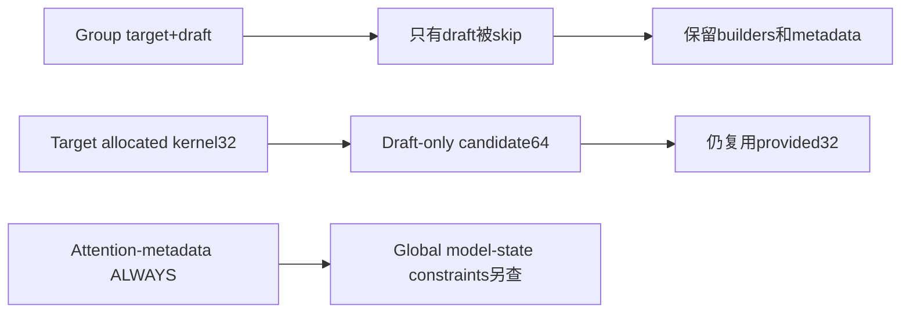

# AI Infra Spec Decode FAQ：Context-K/V-Only Draft、Metadata Builders 与 KV Kernel Layout

> **语言**：中文 | [English](vllm-context-kv-only-draft-metadata-layout-selection-faq.en.md)  
> **Round155 · 2026-11-14白班**：当天vLLM metadata/lifecycle修正；原创plain per-layer planner，无native vLLM/Torch/CUDAgraph执行。

**结论速览**：不需要draft attention metadata，不等于draft KVlayout可删除。原创两group/two-ubatch例builders4→2，draft getter-owned synthetic workspace4096→0B，但kernel64、stride4、logical offsets32B与dense KVpayload524288B仍保留。attention-onlyCG从UNIFORM_BATCH变ALWAYS，**不是global CUDAgraph readiness认证**。

**交付**：[H5 builder/layout planner](../reports/vllm-context-kv-only-draft-metadata-layout-sizer.html) · [7-Card](../reports/vllm-context-kv-only-draft-metadata-layout-selection-cards.html) · [1600px SVG](../../assets/svg/vllm-context-kv-only-draft-metadata-layout-selection-faq-summary.svg) · [sealed report](../../experiments/draft_metadata_layout_selection/report.json)

## Q1：当天修改跳过什么，又保留什么？

固定commit为**Nov14 06:16:51UTC＝14:16:51BJT**。`prefill_context_kv_only`使draft layer names进入no_attn_metadata名单；只对**全部members均在名单内的group**创建0metadata builders。metadata/workspace/attention-CG/RecoverSSM遍历跳过builder-free groups。



不是关闭specdecode，也不是删除draftKV。source先准备all-backend kernel layout再决定builder数量；draft speculator复用target已分配kernel_block_sizes，不能仅看draft backends重新选。

## Q2：为什么“无builders”不意味着“无allocation”？

native创建0builders仍可保留kernel offsets；kernel block table的builder axis为0，table元素数可为0，但`arange(manager/kernel)`仍有entries。原型manager256/kernel64：每group4offsets、int32logical16B；两个group32B。

原型unpadded width=ceil(1024/64)=16，two ubatches/maxseq2：两groups的tablelogical bytes512→256。**native get_block_table_width、packing、alignment与allocator footprint未测**，这不是native peak512→256B。

默认4096Bworkspace是synthetic输入；source新增CPUfake测试的getter返回empty tensor，不提供真实GPUworkspace大小。owner返回zero-byte buffer与no owner不同：前者仍有getter/ownership event，不能都说“没创建”。

## Q3：怎样保持kernel约束与exact token address？



所有layoutgroups共同选择最大合法manager divisor；原型64仍被保留。managerblock3/position250→kernelblock15/position58：`3*256+250 = 15*64+58 = 1018`。1024个独立block/position cases核验exact linear address。

原型K/Vpayload：4blocks×256tokens×2layers×1head×64dims×2B×K/V2＝524288B，不因builders4→2而变化。plain dense per-layer数学排除packed strides、Mamba、PP无本地layer、backend spec customization与nativepadding。

## Q4：Mixed group、provided32与CGsupport有什么边界？



只要mixed group还有active target，不能因与skip名单有intersection就删除整个group。原型mixed仍有2builders/两layer metadata；allgroups skip则builders0，但KVpayload/offsets不消失。

target仅支持32、draft支持16/32/64时，target分配32；draft-only重选64会改变已有layout。source`set_attn`传入allocated sizes，原型也保留32。attention-CG最低support不再被unused draft builder降低，但model-state/additional capture/varlen/backend条件仍须评估，native全局readiness为null。

## Q5：原创constructor计时测到什么？

| Candidate objects | Retained | Gated（ms） | Eager then select（ms） |
| ---: | ---: | ---: | ---: |
| 16 | 4 | 0.000767 | 0.002667 |
| 64 | 16 | 0.002500 | 0.009933 |
| 256 | 64 | 0.009567 | 0.043367 |
| 1024 | 256 | 0.041467 | 0.186533 |

原创dict constructor带256Bprivate zero-state，retained25%；两个paths返回exact相同active objects。2warmups、7轮交替repeat、每sample3operations、median repeat means。submicrosecond小样本只说明这个CPUtoy，不能推出GPU加速。

排除selection/input准备、shared native workspace、KVallocation、vLLM/Torch/CUDAgraphs/GPU。256Bprivate dummy state不是native共享workspace，候选对象数量也不是模型layers数量。

## Q6：怎样复现并验证实际context-only drafter？

```powershell
python -m unittest discover -s tests -p test_draft_metadata_layout_selection.py -q
python -m experiments.draft_metadata_layout_selection.run --check
# --measure只执行原创CPUdummy constructors。
```

八项测试覆盖共同kernel约束、builder/workspace/CGscope、1024addresses/offset/payload数学、mixed/allskip、ownedzero/provided32、非法geometry/不兼容support、32randomcases/34Nodefixtures、四plan sealed report/constructor parity。

来源：[Nov14修正](https://github.com/vllm-project/vllm/commit/165156b59ba013a6353b70237e11366900cb99d3)、[Builder/layout/workspace phases](https://github.com/vllm-project/vllm/blob/165156b59ba013a6353b70237e11366900cb99d3/vllm/v1/worker/gpu/attn_utils.py)、[Kernel views/builders](https://github.com/vllm-project/vllm/blob/165156b59ba013a6353b70237e11366900cb99d3/vllm/v1/worker/utils.py)、[Drafter allocated-layout reuse](https://github.com/vllm-project/vllm/blob/165156b59ba013a6353b70237e11366900cb99d3/vllm/v1/worker/gpu/spec_decode/speculator.py)、[CPUfake integration test](https://github.com/vllm-project/vllm/blob/165156b59ba013a6353b70237e11366900cb99d3/tests/v1/worker/test_attn_utils.py)、[LICENSE](https://github.com/vllm-project/vllm/blob/165156b59ba013a6353b70237e11366900cb99d3/LICENSE)。rights保留，无实现镜像。

真实验收检查actualcache packing/views/strides、builder ownership、metadata consumers、RecoverSSM/ubatching、global graph capture与KVquality/latency。主`synthetic`、`independently_reproduced=false`；CPU单独`measured`；native allocation/graph/quality未知/null。原创60-solid柜非hardware，无视觉浏览器验收，尊重此前拒绝。
