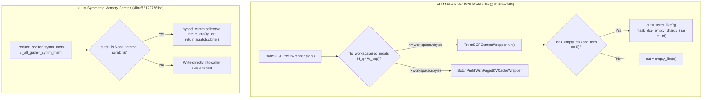

# vLLM FlashInfer DCP `trtllm-gen` 预填充、NCCL 对称内存 Scratch 克隆隔离与 Megatron-LM `softmax_scale` 三级优先级核验

**语言 / Language**: [中文](vllm-trtllm-dcp-prefill-symm-scratch-megatron-softmax-scale.md) | [English](vllm-trtllm-dcp-prefill-symm-scratch-megatron-softmax-scale.en.md)

> **证据级别 / Evidence Tier**: `implementation`（一手上游提交源码）+ `own-offline`（Python 3.12 标准库确定性离线验证 `experiments/vllm_trtllm_dcp_symm_scratch_megatron_scale/run.py --check`）。未声明真实 GPU 集群线上 profiling。

---

## 1. 核心架构问题与结论速览

在长上下文推理的 Decode Context Parallelism（DCP）、NVLink 对称内存集合通信（Symmetric Memory Collectives）以及多头潜在注意力（MLA）训练/推理对齐中，2026-10-20 的三项上游源码提交修复了三个关键的数据路径与数值契约漏洞：

1. **vLLM FlashInfer DCP 预填充 Context Pass 的 `trtllm-gen` 路由与空分片掩码（[`vllm-project/vllm@7b569ec895`](https://github.com/vllm-project/vllm/commit/7b569ec8953cf8099638a6d2ee1e915b75867c3a)）**：
   - 在 `vllm/v1/attention/backends/flashinfer.py` 中新增 `TrtllmDCPContextWrapper`，当开启 DCP、KV Cache 未量化（`KVQuantMode.NONE`）、无滑动窗口（`window_left == -1`）且无 `logits_soft_cap` 时，将 DCP 预填充的 context pass 路由至 `trtllm_batch_context_with_kv_cache`。
   - **Workspace 预算门控**：`TrtllmDCPContextWrapper.fits_workspace(qo_indptr_cpu, num_qo_heads * dcp_world_size)` 严格镜像 FlashInfer `trtllm-gen` launcher 的 LSE softmax 统计信息分配公式：
     $$\text{stats\_bytes} = (H_q \cdot W_{\text{dcp}}) \times B \times \operatorname{round\_up}(\max L_q, 256) \times 8 + 1\text{ MiB}$$
     仅当该值 $\le \text{workspace\_buffer.nbytes}$ 时启用 `TrtllmDCPContextWrapper`，否则自动回退至 `_native_context`（`BatchPrefillWithPagedKVCacheWrapper`）。
   - **空本地上下文分片（Empty Shard）NaN 防护**：当某个请求在当前 DCP rank 上没有历史上下文块（`seq_lens == 0`，即 `self._has_empty_ctx == True`）时，`trtllm-gen` 内核既不写该请求的 `out`，也不写其 `lse`。若沿用 `torch.empty_like(q)`，未初始化显存中的 `NaN`/`Inf` 会在 `cp_lse_ag_out_rs` / `dcp_a2a_lse_reduce` 归约中触发 $0 \times \text{NaN} = \text{NaN}$ 污染。修复方案在 `self._has_empty_ctx` 为真时使用 `torch.zeros_like(q)` 初始化输出，并在内核执行后调用 `mask_dcp_empty_shards_(lse, self._seq_lens, self._cum_seq_lens_q)` 将空分片的 `lse` 显式置为 $-\infty$（跨 4 个 DCP rank 的归约绝对误差从 `NaN` 降至 `0.0`）。

2. **vLLM NCCL 对称内存集合通信 Scratch 缓冲区克隆隔离（[`vllm-project/vllm@8122776fba`](https://github.com/vllm-project/vllm/commit/8122776fba2dcfae2973a0659db2da6ac688306b)）**：
   - 在 `vllm/distributed/device_communicators/cuda_communicator.py` 中，`_get_symm_scratch` 按 `(role, dtype, device)` 缓存对称内存张量（按 2 倍几何扩容，总容量上界 $< 2\times$ 当前分配）。
   - 先前 `_reduce_scatter_symm_mem`（当 `output is None` 时使用 `"rs_out"` 角色键）和 `_all_gather_symm_mem`（使用 `"ag_out"` 角色键）直接将内部 scratch 缓冲区返回给调用方。若调用方跨残差分支或下一层同角色 collective 保留该返回张量，后续 collective 会原地覆写该 scratch 显存（在确定性双步测试中产生 `30.75` 的 L1 激活被覆写误差）。
   - 修复方案在 `scratch_output = (output is None)` 的 `_reduce_scatter_symm_mem` 及 `_all_gather_symm_mem` 返回前执行 `.clone()`（`0.0` 别名覆写误差），而显式传入 `output` 张量的调用路径仍保持零额外拷贝。

3. **Megatron-LM `Attention.get_softmax_scale` 三级优先级与 YaRN MLA 缩放合成（[`NVIDIA/Megatron-LM@0156c21373`](https://github.com/NVIDIA/Megatron-LM/commit/0156c213738eaf718f7fba2a77a3b79fa4f4ef97)）**：
   - 在 `megatron/core/transformer/attention.py` 中新增 `get_softmax_scale(query_tensor, head_dim_index=-1)`，统一 `flash_decode` 与 `flash_decode_and_prefill`（含 FA4 路径）的缩放因子解析顺序：`self.softmax_scale`（MLA 专属）$\to$ `self.config.softmax_scale` $\to$ $d_q^{-0.5}$。
   - 在 `megatron/core/transformer/multi_latent_attention.py`（`MLASelfAttention.__init__`）中，将原先硬编码的 `mscale * mscale / math.sqrt(self.q_head_dim)` 修正为：
     $$\text{softmax\_scale} = \text{mscale}^2 \times \begin{cases} d_q^{-0.5}, & \text{if } \text{config.softmax\_scale is None} \\ \text{config.softmax\_scale}, & \text{otherwise} \end{cases}$$
     在 $d_q = 192$、$\text{rotary\_scaling\_factor}=40.0$（$\text{mscale}=1.36888795$，$\text{mscale}^2=1.87385421$）、自定义 `config.softmax_scale=0.095` 的场景下，修复前遗漏配置会导致 MLA 注意力 logit 缩放偏差 `1.316359x`（`0.135234` vs 正确值 `0.178016`）。

---

## 2. 关键实现路径与数据布局分析

### 2.1 `TrtllmDCPContextWrapper` 显存公式与空分片归约不变量

在 DCP 模式下，每个 rank 持有全部 Query heads（或按 $H_q \times W_{\text{dcp}}$ 聚合后的等效头数），但 KV Cache 按上下文维度切分到 $W_{\text{dcp}}$ 个 rank 上。`trtllm_batch_context_with_kv_cache` 需要在 workspace 中切出一块 LSE（Log-Sum-Exp）统计区：
- 每个 `(head, batch_idx, q_token_aligned_256)` 位置存储一个 `float2`（`max_logit` 与 `sum_exp`，共 `8 B`）。
- 加上 `1 MiB`（`1 << 20 = 1,048,576 B`）保留头开销：

| 场景 (`H_q * W_dcp = 64`, Workspace = `8 MiB`) | `batch_size` | `max_q_len` | `round_up(max_q_len, 256)` | `stats_bytes` (`B`) | `required_bytes` (`B`) | 是否命中 `trtllm-gen` |
|---|---:|---:|---:|---:|---:|---|
| `B=4, max_q=1024` | 4 | 1024 | 1024 | `2,097,152` | `3,145,728` (`3.00 MiB`) | `True` (`TrtllmDCPContextWrapper`) |
| `B=8, max_q=2048` | 8 | 2048 | 2048 | `8,388,608` | `9,437,184` (`9.00 MiB`) | `False`（回退 `_native_context`） |
| `B=8, max_q=3600` | 8 | 3600 | 3840 | `15,728,640` | `16,777,216` (`16.00 MiB`) | `False`（回退 `_native_context`） |
| `B=16, max_q=2048` | 16 | 2048 | 2048 | `16,777,216` | `17,825,792` (`17.00 MiB`) | `False`（回退 `_native_context`） |

---

## 3. 标准库确定性离线验证结果 (`own-offline`)

通过 `python experiments/vllm_trtllm_dcp_symm_scratch_megatron_scale/run.py --check` 对三项机制进行了端到端数值验证（详见 `experiments/vllm_trtllm_dcp_symm_scratch_megatron_scale/results/summary.json`）：

| 验证维度 | 修复前基线 (Legacy / Counterfactual) | 修复后实现 (Verified Implementation) | 核心定量增益 / 不变量 |
|---|---|---|---|
| **DCP Empty Context Shard (`seq_len=0`)** | `empty_like(q)` + 未掩码 `lse` $\to$ `NaN` | `zeros_like(q)` + `mask_dcp_empty_shards_` (`lse=-inf`) | 空分片权重 `0.0`，合并输出 `1.10`（误差 `0.0`） |
| **Symmetric Memory Scratch (`rs_out` / `ag_out`)** | 直接返回内部 scratch 引用，下一步覆写产生 `30.75` L1 误差 | 内部 scratch 返回前 `.clone()` | 调用方持有张量 L1 覆写误差 `0.0` |
| **Megatron-LM MLA `softmax_scale` (`d_q=192`)** | 忽略 `config.softmax_scale=0.095`，固定用 $192^{-0.5}=0.072169$ | `mscale^2 * config.softmax_scale = 0.17801615` | 修正 `1.316359x` 注意力缩放偏差 |

---

## 4. 面向解决方案架构师的设计练习与可证伪问题

1. **架构师容量计算练习**：
   - 假设某千亿模型在 Blackwell B200 上运行 `dcp_world_size = 8`，单卡 Query 头数 $H_q = 16$（聚合头数 $128$），并发预填充批大小 $B = 8$，最大预填充序列长度 $\max L_q = 4096$。要使 `TrtllmDCPContextWrapper.fits_workspace` 始终返回 `True` 而不发生回退，`trtllm` workspace buffer 至少需要配置多少 MiB？
   - **解答**：$\text{stats\_bytes} = 128 \times 8 \times 4096 \times 8 = 33,554,432\text{ B} = 32\text{ MiB}$；加上 `1 MiB` 余量，至少需配置 **`33 MiB`**。
2. **后续可证伪问题（Falsifiable Follow-up）**：
   - 当未来跨层通信重叠（cross-layer communication overlap）在非 DBO 模式下启用时，MoE combine 路径若继续不克隆 `_get_symm_scratch` 缓冲区，是否会在双流并发下重现写后读（RAW/WAR）竞争？可通过检查 `cuda_communicator.py` 中 `role` 命名空间是否按流/层隔离予以证伪。
